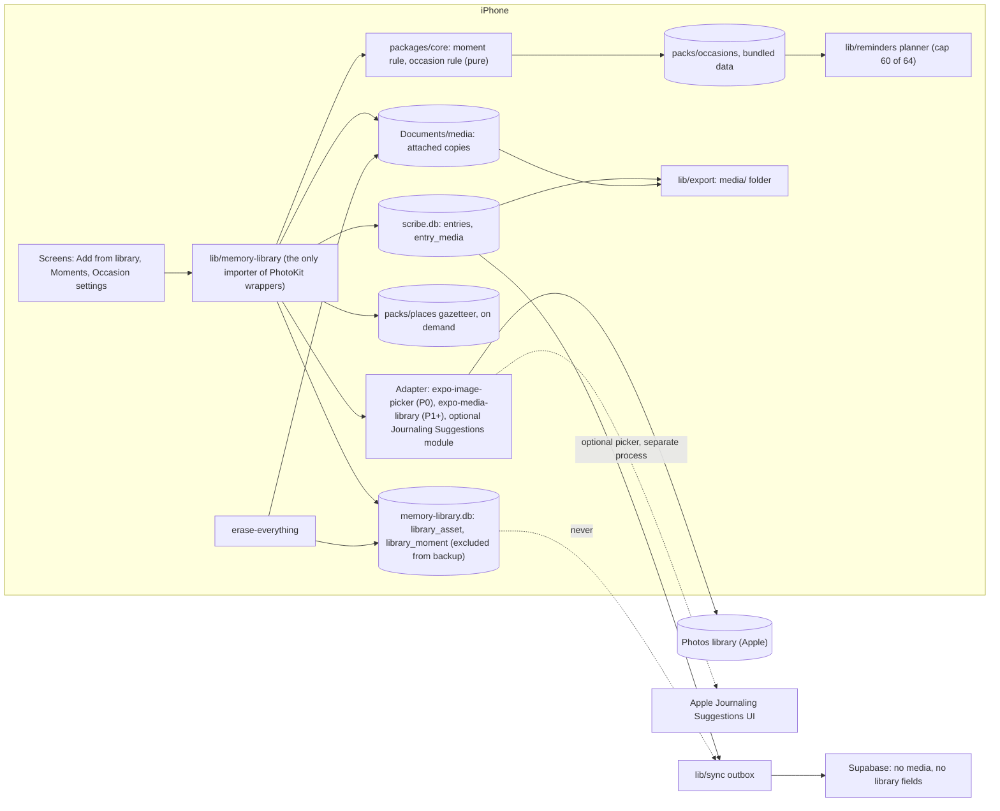

# ADR DRAFT: Memory Library, reading the photo and video library on the phone

- **Status:** Draft, 10 Nov 2026. Proposed, not accepted. Needs the founder (promise, phasing) and counsel (privacy label, permission wording) before any build.
- **Author:** `principal-architect`. Requirements live in NX-39 (`product`, branch `docs/nx-39-memory-library-10nov`, not read, not duplicated). This file is architecture only.
- **Number:** none taken. Proposed next free: **0028**. How I checked on 10 Nov: `git ls-tree origin/develop docs/adr/` ends at `0026`, `0027`, then `0101` (a separate UI series); `git ls-remote --heads origin` shows only `docs/adr-0027-after-the-flip` and `fix/adr-0027-adts-flip` as ADR branches; I listed the 100 open PRs and scanned their files for `docs/adr/` and found none, but one API page errored, so that scan is not proven complete. The coordinator confirms and renames this file.
- **Labels:** [R] repo fact (path given), [V] read in vendor documentation this session (URL in Sources), [U] UNVERIFIED (not readable or not tested), [E] my estimate.
- **Supersedes in spirit:** the "picker only, no library access, strip location" stance of NX-33 (`docs/roadmap/next/03-requirements/NX-33-photos.md` on branch `docs/nx-33-photos-8nov`, read at 2973722). The founder has said that promise will be rewritten (10 Nov). This ADR does not preserve it; it designs the architecture that makes the new promise true.

## 1. The new promise, and what must be true for it

Working wording for counsel (not parent copy): "Early Letters can look at the dates and places of the photos and videos on this phone, only to help you find pictures and remember moments to tell a letter about. It never looks at what is in a picture. Nothing about your library leaves this phone. You can turn it off and erase what it learned at any time."

Each clause maps to an invariant the architecture enforces and a test proves:

| Invariant | Enforced by (section) |
|---|---|
| I1 Metadata only: date, place, media type, duration, album membership. No pixel or audio analysis, no captions, no ranking by content | 8, test T1 |
| I2 Nothing about the library is in any network payload, sync op, analytics event, log line or crash report | 9, T3, T4 |
| I3 The library is never copied wholesale; only items the parent attaches are copied | 5, T5 |
| I4 What the app learned is derived, rebuildable, device-only, excluded from device backup, and erased by Erase everything and by one switch | 4, 11, T6 |
| I5 No word is written for the person; place and date are structured labels beside the letter, never inside its text | 8 |
| I6 No inference about who the family is (religion, culture, health, "home") is stored or shown | 7, 6 |

Honest limits to say now: (1) iCloud device backup copies the app container unless a file is excluded, so "nothing leaves the phone" is only true for the index if it is excluded (section 4); attached copies are a founder choice (section 5). (2) iCloud-only photos are downloaded from Apple by iOS at attach time; that is Apple to the phone, not us, but the parent should be told (section 5). (3) `LEGAL-REQ-012` and `PRIV-R02` list "precise or coarse location" as never collected; today that is about the server (`docs/legal/ENGINEERING_REQUIREMENTS.md` LEGAL-REQ-012). Reading location on the device and keeping it there does not break the letter of it, but the wording needs counsel and an RFC to PRIV-R02 so the rule says "never leaves the device" instead of "never collected" (section 12).

## 2. Context (repo facts)

- Stack: Expo SDK 57, RN 0.86.3, iOS deployment target **17.0** [R] `apps/mobile/app.config.ts:44`. No image picker and no media library in `apps/mobile/package.json` [R] (read 10 Nov). Native modules need a new native build; a JS-only OTA cannot add them.
- Local DB: `expo-sqlite`, versioned migrator on `PRAGMA user_version`, migrations 1 to 9 [R] `apps/mobile/src/lib/db/migrations.ts`; WAL, `synchronous = FULL`, `secure_delete = ON` [R] `lib/db/expo-adapter.ts`. Pure logic lives in `*.logic.ts` and is tested in Node.
- Sync: outbox push and cursor pull [R] `lib/sync/*`; contract in `packages/api/src/server/sync.ts` has `photo_path: nullish(str)` on entries (line 618) and the app writes null. Server has `entries.photo_path`, a private `entry-photos` bucket (10 MB, jpeg/heic/png, path `{child_id}/{author_id}/{entry_id}.<ext>`) [R] `supabase/migrations/20260930000000_scribe_core.sql:137,291`. Remote kill switch `photos`, default off [R] `packages/api/src/remote-config.ts:59`.
- Export: `photo: null`, `counts.photos: 0` [R] `lib/export/schema.ts:140,358`, `pack.ts:239`, `build.logic.ts:661`.
- Reminders: `lib/reminders/planner.ts` keeps under iOS's 64 pending local notifications, default cap 60, evening nudges 21 days ahead, month and birthday notes 92 days ahead [R]. Scheduler identifies ours by id prefix `el.` and `content.data`. No background modes are declared [R] `app.config.ts` ~265 comment.
- Backup exclusion exists for large files: `ScribeFiles.setExcludedFromBackup` [R] `lib/packs/app-support.ts:38`, `lib/model-files.ts:41`.
- Data classes: photos are L4; derived data inherits L4 (DATA_CLASSIFICATION rules 2 and 6) [R] `docs/legal/DATA_CLASSIFICATION.md`. `LEGAL-REQ-013` (strip photo GPS before upload or export) binds when photos ship [R].
- Switch pattern: build flags in `lib/capabilities.ts` plus remote kill switches that can pause but never start [R].
- Permission strings live in `lib/permission-copy.ts` (microphone, Face ID only today) and must match `packages/content` `permissions` word for word [R].
- Packs: `packs/` holds data, downloaded on demand (ADR 0016) [R]; `packs/text-rules` exists.

## 3. (a) Library access model on iOS: options

| # | Option | What the app sees | Permission and entitlement | Expo / RN | Fits the new promise |
|---|---|---|---|---|---|
| A | **Journaling Suggestions picker** (Apple) | Only one suggestion the person chooses: title, a date interval, and up to 13 assets (photo URL, Live Photo, video URL, location place name and pin, workout, contact, song, podcast, motion activity) [V] | No library permission prompt; needs the Journaling Suggestions entitlement `com.apple.developer.journal.allow`; iOS 17.2+; iPhone [V] | No Expo module found [U]; needs a small custom Swift Expo module hosting a SwiftUI view, a config plugin for the entitlement; raises deployment target or weak-links (our target is 17.0) | Strongest privacy; but cannot power passive moments or reminders |
| B | PHPicker via `expo-image-picker` | Only items picked, no permission [V] | None for launching; `NSPhotoLibraryUsageDescription` key only if limited-access/asset ids needed [V] | Expo module, native build | P0 only; no metadata beyond file EXIF |
| C | **PhotoKit read access via `expo-media-library`** (new Asset/Album/Query API) | Whole visible library's metadata; limited access honoured [V] | `NSPhotoLibraryUsageDescription`; read-only; limited access state `accessPrivileges: 'limited'` iOS 14+ [V] | Expo module, native build; included in Expo Go but we use dev client | Required for a moments index and chips |
| D | Own Swift module over PhotoKit | Same as C, narrower surface (no write APIs compiled in) | Same as C | Custom native code, owned forever (CODE-R18 needs an ADR) | Best for I1 enforcement, high cost |
| E | `expo-media-library/legacy` | Same as C | Same | Legacy path of the same package [V] | No: it is the legacy API; new code starts on the new one |

### 3.1 What Apple's Journaling Suggestions actually is (read in this session)

Read [V]: Apple's framework page and `JournalingSuggestionsPicker` page, the Apple tech talk "Discover the Journaling Suggestions API" (111384), an Apple Developer Forums thread, and one third-party write-up (Zenn) for fields Apple's pages did not show.

- **What it is.** "A visual picker interface for iPhone apps" that "displays personal events ... such as a place they visited, a person they connected with, a photo in their library, or a song". When someone chooses one, "the system makes high-level details about the event available to your app". Availability: iOS 17.2 and later; the framework page also lists iPadOS 26 [V]. The picker is a SwiftUI view: `JournalingSuggestionsPicker`, with `init(label:onCompletion:)` returning a `JournalingSuggestion` [V]. Mac Catalyst apps ignore taps on it [V].
- **What a suggestion exposes.** Title; a `date` as a `DateInterval` [V via third-party write-up, not Apple's page]; content by type through `content(forType:)`. The talk lists nine asset types: workout (duration, calories, average heart rate when available), contact (photo or initials image), location (place name and pinned location), song, podcast, photo (URL), live photo (video URL and preview), video (URL), motion activity (step count) [V, talk summary]. Whether the photo and video URLs are local files and how long they stay valid: the talk does not say [U].
- **Permission and entitlement.** "For the picker to appear, your app needs a special entitlement in your app's code signature. You don't need to ask for additional authorization because your app can't access the details for a suggestion until after a person chooses to share them" [V]. The entitlement is `com.apple.developer.journal.allow`, added as the Journaling Suggestions capability in Xcode [V, forum and talk]. Whether Apple must approve the capability for a given account, as it does for some entitlements: not stated on any page I could read [U]; the entitlement's own reference page was not fetchable here (URL outside what the tool allows).
- **Privacy model.** The picker runs in a separate process and renders over the app; "your app will only receive the content of the suggestion they choose to add, nothing else"; the person can deselect assets and edit the title before sharing; five system switches (Activity, Media, Contacts, Photos, Significant Locations) in Settings > Privacy and Security > Journaling Suggestions govern what the picker offers, for all apps [V, talk summary]. The first time it appears a system sheet introduces it [V].
- **Limits.** Not available in the simulator per an Apple engineer on the forum thread (physical device, iOS 17.2) [V]; one developer reported that after the first Photos suggestions were chosen no further suggestions appeared, and judged it not ready for production in Dec 2023 [S, dated, may be fixed]. There is also a "system notifications" path (`JournalingSuggestionsConfiguration`, `JournalingSuggestionPresentationToken`) that lets an app register to receive a suggestion when a person taps a system notification; I read only the symbol names [U]. The app cannot list or query suggestions without the person opening the picker [V by omission: the pages describe a picker only; no list API appears].
- **Expo / RN.** I found no Expo or React Native module for it; I did not search npm [U]. It would need a custom Expo module with a SwiftUI host view, a config plugin to add the entitlement, and our deployment target is 17.0 while the framework starts at 17.2, so the code needs `#available` guards [R][V]. A native build is required.
- **What it means for the promise.** Best possible story: "Early Letters sees only the moment you choose." Includes places, workouts, contacts and music that we do not want (data minimisation: filter to Photo, LivePhoto, Video, Location on receipt, drop the rest before storage). But it cannot do the founder's second goal, passive on-device suggestions and local reminders around trips and festivals, because the app learns nothing until the person opens the picker, and Apple, not we, decides what is suggested and how often. It also gives us no capture date for a photo beyond the suggestion's interval, no album membership, and no way to show a chooser of the child's first-year photos.

### 3.2 Recommendation for (a)

**Two lanes, both behind one in-house module boundary (`lib/memory-library/`):**

1. **Lane 1, P0 now: `expo-image-picker` (PHPicker).** Zero permission. This is NX-33's shape and ships first.
2. **Lane 2, P1 onward: PhotoKit read access through `expo-media-library` (new API), wrapped by our adapter,** with limited access treated as a first-class state. Not option D yet: CODE-R17/R18 prefer a maintained permissive library; the write-API risk is handled by the allowlist test (section 8). Revisit D if the allowlist test cannot be made strict enough or the library's iOS surface lags.
3. **Journaling Suggestions (A): not the foundation; a candidate P1.5 add-on** for people who decline full or limited access ("Pick from Apple's suggestions"). It is the only option that is honest to say "we see only what you choose", and Apple already shows the person the consent sheet. Cost: a custom Swift module, an entitlement and its approval unknown, iOS 17.2 floor, device-only testing. I would spike it for one day before deciding, not build it blind.

Version facts: the Expo `expo-media-library` page I read is for **SDK 56** (v56.0.0, "Included in Expo Go", `getInfo()`, `getLocation()`, `getExif()`, `addListener`, `presentPermissionsPicker`, `getLivePhotoVideoUri()`) [V]; the SDK 57 page and the installed 57.x source were not read [U]; confirm each call against `node_modules/expo-media-library` before coding (CODE-R17, AIE-R11). The migration guide says the new API is stable and the legacy API lives at `expo-media-library/legacy` [V]. `expo-image-picker` docs: "No permissions request is necessary for launching the image library"; `assetId` may be null "when the user gave limited permission"; `exif: true` returns EXIF, GPS tags absent in the camera case [V]. Whether the iOS config plugin of `expo-media-library` also injects `NSPhotoLibraryAddUsageDescription` or write permission: [U]; we must not ship an add-to-library string, and a prebuild diff test checks it (T7).

Permission string (draft for counsel, `permission-copy.ts`): "{app} reads the dates and places of your photos and videos on this phone to help you pick a picture for a letter. It never looks at what is in them, and nothing is sent anywhere." Ask only at the moment of value (the "Add from your library" button), never at launch [U: App Review 5.1.1 data-minimisation reading, counsel].

## 4. (b) Metadata and the on-device moment index

**What is read** (allowlist, section 8): per asset `localIdentifier`, `creationDate`, `location` (latitude, longitude), `mediaType`, `duration`, pixel size, `isLivePhoto`, and `isFavorite` is not read. Album membership is read live for the chooser filter and **not persisted**: album titles are free text a person typed ("Hospital", a name) and are L4. EXIF is not read from files. Camera make and model, lens, serial, software, and the original filename are never read.

**Timezone.** PhotoKit gives an absolute date; the local wall-clock date of capture needs the capture timezone, which is not in `creationDate` [U]. First cut: use the timezone at the asset's coordinates when known (from the gazetteer, section 7) else the phone's current zone; label this [E].

**Where it lives.** A **separate SQLite file** `memory-library.db`, not inside `scribe.db`:

- It is rebuildable derived data, so it must be excluded from iCloud/device backup (the main DB cannot be). Use the existing `setExcludedFromBackup` helper on its directory [R]. Whether the helper covers SQLite sidecar files `-wal` and `-shm` when set on the directory: [U], test T6.
- It has its own `user_version` migrator (reuse `db/migrations.ts` shape), so a corrupt or abandoned index never touches letters, and "forget the index" is `delete file`.
- `PRAGMA secure_delete = ON` as the main DB.

**Data model sketch (device only):**

```sql
-- migration 1 of memory-library.db
create table library_asset (
  local_id    text primary key,      -- PHAsset.localIdentifier, opaque, L3, never logged
  taken_at    integer not null,      -- epoch ms, L4
  kind        integer not null,      -- 0 photo, 1 video, 2 live photo (enum in packages/core domain.ts)
  duration_ms integer,               -- video only
  place_cell  text,                  -- geohash length 6 (about 1.2 km by 0.6 km) [E], null if no location. Raw lat/lon NOT stored
  seen_gen    integer not null       -- scan generation, for deletions
);
create index library_asset_taken on library_asset(taken_at);
create table library_moment (        -- derived; rebuilt by one pure function
  id          text primary key,      -- hash of (first local_id, rule version)
  starts_at   integer not null,
  ends_at     integer not null,
  place_cell  text,
  place_name  text,                  -- from the offline gazetteer pack, nullable
  asset_count integer not null,
  rule_ver    integer not null,
  dismissed   integer not null default 0   -- parent said "not this one"
);
create table library_moment_asset (moment_id text, local_id text, primary key (moment_id, local_id));
create table library_state (key text primary key, value text);  -- access level, last scan cursor, flags
```

In `scribe.db` (letters, backed up, synced as the letters are): one table `entry_media` (section 5). Nothing from the index is copied into `entries`.

**Why coarse cells.** The moment index needs "where, roughly", not a pin on a home. A geohash-6 cell is enough to cluster a trip and look up a nearest city; storing it follows PRIV-R04 (coarse, irreversible reduction). Raw coordinates are read, reduced in memory, and dropped. The attached item's stored place is the same cell, never a pin.

**"Home" and "away".** Trips are best detected as "far from where most photos are taken". That is an inference about where a family lives. Do it at query time from the cell histogram, never persist a "home" value, never show the word "home" or any address, and let the parent override by saying "this is not a trip" (`dismissed`). Counsel to confirm this is not a location-profile under state laws [U].

**Moment rule (pure, in `packages/core`, versioned).** Group assets whose `taken_at` gaps are under 3 hours and whose cells are within one neighbour ring; mark a moment as a "trip" if span is at least 2 days and the median cell is at least X km from the modal cell [E, tune on Asha-style fixtures]. No scoring by content, no "best of", no cover choice by quality: the cover is the earliest item. The pure function lives in `packages/core` (CODE-R10 holds: no platform imports); only the PhotoKit adapter lives in the app.

**Incremental updates.** iOS tells apps when the library changed (`PHPhotoLibraryChangeObserver`); Expo exposes `MediaLibrary.addListener`, where on iOS "the event carries asset IDs" [V SDK 56]. Plan: on foreground, if state is `ready`, (1) apply change events, (2) fall back to `modificationDate > cursor` fetch. No background fetch, no background modes (none declared today [R]). First scan: chunks of 500 assets, resumable by cursor, started after first paint, paused when the app backgrounds or thermal state is high [U: API for thermal state in Expo not checked].

**Budgets.** The performance docs have no number for this (searched `docs/tdd/06-performance-reliability.md`; its budgets are server-side and the transcription budget is itself marked unverified). Proposed, to adopt as new rows: first frame unchanged (scan starts after it); no JS-thread task over 50 ms [E]; first full scan of 50,000 assets within 90 seconds on an iPhone 12 [E]; index under 8 MB at 50,000 assets (about 120 bytes per row plus indexes) [E]; incremental update after a change under 1 second for 100 assets [E]. All measured on device before the flag goes on (T8).

## 5. (c) Storage of attached media

`entry_media` in `scribe.db`:

```sql
create table entry_media (
  id text primary key,             -- UUIDv7 (device-generated, API-R06 if it ever syncs)
  entry_id text not null,          -- letter
  kind integer not null,           -- photo | video | live_photo_still
  file_name text not null,         -- our name, never the original filename
  bytes integer not null, sha256 text not null,
  taken_at integer,                -- epoch ms, copied from the asset at attach time; parent may delete
  place_cell text, place_label text,   -- label only if the parent kept it
  source_local_id text,            -- optional back-reference to the library asset, nullable, never relied on
  width integer, height integer, duration_ms integer,
  created_at integer not null
);
```

**Copy or reference.** Quality attribute 1 is durability of the keepsake (`docs/ARCHITECTURE.md` section 2 [R]); a letter whose picture disappears when someone tidies their camera roll breaks it. **Recommendation: copy on attach** into the app's media folder, keep `source_local_id` only as a hint ("open the original"), and treat a missing reference as normal. Referencing alone is acceptable only for the chooser and the moment index.

| Case | Behaviour |
|---|---|
| Photo | Copy as HEIC/JPEG, longest side 2048 px, quality about 0.85, at most 5 MB (NX-33 numbers, proposed there). Orientation applied to pixels. **GPS, device and XMP/IPTC removed on the stored copy** by re-encode, proved by a byte scan (T5). Capture date and the optional place label live in the row, not in the file. |
| iCloud-only asset | PhotoKit can fetch the original from iCloud when network access is allowed on the request [U: Apple doc not read]; this is a download from Apple to the phone. Ask once before the first one ("This picture is in iCloud. The phone will download it."), show progress, allow cancel, fail calm. Never download in the index scan (index reads metadata only). |
| Live Photo | P1/P2: still only. `getLivePhotoVideoUri()` exists [V SDK 56] so motion can come later; it is a video under P3 rules. |
| Video (P3) | Cap 2 minutes and 150 MB after transcode [E, founder]; transcode to H.264/HEVC 720p with a native export (`AVAssetExportSession`) because neither `expo-image-picker`'s preset (marked deprecated [V]) nor `expo-media-library` transcodes [U]; likely needs one small custom module, which is the real P3 cost. Strip location metadata on export. Thumbnail: one frame at 0 s, JPEG. |
| Free disk | Check free space before copy against file size times 2 plus a fixed floor; refuse with the calm line NX-33 R14 describes; a failed copy never loses the letter. Constant: [U] which one Review uses today. |
| Per-letter cap | 10 items in a letter (founder tunable); total media directory has no hard cap but Settings shows its size, no gap-counting language. |
| Export | `media/<id>.<ext>` in the ZIP with size and sha256 per item; `counts.photos` and a new `counts.videos`; schema version raised; GPS-free files; `taken_at` and any kept place label in `entries.json`. The published JSON schema (#673) and `schema.ts` change in the same PR (NX-33 R8 shape). |
| Erase | `erase-everything.ts` gets a step that deletes the media folder and `memory-library.db`; Delete a book deletes its letters' media; Recently deleted hides media; purge deletes files. All repeatable (resume-at-launch pattern) [R]. |
| Device backup | Attached copies live in Documents beside recordings and travel in iCloud device backup like recordings do [U: confirm]. Founder choice: include (durable, doubles backup size) or exclude video only. Recommend: photos included, videos excluded, and say so in Settings. |

**Cloud and sync. Default: nothing leaves the phone in P0 to P4.** `photo_path` stays null (NX-33 R16 [R]); no media op exists in the outbox; a contract test asserts the sync schemas have no key containing `library`, `place`, `taken_at` or `media` (T3). If media ever syncs (a separate ADR): reuse the `entry-photos` bucket only for photos (it allows jpeg/heic/png, 10 MB, one object per entry by path rule [R]), which does not fit several items per letter or video, so the bucket and the path rule need an additive change (API-R11) and a new migration with grants, a data-map entry and RLS allow/deny tests (DB-R12 to R14, DQ-R02). Supabase Free plan has a 1 GB storage limit [U: from the brief, not re-read this session; ARCHITECTURE.md prices Pro at 100 GB included]; at 0.5 MB per photo that is 2,000 photos in all families combined on Free, so media sync needs Pro and a per-family byte budget. Backup consequence: server copies of a child's photos are the most identifying data we could hold (NX-33 P1/P2 reasoning [R]); `LEGAL-REQ-013` requires GPS-free uploads, which the stored copies already are. Photos stay out of `book_entries` for co-parents until counsel and the founder choose.

## 6. (d) Place names

| Option | Privacy | Cost | Quality |
|---|---|---|---|
| CLGeocoder reverse geocoding | Apple's geocoder sends the coordinate to Apple's servers [U: Apple doc not read; widely understood but unverified]; rate-limited [U] | none | best |
| **Offline gazetteer pack** (nearest populated place for a cell; data pack in `packs/places/`, downloaded on demand, ADR 0016) | nothing leaves the phone | pack of a few MB for cities of 15,000+ people [E]; licence: GeoNames is CC BY 4.0 [U: not read], needs attribution in Settings licences (`lib/licences.ts` [R]) | city level only, enough for "Near Lisbon" |
| Coordinates only, no names | nothing | none | useless to a parent |
| Parent types the place | nothing | UI only | exact, and it is their word |

**Recommendation:** offline gazetteer from P2; never `CLGeocoder` (it would make "nothing about your library leaves this phone" false by one hop). Before P2, show date-only chips and let the parent type a place in the letter flow (a structured `place_label` field, not inserted into their words). The gazetteer name is shown as "Near Lisbon" only as a suggestion the parent taps to keep; unkept suggestions are not stored on the letter. If the pack is not downloaded, moments show date ranges only. Pack data is a data-only asset: no code, signed manifest in `packages/api` like the other packs [R].

## 7. (e) Occasions and reminders

**Occasion calendar.** `packs/occasions/` (data only, versioned, signed like other packs): entries `{id, rule, nameKey, years}` where `rule` is a fixed date, an nth-weekday, or a **precomputed date table for years covered** (lunar and lunisolar dates are tables, not algorithms, and the pack states the last covered year; past it the occasion is silently inactive and a pack update is due). Names are parent vocabulary and go through `packages/content` and its rules test.

**No inference.** The parent opts in by choosing from a neutral, alphabetical list of occasions ("Which days would you like a nudge for?") with no default selected, none ordered or filtered by locale, region, language, child name, photo content or past behaviour. The pack carries no region or religion field. Holiday-list curation is an editorial and legal risk (omission offends, inclusion presumes): `content` and counsel review the list before P4.

**Trips and moments are not scheduled notifications.** iOS local notifications are scheduled ahead of time; the app learns of new photos only when it is open (no background modes [R]). So a trip-specific local notification cannot be sent while the phone is away. Honest design: moments appear in-app on foreground; local notifications are date-driven only (occasions the parent chose, and an optional generic weekly look-back). Bodies never name a place, a photo or a trip.

**Notification budget.** Today the planner caps at 60 of the 64 pending [R] and fills evening nudges 21 days, months 92 days. Occasions add a reserved slice: planner takes a `reserved` count for occasions (proposed 8 of the 60; occasions within the next 90 days, nearest first, one per day), evening nudges shrink accordingly. The planner stays a pure function (`planner.ts`), the new kind is `'occasion'` in `PlannedKind`; ids stay stable per day and kind so a re-plan changes no ids [R]. Quiet hours window and the existing preference screen apply.

## 8. (f) The constitution: metadata only, no ML, no words

"The machine may remove and repair. It may never add meaning" (`CLAUDE.md`). Applied here: a place or date shown beside a letter is a fact of the file, labelled as such, never merged into `final_text` or `raw_transcript`; no suggestion text is written for the parent ("You visited the beach!" is forbidden; the chip reads "Near Lisbon, 3 to 5 May" built from fields, no sentence). Moment titles come only from date and gazetteer name. The parent may rename a moment; their words win.

**Test T1 (source-pattern), `apps/mobile/test/memory-library-constitution.test.ts`:**
1. Only files under `apps/mobile/src/lib/memory-library/` may import `expo-media-library`, `expo-image-picker` or a Journaling Suggestions module.
2. In that folder, a literal allowlist `ALLOWED_LIBRARY_CALLS` names the APIs we may call (for example `requestPermissionsAsync`, `getPermissionsAsync`, `presentPermissionsPicker`, `Query`, `Asset.getInfo`, `Asset.getLocation`, `Album.getAll`, `getLivePhotoVideoUri`, `addListener`); the test fails if the code calls any other member of the library, and fails if the allowlist itself grows without a changed snapshot reviewed by this steward.
3. Banned patterns anywhere in `apps/mobile/src` and `packages/*/src`: `createAsset`, `saveToLibrary`, `deleteAssets`, `Album.create`, `addAssetsTo`, `getExif` outside one `readCaptureDate` helper (it would be dropped if PhotoKit date suffices), `Vision`, `VNRequest`, `MLKit`, `CoreML`, `FaceDetector`, `classif`, `caption`, `ImageLabeling`, `expo-face-detector`, and `CLGeocoder`.
4. The folder imports nothing from `fetch`, `XMLHttpRequest`, `@supabase/*`, `lib/sync`, `lib/analytics` or `expo-network`.
5. Dependency check: `apps/mobile/package.json` gains no package matching the banned names.

A source scan proves absence of calls; it does not prove the OS library does not analyse content, but neither library does by design [U]. Reviewer rule (CODE-R01): any PR touching `memory-library/` or the allowlist is reviewed by this steward.

## 9. (g) Privacy and telemetry

- Analytics is off in every 1.0 profile [R] `lib/capabilities.ts`. When on, new catalogue events are counts only through `packages/analytics/src/catalog.ts` (PRIV-R11): `library_access_changed` (`level: oneOf('none','limited','full')`), `library_attach_used` (`kind`), `moments_opened`. No dates, places, counts of photos, album names, asset ids, error text.
- Logs: typed errors with a stable `code` only (CODE-R15/R16): `LIBRARY_DENIED`, `LIBRARY_LIMITED`, `ASSET_GONE`, `ICLOUD_UNAVAILABLE`, `DISK_FULL`, `EXPORT_FAILED`. `local_id`, `taken_at`, `place_cell` are never put in an error, a breadcrumb or `console` (OBS-R02, OBS-R05, PRIV-R10). The log canary fixtures (OBS-R10) gain a fixture library with a unique place string and asset ids; the canary fails on any hit.
- Crash reporting is opt-in and scrubbed; add the three identifiers to the scrubber denylist (BL-021 [U status]).
- Data map and classification: `library_asset.*` and `library_moment.*` are L4 device columns; `local_id` L3; the DB file is L4 at rest with Data Protection (DATA_CLASSIFICATION L4 handling [R]); add rows in the same PR (PRIV-R01, DQ-R02).
- Apple privacy manifest: `lib/privacy-manifest.ts` declares collected types per build [R]; reading the library and keeping it on the device is, by Apple's definition quoted there ("kept off the device in a readable form"), not collection [R, definition read by a prior author, 16 Oct]. Counsel confirms for location and for photos. Required-reason API reasons for the new pod need the BL-349 audit re-run after adding the dependency [R].

## 10. (h) Failure modes, UX hooks, migration, rollback

| State or failure | Behaviour |
|---|---|
| Not determined | Show "Add from your library"; the permission prompt only on tap |
| Denied or restricted (parental controls) | Calm line and a "Choose one picture" that uses PHPicker (lane 1), which needs no permission; no repeated prompting; Settings deep link only on the parent's tap |
| **Limited access** | First-class: index only the visible set; show "Choose more photos" (`presentPermissionsPicker` [V]); never nag; if the visible set shrinks, assets leave the index at the next scan (`seen_gen`) but attached copies stay |
| Asset deleted from library | Attached copy stays; `source_local_id` hint cleared |
| Library very large | Scan resumes by cursor; the chooser works from live queries while the scan runs |
| iCloud offline or download fails | Calm line, nothing attached, letter unharmed |
| Index corrupt or version skew | Delete and rebuild; letters never touched |
| Migration | `scribe.db` gets one additive migration (10, or the next free: NX-33 also wants one; coordinate with `mobile`) for `entry_media`; `memory-library.db` has its own migrator; both append-only, tested in Node like `migrations.test.ts` |
| Rollback | Build flag off removes UI and permission calls; remote kill switch `memoryLibrary` (new, additive, default off, can pause never start, like `photos` [R]) stops scans and attach; existing attached media still export and erase; the index file is deleted by a "Forget what the app learned" action and by Erase everything |

Feature flags: `EXPO_PUBLIC_MEMORY_LIBRARY` in `lib/capabilities.ts` in the existing pattern, off in `production` until counsel answers, on in `testflight` and `preview` first; sub-flags per phase (`media_video`, `occasions`) so P3 and P4 ship dark.

**Binary and install size.** Adding `expo-media-library` (and `expo-image-picker`) adds native code and plist keys; the size delta is [U] and is measured on the first EAS build as an install-size diff before merge (Xcode App Thinning report). The gazetteer pack and any model-free data are downloaded on demand (ADR 0016), not bundled; the occasion pack is bundled JSON, [E] under 50 KB. No ML model is added by this feature.

## 11. Component diagram



## 12. Threat model summary

| # | Threat | Mitigation | Residual |
|---|---|---|---|
| T-1 | Library metadata leaks through sync, analytics, logs, crash reports | No code path (allowlist, contract test T3, canary T4); folder cannot import network | A future dev wires one; the tests fail |
| T-2 | Index reveals movements and home area to someone with the unlocked phone | Cells not pins; no "home" stored; app lock covers the screens [R]; index excluded from backup | Anyone with the phone and the app unlocked sees moments |
| T-3 | Index in device backup read by an attacker with the Apple account | Separate file excluded from backup (T6) | `-wal`/`-shm` coverage [U]; attached copies in backup are a founder choice |
| T-4 | Stored copies leak GPS on export or share | Re-encode strips; byte-scan test over fixtures; export checks again | A bug in encoder; test catches |
| T-5 | Permission creep: write access or add-only string shipped | Prebuild diff test (T7), banned write APIs (T1) | Library updates change plugin keys: diff on every dependency bump |
| T-6 | Inference harms (religion, culture, health, relationship) from occasions or places | No inference, opt-in neutral list, no region field, no naming of places beyond city, no health words, content rules | A curated list can still presume; editorial review |
| T-7 | Face, object or caption creeping in later "to make suggestions better" | T1 bans, steward review, constitution | Policy, not physics |
| T-8 | Malicious or malformed asset (huge, truncated, odd codec) crashes the app | Size and duration caps before copy, decode in a try with typed error, never in the launch path | OS decoders have CVEs; keep OS current |
| T-9 | Other app's data via `local_id` collisions or stale ids | Ids are treated as hints; `ASSET_GONE` is normal | none |
| T-10 | Apple Journaling Suggestions returns more than needed (workouts, contacts) | Filter to Photo, LivePhoto, Video, Location on receipt; drop the rest before storage; test with fixture | Entitlement approval and behaviour [U] |
| T-11 | Reminders reveal content on the lock screen | Bodies carry no place, photo or child name beyond the existing toggle [R] | Occasion names are visible; parent chose them |

New surface, so SEC-R10 requires `security-architect` review before code; Independent review of any server change is D-041 (none here).

## 13. Test strategy

- **T1** constitution scan (section 8). **T2** pure unit tests for the moment rule and occasion rule in `packages/core` with Asha-style fictional fixtures (no real family data, `no-real-family-data.test.ts`). **T3** sync contract test: no `library`/`place`/`taken_at`/`media` keys in `packages/api` sync schemas. **T4** log canary fixtures (OBS-R10). **T5** byte-scan of stored copies for Exif, XMP, IPTC, GPS across a fixture set (NX-33 R3 shape). **T6** backup-exclusion test for the index directory and sidecar files (device row). **T7** prebuild plist diff: only `NSPhotoLibraryUsageDescription` added, no add-only key, string equals `permission-copy.ts` and `packages/content`. **T8** device performance rows: first scan, incremental update, thermal, 50,000-asset library. **T9** migration tests for `scribe.db` and `memory-library.db` (fresh, upgrade, corrupt). **T10** adapter fake: denied, restricted, limited, shrinking library, deleted asset, iCloud-only, disk full. **T11** erase test: media folder and index empty after Erase everything, including an interrupted erase that resumes. **T12** planner tests: occasions never push the total above 60; stable ids. Device rows (limited access selected, iCloud-only photo, Live Photo, long video) are `qa`'s.

## 14. (i) Phases, dependencies, and what each lets us promise honestly

| Phase | Ships | Needs | The promise it makes true (after counsel) |
|---|---|---|---|
| **P0** | One picked photo per letter via PHPicker (NX-33 shape), stored copy with metadata stripped, capture date optional from the picker result | `expo-image-picker`, new native build, NX-30 tab slot, export bump | "You choose the picture; the app sees only that one. It stays on this phone." (No library permission asked.) |
| **P1** | Library read access (limited honoured); chooser by date range and album; metadata chips (date; place chip only from parent-typed text); attach several | `expo-media-library`, new native build, `memory-library/`, T1/T7, `entry_media` migration, permission string and counsel | "The app reads the dates of your photos on this phone, only to help you find pictures. It never looks inside them. Nothing is uploaded." |
| **P1.5 (optional spike)** | Journaling Suggestions picker lane | Custom Swift module, entitlement, iOS 17.2 guard | "Pick a moment Apple suggests; the app sees only that." |
| **P2** | On-device moments index and offline place names; "Moments" list | index DB, gazetteer pack, core rule, backup exclusion, perf rows | "It builds a small list of dates and rough places on this phone, deletes on request, and never uses what is in a picture." |
| **P3** | Video attach (caps, transcode, thumbnail, export) | native transcode module, disk and backup decisions, export schema | "Videos you attach are copied to your book on this phone and are in your export." |
| **P4** | Occasion pack and local reminders | pack, planner change, content and legal review of list | "Reminders only for days you choose. We do not guess." |

**Order versus other work.** After Build 12 (account-first stack) as NX-33 already states; none of P0 to P4 needs sync. P0 needs NX-30's tab. P1 and later must not start before counsel answers on permission wording and privacy label, and before `security-architect` reviews T-1 to T-5. Media sync, if ever, comes after the Build 12 recording backup restore drill passes (NX-33 P2 reasoning [R]) and is a separate ADR. Every phase ships dark behind its flag; each promise above is made in the product only after the phase's tests are green and the claim is registered (PRIV-R17).

## 15. Decision requested and open questions

Recommended: lane 1 then lane 2 as above, copy-on-attach, separate backup-excluded index with coarse cells, offline gazetteer, no CLGeocoder, date-driven reminders only, optional Journaling Suggestions spike.

Open questions, in priority order:
1. **Founder:** are stored copies in iCloud device backup acceptable (photos in, videos out)? And does Journaling Suggestions earn a spike, given it cannot power passive suggestions?
2. **Counsel:** does reading location on the device, with only a coarse cell kept on the device, change the App Store privacy label; do `LEGAL-REQ-012` and `PRIV-R02` need rewording; is "away from usual places" a location profile; wording of the permission string and the new promise.
3. **Apple (unverified):** is the `com.apple.developer.journal.allow` capability available to every developer account or approval-gated; are Journaling Suggestions photo URLs local files; what exactly the system-notification registration does.
4. **Expo 57:** exact `expo-media-library` 57.x API and plugin keys (I read the SDK 56 page); whether its plugin adds a write string; whether `setExcludedFromBackup` covers WAL files.
5. **Capture timezone** for the local calendar date, and whether PHAsset gives enough.
6. **Disk-free constant** Review uses today, and the real launch budget for the index scan (none documented).
7. **Packs:** GeoNames (or another gazetteer) licence and pack size; who maintains the occasion list and its year coverage.
8. **RFCs to raise** (handoffs to the other four stewards, label `rfc`; MUST changes need the founder): PRIV-R02 wording ("never leaves the device"), a CODE rule requiring a source-pattern allowlist for any OS-library wrapper, and an OBS row adding library identifiers to the scrubber denylist. Not filed in this PR.

## Sources (opened 10 Nov 2026)

- Expo `expo-image-picker` docs: https://docs.expo.dev/versions/latest/sdk/imagepicker/
- Expo `expo-media-library` (SDK 56 next API) docs: https://docs.expo.dev/versions/v56.0.0/sdk/media-library-next.md
- Expo media library migration guide: https://docs.expo.dev/guides/sdk-libraries-migration/media-library/
- Apple Journaling Suggestions framework: https://developer.apple.com/documentation/journalingsuggestions.md
- Apple `JournalingSuggestionsPicker`: https://developer.apple.com/documentation/journalingsuggestions/journalingsuggestionspicker.md
- Apple tech talk 111384, Discover the Journaling Suggestions API: https://developer.apple.com/videos/play/tech-talks/111384
- Apple Developer Forums thread 740607: https://developer.apple.com/forums/thread/740607
- Third-party write-up (fields, limits; dated Dec 2023): https://zenn.dev/mtfum/articles/journaling_suggestions
- Not readable this session: Apple's PhotoKit, PHPicker and CLGeocoder pages, the entitlement reference page, Expo SDK 57 media library page.
