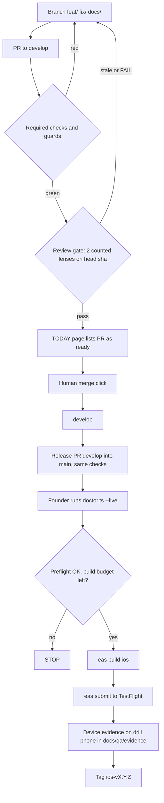

# Harness v2 architecture (ops, 1 Nov 2026)

Covers G3, G7 (workflow parts), G10 and how the sibling files fit. Facts cite `file:line`, PR numbers or pages fetched 1 Nov 2026. U means unverified. Read with RETROSPECTIVE.md; its Constraints bind this file.

## 1. What it is, and is not
The harness is a set of no-model machines on GitHub Actions and the founder's computer that make a change cheap to check, hard to merge wrongly and visible on one page, so a human click is informed. Every part is deterministic code, free to run, and fails closed. It is not an unattended model lane: `agents.yml` stays `disabled_manually` and no scheduled model job runs before the 9 Nov go/no-go (CR-5, CR-22; RULINGS.md:41, :298). It is not a security boundary: comment-based gates are consistency checks (CR-32), and review independence needs a second identity (G11, held to 10 Nov). It does not build, sign or upload from agent sandboxes (TESTFLIGHT.md:19).

## 2. Components
| Component | Runs where | Trigger | Cost | Owner | State |
|---|---|---|---|---|---|
| Required checks (`applied migrations unchanged`, `required`, `compliance-fence`) | GitHub, ubuntu | PR | zero | ops | exists (ci.yml, migration-guard.yml, compliance-fence.yml) |
| Review gate, REVIEW-GATE.md (sha-bound "2 counted reviews, none failing after", reuses `parseLens`/`countedPass` in `scripts/status/page.mjs`) | GitHub, ubuntu | PR, review comment | zero | qa | proposed |
| TODAY page cron, FOUNDER-PAGE-AND-CLAIMS.md (`page.mjs` + `check.mjs`, no model) | GitHub, ubuntu | schedule, dispatch | zero | chief-of-staff | proposed, never-run |
| Claims checker (`CLAIMS.md`, 72 h expiry, advisory) | GitHub, ubuntu | PR, in TODAY cron | zero | chief-of-staff | proposed |
| Skip and trace guards, EVIDENCE-AND-GREEN.md (skip count, "has a non-skipped success" ledger, `trace.mjs --check`) | GitHub, ubuntu | PR, nightly | zero | qa | proposed |
| Supply-chain jobs (`dependabot.yml`, SHA pins for 17 tags, `npm audit --omit=dev`), SECURITY-MODEL.md | GitHub, ubuntu | PR, weekly | zero | ops, security | proposed |
| iOS compile and store-profile Release check | GitHub, `macos-26` | PR (cancel stale) | zero if public (U for macOS) | mobile | exists (ios-compile.yml:60, :281) |
| Release path A: `eas build` + `eas submit` on the founder's computer | founder laptop, EAS | by hand | zero within 15 builds | founder (ops writes list) | never-run |
| Release path B: `testflight.yml` | GitHub + EAS, env `testflight` | dispatch only (testflight.yml:38-42) | zero within quota | S20 | exists, never-run (5 of 5 runs skipped) |
| `release-ios.yml` | GitHub, ubuntu | push of `ios-v*`, dispatch | zero | S20 | exists, run history U |
| Nightly | GitHub, ubuntu | cron 10:23 UTC (nightly.yml:24) | zero | ops | exists, last run green 31 Oct |
| Kill harness (planted failures) | GitHub, ubuntu + 3 `macos-26` jobs | PR, cron 09:41 UTC (kill-harness.yml:65) | zero if public (U) | qa | exists |
| Scheduled tasks (Claude connectors) | founder's Claude account | founder-set | subscription, not metered here (U) | founder | exists; trim per G8 |
| `agents.yml`, `claude.yml`, `agents-check.yml` | GitHub | cron `17,47 * * * *` (agents.yml:22) | zero while off | CTO | disabled; keep off |

## 3. A change from branch to store

## 4. Free-tier budget
| Vendor | Limit (source, accessed 1 Nov 2026) | Our use | Stops being free when |
|---|---|---|---|
| Expo EAS Free | 15 iOS + 15 Android builds a month, low priority, 45 min timeout, 1 concurrent macOS build (expo.dev/pricing) | 4 to 6 iOS builds before 9 Nov | a retry loop passes 15; founder moves to Starter (paid, price U) |
| GitHub Actions, public repo | standard hosted runners in public repos free; larger runners billed (docs.github.com, about billing for Actions). The page lists macOS 3-core/4-core at $0.062 a minute but does not say macOS standard is free in public repos: U | 7+ workflow runs per PR, 4 macOS jobs | repo goes private (Free plan includes $12 a month, about 193 macOS minutes at $0.062, my arithmetic) or a `-large`/`-xlarge` label is used |
| Vercel Hobby | "restricted to non-commercial personal use only"; commercial includes advertising a product or service and any payment request (vercel.com/docs/limits/fair-use-guidelines, updated 14 Sep 2026); Hobby 100 GB transfer, 1M invocations | marketing site for a paid app | the site is judged commercial (likely at store launch; U), or usage passes the table |
| Cloudflare R2 | 10 GB-month storage, 1M Class A, 10M Class B, egress free, Standard class only (developers.cloudflare.com/r2/pricing) | packs; speech model about 575 MB per language (TESTFLIGHT.md:48) | storage over 10 GB, or an Infrequent Access bucket |

## 5. Build 1 and build 2 checklist
Path A (computer) for both builds; path B only after a dispatch rehearsal. Stop at any red line and write the exact output into `docs/release/`.
1. `git switch develop && git pull && npm ci`. STOP if the tree is dirty.
2. `npx tsx scripts/release/doctor.ts --live` (TESTFLIGHT.md, step 5). STOP on any FAIL. It has never run against Apple or Expo.
3. `npm run preflight:testflight -w @scribe/mobile` (build 2: `preflight:alpha`). STOP on FAIL; it can fail when doctor exits 0.
4. Confirm `extra.eas.projectId`, `ascAppId`, `keys.ts` public lines and the published manifest are merged. STOP if any is missing.
5. Count builds used this month on the Expo dashboard. STOP if fewer than 3 remain.
6. `eas build --platform ios --profile testflight` (build 2: `preview`). Answer no to expo-updates. One retry only; a second failure is a STOP and a note.
7. `eas submit --platform ios --profile testflight --latest`. STOP on credential prompts the log does not explain.
8. Wait for Apple processing; confirm the build in TestFlight; install on the drill phone.
9. Run B1 rows from ALPHA_GO_NO_GO.md; save photos or notes under `docs/qa/evidence/`. No evidence, no "on TestFlight" claim.
10. Build 2 only: freeze 3 Nov 5:00 AM PT (D-089); no workflow, `eas.json` or `app.config.ts` change after it except S0/S1.

Budget of 15 iOS builds: build 1 (1), build 2 (1), two spares for credentials or flag fixes (2), `production` profile for Plus after 9 Nov (1), spare for the go/no-go fix (1), total 6 planned, 9 headroom.  Never spend a build to test a hunch.

## 6. Trigger map
- PR: ci, migration-guard, web, web-e2e, deploy-scripts, db-cli, agents-check, ios-compile, kill-harness, compliance-fence (`pull_request_target`), testflight (skipped stub).
- Push: ci, migration-guard, web, agents-check, deploy-db, deploy-functions; tag `ios-v*`: release-ios.
- Schedule: nightly daily, kill-harness daily, agents (off).
- Dispatch: web, web-e2e, ios-compile, kill-harness, nightly, testflight, release-ios, deploy-db, deploy-functions, agents.

If the repo goes private: all 4 macOS jobs per PR bill at $0.062 a minute against $12; ios-compile and kill-harness macOS jobs must move to `needs: changes` paths filters, schedule-only, or the Release launch check (ios-compile.yml:272-280) moves to the founder's computer. Ubuntu minutes (2,000 a month by my arithmetic) are tight with 7+ runs per PR. Secret scanning and push protection availability on private repos is U.

## 7. Rollout order (CR-22: proposals only until the founder applies)
- Sun 1 to Mon 2 Nov: ops writes proposals under `docs/ops/proposed/` (review gate, TODAY cron, guards, supply chain); docs-only changes land normally. Founder runs the Section 5 rehearsal up to step 3.
- Tue 3 Nov freeze: build 2. No workflow change applied.
- Wed 4 to Sun 8 Nov: docs and scripts land (`CLAIMS.md`, ledger, `trace.mjs --check` as a local command). Device evidence B1.
- Mon 9 Nov go/no-go.
- Tue 10 Nov: founder applies, one PR each, in order: `dependabot.yml` and Dependabot security updates; review gate as a non-required check for a week; TODAY cron; guards; SHA pins; `npm audit` job. G11 identity decision same day.
- Tue 17 Nov: make the review gate required if it caused no false blocks.
- Exception request (CTO ruling, not assumed): TODAY cron before 9 Nov, since it is no-model and read-only.

## 8. Honest limits
- The release path has never run; every Section 5 step is a hypothesis until one pass is recorded.
- Required-check changes made in a PR cannot test themselves when they use `pull_request_target` (compliance-fence.yml:6-9).
- The review gate reads comments on one account; it catches haste (#460), not collusion.
- Free-tier facts can change; the macOS-public answer is U, and the Vercel classification is U.
- Proposals are untested until applied; the first week after 10 Nov carries the risk.

## 9. Open founder decisions
1. Build path for build 1 and 2. Recommend path A. Default: path A.
2. Allow the no-model TODAY cron before 9 Nov? Recommend no, apply 10 Nov. Default: no.
3. Vercel: ask Vercel support whether the site is commercial, or budget Pro before the store listing. Recommend asking now. Default: Hobby until asked.
4. Keep the repo public? Recommend yes; going private makes macOS paid. Default: public.
5. Review gate required or advisory first? Recommend advisory one week. Default: advisory.
6. Second identity (G11). Recommend decide 10 Nov. Default: held.

Conflicts of interest: I am the ops agent and own the files this design adds to (`docs/ops/**`, `scripts/**`); I benefit from more scope, co-own the release checklists, and lean toward the manual path for build 1, which gives me less to maintain.
