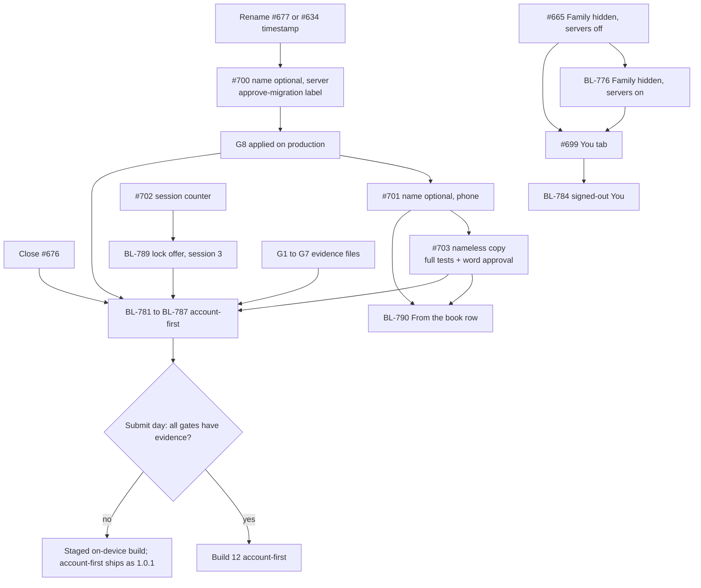

# Build 12 plan: the cut, the merge order, the gates, what we measure and how we roll out (9 Nov 2026)

Written by `product`, docs only, 9 Nov 2026 (UTC). It decides nothing and writes no `DECISIONS.md` entry; section 7 is a DRAFT for the founder. Rows: `docs/BACKLOG.md` BL-775 to BL-815. Packets: `docs/backlog/EXECUTION-PACKETS-BUILD12-2026-11-09.md`.

Tags: EVIDENCE = read in the repo or by `gh api` on 9 Nov. PROPOSED = my number or my suggestion, nothing measured. UNVERIFIED = not read.

## 1. What I found that changes the plan

1. EVIDENCE: #665 hides the Family tab only in a store build with server features OFF (its own comment says a servers-on store build "shows them as the real flow"). Build 12 turns server features ON. With #665 and #699 as written, the bar would be Tonight, Book, Family, You. Fix: BL-776 (draft reading D-152).
2. EVIDENCE: #640 (app lock) is merged (bc3b8209), so it no longer blocks the lock move (BL-789). #702 does: the session counter must exist first. Also merged since the 8 Nov tracker: #520 (delete a book, erase everything) and #689 (English-only spoken-language list).
3. EVIDENCE: #700's migration is stamped `20261109000000`; #634 and #677 both carry `20261108000000` (different file names). Rename one before either merges.
4. EVIDENCE: #676 ("Drop dormant sign-in capabilities from the store build") is still open and `dirty` (head f0f9a74d). It is the opposite of account-first. The Build 12 programme document is said to call it withdrawn (not read); the repository disagrees. Close it before any account-first row merges (founder or coordinator).
5. EVIDENCE: #703 is `unstable`: 13 checks succeeded, 1 in progress, 1 skipped at 09283722. Full tests on a full checkout before it merges.
6. EVIDENCE: #699 and #703 both repeat their base PR's files in their diffs (stacks). Merge the base first, rebase with `--onto`.
7. Not in the repo: the PR numbers 699 to 703 had no BL ids before this PR. They have BL-775, 777, 778, 779, 780 now.

## 2. The gates G1 to G7, with the evidence file each needs

NX-31 section 0 defines the gates; a gate is not closed on a PR body alone (council pass 2). Each needs a dated evidence file that the CCO and the CPrivO can open. The paths are PROPOSED (a new folder `docs/release/evidence/build12/`; nothing there yet).

| Gate | Closed when (short) | Closed by | Evidence file (proposed path) | Open on 9 Nov |
|---|---|---|---|---|
| G1 | Production Supabase with Apple key and Resend; sign-in works from a fresh phone; policy rows seeded; keep-alive or Pro | `ops`, founder | `G1-production-smoke.md`: smoke run output, the Auth settings screenshot, the plan page screenshot | open (BL-757; the 8 Nov attempt failed per NX-31) |
| G2 | v1 Terms and Privacy deployed at public addresses; policy rows exist on production | `ops`, `legal`, founder | `G2-legal-pages-and-policy-rows.md`: HTTP 200 for the five addresses, the policy rows query result | open (#672, #678 not merged) |
| G3 | App Privacy label updated from Data Not Collected | founder; counsel reads | `G3-privacy-label.md`: screenshot of the saved label, and a table built from the code of what is collected (council: "label from code") | open |
| G4 | Reviewer path run by someone who is not the founder | `ops`, `qa` | `G4-reviewer-path-run.md`: who ran it, on which phone, with only the Notes, back end live, time taken | open (BL-786) |
| G5 | Delete account built and drilled in the same build | `mobile`, `ops`, `qa` | `G5-deletion-drill.md`: D31-16 on production, the purge worker log line, rate-limit proof | open (BL-760, BL-785) |
| G6 | Notes for Review name the local start | `ops`, founder | `G6-notes-for-review.md`: the Notes text as submitted | open |
| G7 | Mail and security gates: R20 preflight, R-17 review status, counsel packet answers or the founder's written risk acceptance | `ops`, `security-architect`, founder | `G7-mail-and-security.md`: preflight output (BL-788), the R-17 record, the founder line | open (R-17 status UNVERIFIED) |

A gate I add (PROPOSED, call it G8): #700's migration is applied on production and `supabase/APPLY.md` and `.github/migrations-applied.txt` show it, before any servers-on build with #701 reaches a user. Evidence: `G8-name-optional-migration.md` (the apply log line and one empty-name create on production with Asha test data).

The 10-point gate of the Build 12 programme document: not read (UNVERIFIED). G1 to G7 are NX-31's table; I did not map them to the ten.

## 3. Dependency and merge order

### 3.1 In ten lines (the order, from council pass 2)

1. Close #676 (founder or coordinator). Rename the timestamp of #677 (or #634) before either merges.
2. #665 merges (Family tab hidden in the servers-off store build; ready, clean).
3. BL-776 (Family hidden in the servers-on store build) lands, or is folded into #699 before it merges.
4. #699 merges after rebase `--onto origin/develop a8614c5e` (the You tab; three tabs in Build 12).
5. #700 gets `red-team` review and the `approve-migration` label; it merges; the founder applies it to production (G8).
6. #701 merges only after #700 is live on production (the phone may make an empty-name book only if the server accepts it).
7. #703 rebases `--onto origin/develop 4e322591`, passes the full tests on a full checkout, and merges after the founder approves its words.
8. #702 merges (the counter); nothing reads it until step 9.
9. BL-789 (lock offer to session 3) and BL-790 (From the book row) follow; BL-790 after #701 and #703 (shared lines in `(tabs)/index.tsx`).
10. Account-first (BL-781 to BL-787) merges last, behind `EXPO_PUBLIC_SERVER_FEATURES`, only when G1 to G8 have evidence files; otherwise the fallback rule in 3.3 applies.

### 3.2 Graph (Mermaid)

Overlaps on the same files (EVIDENCE from the PR file lists): #699 and #665 share five files; #701 and #703 share 18; #701/#703 and BL-790 share `app/(tabs)/index.tsx`; #701/#703 and BL-789 share `app/onboarding.tsx`; BL-781 and BL-782 share `app/(auth)/sign-in/index.tsx` and `consent.tsx` with #701/#703 (one line each).

### 3.3 The fallback rule (binary)

Name one decision day, two working days before the submit date (the submit date itself is in the programme document, which I did not read: UNVERIFIED). On that day, for each of G1 to G8 the question is yes or no: is the evidence file in the release record? If every answer is yes, submit the account-first Build 12. If any answer is no, submit the staged on-device binary (the production profile as `eas.json` has it today: `EXPO_PUBLIC_SERVER_FEATURES` off, `EXPO_PUBLIC_BACKUP` off, `EXPO_PUBLIC_ACCOUNT_DELETION` on) and ship account-first as 1.0.1. There is no partial account-first. For this to be one flag, both code paths must exist behind `SERVER_FEATURES` (NX-31 section 13 step 2); BL-781 carries a test that the flag-off path matches Build 11 behaviour. The staged binary still contains the You tab (BL-775), the optional name (BL-778, local only), and the lock move (BL-789), none of which need the server; BL-777 is then not needed for that binary but harmless.

## 4. Success metrics, per feature (every threshold is PROPOSED)

The constraint: analytics are off in every 1.0 profile and opt-in (D-124 item 3). The existing events in `packages/analytics/src/catalog.ts` (read 9 Nov) are therefore mostly silent in Build 12. So each feature has a non-analytics way first. New events are proposals for `analytics` with `privacy` review; each carries names and enumerated values only, never text, names, dates of birth, audio or counts of gaps. None is added by this PR.

| Feature | Question | Non-analytics way (first) | Existing allowlisted event, when opted in | Proposed new event (name only; values enumerated) | Proposed target |
|---|---|---|---|---|---|
| Account-first (BL-781, 782) | Do strangers get from install to a signed-in book? | Supabase Auth logs: sign-ins by method and failures by reason; accounts created per day versus App Store Connect installs | `auth_sheet_shown`, `auth_method_selected`, `auth_succeeded`, `auth_failed` (reason enum), `auth_email_sent` (attempt) | none | At least 85 percent of first-run starts reach a signed-in session within 3 minutes (HYPOTHESIS; NX-31-R15 sets 150 s to the first kept letter for Apple) |
| Email code deliverability (BL-788) | Does the code arrive? | Resend dashboard: delivered, bounced, complaint; the founder phone script (3 to 5 parents) | `auth_email_sent` attempt 2 or higher is a proxy for "did not arrive" | none | Bounce plus complaint under 2 percent; attempt 2 or higher under 15 percent |
| Outage and local start (BL-783) | How often does the fallback fire, and do those people come back to sign in? | Supabase status page notes; a count of books with a later-claimed account is a server count with no content | none | `local_start_chosen` {reason: outage, offline}; `local_start_claimed` | Fires for under 3 percent of first runs in week 1; a spike is the alert |
| Name optional (BL-777, 778, 780) | Do people leave it empty, and does it read well? | Server count (an ops function, service role, no ids): children with an empty name versus all; phone script: show the nameless screens to 3 parents and ask if anything reads oddly | `child_added` (read its props before use: UNVERIFIED) | none | Report the share; no target (it is a choice). Zero "reads wrongly" findings in the script |
| You tab (BL-775, 784) | Do people find Settings in one tap? | Tap test in BL-798 (1 tap to Settings home, 2 to Account); TestFlight feedback text | `screen_view` (route enum; whether a `you` route is in `ROUTE` is UNVERIFIED) | none | 5 of 5 parents find Export and Help without help |
| Lock move (BL-789) | Do people turn the lock on when offered in session 3? | Phone script; count of devices with the lock on is not collected (on the phone only) | `settings_changed` has no lock key (read: the keys are reading_size, theme, reminders, languages, lock_screen_names, sensitive_data, pack_cellular, listening_copy) | `lock_offer_result` {yes, not_now}; or add `app_lock` to `settings_changed` keys | Report only; no target. A complaint that the lock came too late is a finding |
| From the book row (BL-790) | Does it make people open the app and listen or read? | Phone script (NX-30-R10: 5 parents, "does the row make you open it?"); no relevance scoring so nothing to tune | `screen_view` | `tonight_row_opened` (no props) | Most of 5 parents name it as a reason to open (NX-30-R10, a study not a pass bar) |
| First kept letter | Does the first letter happen? | Server count of books with 1 or more synced letters per account (synced letters only; local-only letters are invisible) | `letter_saved`, `moment_shown` (type first_letter) | none | 60 percent of signed-in accounts keep a letter within 24 hours (PROPOSED; NX-31-R15 times it on the bench) |
| Delete account (BL-785) | Can people leave, and do they? | Support mail; `purge_ledger` counts; Auth deletions | `account_deletion` (stage enum) | none | 100 percent of requested deletions complete in the stated time (D31-16) |
| Reminders after the card | Do reminder cards end in a yes? | Phone script | `reminder_prime_shown`, `reminder_prime_result`, `os_permission_result` | none | Report only |
| Health | Is it working? | App Store Connect crash and hang rate, TestFlight crashes, support mail volume and themes | `error_shown`, `sync_failed` | none | Crash-free sessions at least 99.5 percent (PROPOSED) |

The founder phone script (3 to 5 parents, one phone, one build, 20 minutes each; recorded as minutes and quotes, no child names, no recordings): (1) install and start a book from the store build; (2) leave the name empty once and fill it once; (3) find Settings, Export, Help; (4) keep one letter; (5) say what the Tonight row is for; (6) turn the lock on or decline; (7) what, if anything, felt like being asked for too much. File as `docs/qa/evidence/build12-phone-script-<date>.md`.

## 5. Rollout and learning plan

Order of exposure (PROPOSED): internal TestFlight (founder and family) -> external group of friends -> App Store with phased release if the store offers it for this app (the setting is Apple's; whether it is on is UNVERIFIED). Each step needs the previous step's week-1 read.

What we watch in week 1 (daily, 10 minutes, by `ops` and `product`): Supabase Auth sign-ins by method and failure reason; Resend delivery; Supabase project state, database size and rate limits against the Free plan, and whether the project is paused (check every day until the Pro move); App Store Connect crash-free rate and any TestFlight feedback; support mail count and themes (the weekly report goes to earlyletters@gmail.com, NX-17, BL-762); deletion requests; any report that a letter or a recording is missing.

What triggers action (all PROPOSED):

| Trigger | Action |
|---|---|
| Any report that a kept letter or recording is lost or shows another family's | Stop. Pause the phased release (or remove from sale), open an incident, expedited 1.0.1. The one trigger with no threshold |
| Sign-in success below 70 percent of attempts for a day, or email bounce plus complaint above 5 percent | Fix mail or provider the same day; if it lasts 24 hours, expedited fix with the local start surfaced or the staged binary |
| Project paused or at a Free-plan limit | Move to Pro that hour (founder spend; BL-814 has the steps) |
| Crash-free sessions below 99 percent, or a crash on the record or save path | Expedited fix; pause the phased release |
| An empty-name book refused on first sync | Check G8; the migration is not live. Pause and apply |
| Apple review rejection under 5.1.1(v), 2.1(a) or 2.5.19 | Use the answer prepared in BL-786; if it needs a build, ship the staged binary and account-first as 1.0.1 |
| Two parents in the phone script find the sign-in confusing | Not a rollback: a copy fix in BL-804 for 1.0.1 |

The levers are limited and the plan says so: sign-in outage handling is a build-time constant with no remote switch (founder, 9 Nov), the only remote kill switch in `packages/api` is for backup uploads, and an App Store binary cannot be recalled. A fix reaches people through an update. Learning review at day 7: `product` writes one page (what happened, what the parents said, which rows change); the founder reads it before 1.0.1 is planned.

## 6. BOARD claim lines, proposed (not applied)

PR #682's branch is untouched. These are lines for `docs/agents/BOARD.md`, "Active claims", format `| Agent | Area | Files (globs) | Since (UTC) | Status |`; each agent writes its own line, so these are suggestions for the coordinator.

| Agent | Area | Files (globs) | Since (UTC) | Status |
|---|---|---|---|---|
| mobile | BL-776, BL-775: Family tab hidden in servers-on store build, the You tab (#665, #699) | apps/mobile/src/app/(tabs)/_layout.tsx, apps/mobile/src/app/(tabs)/you.tsx, apps/mobile/src/lib/family/entry.logic.ts, apps/mobile/src/app/settings/children/[id].tsx, apps/mobile/test/{tab-bar,store-family-tab,family-tab}.test.ts, docs/design/IA.md | 2026-11-09 | proposed |
| mobile, content | BL-778, BL-780: name optional on the phone (#701, #703) | apps/mobile/src/app/onboarding.tsx, apps/mobile/src/components/onboarding/child-step.logic.ts, apps/mobile/src/lib/copy.ts, packages/core/src/child.ts, packages/content/src/{strings.en,prompts}.ts, packages/content/test/nameless-child.test.ts | 2026-11-09 | proposed; #703 stacked on #701 |
| mobile | BL-779, BL-789: session counter, lock offer to session 3 (#702, then new) | apps/mobile/src/lib/asks/**, apps/mobile/src/lib/analytics/ask-sequencer.logic*.ts, apps/mobile/src/components/app-lock/lock-offer.tsx, apps/mobile/test/{next-ask,kept-letter-sessions,app-lock-offer-placement}.test.ts | 2026-11-09 | proposed |
| mobile, content | BL-790: Tonight From the book row | apps/mobile/src/app/(tabs)/index.tsx, apps/mobile/src/components/tonight/**, apps/mobile/test/tonight-*.test.ts | 2026-11-09 | proposed; start after #701 and #703 |
| data architect | BL-777: name optional on the server (#700); timestamp clash with #634, #677 | supabase/migrations/20261109000000_child_name_optional.sql, supabase/tests/{child_name_optional,children_entitlements}.test.mjs, supabase/APPLY.md | 2026-11-09 | proposed; needs approve-migration |
| ops | BL-788, BL-814: mail preflight, Free-to-Pro line | scripts/release/mail-readiness.*, docs/ops/** (the Build 12 ops sheet) | 2026-11-09 | proposed |
| design systems | BL-795 (tests and tokens only), BL-799 to BL-804, BL-807 specifications | packages/design-tokens/test/**, docs/design/specs/** | 2026-11-09 | proposed |
| product | BL-775 to BL-815 rows, packets, plan (this PR) | docs/BACKLOG.md, docs/backlog/EXECUTION-PACKETS-BUILD12-2026-11-09.md, docs/backlog/BUILD12-PLAN-2026-11-09.md | 2026-11-09 | active (draft PR) |

## 7. DRAFT decision entries (Proposed; only the founder decides)

Ids come from `node scripts/agents/next-id.mjs` at writing (D-144 first). They are proposals inside this document, not rows in `docs/DECISIONS.md`. The founder's 9 Nov words are relayed by the coordinator and by NX-31 revision 3; I did not hear them myself.

| Id | Draft entry | Status |
|---|---|---|
| D-144 | Account first: in Build 12 a new customer creates or signs in to an account before the book opens, behind `EXPO_PUBLIC_SERVER_FEATURES`. A phone that already holds a book never loses reading, recording and export when a session ends ("narrow", NX-31-R22). Source: founder, 9 Nov. Gate: G1 to G8 have evidence files on the decision day; otherwise the staged on-device binary ships and account-first is 1.0.1 | Proposed |
| D-145 | Amends D-121 for Build 12 only: D-121 staged the first store build as on-device only (server features, backup, status report and analytics off). This entry reverses the "server features off" half; backup, status report and analytics stay off, English only stays, Plus stays on. Closes or supersedes #676 | Proposed |
| D-146 | Reading of D-006: "no local-only mode" means a person who answered No to the age question gets no book at all. The local start (a build-time constant, reachable only after the answer Yes, only when sign-in is unreachable or the phone is offline) is not a local-only mode in D-006's sense. This reading is plausible, not certain | Proposed |
| D-147 | A child's name is optional at first run and on the server; the date of birth or due date stays required. A later book added from Settings still needs a name (twins need names to be told apart). Records F03-U02 as stale | Proposed |
| D-148 | The Face ID or passcode lock offer moves off "The book is open." to the third session that ends in a kept letter, and Settings > Privacy. At most one ask per session and per day; the lock is first in session 3 | Proposed |
| D-149 | Free backup scope: recording backup is free for every Free-plan customer (D-104 item 2, D-111 item 6 stand; Plus adds and never gates what exists). Backup is OFF in Build 12: no copy, no UI, no migration applied, no claim of safekeeping in the listing or first run. B-1 to B-5 of NX-34 are decided when backup is scheduled | Proposed |
| D-150 | The Build 12 cut: account first, You as the third tab, name optional, local-start fallback, lock offer to session 3, Tonight From the book row; "key motion" means the From the book row and, only if ready and `qa` agrees, the first-kept-letter moment (council reading; the founder to confirm). Out: backup, Photos and the Photos tab, the full motion push (NX-35 M8 out), share, search | Proposed |
| D-151 | Navigation intent: four buttons (Tonight, Book, Photos, You), You the placeholder fourth; Build 12 ships three (Tonight, Book, You). The Photos tab is added only when a photo can be added to a letter (NX-30a-R11). Product records it in `docs/design/IA.md` (NX-30-R6) | Proposed |
| D-152 | Reading of D-126: the Family tab and the child Settings row are hidden in the store build until co-parent sharing ships, whatever the server switch says (D-126 says "while server features are off"; account-first turns them on) | Proposed |

Draft edit to F03-U02 (for the founder, not made here): replace "Continue is disabled while the name is empty" with "Continue needs a birthday or a due date; the name may stay empty, and every place that shows the name shows the fallback `onboarding.childFallback` (NX-31-R3)". Source file not opened by me: UNVERIFIED which line carries it.

## 8. Founder decisions still open (from my brief and council pass 2)

1. Close #676 (or confirm it was withdrawn and why it is still open).
2. Decide D-144 to D-152, or change them.
3. Reconfirm Free for production, with the written Pro trigger (BL-814).
4. What "key motion" meant (BL-800).
5. Word approval for #703's nine changed strings and two replaced prompts.
6. Whether the add-book form may also allow an empty name for later books (default: no).
7. Label `approve-migration` on #700 after `red-team` review; apply it before #701 reaches production; choose which of #634 and #677 is re-stamped.
8. The reviewer sign-in path (BL-786), the submit date and the decision day (3.3).
9. B-1 to B-5 (backup): later.

## 9. UNVERIFIED

- The Build 12 programme document (`claude/Karma-build-12-store-programme-2026-11-08.md`) and its 10-point gate: not read. G1 to G7 are from NX-31.
- NX-31 sections 4 to 6, 10, 12, 14 and 16 to 18, NX-32 sections other than the requirement and trace tables, NX-33 and NX-34 text beyond their requirement tables, NX-35 sections 5 to 9 and 12 to 13, `15-core-capability-gaps.md`, `13-sequence-and-handout.md`: skimmed at most or not read. The BL rows cite the requirement tables only.
- #634, #677, #685, #666, #676 contents: only file lists and states. Whether #634 redefines `create_child_row`: not read.
- Whether any unpushed branch uses BL-775 to BL-815 or D-144 to D-152: `next-id.mjs` counts `develop` and open PRs only.
- F03-U02's exact text and file; F17-REQ numbers; whether `you` is in the analytics `ROUTE` list; `child_added` props.
- CI state of #699 to #702 (only mergeable state was read); no test was run by me.
- Whether Apple accepts a sandbox Sign in with Apple account as a login (NX-31 also marks it UNVERIFIED).
- `apps/mobile/eas.json` values quoted here were read on the base of this branch (2bfe7d26, 8 Nov). #666 (production profile store-ready) merged afterwards, so the current `production` profile may differ: re-read before relying on them.
- The council scratch file is not in the repo; I used it as relayed by the coordinator.
