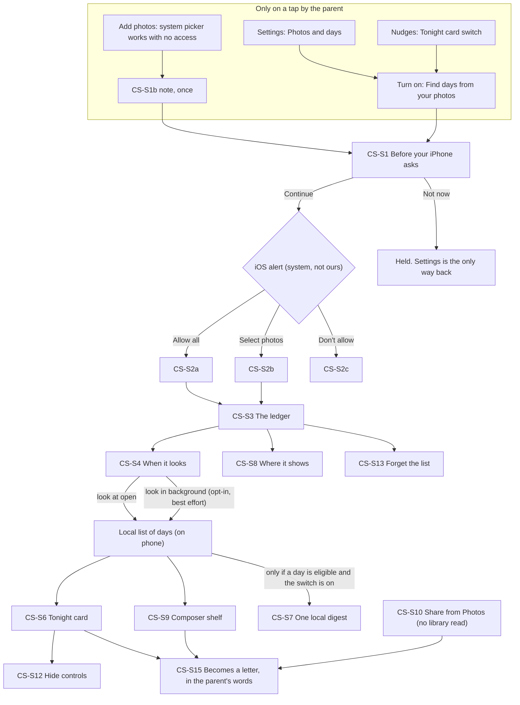

# Memory Library: permission, consent and batch surfacing (design spec)

Status: draft, 10 Nov 2026 (UTC). Docs only. Author: `design-systems` (Chief Design Officer lens, Claude role). Screens are `CS-S<n>` (a working label; this file assigns no BL, D, CR or NX id). Companion wireframes: `MEMORY-LIBRARY-CONSENT-AND-SURFACING-WIREFRAMES-10nov.html` (static, no scripts, no external requests, light and dark for every screen, AX5 for the two busiest).

This is a design spec, not a requirement and not a founder decision. It builds on the flows in PR #746 (`MEMORY-LIBRARY-FLOWS-10nov.md`, head 00a1082c) and does not repeat them. Where it disagrees with #746, #747 (NX-39) or #745 (ADR) it says so by file and section (section 13). Nothing here is legal advice. Every promise wording, the iOS purpose string and the App Privacy label answers are the founder's and counsel's.

Readiness: not scored. What keeps it from ready: no iOS background behaviour has been measured on a device by this team (section 10), every string is a content placeholder (section 9), the founder's answers in section 14, counsel on the rows marked R, and the privacy lane's answer on what the local list may hold.

## 0. The founder's ask, and the honest shape of the answer

The ask (10 Nov): a beautiful permission and consent experience; the app reads library information in a batch about 2 to 3 times a day; from that it surfaces things in the app, by push and by other nudges.

What this spec does with it, in four sentences:

1. **The look is a thing the parent can see.** A "look" is one on-phone read of the date and place of photos and videos. The parent has one page (CS-S3) that says what is on, what each switch lets the app read, when it last looked, and a one-tap off and a one-tap forget.
2. **"2 to 3 times a day" is a ceiling we set, never a promise.** iOS decides when background work runs and may not run it at all (section 11, verified from Apple sources). The honest floor is: every time the parent opens the app, if looking is on. Background looks are a second, separate, default-off choice (CS-S4).
3. **Nothing important waits for a background look.** The Tonight card, the composer shelf and the share route all work from the look at open. The one thing that does use an unseen look is the optional digest notification, and it is silent when no look has happened.
4. **Looks reading 3 times a day does not mean notifying 3 times a day.** The digest is one local notification at most, inside the existing weekly cap and the 21:30 to 07:00 quiet window, off by default, with a generic line that carries no photo, place or count.

## 1. Rules that hold on every screen here

- Tokens only (`packages/design-tokens/src/tokens.ts`). This spec adds **no colour token, no motion token and no haptic intent** (section 4). It reuses `bg`, `surface`, `surfaceRaised`, `text`, `textMuted`, `accent`, `accentSoft`, `onAccent`, `line`, `controlBorder`, `focus`, `destructive`, spacing, `fadeMs` (200), `exitMs` (160), `swapMs` (150), `enter` (280, dy 8), `staggerMs` (30), and the haptic intents `tap`, `press`, `soft`, `success`, `warning`.
- 44 pt minimum targets, 56 pt primary buttons, 20 pt gutters, Dynamic Type to AX5 with no clipped line and no truncated text, Reduce Motion, Reduce Transparency, Increase Contrast, both themes. Colour is never the only signal: every on/off has words beside the switch.
- Constitution: nothing here writes, rewrites, summarises or titles anything. No suggestion contains a machine-made caption, event name, "a year ago" sentence or "trip". A date is a date; a place is the place text the phone's own data gave, shown to the parent, never put into a letter.
- No streak, point, badge, count of gaps, "N days ago", fear, guilt or loss word. The ledger shows the times of looks (a fact about the app), never a count of photos or of unwritten days.
- Parent words: only `BRAND.md` glossary words (letter, note, book, month, reminder, message, recording, your words) plus the **new words in section 9**, which are placeholders for `content`. Nothing in this file is a final string. Where a screen needs words, the table gives a key and an intent in plain terms; the wireframes show the intent in brackets.
- No em dash, en dash, curly quote, ellipsis character or emoji.
- Truth: "on this phone" is allowed only where it is true (#746 section 1.2 and 1.3 gaps 1 to 4 still apply and are not repeated).

## 2. Flow overview

Why the trigger is "on tap, never at launch": iOS asks once, and a "No" cannot be undone from inside the app (it needs iPhone Settings). Asking in the first seconds, before the parent has felt any benefit, spends the one ask on the lowest-trust moment. #749 (benchmark) and #746 ML-S1 both land on the same rule; this spec makes it testable: no `requestAuthorization` call may run from app launch, first run, a push tap, a deep link, recording, Listening or Review text entry. The only callers are the Continue button of CS-S1 and nothing else.

## 3. Screen specs

Every screen has: purpose, entry, layout, states, VoiceOver, AX5, Reduce Motion, light and dark. Where a person agrees to something, a Shown / Records / Never / Decline block follows (COORDINATION section 10, PRIV-R21). Existing components are named; **NEW** means not in `apps/mobile/src/components/ui`.

### CS-S1 Before your iPhone asks (the pre-permission sheet)

Purpose: in the parent's terms, say what looking at dates and places is for, when it happens, what it never does, and that "Not now" costs nothing, before iOS shows its once-only alert.

Entry (parent taps only): CS-S1b (the one-time note under the first photo added with the system picker, #746 ML-S1b), the "Find days from your photos" switch in Settings (CS-S3), or the Tonight card switch (CS-S8). Never at launch, never in first run, never during recording, Review text entry or Listening, never from a push tap, never twice from a note.

Layout: `Sheet` medium; opens full height at AX5. A `PermissionPrimer` (NEW, a `Sheet` preset shared with the reminder ask so the two feel alike). Top to bottom: decorative glyph (hidden from VoiceOver); title (`title2`, heading); three short statements as separate paragraphs, not a bullet list of legalese; a "What happens next" `callout` line; two buttons, equal width, equal 56 pt height, equal type: `Button primary lg` and `Button outline lg`. No text-link "Not now", no pre-selected option, no timer, no Close glyph (VoiceOver escape maps to Not now).

Content blocks (keys `consent.ask.*`, intents only):

| Key | Intent | R |
|---|---|---|
| `title` | Names the choice as a question about finding photos by their day | no |
| `reads` | What is read: the date and the place of photos and videos | R |
| `never` | What is never read: what is in a photo, who is in it. And that nothing is written for the parent | R |
| `when` | **New against #746.** When it looks: when the parent opens the app; and only if they choose it later, in the background | R |
| `where` | Where the result lives: a list on this phone; nothing is sent to us | R, gap 1 to 3 of #746 |
| `next` | Your iPhone asks next; the parent can choose all photos or some; the app works either way | no |
| `continue` / `notNow` | Working labels "Continue" and "Not now" (existing in the app) | no |
| `os.purpose` | The iOS usage-description string: one honest sentence, no promise beyond this sheet | R, counsel |

Actions: Continue closes the sheet and calls the iOS request. Not now closes the sheet and **holds**: the sheet never returns from a note; Settings is the only way back; one `Toast` carries the intent "you can change this any time in Settings". Result routing in CS-S2.

| State | Spec |
|---|---|
| Default | As above |
| Loading | None. Static. Continue hands off at once |
| Offline | Works. Needs no network |
| Error | If iOS returns an error instead of an answer, the sheet closes and one `ErrorLine` appears where the parent came from (intent: did not work, try again in Settings). No retry loop |
| Denied before | If iOS already holds a "Don't Allow", iOS will not show its alert again. The sheet is not shown; CS-S3 shows the denied row with an Open Settings button (CS-S2c) |
| Already allowed | The sheet is not shown; the switch just turns on |
| Long text | Paragraphs wrap; the sheet scrolls; nothing is truncated |
| Nameless child | No child name on this sheet |
| AX5 | Full height, scrolls. Buttons follow the last paragraph, full width, stacked, same height. The title and first paragraph are visible with the next paragraph cut off at the fold so scrolling is evident. The 64 pt glyph box does not scale |
| VoiceOver | Focus lands on the title. Order: title, reads, never, when, where, next, Continue, Not now. Continue hint: "Your iPhone asks next." Glyph hidden |
| Reduce Motion | Presents with one `fadeMs` cross-fade, no slide |
| Light / dark | `surfaceRaised` sheet; dark draws a 1 pt `line` edge; `text` on `surfaceRaised` and `controlBorder` on `surfaceRaised` as in tokens.ts comments (14.83 light for text on raised per #746 section 6; this file recomputes nothing) |

Shown: the blocks above, by key. Records: the access level the OS reports, whether Not now was chosen, and the time of the choice, in phone-only settings (whether that is a counted act is #746 Q4, privacy and legal). Never: a list of photos, any date, place or count of photos. Decline and withdraw: Not now holds; Settings can turn it off; Export and deletion still work.

Analytics (catalog first; nothing else): `consent_ask_shown` (`source`: oneOf note, settings, nudges), `consent_ask_result` (`result`: oneOf continued, not_now), `consent_access_level` (`level`: oneOf all, selected, denied). No date, place or count.

### CS-S2 After the answer: Allow all, Select photos, Don't allow, and later changes

Purpose: accept the answer without comment, show what now works, and never ask again.

The iOS alert is the system's. The app does not restyle it, does not follow it with a second "are you sure", and does not show a thank-you. Button names in the iOS alert on current iOS are **UNVERIFIED** (not read this session); this spec names the three outcomes by what they mean, not by Apple's labels.

| Answer | What the parent sees | What the app does |
|---|---|---|
| **CS-S2a Allow all** | The ledger (CS-S3) opens with "Photo access: all photos" and the master switch on. One look runs at once, invisibly; no spinner. The Tonight card can appear on the next arrival at Tonight, never mid-view | Looks at open. Background looking stays off until the parent chooses it (CS-S4) |
| **CS-S2b Select photos (limited)** | The ledger opens with "Photo access: the photos you chose" and one calm line under it saying that new photos appear here only when added to the chosen set (intent; the line is allowed only after the device spike confirms how new photos behave under limited access, **UNVERIFIED**). A quiet "Choose more" button | Looks only over the chosen set. The app sets `PHPhotoLibraryPreventAutomaticLimitedAccessAlert` to true (verified, section 11) and presents the picker itself (`presentLimitedLibraryPicker`, verified), so the system's selection prompt never appears at an unexpected moment such as a cold launch |
| **CS-S2c Don't allow** | The ledger shows "Photo access: off in iPhone Settings" with an "Open Settings" quiet button. The "Find days" switch is disabled with its reason in words. No red, no apology, no "you are missing out" | Nothing is read. The system picker keeps working for adding photos. Occasions and reminders do not use photos and keep working |
| **CS-S2d Changed later in iPhone Settings** | On the next open, the ledger and every card reflect the new level without comment. Going to a narrower level or off: the local list is cleared at once and the ledger says so in one line (intent: the list was cleared because access was turned off). Going wider: nothing changes until the parent turns looking on | Re-reads `authorizationStatus` on every foreground (verified API). An access level that is no longer enough quietly removes any card that depended on it |

Rules: "Choose more" and "Open Settings" appear only in the chooser, the ledger and CS-S4, never in Review or Tonight. Under limited access a suggestion is built only from what the app can see and says nothing about what it cannot. **Design finding for the founder:** under Select Photos, a background look sees only photos the parent already chose, so the digest will rarely have anything new to offer; the honest ledger line for limited access says looking is over the chosen photos. Batch surfacing is a full-access feature in practice. State this to the parent in the ledger rather than letting the switch look broken.

States: AX5 notes wrap whole and "Choose more" is 44 pt or more, full width; VoiceOver reads the access row as one element with its value and says "Opens iPhone Settings" in the hint; the level change is announced politely once on arrival; Reduce Motion: none; dark: `textMuted` on `bg` 8.01 (tokens.ts).

### CS-S3 The ledger: what Early Letters can see

Purpose: the one page where a parent sees everything this feature does, can turn it off in one tap and can make it forget in one tap. The answer to the trust cost of unseen reads is not a promise; it is being able to look.

Entry: Settings (You tab), "Photos and days" (working label, #746 Q1), pushed page, native header "Photos and days", no lamp. Absent when the build switch is off.

Layout (`ListSection` / `ListRow`, 44 pt rows, values under titles at AX5):

1. **Master row** (`Toggle` row, the first thing on the page): label intent "Find days from your photos"; the sentence under it changes with the state and carries the on/off in words ("On. Looks when you open Early Letters." / "Off. Nothing is read."). Turning it **off is one tap, with no dialog and no "are you sure"**; it stops looking and hides every card at once. The list is kept until the parent chooses Forget (so off is reversible); the row under "On this phone" says so. Turning it on with no access opens CS-S1.
2. **Photo access** row: value "All photos", "Chosen photos", "Off in iPhone Settings" or "Not asked yet"; opens a small page with a plain sentence, "Manage in Settings" (opens iPhone Settings), and for chosen photos "Choose more".
3. **What each switch lets the app read** (section header). Two `Toggle` rows, each with a one-line "lets the app read" description and a one-line "does not" description:
   - **Dates**: the day each photo or video was taken. Never what is in it.
   - **Places**: the town or area a photo carries, as a place name from a table kept in the app (#747 D4; if the offline table fails its test the row does not exist and the parent types places instead). Never a street, never coordinates kept.
   A parent can allow dates and refuse places. Places off means cards and the chooser show dates only. This separation is a design choice (opinion): the place is the more sensitive field (a hospital, a home), and a calm product lets the parent say so row by row.
4. **When it looks** row: value = the last look as a date and part of the day ("Today, morning"), no count; opens CS-S4.
5. **On this phone** (section): one static row stating what is kept (intent: a list of days that have photos, and the days you hid) and when it was updated; **Forget the list** (`ListRow` with a leading glyph; text colour `text`, not red, because it deletes only the app's own list and never the parent's photos or letters); **Hidden choices** row (opens CS-S12c).
6. **Where it shows** row: value summarising the switches ("Tonight", "Tonight and a weekly message"); opens CS-S8.
7. **Never** (static `footnote` block with a lock-free plain list, not a link): never reads what is in a photo; never reads who is in it; never writes anything for you; never sends the list to us.
8. Footnote: the parent can change access any time in iPhone Settings.

| State | Spec |
|---|---|
| Default | As above |
| Loading | The access level is read at open; the previous value shows for under a second, then settles in place. No spinner |
| Empty (nothing found yet) | The "On this phone" row says nothing is kept yet. No call to action, no "go take photos" |
| Denied | Row 1 and 3 disabled, reason in words under the master row; Photo access row has "Open Settings" |
| Limited | Row 2 value "Chosen photos", "Choose more" present, the honest line from CS-S2b |
| Offline | Everything works. The ledger needs no network |
| Low Power, Background App Refresh off | See CS-S4. The ledger itself never changes |
| Error | A failed Forget shows one `ErrorLine` under its row; nothing half-done is reported as done |
| Long text | Rows and values wrap |
| AX5 | Values under titles; sections stack; no row hides text behind a "More"; buttons full width |
| VoiceOver | Header; master row "Find days from your photos, on. Switch." with the description as the hint; each row one element with its value; the "Never" block read as plain text. Switch change announces its new state once, politely |
| Reduce Motion | The sentence under the master row swaps over `swapMs` (150) opacity only; nothing slides |
| Light / dark | `ListSection` raised; dark 1 pt `line` edge; on/off is carried by the words, not by the switch colour alone |

Shown / Records / Never / Decline (per switch, in one table):

| Switch | Shown | Records | Never | Decline and withdraw |
|---|---|---|---|---|
| Find days from your photos | The sentence under the row and CS-S1 | On/off, time of change, phone only | Photo content, who is in it, a count of photos | Off in one tap; Forget; Export and deletion still work |
| Dates | The row's two lines | On/off | The date in analytics, logs or a notification | Off; cards then show nothing date-based, so the feature pauses |
| Places | The row's two lines | On/off; a place name per day in the local list | Coordinates; a street; a place in analytics, logs, crash reports or a notification | Off; places are removed from the list at once |

### CS-S4 When it looks: the cadence control, shown honestly

Purpose: let the parent choose how much looking they want, and tell the truth about what iOS does.

Entry: ledger row "When it looks".

**Layout.** Two choice rows (a `ListSection` with a check, single select, 56 pt rows with the description under the title), then a status block, then a short log.

1. **Only when I open Early Letters** (default). Description intent: looks each time you open the app. This is the only mode whose frequency we can state as a fact.
2. **Also in the background** (opt-in, default off). Description intent: Early Letters asks your iPhone for up to 3 looks a day. **Your iPhone decides when, and may do fewer or none.** Choosing it opens the small consent sheet CS-S4a first.
3. **Status block** (read-only facts, each with words, never colour alone): "Background App Refresh for Early Letters: on / off" with Open Settings when off; "Low Power Mode: on / off" with the sentence that looking may pause while it is on. Whether the app can read these two settings from code is **UNVERIFIED**; if it cannot, the block is a single static line naming both and does not claim a state.
4. **Recent looks** (a short list, newest first, at most the last 5): a time and a word for what started it ("you opened the app" or "in the background"). No count of photos, no "found" numbers. If background looks have not happened, the list simply shows only "you opened the app" rows; that is the truth, and the page does not apologise for it.

Why "up to 3" and not "3": the system decides. Apple's Developer Technical Support says app refresh tasks are run "when it thinks your app needs a refresh. You have virtually no control over this", and an app the person runs infrequently is likely to receive none; processing tasks run "typically overnight when the device is on mains power" (forum thread 725675, read). WWDC25 session 227 says people can change Low Power Mode, Background App Refresh and Low Data Mode and that background work should honour them, and that there is no guarantee. So the page never says "3 times a day". It says what the app asks for, and shows what happened. If the device spike (section 10) shows background looks rarely run, the wording changes to match the measurements; the copy follows the data, not the other way round.

How the app asks for background looks (for `mobile`, from verified Apple statements): one `BGAppRefreshTask` or `BGProcessingTask` request with an earliest-begin of several hours after the last look (this is what caps the app at about 3 a day on its own side); not rescheduled on every launch (Apple DTS: doing so can stop your own task firing; forum thread 786186, read). The ADR's "no background modes declared today" (#745, reminders paragraph) changes: adding a background mode is a build config change whose App Review effect is **UNVERIFIED**.

#### CS-S4a Looking in the background: the second consent

A `Sheet` medium, the same `PermissionPrimer` shape as CS-S1, shown the first time the parent chooses row 2. Purpose: this is the unseen read, so it gets its own plain statement.

Intents: (1) it looks when Early Letters is not open, using the same date and place only; (2) your iPhone decides when and may skip; Low Power Mode and Background App Refresh can stop it; (3) it never shows anything on its own except what the parent switches on in "Where it shows"; (4) how to turn it off in one tap. Buttons: "Turn on" and "Not now", equal. Not now holds; the row stays at choice 1.

Shown: the four intents. Records: the choice and the time, phone only; every look's time in the recent list (times only). Never: a photo, place or count in the log; a look reported to analytics beyond a bucketed event with no content. Decline and withdraw: choose row 1 or switch the master off; Forget clears the log.

| State | Spec |
|---|---|
| Background App Refresh off | Choice 2 is selectable, but the status block says in words that looking will happen only when the parent opens the app, with Open Settings. Not disabled, because the parent's wish is valid and iOS may be changed later |
| Low Power Mode on | Status says looking may pause. No red. It resumes without any message when Low Power Mode ends |
| Offline | No effect (local) |
| Limited access | Choice 2 shows the CS-S2b caveat |
| Denied | Whole page replaced by the CS-S2c line |
| AX5 | Rows stack; the check is a word as well as a glyph ("Chosen"); log rows stack time over reason |
| VoiceOver | "Only when I open Early Letters, chosen." Radio-group semantics; the status block read in order; the log rows one element each |
| Reduce Motion | None beyond `swapMs` |

### CS-S6 Tonight card: a day to tell a letter about (in-app surface)

This is #746 ML-S10 with the changes below; read that section for its entry rules, frequency cap (one per 7 days, proposed) and VoiceOver order.

Changes this spec requires:

1. **The card is built from the last look, not by a look.** Tonight never waits for a look and a card never appears while the parent is on Tonight. It appears on the next arrival at Tonight. (No layout shift, no pop-in.)
2. **The body shows the date only by default.** The place appears after the tap, in the chooser heading (CS-S9), not on the card. Reason: Tonight is read over shoulders and on shared phones, and a place can be a hospital (#746 section 12.1 decision 2 already prefers the text-only card; this goes one step further). The founder's wording with the place is a choice (section 14, decision F4).
3. **No thumbnail** (agree with #746 decision 5).
4. Actions, in this order: `Button primary` "Tell a letter about it"; `Button quiet` "Not this day"; a "More" button (44 pt, text label, not an icon only) opening the hide menu (CS-S12). VoiceOver reads the group as one: date, body, the three actions.
5. The card respects the master switch, the Dates switch, the Tonight-card switch in CS-S8, the hidden days and stretches, and the 30-day window. When any is off, there is no card and no placeholder.

States: loading: the card does not exist until the list has it; empty: no card; denied/limited/offline/Low Power/background-off: the card is unaffected (it uses the last list); error: if the chooser cannot open the day, the chooser shows its own error and the card is removed; AX5: buttons stack, card text whole; Reduce Motion: `fadeMs`; dark: `surfaceRaised` with 1 pt `line`.

### CS-S7 The digest: one local notification, never more

Purpose: a single, gentle message that the parent has switched on, which carries no content from the library.

Rules (all must hold; each a test, section 12):

- Local only. Scheduled with the on-phone notification centre. No remote push, no token, no server involvement. (A remote push would mean a server knows something derived from the library and would flip the App Privacy label.)
- Off by default. Its own switch in CS-S8.
- **At most one per week by default**, and it **consumes a slot from the existing weekly cap; it never adds one** (NOTIFICATIONS.md "nudge budget"). The parent can pick "weekly" or "when something is there" with a ceiling of the existing cap; there is no "daily". I did not find a numeric weekly cap constant in `apps/mobile/src/lib/reminders/planner.ts`; `mobile` must name where the cap lives and the digest must read it. The brief says one exists; I have not verified its value.
- Inside the existing window: nothing between 21:30 and 07:00. The parent picks the time; default evening (#746 proposes 7:00 PM, a hypothesis for the diary study).
- **Content: generic only.** No photo, place, date of a photo, count, child name (unless the existing "names in notifications" switch is on), no occasion name. The line carries an invitation to say a few words, in the family of the existing reminder lines. Intent only here; `content` writes it, `rules.test.ts` passes it.
- **Condition:** the digest is scheduled only when the last look found at least one eligible, unhidden, unanswered day, and is cancelled when the parent writes a letter, hides the day, turns the switch off, or turns looking off. If no look has happened, nothing is scheduled. Silence is the correct outcome and the ledger never reports it as a failure.
- A tap opens Tonight. It attaches nothing and opens no library view.
- Trips are never a notification. A notification about a trip would tell a lock screen where the phone has been.

**Honest design finding.** A notification that must carry no photo, place or count says "a few words about the week?" It is a reminder with extra permission. Its only link to the library is whether to send it. This is a legitimate use (it avoids nagging when there is nothing) but the founder should know that the batch reads buy a smarter *whether*, not a richer *what*. The value of looking is in the app surfaces; the digest is the small extra.

States: notifications denied: the digest switch shows its reason and Open Settings; the Tonight card is the surface; quiet window: the schedule skips to the next allowed time; Low Power / background off: unaffected if the schedule was made at open; AX5: the lock-screen text is the OS's; the Settings row stacks; VoiceOver: the preview in CS-S8 reads as the notification would.

Shown: the generic line and the time, in CS-S8, with a live preview of the real words. Records: the switch, the time, the last-scheduled time. Never: any content from the library in the payload. Decline and withdraw: the switch; the existing one-tap stop for reminders also stops this (NX-39 R29).

### CS-S8 Where it shows: one switch per surface

Purpose: let the parent choose each place the feature may speak, each default off except what already exists.

Entry: ledger row "Where it shows". A `ListSection` of `Toggle` rows, each with its words about what it does and what it never does.

| Surface | Default | What it does | Never |
|---|---|---|---|
| Tonight card (CS-S6) | Off until the parent turns on "Find days"; then on | An in-app invitation, one at a time | A thumbnail, a count, "N days ago" |
| Photos from today on the composer (CS-S9) | On with "Find days" | Today's and recent days appear as date choices in the add-photos sheet | Anything while recording or listening |
| A message about the week (CS-S7) | **Off** | One local notification, generic words | Any library content in it |
| Add from Photos (CS-S10) | Not a switch (parent-initiated) | Appears in the share sheet | n/a |
| Home Screen or Lock Screen widget (CS-S11) | Not offered | n/a | n/a |

Reminder time and the two lock-screen switches (child name, day name) are existing controls and appear under the message row only when it is on.

### CS-S9 The composer shelf (in the add-photos sheet)

Purpose: when a parent opens "Add photos or videos", the days that have photos are one tap away, without any suggestion about what to write.

Not on the recording screen, not on Listening, not in the middle of Review text entry. It lives inside the chooser sheet (#746 ML-S4), as a single horizontal row of **date chips** at the top (today, then days with photos, newest first, up to the same 30-day window), each a 44 pt `Chip`. Tapping one scopes the grid to that day, with nothing pre-selected. The heading of the scoped grid shows the date and, if the Places switch is on, the place. There is no thumbnail strip, no count on a chip, no "suggested" label and no ranking beyond time. Hidden days do not appear.

States: not allowed or limited-and-empty: the row is absent; Places off: date only; AX5: the row becomes a wrapped list of full-width chips; VoiceOver: each chip is a button with the full date; Reduce Motion: none.

### CS-S10 Add from Photos (the share sheet) [later, spec only]

Purpose: a route that needs **no library read at all**: the parent selects photos in the Photos app, taps Share, chooses Early Letters, and the items arrive in a new letter's media. It is parent-initiated, so it needs no consent screen of its own and no background anything. It is the lowest-trust way to the same outcome and should be built before any unseen read if the founder wants the quickest honest win.

Spec in brief: a share extension target; the receiving screen is the Review attach flow (CS-S15) with the items attached and nothing else added. The copy of items follows the same stripping rule as the picker (#746 gap 4). Feasibility with Expo (config plugin, extension target) is **UNVERIFIED**; this is a request for `mobile` to spike, not a promise.

### CS-S11 Widget [not offered in this spec]

The rule is no photo, place or count in a widget. A widget also refreshes on the system's budget, not ours (UNVERIFIED, WidgetKit not read), and it sits on a Home or Lock Screen. This spec offers **no widget that reads or reflects the library**, not even a "something is waiting" state, because that single bit is derived data on a lock screen. A static "speak a letter" shortcut widget that never touches the list is a different feature (not specified here) and is allowed by the rules.

### CS-S12 Hide controls

Four controls, each named for what it does. All store only what is needed to keep a day hidden (a date, or two dates, or an opaque photo identifier) on the phone, in the same local store as the list.

| Control | Where | What it does |
|---|---|---|
| **CS-S12a Not this day** | Card, quiet button | The day never returns. Toast with Undo for the toast window |
| **CS-S12b Hide a stretch** | Card "More" menu, and Hidden choices | A small `Sheet`: two `DateField`s, "From" and "Until", pre-filled with the card's day; Done. No card or shelf chip appears for any day in the range. The parent sets it; the app never guesses a hard season. Backs NX-39 R20 |
| **CS-S12c Hide this photo** | Photo preview in the chooser (long press), or the viewer menu | The photo is left out of every card and shelf; it can still be picked from the grid. Different from taking a photo out of a letter |
| **CS-S12d Stop these** | Card "More" menu | Turns "Find days" off (the "never suggest" control). One tap, no dialog, Toast with Undo. Equivalent to the master switch |

**Hidden choices** page (from the ledger): a plain list of the days and stretches the parent hid, each with "Show again". Behind App Lock like the Book. Nothing in it is a count. It exists because a hidden thing the parent cannot see or undo is a trap. This conflicts with NX-39 R17 ("no list of dismissed or snoozed moments exists anywhere"); see section 13 and decision F6.

States: empty list: "Nothing hidden." (intent); AX5: sheets stack, DateFields full width, Done reachable above the keyboard; VoiceOver: each control is a button with the verb in its name; the Undo toast is read once; Reduce Motion: `fadeMs`.

### CS-S13 Forget the list

Purpose: one tap to clear what the app made.

Row "Forget the list" in the ledger. Tap: the local list of days and places is deleted at once, the master switch turns **off**, and one `Toast` says (intent) "Forgotten. Looking is off." with **no Undo** (the list can be rebuilt by turning looking on; the photos are untouched). Hidden choices are kept unless the parent also removes them in Hidden choices ("Clear hidden choices"), so forgetting the list never resurrects a day the parent hid.

Why the master switch turns off with it: if looking stayed on, the list would be rebuilt at the next open, and "forget" would feel like a lie. Why no confirm dialog: the action is reversible by turning looking on, it deletes none of the parent's data, and a three-button dialog (#746 ML-S14 row 5) is more weight than the action deserves. This is a design opinion; if privacy wants a confirm, it is one button plus Cancel, never three.

Haptic: `soft` once on completion. Announcement: "Forgotten. Looking is off." Reduce Motion: none. Failure: `ErrorLine` under the row; the list is reported forgotten only after it is.

### CS-S14 The state matrix

Every surface behaves per the table. "Quiet" means no message, no badge, no banner.

| State | Ledger (CS-S3) | When it looks (CS-S4) | Tonight card (CS-S6) | Composer shelf (CS-S9) | Digest (CS-S7) |
|---|---|---|---|---|---|
| Never asked | Master off; "Not asked yet" | Not reachable | None | Absent | None |
| Empty (allowed, nothing found) | "Nothing kept yet" | Normal | None | Absent | None |
| Allowed, all | Normal | Normal | Works | Works | Works if on |
| Limited | "Chosen photos" + Choose more + honest line | Caveat shown | Over chosen set only | Over chosen set | Rare |
| Denied | Reason + Open Settings | Replaced by the denied line | None | Absent | None |
| Offline | Normal | Normal | Normal (local) | Normal | Normal (local) |
| Low Power Mode | Normal | Status line says looking may pause | Last list used | Last list used | Not rescheduled until a look |
| Background App Refresh off | Normal | Status line: only when you open it; Open Settings | Works from the look at open | Works | Works only from a look at open |
| App not opened for days | Last-looked shows the true time | Log shows no new rows | Last list; the 30-day window means old days expire | Same | None is scheduled after a stale look (digest requires a look within the last 3 days, proposed) |
| Switch off | "Off. Nothing is read." | Not reachable | None | Absent | Cancelled |
| Access later revoked | List cleared; one line | Replaced | None | Absent | Cancelled |

### CS-S15 How a suggestion becomes a letter without the app writing words

The path, and the rules on it. This is #746 ML-S10 and NX-39 R19 made explicit.

1. The parent taps "Tell a letter about it" on the card, or a date chip on the shelf, or arrives from the share sheet.
2. The chooser opens scoped to that day. **Nothing is pre-selected.** The parent taps the photos they want.
3. The capture screen opens (Speak or Type), unchanged. **There is no seeded text, no prefilled title, no suggested first line, no place or date inserted.** The standard prompt behaviour of the app is untouched; this feature adds no prompt.
4. In Review, the chosen photos sit below the parent's words. The date and place chips show to the parent only (#746 ML-S6). No button copies a chip into the letter.
5. The letter is kept only with the parent's words; if the parent leaves without words, the photos are dropped (NX-39 R19; #746 ML-S9 drop note).
6. Which day the letter is "about": the letter keeps its own captured date. If product wants a separate "this letter is about" date taken from the photos, it is an editable chip the parent confirms, never text (open question, section 14 Q-D2).

Test: the letter's words are byte-identical before and after attaching media and before and after a suggestion was tapped.

## 4. Motion and haptics

No new motion token, no new haptic intent. Everything uses tokens that exist in `packages/design-tokens/src/tokens.ts` (read this session: `fadeMs` 200, `exitMs` 160, `swapMs` 150, `enter` {dy 8, 280 ms}, `staggerMs` 30, `reduceMotion` {fade, 200}).

| Moment | Motion | Reduce Motion | Haptic |
|---|---|---|---|
| CS-S1 / CS-S4a sheet | Native sheet | One `fadeMs` cross-fade | none |
| iOS alert | System's | System's | system's |
| Ledger state sentence changes | Opacity swap over `swapMs` | Same (no travel) | none; the native `Toggle` supplies its own |
| Card enters on Tonight | The existing Tonight stagger, once per cold launch | `fadeMs` | none |
| Card leaves (Not this day) | Fade over `exitMs`, Toast with Undo | Same | `tap` on the button |
| Forget done | Row value updates | none | `soft` |
| Look in progress | **Nothing.** No spinner, no shimmer, no "scanning". A look is invisible. If the ledger is open, the last-looked value swaps over `swapMs` | none | none |
| Digest scheduled or cancelled | Nothing visible | none | none |

Not used: `success` (reserved for saving a letter), `warning` (nothing here is a warning), `press`. No sound. No progress ring, no "searching your photos" animation: a calm product does not perform surveillance theatre.

## 5. Accessibility, as a checklist `qa` ticks on a device

- [ ] Every control 44 pt or more; primary and equal-weight sheet buttons 56 pt; switch rows 44 pt or more including the description.
- [ ] Dynamic Type to AX5 on a 320 pt-wide phone: zero clipped lines on CS-S1, CS-S3, CS-S4; no text truncated; sheets scroll; buttons reachable; values under titles.
- [ ] VoiceOver: focus lands on each screen's heading; reading order is visual order; each row is one element with label, value and hint; a switch announces its state once; "Forgotten. Looking is off." is announced; decorative glyphs hidden.
- [ ] Voice Control: every control has a unique visible name ("Find days from your photos", "Look at dates", "Look at places", "Also in the background", "Forget the list").
- [ ] Switch Control and keyboard: no gesture is the only way (long-press preview has a Select and a Hide button).
- [ ] Reduce Motion: no travel, scale or loop anywhere here; sheets cross-fade at `fadeMs`.
- [ ] Reduce Transparency: no blur on any sheet or card here. Increase Contrast: `line` and `textMuted` take their `highContrast` values.
- [ ] Contrast in both themes: text pairs as listed in tokens.ts comments; on/off carried by words as well as the switch.
- [ ] Nameless child: no empty quote, no "'s" fragment, no "undefined".
- [ ] No string contains a count of gaps, a streak, "N days ago", "AI", "scan", "index", "metadata", "moment", "library", "safe", "backed up", an em or en dash, a curly quote, an ellipsis character or an emoji.
- [ ] Cognitive load: one decision per screen; no timer; no countdown; "Not now" holds.
- [ ] No deaf or hard-of-hearing reader gets a worse screen: nothing here uses sound.

## 6. Components

| Component | Status | Notes |
|---|---|---|
| `Sheet`, `Button`, `Toggle`, `ListSection`, `ListRow`, `Chip`, `DateField`, `Toast`, `ErrorLine`, `AppNote`, `Card`, `Dialog` | exist | Reused as specified |
| `PermissionPrimer` | NEW (#746 section 5.2 already proposes it) | A `Sheet` preset: glyph, title, paragraph slots, equal button pair. Shared by CS-S1, CS-S4a and the reminder ask so permission moments look alike |
| `LedgerRow` | NEW (a `ListRow` variant) | Title, value, optional "lets the app read / does not" lines; the on/off in words |
| `ChoiceRow` | NEW (a `ListRow` variant) | Single-select row with description and a check that is a word at AX5 |
| `LookLog` | NEW | Newest-first rows: time and reason, last 5 |
| `DayCard` | NEW in #746 | Gains the "More" menu |

Library first: nothing here is built outside the existing component set and the native `Toggle`.

## 7. Tokens

None added. One **collision** with #746 section 5.1 to resolve: `colors.scrim` already exists in `tokens.ts` (light `#2B272252`, dark `#0000008C`, documented as the dimmer behind sheets and dialogs). #746 proposes a different `scrim` (`rgba(0,0,0,0.60)`) and says none exists today. Use a different name for the media badge (`mediaScrim`) and keep the existing one for sheets. Not needed by this spec.

## 8. Truth lines (what must be true in the build before a line is shown)

- "Nothing is sent to us" about the list: the list never enters sync, analytics or crash reports, and place names come from an offline table (#746 gap 1, 2; #748).
- "Looks when you open it": a foreground look runs on open and uses the persistent-change token so it is cheap (`fetchPersistentChanges(since:)` exists, verified).
- "Up to 3 a day": only if the device spike shows it; otherwise the number is not shown.
- "Chosen photos": only while the OS reports limited access.
- The last-looked time and recent-look rows are real timestamps written by the app, not estimates.

## 9. Content placeholders (for the content agent; none is a final string)

New parent-facing words this spec needs that are **not** in the BRAND.md glossary (read 10 Nov): photos and videos, day, place, look / looks / last looked, "the list" (what is kept on the phone), forget, hide, a stretch of days, background (as in "when the app is not open"), Tonight (existing tab word, used as a place), "Photos and days" (working section name; the founder's "Memory Library" is internal, CR-25). Words to **avoid** because the brand or #746 bans them: moment, memory (as something the app makes), library, index, metadata, scan, analyse, detect, match, suggestion engine, AI, sync, upload, entry, take, draft.

Buttons (22 characters or fewer): working labels "Continue", "Not now", "Turn on", "Choose more", "Open Settings", "Tell a letter about it" (21), "Not this day", "Done", "Show again", "More".

Intent keys by screen: `consent.ask.*` (CS-S1), `consent.bg.*` (CS-S4a), `ledger.*` (CS-S3), `cadence.*` (CS-S4), `card.*` (CS-S6), `digest.*` (CS-S7), `surfaces.*` (CS-S8), `shelf.*` (CS-S9), `hide.*` (CS-S12), `forget.*` (CS-S13). `content` places them under the proposed `memoryLibrary.*` namespace of #746.

## 10. What to measure on a device before any cadence wording ships (spike spec, for `mobile`, `qa`)

The brief's UNVERIFIED items, as a spike with thresholds written before the run:

1. For 7 days on at least 3 iPhones (one SE class, one with Low Power Mode used daily, one with Background App Refresh off): log only the time and the reason of each look (no content). Report looks per day by reason.
2. Threshold for showing the words "up to 3 a day": background looks reach 2 or more on at least 5 of 7 days on the typical device. Otherwise the ledger says "a few times a day when you use the app" or nothing about frequency.
3. Whether a background-started look can read a limited or full library while the phone is locked (data protection), and whether it can schedule a local notification.
4. Whether `backgroundRefreshStatus` and `isLowPowerModeEnabled` can be read from code through the Expo layer in use.
5. Whether photos added after a "Select Photos" choice are visible without the parent choosing them.
6. The effect of adding a background mode on App Review.

## 11. Verified and unverified

Verified this session (page read; a forum answer is an Apple engineer's, not documentation):

- `PHAuthorizationStatus.limited` exists; `presentLimitedLibraryPicker` presents the selection UI; adding `PHPhotoLibraryPreventAutomaticLimitedAccessAlert` = true to Info.plist prevents the system presenting the limited-selection prompt automatically. Source: developer.apple.com/documentation/photos/phauthorizationstatus/limited.md.
- `PHPhotoLibrary` offers `authorizationStatus(for:)`, `requestAuthorization(for:handler:)`, change observers, `fetchPersistentChanges(since:)` with a persistent change token, and an availability observer. Source: developer.apple.com/documentation/photos/phphotolibrary.md.
- App refresh tasks are run by the system, "virtually no control", driven by device condition and user activity, none for an infrequently run app; processing tasks "typically run overnight when the device is on mains power". Source: developer.apple.com/forums/thread/725675 (Apple DTS).
- Processing tasks run roughly daily, usually overnight on charge, may be deferred or never fire; do not reschedule on every launch; one Apple engineer states processing tasks launch force-quit apps. Source: developer.apple.com/forums/thread/786186.
- Background execution is "opportunistic, often discretionary"; conditions include network, CPU, activity, thermal and battery; frequently used apps have higher chance; people can toggle Low Power Mode, Background App Refresh and Low Data Mode and apps should honour them; there is no guarantee; after a force quit "the system respects their intent" (for background push). Source: developer.apple.com/videos/play/wwdc2025/227/.
- Tension noticed: the WWDC25 force-quit statement (about background push) and the forum statement (processing tasks launch force-quit apps) do not obviously agree. Which holds for our case is UNVERIFIED.
- Repo: `tokens.ts` has `scrim`, motion values and spacing quoted above; `planner.ts` has no numeric weekly-cap constant that my grep for cap/budget found; the haptic intents are in COMPONENTS.md.

UNVERIFIED (not read, remembered, or inferred): the exact labels and wording of the current iOS Photos alert; how limited access treats new photos; periodic limited-library prompt timing; Low Power Mode's exact effect on background tasks (WWDC25 names the setting; the page I could read did not detail it); `backgroundRefreshStatus` and `isLowPowerModeEnabled` use through Expo; data protection of the library while locked; whether a background task may schedule a local notification; Expo support for background tasks and share extensions; WidgetKit refresh budgets; App Review treatment of background modes; whether revoking Photos access in iPhone Settings ends the app process; blocked: the Apple Support Low Power Mode article and the BGTaskScheduler documentation page could not be fetched (the fetch permission was not granted for URLs not in search results).

## 12. Tests (working labels for `qa`, `mobile`)

`[CS] no requestAuthorization call runs from launch, first run, push tap, deep link, recording, Listening or Review text entry`; `[CS] Not now on CS-S1 never shows the sheet again from a note`; `[CS] the two buttons of CS-S1 and CS-S4a have equal size and weight`; `[CS] with the master switch off 0 library reads happen`; `[CS] Forget deletes the list, turns the master switch off and leaves hidden choices`; `[CS] revoking access clears the list on next open`; `[CS] no card appears while Tonight is visible`; `[CS] the digest payload has no photo, place, count or occasion name`; `[CS] the digest is never scheduled outside 07:00 to 21:30`; `[CS] the digest never adds to the weekly cap`; `[CS] with no look in 3 days no digest is scheduled`; `[CS] no widget reads the list`; `[CS] the letter's words are byte-identical before and after a suggestion is used`; `[CS] ledger recent-look rows hold a time and a reason only`; `[CS] the limited-access prompt key is set and the app presents its own picker`.

## 13. Disagreements with other documents

- **#746 FLOWS section 5.1 (tokens):** says no `scrim` exists; `tokens.ts` has one (section 7 here).
- **#746 ML-S1 and S14:** written before the batch ask; no statement of *when* the app looks, no ledger of last looks, a three-button "clear" dialog. Replaced by CS-S1 `when` block, CS-S3, CS-S13.
- **#746 ML-S10 (card with place):** this spec shows date only on the card.
- **#746 ML-S4 (cap 8 / 2 videos / 60 s) against #747 D3 (up to 5):** not mine to settle; flagged.
- **#746 ML-S10 (7-day gap, dismissed days remembered) against #747 R17 (14-day snooze, no list of dismissed moments):** flagged; this spec needs a visible Hidden choices page.
- **#745 ADR "no background fetch, no background modes":** the batch ask changes this; the ADR needs an amendment if background looks are chosen.
- **#747 R27 "The app never reads the library in the background":** direct conflict with the founder's 10 Nov batch ask. This spec resolves it by making background looks a separate, default-off, second consent; R27 would need the founder's amendment.
- **#747 D2 (picker in P1, library only at P2):** this spec's CS-S10 (share sheet) is another no-library-read route for P1; suggested as an addition.

## 14. Decisions that belong to the founder (recommendation and default)

| # | Decision | Recommendation | Default |
|---|---|---|---|
| F1 | Do background looks ship in the first build with a library read, or only the look at open? | Look at open first. Background looks in a later build, after the section 10 spike | Look at open only |
| F2 | The words promising frequency | Say "up to", show the log, never say "3 times a day" as fact | No frequency words |
| F3 | Dates and Places as separate switches | Separate | Separate |
| F4 | Place on the Tonight card | Date only; place after tap | Date only |
| F5 | The digest | Offer, off by default, weekly ceiling, generic words | Off |
| F6 | A visible Hidden choices page against NX-39 R17 | Visible, behind App Lock | Visible |
| F7 | Revoked access clears the list at once | Yes | Yes |
| F8 | Forget turns looking off | Yes | Yes |
| F9 | Whether to build the share-sheet route (CS-S10) before any unseen read | Yes, as the first honest win | Spike |
| F10 | The section name ("Photos and days" or other) | `content` proposes | "Photos and days" |

Open questions: Q-D1 whether allowing photo access is a counted act (PRIV-R21; privacy, legal); Q-D2 a separate "about" date for a letter (product); Q-D3 whether the iOS purpose string is counsel's alone (it is).

## 15. Test of the whole against the brief's tensions

1. Unseen batch reads: separated, second consent, default off, visible log (CS-S4, S4a).
2. iOS gives no schedule: "up to", log of real looks, state block, spike (CS-S4, section 10).
3. Reading is not notifying: digest at most weekly, shares the cap, generic words, silent when nothing (CS-S7).
4. Push stays local: stated as a rule and a test (CS-S7).
5. Occasions never inferred: unchanged from #746 ML-S12; this spec adds no occasion behaviour and the digest carries no occasion name.
6. Journaling Suggestions: not used here; the same ledger would apply if chosen, with "Apple chooses" noted. Not a foundation.
7. Promise rewrite: no promise wording is written here; the `when` and `where` blocks are for counsel.
