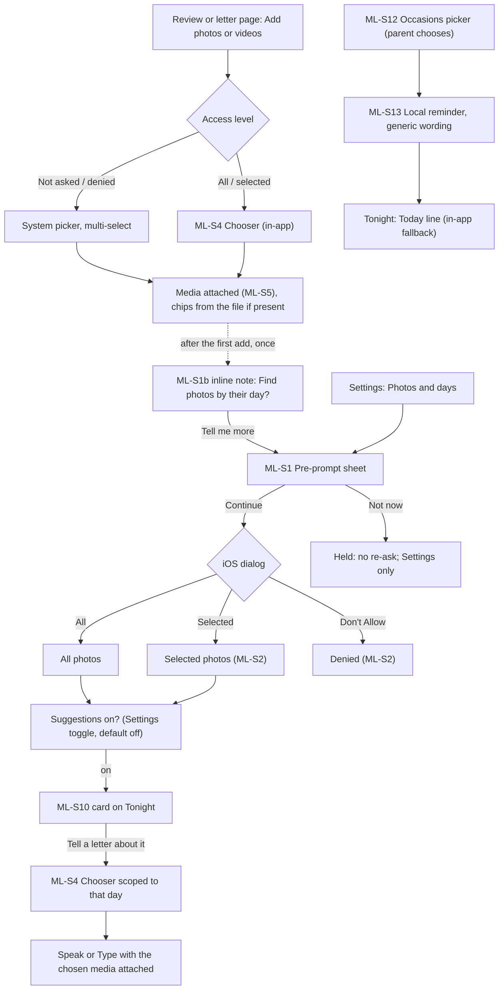

# Memory Library: design flows (photos, videos, days and occasions)

Status: draft, 10 Nov 2026 (UTC). Docs only. Author: `design-systems`. Working label: screens are `ML-S<n>` (a working label; this file assigns no BL, D, CR or NX id and reserves none). Companion file: `MEMORY-LIBRARY-WIREFRAMES-10nov.html` (static, no external requests, token hex values, light and dark for every screen, AX5 for the busiest).

Parallel work this file does not duplicate and has not read (it was being written at the same time): requirements NX-39 (branch `docs/nx-39-memory-library-10nov`), the architecture ADR (`docs/adr-memory-library-10nov`) and the privacy note (`docs/privacy-memory-library-10nov`). Where this file needs an answer from them it says so in section 12 and names the question. Nothing here is a requirement id.

Readiness: not scored. What keeps it from ready: the founder's word approval for every string (each one in section 3 to 9 is a placeholder and **needs founder word approval**), the four truth gaps in section 1.3 (answers from the ADR and privacy lanes), counsel for the rows marked R, a device pass for everything marked UNVERIFIED (section 13), and the founder's design answers in section 12.1.

| | |
|---|---|
| Refines | NX-33 (photos, `docs/nx-33-photos-8nov`) and NX-30 (the Photos tab slot), without keeping NX-33's "never read the library, never read a photo's date or place" promise (founder direction, 10 Nov); NX-36 screen format (`docs/nx-36-screen-specs-9nov`); NX-35 M10 (photo add motion); YOU-TAB-STATES-9nov (Settings shell); `docs/design/NOTIFICATIONS.md` sections 4 and 5 (opt-in celebrations, the photo idea) |
| Reads | `docs/design/COMPONENTS.md` (2.6 Chip, 2.14 Toast, 2.23 PhotoFrame), `PHOTOGRAPHY.md`, `MOTION.md`, `packages/design-tokens/src/tokens.ts` (`target`, `motion`), `packages/content/VOICE.md`, `BRAND.md`, PR #735 (untrue-copy rules, open, read by API on 10 Nov), `docs/agents/COORDINATION.md` section 10 |
| Tag | EVIDENCE for what the files above say. HYPOTHESIS for how a parent feels, and for every number marked "proposed". UNVERIFIED for any statement about Apple's behaviour: I opened no Apple documentation this session (section 13) |
| Release | After Build 12. Build 12 has three tabs, no photo UI and no image picker (NX-36 section 0). Everything here sits behind one build switch (name for `mobile` to choose) and is absent, not greyed, when it is off |

## 0. What the parent should feel

A parent has hundreds of pictures of the day at the zoo, and no time. They want those pictures beside the words they say about it, and now and then a small nudge that says "that day was worth a few words". The feature must feel like a friend who knows where the shoebox is and never reads what is written on the back of each photo.

Three promises the screens keep, each a test in section 11:

1. **It works with no access at all.** Saying No to the library costs nothing except one convenience. Adding photos still works through the system picker. Occasion reminders do not use photos.
2. **The app reads dates and places, never pictures.** No face, scene or object detection, no captions, no ranking by what is in an image. A suggestion is a date and a place, offered as an invitation.
3. **Nothing is written for the parent.** A date or place chip is shown to the parent beside a picture; it is never inserted into the letter. A suggestion never counts what is missing, never says how long ago, never says a day was "not written".

## 1. Rules that hold on every screen

Rules in NX-36 section 2 (tokens only, 44 pt targets, 56 pt primary, 20 pt gutters, Dynamic Type to AX5, VoiceOver order, Reduce Motion, contrast table, analytics rules) apply here unchanged and are not repeated. This section lists only what is new.

### 1.1 Words

- Parent vocabulary: book, letter, photos and videos, day, place, kept, this phone. **Not** "moment" (BRAND.md's internal-terms table lists "moment" as an internal word for a short piece someone makes), not "memory" as a thing the app makes, not "library" (Apple's word; say "your photos"), not "index", "metadata", "geotag", "scan", "analyse", "detect", "match", "suggestion engine", "AI", "sync" (new strings), "upload", "entry", "take", "draft".
- "Memory Library" is the founder's name for the feature. It is a working name in this file. Whether it is a parent-visible Settings label is Q1 (section 12.2); the placeholder label below is "Photos and days".
- No streak, count of gaps, "N days ago", "you have not written about", "don't miss", "last chance", "only", countdown or badge. A number appears only where the parent selected something (a selection count in the chooser) or where it names a date.
- Never gender the child; `{child}` with the existing fallback ("your child").
- Buttons are 22 characters or fewer. No em dash, en dash, curly quote, ellipsis character or emoji.
- Every line below is a placeholder that **needs founder word approval**. Rows marked R also need counsel: they say what is read, where something is kept, or what a person agrees to.

### 1.2 The truth rule for "on this phone"

Backup is OFF in Build 12 and PR #735 (open) changes account and sign-in copy to say only what the build does. The same rule applies here:

- Allowed: "kept on this phone", "your photos stay in your Photos app", "read on this phone". These are statements of fact, and only true once section 1.3 is answered.
- Not allowed: "safe", "backed up", "kept safe", "private to you only", "end to end encrypted", "nothing ever leaves", "automatically", "securely". A lost phone loses the kept copies; the line about the original is "your original stays in your Photos app" only where that is true (a deleted original is not).
- Every screen below that says where media or metadata lives has a **Truth line**: what must be true of the shipped build for the words to be allowed. If it is not true, the line is not shown.

### 1.3 Four truth gaps that decide whether the privacy lines can be said

These are design findings, not decisions. The privacy and ADR lanes answer them; until they do, the lines marked "(gap n)" stay out of the build.

| Gap | The problem | What the design does meanwhile |
|---|---|---|
| 1. Place names | A photo carries coordinates, not a place name. Turning coordinates into "near Mysore" normally calls a geocoding service. Apple's geocoder sends the coordinates to Apple (UNVERIFIED this session). Then "read on this phone only" is not true of the place name | Copy says "read on this phone" about the photo's date and place data only if the lookup is offline (a bundled place table) or the line names the lookup. Fallback that needs no lookup: the chip shows the date only, and the place chip is a field the parent types |
| 2. Letter sync | Build 12 is servers on: a letter's words sync to the account after consent. If the chip's place and date live in the letter row, a place leaves the phone | Chips are stored in a phone-only table that sync never reads. If the ADR cannot do that, the place chip is typed by the parent only and is never derived |
| 3. Stored copy or reference | If a letter points at the original in Photos, deleting the original empties the letter. If the app keeps its own copy, the copy sits in the app's folder, with the recordings | Both states are designed (the "not on this phone any more" tile, S8). The recommended model is a kept copy, as NX-33 had it, because the book must outlive the camera roll and the export must include the files |
| 4. Location inside the file | A kept copy of a photo may still contain GPS in its file. LEGAL-REQ-013 (cited in NX-33, not re-read) says to strip it | Default: strip at add time; the place chip lives in the phone-only table instead. Settings row "Remove place from saved photos" (S14) strips older copies |

### 1.4 Access levels, and what each one does

iOS gives the app three answers about the library, plus "not asked yet". This table is the whole behaviour. Terms follow the iOS dialog's own words ("Select Photos", "Allow Full Access", "Don't Allow"); UNVERIFIED against Apple's current dialog.

| Level | Add photos or videos | Chips (date, place) | Suggestions ("a day to tell a letter about") | Photos tab | Settings row says |
|---|---|---|---|---|---|
| Not asked yet | System picker (needs no permission, UNVERIFIED) | From the picked file if it carries them (Apple's picker may let the person withhold location, UNVERIFIED) | Off | Works (it shows what is in the book, not the library) | "Not asked yet" |
| All photos | In-app chooser over the whole library | From the library record | Works over the whole library | Works | "All photos" |
| Selected photos only (limited) | In-app chooser over the chosen set, with "Choose more" | From the library record, for the chosen set | Works over the chosen set only; the card never says anything about what it cannot see | Works | "Selected photos" |
| Denied | System picker | From the picked file if present | Off | Works | "Off in iPhone Settings" |
| Changed behind our back (the person toggled it in iPhone Settings) | Re-read on every foreground; the screen shows the new level without a fuss | Same | Same; a suggestion that is no longer visible quietly disappears | Works | Updates in place |

The Photos tab and a letter's kept photos never depend on access: they read the book's own files.

## 2. Flow overview

## 3. Screen specs

Each screen has the NX-36 blocks: purpose, entry, layout (real component names; NEW marked), states (default, loading, empty, offline, denied, limited, error, long text, nameless child, AX5, VoiceOver, Reduce Motion, light and dark), copy keys, targets and analytics, truth line, and delight within the calm. "Shown / Records / Never / Decline" lines (COORDINATION section 10) are given for every screen where a person agrees to something: ML-S1, S12, S13, S14.

Copy key namespace: `memoryLibrary.*` (proposed; `content` places them). Existing keys are named where reused.

### ML-S1 The pre-prompt: why we ask, before iOS asks

Purpose: say in the parent's own terms what reading dates and places is for, what it is not, and that No costs nothing, before iOS shows its one-time dialog.

Entry (never at launch, never in first run, never during recording, Review text entry or Listening):
1. The one-line note under the first attached media (ML-S1b below), or
2. Settings, Photos and days, "Photo access" (ML-S14), or
3. Settings, "Suggest days" toggle turned on with no access.

Why a pre-prompt at all: iOS shows its dialog once; a No there cannot be undone from inside the app (only in iPhone Settings). The existing reminder ask follows the same logic (NX-36 S12).

Layout: `Sheet` (medium detent; at AX5 it opens full height and scrolls), `SheetFrame` header with no Close glyph (the two answers close it; VoiceOver escape maps to "Not now"). Top to bottom: line-art glyph (hidden from VoiceOver, 64 pt `accentSoft` circle, Phosphor `ImagesSquare`), title (`title2`, heading 1), three short paragraphs (`body`), a three-line "What happens next" list (`callout`, `textMuted`), two full-width buttons stacked, 56 pt, equal weight: "Continue" (`Button` primary, `lg`) and "Not now" (`Button` outline, `lg`). No dark pattern: same height, same width, same type size; "Not now" is not a quiet text link.

| Key | Placeholder words | R |
|---|---|---|
| `memoryLibrary.ask.title` | "Find photos by their day?" | no |
| `memoryLibrary.ask.body1` | "Early Letters can look at the date and place of the photos and videos on this phone. That makes it easy to find the ones from a special day, and to offer you a few words about it." | R |
| `memoryLibrary.ask.body2` | "It reads only the date and the place. It never looks at what is in a photo, and it never writes anything for you." | R |
| `memoryLibrary.ask.body3` | "Your photos stay in your Photos app. Only the ones you add to a letter are kept in your book, on this phone." | R (gap 3) |
| `memoryLibrary.ask.next` | "Next, your iPhone asks you. You can choose all photos, or only the ones you pick. Early Letters works either way." | no |
| `memoryLibrary.ask.continue` | "Continue" | no |
| `memoryLibrary.ask.notNow` | "Not now" | no |
| `memoryLibrary.ask.heldNote` | "You can change this any time in Settings." (shown after Not now, as a toast) | no |
| `memoryLibrary.os.purpose` | The iOS usage-description text: "To help you find photos and videos from a special day to go with a letter. Dates and places are read on this phone." | R |

The iOS purpose string is the one line iOS shows inside its own dialog. It must be short, true, and not promise more than the pre-prompt (counsel; the string lives in the build config, not the app).

Actions: Continue closes the sheet and requests access (iOS dialog). Not now closes the sheet and **holds**: the app never shows this sheet again from an ML-S1b note, ever; the only way back is Settings (ML-S14). No timer, no re-ask. Result routing in ML-S2.

| State | Spec |
|---|---|
| Default | As above |
| Loading | None. The sheet is static; Continue hands off to iOS at once |
| Offline | Works (needs no network) |
| Error | If iOS returns an error rather than an answer, the sheet closes and one `ErrorLine` shows in the place the person came from: "That did not work. You can try again in Settings." (`memoryLibrary.ask.error`). No retry loop |
| Empty / limited / denied | Not applicable here; they are the results (ML-S2) |
| Long text | Paragraphs wrap; the sheet scrolls; nothing is truncated |
| Nameless child | No child name on this sheet |
| AX5 | Full-height sheet, paragraphs scroll, the two buttons go inline after the last paragraph and stay full width; glyph keeps its 64 pt box (artwork with a measured layout does not scale) |
| VoiceOver | Focus lands on the title. Order: title (heading), body1, body2, body3, next, Continue, Not now. Glyph hidden. Buttons read their visible text. Hint on Continue: "Your iPhone asks next." |
| Reduce Motion | Sheet presents with one `fadeMs` (200 ms) cross-fade instead of the slide (`useMotion()`) |
| Light / dark | `surfaceRaised` sheet; dark draws a 1 pt `line` edge; text on raised 14.83 : 1 light, 14.29 : 1 dark; outline button edge `controlBorder` 3.83 / 4.08 : 1 on raised |

Targets: both buttons 56 pt. Analytics (catalog first): `memory_ask_shown` (property `source`: oneOf note, settings, toggle), `memory_ask_result` (`result`: oneOf continued, not_now). The iOS answer is `memory_access_result` (`level`: oneOf full, selected, denied); no photo, count, date or place is ever a property.

Shown: the words above, by key, and no link needed (it asks for no Terms). Records: the access level the OS reports and whether "Not now" was chosen, in a phone-only setting; the act is not a policy act, so no `record_policy_act` row unless counsel says photo access is one (Q4). Never: the photo list, any date, any place, any count of photos. Decline and withdraw: Not now holds; in Settings the row can be set to Off; Export and deletion still work.

Truth line: body1 to body3 are allowed only if (a) the build reads nothing but date, place and the pixels needed to make the kept copy, (b) gap 1 is answered, and (c) no library data goes to sync, analytics or crash reports. Delight within the calm: none, on purpose.

#### ML-S1b The note under the first attached photo

One `AppNote` (footnote, `textMuted`, Info glyph), once, below the strip in Review, after the first photo is added without library access: "Want photos easy to find by their day? Let Early Letters see their dates." with a `Button quiet sm` "Tell me more" (44 pt) that opens ML-S1. Shown at most once ever; a second showing never happens, even after the app is reinstalled over the same data. It has no close button; it goes away when the person leaves Review. Key `memoryLibrary.ask.noteLine` / `noteLink`. Analytics: none beyond `memory_ask_shown`.

### ML-S2 After the iOS answer: all, selected photos, denied

Purpose: accept the answer without comment, show what now works, and offer the next step only where it helps.

Layout: not a screen; three small states inside the screen the person came from (Review, the chooser, or Settings).

| Result | What shows | Copy (placeholders) |
|---|---|---|
| All photos | The chooser opens (S4). Nothing is said | none |
| Selected photos | The chooser opens over the chosen set. Inside it, a pinned `AppNote` at the top: the set is what the person chose, and a `quiet` button "Choose more" opens iOS's own selection screen | `memoryLibrary.limited.note` "You chose to share some of your photos. These are the ones Early Letters can see." ; `memoryLibrary.limited.more` "Choose more" |
| Denied | The system picker opens at once if the person had tapped Add; in Settings the row reads "Off in iPhone Settings" with a `quiet` "Open Settings" | `memoryLibrary.denied.note` "Early Letters cannot see your photos. You can still choose photos one at a time." ; `memoryLibrary.denied.settings` "Open Settings" |

Rules: no apology, no red, no "you are missing out". Denied is an ordinary state with the same warm paper as every other. "Choose more" and "Open Settings" are never shown in Review or Tonight, only inside the chooser and Settings, so the main path stays clean. A suggestion that depended on a photo no longer visible disappears without a message.

States: loading: the chooser shows tiles filling in with no spinner glyph and no counts; offline: unaffected (library is local; an iCloud-only original needs a network, see ML-S4); AX5: the note wraps whole, "Choose more" is 44 pt or more and full width; VoiceOver: the note is read before the grid, polite live region on change; Reduce Motion: none; dark: `textMuted` on `bg` 8.01 : 1.

Truth line: "the ones Early Letters can see" is true only while the access level is selected photos. Analytics: `memory_access_result` above.

### ML-S4 The chooser: pick photos and videos, several at once

Purpose: let a parent pick several photos and videos, newest first, and see their dates without opening each one.

Entry: "Add photos or videos" in Review (ML-S5), on the letter page (ML-S8), on the Photos tab (ML-S9), or "Tell a letter about it" on a day card (ML-S10, which opens the chooser scoped to that day). With access "all" or "selected". Without access the system picker is used instead (Apple's own multi-select sheet; the app cannot restyle it, so S4 does not apply and chips come from the file).

Layout (full-height `Sheet`, grabber, native pull to close; the header row is 48 pt):
1. Header: title (`title2`, heading 1) "Add photos or videos"; "Close" top left (44 pt target, text not icon only).
2. A segmented filter, `SegmentedControl` with two or three items, labelled "All", "Photos", "Videos" (falls back to `Chip` filter at AX5, the COMPONENTS 2.9 rule). Never "Favorites", "People", "Places" (those would be recognition or grouping by content; places are metadata but grouping by place is a ranking we do not offer in v1).
3. Month section headings (`label`, heading trait) and a 3-column grid at default, 1 column at accessibility sizes (NX-33-R13 rule); tiles are `MediaTile` (NEW): square crop, 4 pt gap (`tokens.space[1]`), 96 pt minimum edge so the tile is above `target.min`. A video tile shows a duration badge bottom-left ("0:14") on a `scrim` background with `onScrim` text, plus a play glyph; the duration is text, not an icon only. A selected tile shows a 2 pt `accent` ring, a filled check badge top-right (shape plus colour) and, for selection order, a small number only after the second selection ("1", "2", and so on), because the order they are chosen is the order they appear in the letter.
4. When opened from a day card: the heading reads the date and the grid shows only that day's items, with a quiet "Show all photos" `quiet` button above the grid. Items are sorted by time. The day is metadata; nothing is pre-selected.
5. Pinned footer (inline in the scroll at AX5): `Button` primary `lg` "Add", disabled until one is selected with the reason line in words ("Choose one or more to add."); the label gains the count when selected: "Add 3" is a count of the person's own selection, not a gap. Beside it, a `Button quiet` "Clear" to unselect all.

The gentle cap (proposed, Q3): one letter holds up to 8 photos and videos, of which up to 2 may be videos, each up to 60 seconds. Not a countdown. Under the footer, as selected items approach it, a `footnote` line: at 6 selected "A letter holds up to 8." (`memoryLibrary.cap.near`); at 8, the remaining tiles stay visible but pressing one does nothing except a polite announcement and the line "That is the most one letter holds. To add another, take one off." (`memoryLibrary.cap.reached`). Nothing turns red. If a letter already has some media, the cap counts what is already attached.

Rows of detail:
- Multi-select by tapping tiles; tapping again unselects. Long-press opens a full-screen preview with a Select button (an alternative to the tap, for Switch Control). No drag-to-select in v1 (a pointer gesture with no accessible equivalent).
- Videos longer than the cap: tile is selectable but the Add result reports it ("That video is longer than a letter can hold. Choose a shorter one.", `memoryLibrary.video.tooLong`). The app does not trim or edit video.
- iCloud originals: a tile whose original is in iCloud shows a small cloud glyph with a text label in the tile's accessible name ("In iCloud"). Adding it downloads it; during the download the footer shows "Getting 2 photos from iCloud" with a `Button quiet` "Stop" (`memoryLibrary.cloud.getting`); offline: "These photos are in iCloud, and this phone is offline. Try again when you are connected." (`memoryLibrary.cloud.offline`). A failed item is skipped and named; the rest are added. A failed add never loses the letter.

| State | Spec |
|---|---|
| Default | As above, newest first, month headings |
| Loading | Tiles fill in as thumbnails arrive, no spinner, no skeleton animation; the grid never reorders after tiles appear |
| Empty | "There are no photos or videos here yet." (`memoryLibrary.chooser.empty`); when the filter is Videos: "There are no videos here." No call to action, no "go take some" |
| Offline | Local photos work. iCloud-only items: see above |
| Denied | Chooser is not used; the system picker opens |
| Limited | The pinned note and "Choose more" (ML-S2) |
| Error | Library read failed: one `ErrorLine` (WarningCircle plus words) "Your photos could not be opened. Try again." (`memoryLibrary.chooser.error`) and a "Try again" button; the letter and its words are untouched |
| Long text | Headings wrap; dates in the VoiceOver name are full dates |
| Nameless child | Not used on this screen |
| AX5 | One column, tiles grow to the screen width with their date under them in `callout`; the segmented control becomes chips; the footer is inline after the grid; long press preview still works |
| VoiceOver | Focus lands on the title. Then the filter, then each month heading (heading), then each tile as one element: "Photo, 14 October, selected" / "Video, 14 October, 14 seconds, not selected, in iCloud". Double tap toggles. Selection changes announce "3 selected" once, politely, debounced. The footer is last |
| Reduce Motion | Selection ring appears at once (no scale); sheet presents at `fadeMs`; nothing animates per tile |
| Light / dark | Tiles are the person's photos and keep their own colour; ring `accent` on `bg` 5.50 / 8.37 : 1 against paper but the ring sits on a photo: it is drawn with a 1 pt `bg` inner edge so it reads on any picture; badge text `onScrim` on `scrim` at least 5.7 : 1 (section 6); dark: the sheet is `bg` with 1 pt `line` edge |

Targets: tile 96 pt or more; Add 56 pt; filter 44 pt. Analytics (catalog first): `media_added` (`kind`: oneOf photo, video, mixed; `source`: oneOf chooser, picker, day; no count of items, no dates, no places).

Truth line: "Add" copies the chosen items into the book on this phone; the originals stay where they are. Delight: tile selection plays `tap` haptic on select (not on unselect); nothing else.

### ML-S5 Attaching media in Review

Purpose: add photos and videos to a letter without ever changing its words.

Entry: Review (after Listen or Write). It sits below the words and above Keep.

Layout (inside the existing Review scroll, in this order after the letter text and small-fix marks): section heading `label` "Photos and videos"; a horizontal-wrapping `MediaStrip` (NEW) of tiles at 72 pt (hit slop to 44 pt minimum; the tile is already larger), each with a trailing "Take off" affordance in its menu; a `Button outline md` "Add photos or videos" (48 pt) when below the cap; the cap line when at it; then the chips rows (ML-S6).

Pre-selection: none. The app never attaches a photo on its own, not from a day card, not from a date match. A photo is attached only by a tap on it.

| State | Spec |
|---|---|
| Default, none attached | Only the heading and the "Add photos or videos" button. No placeholder frame, no "add your first photo" |
| Loading | While copying into the book: each tile shows its thumbnail with a `textMuted` "Adding" label under the strip (not per-tile spinners); Keep stays enabled and waits for the copy to finish (the save never loses a photo; if Keep is tapped mid-copy the copy completes first, announced "Adding your photos") |
| Offline | Local; iCloud rule from ML-S4 |
| Denied / limited / not asked | The same button; the system picker or chooser opens (section 1.4). Nothing in Review says what access the app has |
| Error | A photo that could not be added: `ErrorLine` under the strip "One photo could not be added. Try another." (`memoryLibrary.attach.failed`); the rest stay |
| Long text | The words above are never truncated and never move when media is added (NX-35 M10: layout adjusts below) |
| AX5 | One tile per row, full width, 4:3; "Add photos or videos" and Keep stay inline after the strip |
| VoiceOver | Heading, then each tile ("Photo 1 of 3, 14 October, near Mysore" or the typed description; actions: "Edit details", "Take off"), then the add button. "Photo added" is announced once per add (NX-35 M10) |
| Reduce Motion | Tiles appear at `fadeMs` with no layout spring |
| Light / dark | Tile border 1 pt `line` in dark and light (a photo can be near the paper colour) |

Take off: the photo leaves the strip at once, with the existing `Toast` "Photo taken off. Undo" (`photos.removedToast`, NX-33, reused; for a video "Video taken off. Undo", `memoryLibrary.attach.videoOff`). The kept copy is deleted after the toast window; the original is never touched. Undo restores it unchanged.

Truth line: nothing in Review says where media is kept except through the one line under the first add, `memoryLibrary.attach.localLine` "Photos and videos you add are kept in your book, on this phone." (R; allowed under gap 3). Delight: none. Later: NX-35 M10's fade-in only.

### ML-S6 The date and place chips

Purpose: show the parent when and where a photo was taken, so they can recall the day, without putting a word into the letter.

Where chips show (parent only): in Review (under each tile in the strip, or one row per tile at AX5) and on the letter page (ML-S8) in the parent's view. They do **not** show in Read together, in the printed book or PDF, on Tonight, or in a notification. Whether they are in the export JSON (the person's own data, so yes is the default) is Q6.

Layout: `Chip variant="input"` (COMPONENTS 2.6), 36 pt visual with 44 pt hit slop, two chips per picture at most: a date chip ("14 Oct") and a place chip ("Near Mysore"). The chip text is `callout`, on `accentSoft`; text `accent` on `accentSoft` 4.74 : 1 light, 5.99 : 1 dark. A leading glyph (Phosphor `CalendarBlank`, `MapPin`) is decorative and hidden from VoiceOver; the chip's words carry the meaning. The place chip says "Near" because a coordinate is not a street address; the place is a locality, never a street, never a business name.

Behaviour:
- Tap a chip: opens ML-S7 (edit).
- The trailing x on an `input` chip removes that chip and nothing else (its own accessible name: "Remove place for photo 2"). Removal is silent apart from the `Toast` "Place removed. Undo" (`memoryLibrary.chip.removed`).
- A chip is never added by the app to the letter's words. There is no "Use in my letter" button (it would write for the parent). A parent who wants the place in their letter says or types it.
- A photo with no date or place metadata shows no chip (no empty chip, no "Unknown"). The "Add a place" affordance is a `quiet` button visible only in the edit sheet.
- A place chip is shown only if a place was resolved (gap 1). Otherwise only the date chip shows.
- Where a photo has several same-day neighbours, no grouping chip is drawn ("3 photos from this day" would be a count); the date chip is enough.

States: loading: chips appear with the tile; error: a missing chip is simply absent; AX5: chips wrap onto their own rows under the tile, 44 pt tall, never truncated ("Near" plus a long locality wraps); VoiceOver: read as part of the tile's label ("Photo 2 of 3, 14 October, near Mysore"), and each chip is also reachable as a button with the action "Edit"; Reduce Motion: removal is a `fadeMs` fade; dark: as above.

Shown: the chip words are data from the picture or typed by the parent. Records: the chip's date and place text, per kept picture, in a phone-only table (gap 2). Never: the chip text in analytics, logs, crash reports, notifications, sync payloads, or the letter text. Decline and withdraw: removing a chip deletes the stored value; "Remove place from saved photos" in Settings clears all places.

### ML-S7 Edit a chip (date or place)

Purpose: let the parent correct or clear what the phone knew.

Layout: small `Sheet` (medium). Title "Details for this photo" (`memoryLibrary.chip.editTitle`); a `DateField` (the same control as the child's birthday, label "Day") with a `Button quiet` "Remove day"; a `TextField` (label "Place", placeholder "A town, a park, a home") with a `Button quiet` "Remove place"; "Done" primary `lg`. Fields hold the parent's own typed words exactly (never autocorrected, never suggested; `autoCorrect` off). The typed place has a limit of 60 characters, showing the limit line gently near it (the `nameLimit` pattern). A third optional field "Describe it" (NX-33-R12, 140 characters) is the accessible label; its placeholder is "What is in it? Only if you like."

States: nothing is saved until Done; Close keeps the old values; error: none (free text); AX5: fields and buttons stack, the keyboard never covers Done; VoiceOver: title, Day, Remove day, Place, Remove place, Describe it, Done; Reduce Motion: sheet at `fadeMs`; dark: field edge `controlBorder` 4.47 : 1.

### ML-S8 The letter page with media: 1, 3 and 8 items, and a video

Purpose: the letter is still words first. Media sits with the words like prints in a book, never above them as a gallery.

Rules: the words and signature are never truncated (D-027). Media comes after the words and before the signature rows at default sizes (the parent reads the words, then sees what went with them). The order of media is the order the parent chose. Chips show in the parent's view only (ML-S6).

| Count | Layout (default width) | AX5 |
|---|---|---|
| 1 photo | One `MediaTile` at full gutter width, natural aspect clamped 3:4 to 16:9 (PhotoFrame `inline`), 12 pt below the words, 1 pt `line` border, radius `md` | Same, scales to width; chips under it |
| 3 photos | One large (the first, full width, 4:3) above two half-width tiles (4 pt gap) | One column, three tiles |
| 8 items | A 2-column grid of 4 rows, square crops, 4 pt gap; first tile not enlarged (no hero among eight). The cap line is not shown on the page | One column, eight tiles stacked, each with its chips under it |
| 1 video | One `MediaTile` with a poster frame, a 56 pt round play button (`scrim` ring, `onScrim` triangle) and the duration "0:14" bottom-left; the tile is a button, never autoplay | Same; play button stays 56 pt |
| Mixed | Photos and videos in chosen order in the same grid; video tiles carry the duration badge | One column |

Tap a tile: opens `MediaViewer` (NEW): full-screen, black `scrim` background in both themes (a photo viewer is the one place a fixed dark surface is right, and is not text on a theme colour), swipe between items, "Close" top left and "Take off" in an overflow menu (not a destructive red button in plain view), the item's chips and typed description under the picture in `onScrim` text, "2 of 8" in text. Pinch to zoom; double-tap to zoom; no share, save, copy or long-press menu (hidden sharing, as NX-33-R10). A video plays only after a tap on its play button, with the system player's controls, sound on (the child's voice may be the point); playing a video pauses the letter's recording playback first, and the reverse.

Add more from the page: a `quiet` "Add photos or videos" below the grid when under the cap (same chooser). Take off from the viewer, with the same Undo toast.

| State | Spec |
|---|---|
| Loading | Tiles show a flat `surface` colour until the thumbnail is ready; no blur placeholder animation (NX-35 M10); layout never shifts (aspect is stored) |
| Empty | No media: the section is absent (nothing says "no photos") |
| Offline | Local |
| Missing file | A tile whose kept file is gone shows a `surface` box with a "Not on this phone any more" label and a quiet "Remove" action (`memoryLibrary.tile.missing`); the letter reads normally. If the model is reference-not-copy (gap 3), this state is common and the line reads "This photo is no longer in your Photos app." |
| Error (video will not play) | The viewer shows `ErrorLine` "That video could not be played." (`memoryLibrary.video.failed`) and Close; the letter is untouched |
| Long text | Words above are whole; media never overlays text |
| Nameless | Not used |
| AX5 | As the table; Reduce Motion: viewer opens at `fadeMs`, no zoom animation; swipe between items still works, with arrow buttons ("Previous", "Next", 44 pt) as the accessible alternative |
| VoiceOver | Words first, then the media group ("Photos and videos, 3 items", a container), then each tile ("Photo 1 of 3, 14 October, near Mysore. Opens the photo." or the typed description alone), then the signature rows. In the viewer: "Photo 2 of 8", swipe up or down to change item (adjustable trait), "Take off" in the actions rotor |
| Reduce Motion | NX-35 M10: tiles appear at `fadeMs`; no parallax, no Ken Burns, no slideshow, ever |
| Light / dark | Tile border `line`; viewer `scrim` is dark in both themes; viewer text `onScrim` on `scrim` at least 15 : 1 |

Accessibility limit, said plainly: a video carries speech and the app makes no captions or transcripts (constitution). A deaf or hard-of-hearing reader gets nothing from the sound. The typed description (140 characters, the parent's own words) is the only accessible alternative, and is offered on every video (ML-S7). Whether to also let a parent type a longer "what is said" note is Q7.

Truth line: the page never says where media is kept. Delight within the calm: the pictures sit in the letter's own paper with a 1 pt border; nothing moves.

### ML-S9 The Photos tab (NX-30 option C, after Build 12)

Purpose: every photo and video the family has put with a letter, month by month, as a quiet second way into the book. It shows the book, not the phone's library.

Entry: the Photos tab (third of four: Tonight, Book, Photos, You). Build 12 has three tabs and no Photos tab; this ships with NX-30 option C and the build switch. VoiceOver "Photos, tab, 3 of 4."

Layout: native header "Photos" (heading 1), then month sections using the Book's own month headings (`MonthOpener` words, not a new label), each a 3-column grid of `MediaTile` (4 pt gap, 20 pt gutters), newest first, for the active child's book (the book switcher changes the grid). At the top, a single `Button quiet md` "Add photos or videos" that starts a letter with the chosen media attached (NX-33 rule: if the person leaves without keeping words, the media is dropped; the sheet says so: `memoryLibrary.tab.dropNote` "Photos are kept once you add a few words."). No counts of photos, no totals, no "N photos this month".

| State | Spec |
|---|---|
| Default | As above; tap a tile opens that tile's letter (the same page the Book opens); no share or copy |
| Loading | Tiles appear with thumbnails; no skeleton animation |
| Empty | `EmptyState`: "Photos and videos you add to letters will show here." (`photos.empty`, NX-33, reused). No call to action beyond the quiet add button above; no illustration of a camera |
| Offline | Local; fully works |
| Denied / limited / not asked | The tab is unchanged (it never reads the library). The quiet add button opens the chooser or the system picker as in section 1.4 |
| Error | A tile with a missing file shows the "Not on this phone any more" box; the rest are unaffected |
| Long text | Month headings wrap, never truncated |
| Two children | One book at a time; the switcher shows the book name; a nameless child shows "Your child's book" |
| AX5 | One column, each tile full width with its date and chips under it; headings never truncate (NX-33-R13) |
| VoiceOver | Header, quiet add button, then per month: heading (heading trait), then tiles in grid order, each "Photo, from the letter of 14 October" (NX-33-R11 words) or the typed description; the viewer is not used here (a tap opens the letter) |
| Reduce Motion | None |
| Light / dark | As ML-S4 tiles; header and headings `text` on `bg` 14.00 / 15.66 : 1 |

Targets: tiles 96 pt or more. Analytics: `photos_tab_opened` (NX-33; catalog first), no count. Truth line: none. Behind App lock: the tab is behind the lock like the Book.

### ML-S10 A day to tell a letter about, on Tonight

Purpose: offer, once in a while, a few words about a day that has photos, without a count, a deadline or a guilt line.

Name: the code and specs say "moment" (internal term). The card never says the word.

Rule: the card is an invitation. It never says how long ago, never lists several, never says "no letter for this day", and has no badge, dot or red.

Entry: Tonight (S13) only. It appears only when all hold: suggestions are on (Settings, default **off**); access is all or selected; the book has at least one kept letter; no day card has been shown in the last 7 days (proposed); this is the first Tonight view of that day; no kept letter already carries that date; the day is within the last 30 days (older ones quietly expire; the card is gone with no trace); the child's book is the active one. Frequency cap: one card per 7 days (proposed) and at most one on screen. If the person dismisses two in a row without writing, the interval doubles to 14 days; a third dismissal turns suggestions off after one calm line (see below). These numbers are proposed and come from the research in section 12.3, not from data.

Layout: Tonight's one extra slot (S13 item 6) is shared with "From the book": a day card takes the slot when eligible and "From the book" returns on other days. They are never both shown. The card is an extension of `ResurfacedCard` (`Card` raised, radius `md`, 16 pt padding, left rule `accent`): `caption` kicker "A DAY TO TELL" is **not** used (it reads as a to-do); the kicker is the date in `caption` caps ("SAT 14 OCT"); body in `body`: placeholder (a) "Some photos from this day, near {place}. Tell a letter about it?" with place omitted if none resolved ("Some photos from this day. Tell a letter about it?"). Placeholder (b), the founder's wording: "A day out on {date}, near {place}: tell a letter about it?" Recommendation: (a), because "a day out" claims something the app cannot know from a date and a coordinate: the day may have been a hospital visit, a funeral or a hard week, and a cheerful claim read at that moment is the kind of mistake that is not forgiven. Q2 asks the founder. Two buttons: "Tell a letter about it" (`Button primary md`, 48 pt; 21 characters) and "Not this one" (`Button quiet md`). A small `quiet` "No more of these" (`Button quiet sm`, 44 pt) sits as a text link under them; it switches suggestions off and shows a `Toast` "Suggestions are off. You can turn them on in Settings. Undo". No thumbnail in v1 (decision 5 below).

| State | Spec |
|---|---|
| Default | As above |
| Loading | The card does not appear until its day is ready; Tonight never waits for it |
| Empty | No card. Never a placeholder |
| Offline | Local; the place text appears only if the lookup is offline or already stored (gap 1); otherwise the card omits the place |
| Denied / limited | Suggestions are off when denied. With selected photos, the card uses only the chosen set and says nothing about what it cannot see |
| Error | If the day's photos cannot be opened when tapped, the chooser shows its own error (ML-S4); the card is removed |
| Long text | A long place wraps; never truncated |
| Nameless child | No child name on the card ("Tell a letter about it" is nameless) |
| AX5 | Buttons stack and grow, inline in the scroll after the last waiting letter (S13 rule: pinned footers become inline) ; card text wraps whole |
| VoiceOver | One group, in order: kicker "Saturday 14 October", body, "Tell a letter about it. Opens your photos from that day.", "Not this one", "No more of these". The card is announced politely when Tonight arrives only if it is the first element; otherwise nothing is announced |
| Reduce Motion | Enters with the existing Tonight stagger (`enter(3 + i)`, once per cold launch) or at `fadeMs`; no new motion token |
| Light / dark | Card on `surfaceRaised`: text 14.83 / 14.29 : 1; kicker `textMuted` 5.83 / 7.32 : 1 |

Actions: "Tell a letter about it" opens ML-S4 scoped to that day (nothing pre-selected), then Speak or Type with the chosen media attached, and the card does not return for that day. "Not this one" removes the card and that day never returns. Dismissed days are remembered as a bare date in the phone-only table so they do not come back; "Clear what Early Letters has noted" (ML-S14) erases it.

Shown: the card's words, by key. Records: the date of the dismissed or answered day, on the phone. Never: a photo, a place name, a count or a time-since in analytics or logs. Decline and withdraw: Not this one, No more of these, the Settings toggle; Export and deletion still work.

Analytics (catalog first): `day_card_shown`, `day_card_opened`, `day_card_dismissed` (`kind`: oneOf not_this_one, no_more). No date, place or count.

Delight within the calm: the card is written in the book's own type setting and sits where "From the book" sits. Nothing else.

### ML-S11 (folded into ML-S4)

The "pictures from that day" chooser is ML-S4 opened with a date scope. It has no separate screen.

### ML-S12 Occasions: the parent chooses what the family celebrates

Purpose: let a parent tell the app which days the family marks, so a small invitation can come on those days, and never guess.

Rule: opt-in. Nothing is chosen by default. The app never infers an occasion from the language, the name, the region, the photos or the date of birth, and never sorts the list by region or likelihood (alphabetical for everyone). The default state is "None chosen" and it is a complete, normal state (NOTIFICATIONS section 4: "Celebrations are opt-in and never inferred").

Entry: Settings, Photos and days, "Days we celebrate" (ML-S14). One optional ask card later (ML-S13b).

Layout: pushed Settings page, native header "Days we celebrate". A short intro (`body`, `textMuted`): "Pick the days your family marks, and Early Letters will ask for a few words on those days. Pick none, and it stays quiet." Then a `ListSection` of `Toggle` rows alphabetical (the list is a hypothesis for `content` and a cultural reviewer to settle; starting set from NOTIFICATIONS section 4: Christmas, Diwali, Eid al-Adha, Eid al-Fitr, Hanukkah, Holi, Lunar New Year, Nowruz, Vaisakhi, plus "A family celebration day", the generic frame). Under the list: "Add your own" (`Button outline md`, opens a sheet with a `TextField` name, 40 characters, and a `DateField`, with a "Repeats every year" `Toggle` default on). A custom day is the parent's own words, shown only to them; the lock screen never carries it (ML-S13).

Each festival row shows the date it falls on this year as `textMuted` text under the title ("Falls on 12 Nov"), because dates move (lunar and lunisolar calendars) and some depend on a sighting (Eid may differ by a day by place). A short line under such rows: "This date can differ by a day where you live." (`memoryLibrary.occasion.dateNote`). A wrong date is a trust break, so the date table needs a source and a review (Q5).

| State | Spec |
|---|---|
| Default | None chosen; no row is toggled; "None chosen" is the value on the Settings row |
| Loading | Local table; no loading state |
| Empty | n/a (the list is always there) |
| Offline | Works |
| Denied (notifications) | Choices are saved. A calm line under the list: "Notifications are off for Early Letters, so the day shows on Tonight instead." with `quiet` "Open Settings" (`memoryLibrary.occasion.notifOff`) |
| Error | None possible except a custom name left empty: the Save button waits with the reason in words |
| Long text | Row titles wrap; value under title at AX5 |
| Nameless child | Not used on this screen |
| AX5 | Rows grow, date text under the title, toggles stay 44 pt or more; the page scrolls; "Add your own" is inline |
| VoiceOver | Header, intro, then each row as one element: "Diwali, falls on 12 November, off. Switch." Toggle announces on or off. "Add your own" is a button; the count of chosen days is not read |
| Reduce Motion | Toggle flips at `fadeMs` |
| Light / dark | As Settings (ListSection raised, dark 1 pt `line` edge) |

Shown: the list and intro above, by key. Records: the chosen occasion ids (or the custom name and date) on the phone, in a phone-only setting; they identify belief or culture, so they are never sent to a server, analytics (analytics sees only the count of chosen days, bucketed: 0, 1 to 3, 4 or more, and nothing else), a crash report or a notification payload. Never: infer, suggest by locale, sync to the account, or show the occasion name anywhere outside the app unless the parent turns that on (ML-S13). Decline and withdraw: toggle off; "Clear all" in the page footer; Export and deletion still work.

### ML-S13 Occasion reminders: wording, quiet hours, "not now" that holds

Purpose: a gentle note on a day the parent chose, that cannot embarrass them on a lock screen.

#### Notification wording rules

| Rule | Detail |
|---|---|
| Lock screen shows the least | Title: the app name (as the existing reminders do). Body: a generic line. Never a photo, never a place, never a child name, never the name of the festival, never a count |
| Child name | Only if the existing "Show {child}'s name on the lock screen" switch (names-in-notifications) is on. It is off by default (NOTIFICATIONS section 2) |
| Occasion name | Only if a separate switch "Show the day's name on the lock screen" is on. Off by default. A festival name can reveal faith to anyone who sees the phone |
| Length | Title at most 40 characters, body at most 110 (the existing lint) |
| Characters | No em dash, en dash, curly quote, ellipsis character, emoji, exclamation mark |
| Tone | An invitation with a question or an observation: never "don't forget", "last chance", "you haven't", "today only", never a countdown |
| Time | Inside the existing 7:00 AM to 9:30 PM window (a tested rule that remote config may only narrow). The parent picks the time (default evening, 7:00 PM, a hypothesis for the diary study) |

Placeholder lines (all need founder word approval and a `content` rules-test pass):

| Key | Words |
|---|---|
| `memoryLibrary.notif.generic` (body) | "A few words about today?" |
| `memoryLibrary.notif.withName` (body, names switch on) | "A few words for {child} about today?" |
| `memoryLibrary.notif.withDay` (body, day-name switch on) | "{day} today. A few words about it?" |
| `memoryLibrary.notif.withBoth` | "{day} today. A few words for {child}?" |
| `memoryLibrary.inApp.today` (Tonight line, notifications off or tapped) | "Today is {day}. Tell a letter about it?" ; generic: "A day your family marks. Tell a letter about it?" |

Photos never appear in a notification, a widget or a lock screen. A trip is never a notification in this design: a notification about a trip would announce, on a lock screen, that the app looked at where the phone has been. Trips and any "after a trip" invitation are an in-app card only (ML-S10). A parent-chosen "days away" date range (NOTIFICATIONS section 5's zero-permission substitute) is a separate idea that does not use photos; it is not specified here (Q8).

#### Quiet hours and the ask

- Notification permission: occasions use the same permission as reminders. If it is already granted, nothing new is asked. If not, the first time the parent picks an occasion the existing priming sheet pattern appears (the reminder ask, S12) and the iOS dialog follows; the answer is respected and never re-asked in the app.
- At most one occasion notification per day, and never on the same day as a regular evening reminder (the occasion replaces that reminder's slot; NOTIFICATIONS "nudge budget").
- Never during a sensitive season: the one-tap stop that already exists for reminders applies to occasions too.
- A tap on the notification opens Tonight, with the in-app line (`inApp.today`) above the prompt. Speak and Type remain where they are.

#### ML-S13b The ask card, and the "not now" that holds

An optional bottom card, in the S12 shape, offered at most once, in the lowest slot of the ask order (after the lock offer, the reminder ask and the analytics consent; NX-36 section 4.3): title "Days your family marks?" (`memoryLibrary.occasion.askTitle`), body "Pick the ones you celebrate and Early Letters will ask for a few words on those days. You can also pick none." (`askBody`), buttons "Choose days" (primary) and "Not now" (outline, equal height). **Not now holds**: the card never shows again (cap of 1 showing ever); the Settings row is the only door. A parent who closes it with VoiceOver's escape gesture gets "Not now". The card appears only after a kept letter has landed and never in a session that already showed another ask.

States for the card: AX5 stacked and inline in the scroll; Reduce Motion at `fadeMs`; dark with 1 pt `line` edge; VoiceOver title, body, Choose days, Not now.

Shown / Records / Never / Decline for ML-S13: Shown: the table above and the card words. Records: the chosen time, the two switches, the "held" flag. Never: the occasion, place or child name in a payload the OS shows unless the switches are on; any photo. Decline: Not now holds; each switch off; occasions off in Settings; Export and deletion still work.

Analytics (catalog first): `occasion_ask_shown`, `occasion_ask_result` (oneOf chose, not_now), `occasions_set` (`bucket`: oneOf none, one_to_three, four_plus). Never an occasion id or name.

### ML-S14 Settings: Photos and days

Purpose: one page where a parent sees and changes everything this feature does.

Entry: Settings (the You tab), section "Your letters", row "Photos and days" (placeholder; "Memory Library" is the founder's working name, Q1). Absent when the build switch is off.

Layout (pushed Settings page, native header, no lamp, `ListSection` / `ListRow`, 44 pt rows, values under titles at AX5):

1. Intro (`body`, `textMuted`): "Photos and videos you add to a letter are kept in your book, on this phone. Early Letters reads the date and place of your photos only to help you find them." (R, gap 1 to 4; `memoryLibrary.settings.intro`)
2. **Photo access** row: value "All photos", "Selected photos", "Off in iPhone Settings" or "Not asked yet". Opens a small page: a plain sentence about the current level, `Button outline` "Manage in Settings" (opens iOS app settings), for selected photos also `Button quiet` "Choose more photos"; for "not asked yet" `Button primary` "Allow photo dates" that opens ML-S1. Copy: `settings.access.*`.
3. **Suggest days** `Toggle`, default off, with a footnote "Now and then, Tonight can offer a few words about a day with photos. It never counts or reminds." (`settings.suggest.help`). Turning it on with no access opens ML-S1. Turning it off hides any current card.
4. **Days we celebrate** row, value "None chosen" or "2 chosen" (a count of the parent's own choices; nothing about gaps), opens ML-S12. With a sub-row **Reminder time** (a `ListRow` with the time picker as in S12) and the two lock-screen switches (child name; day's name), both default off, only visible once a day is chosen.
5. **Clear what Early Letters has noted** row (destructive wording, not red text unless it deletes the person's data; it does not delete the person's photos or letters, so `text` colour with a confirmation). Opens a confirm `Dialog`: title "Clear what Early Letters has noted?" body "This removes the list of days and places that Early Letters made on this phone to find days. Your photos, videos and letters are not touched." Buttons: "Clear and turn off" (primary), "Just clear" (outline), "Cancel" (quiet), all 44 pt or more; Clear on its own rebuilds the list only if suggestions are on (the body says so in one line when they are: "It will be made again while suggestions are on."). After: Toast "Cleared." (`memoryLibrary.clear.done`).
6. **Remove place from saved photos** row. Confirm `Dialog`: "Remove place from saved photos?" body "This removes the place from the photos and videos kept in your book. Dates and anything you typed stay. This cannot be undone." Buttons: "Remove places" (primary), "Cancel". Progress: a single busy line, no per-item counter ("Removing places"). Done: Toast "Places removed."
7. A `footnote`: "Your originals stay in your Photos app. Photos and videos in your book are included when you export your book." (`memoryLibrary.settings.exportNote`; R; true only if the export carries media, which NX-33-R8 specified).

| State | Spec |
|---|---|
| Default | As above |
| Loading | Access level read at open; the value shows the last known level for under a second, then settles in place |
| Offline | Everything local works |
| Denied | Row 3 is disabled with its reason in words ("Needs photo access.") and an action "Allow photo dates"; the page is otherwise normal |
| Limited | Row 2 value "Selected photos"; "Choose more photos" present |
| Error | A failed clear or strip: one `ErrorLine` "That did not finish. Try again." under the row, nothing half-done is reported as done |
| Long text | Rows and values wrap |
| AX5 | Values under titles; confirm dialogs stack buttons; nothing clips |
| VoiceOver | Header, intro, rows in order, each one element with its value ("Photo access, selected photos. Opens."); destructive rows say what they do in their hint; the Toggle states on/off |
| Reduce Motion | Dialogs at `fadeMs` |
| Light / dark | As S14 of NX-36 |

Shown / Records / Never / Decline for ML-S14: Shown: the words above. Records: the toggles, the time, the two lock-screen switches, "Clear" and "Remove places" completions as phone-only settings, no analytics beyond bucketed `memory_setting_changed` (`setting`: oneOf access, suggest, occasions, clear_noted, remove_places; no value of occasions). Never: any list of days or places in logs. Decline and withdraw: every row here is the withdrawal; there is no penalty copy; Export and deletion still work.

### ML-S15 What the app does with no access (the baseline)

A parent who never allows anything and never picks an occasion has a complete app:

- Add photos or videos: system picker, multi-select; date and place chips only if the file carries them and the person did not withhold location in Apple's sheet (UNVERIFIED).
- The letter page, Photos tab, take off, undo, export, erase: unchanged.
- No day cards on Tonight. No change to Tonight at all.
- Occasion reminders work without photo access (they use only the parent's choices and the calendar).
- Settings shows "Not asked yet" or "Off in iPhone Settings" with an optional door to change it. No banner, no badge, no nag on any other screen.

## 4. Copy summary (everything marked "needs founder word approval")

Keys are proposed; every string below is a placeholder and **needs founder word approval**. Rows marked R also need counsel. None contains a forbidden character; `content` runs `packages/content/test/rules.test.ts` before use, and the untrue-copy test from PR #735 (no "safe", "backed up", "backup", "co-parent", "same book") once merged.

Keys that already exist and are reused: `photos.removedToast`, `photos.undoButton`, `photos.empty`, `photos.describeButton`, `photos.describePlaceholder`, `photos.a11y.withLetter` (NX-33, still a proposal until merged; mark as new if NX-33 does not land first).

New keys: see the tables in each screen. Buttons and their lengths: "Continue" (8), "Not now" (7), "Choose more" (11), "Open Settings" (13), "Add photos or videos" (20), "Add" (3), "Clear" (5), "Tell a letter about it" (21), "Not this one" (12), "No more of these" (16), "Choose days" (11), "Clear and turn off" (18), "Just clear" (10), "Remove places" (13), "Manage in iPhone Settings" (25, over the 22-character limit: use "Manage in Settings", 18), "Choose more photos" (18), "Allow photo dates" (17). All are 22 or fewer.

## 5. Tokens and components: needed against existing

### 5.1 Tokens (all in `packages/design-tokens/src/tokens.ts` with tests; none exists today)

| Token | Value (proposed) | Why |
|---|---|---|
| `colors.scrim` (per theme) | rgba(0,0,0,0.60) light and dark | Badge background on a photo; worst case over a white photo composites to #666666, with white text 5.74 : 1 (computed here from the formula in WCAG 2.x; `design-systems` adds a test using this exact number) |
| `colors.onScrim` | #FFFFFF | Text and glyphs on the scrim |
| `colors.viewer` | #000000 | The viewer surface (fixed in both themes) |
| `media.tileMin` | 96 | Smallest tile edge; above `target.min` 44 |
| `media.gap` | `space[1]` (4) | Grid gap |
| `media.stripTile` | 72 | Review strip tile (hit slop to 44 is already met) |
| `media.cap` | 8 (photos and videos), `media.capVideo` 2, `media.videoMaxSec` 60 | Proposed gentle cap; these are product limits, so they may live in `packages/core` instead; `mobile` and `product` decide (Q3) |

No new motion token. Everything uses `fadeMs`, `enter`, `exitMs`, `staggerMs`, `swapMs`. No new haptic intent (existing `tap`). Increase Contrast: `line` becomes control strength (`tokens.highContrast`); the badge scrim goes to 0.75.

### 5.2 Components

| Component | Status | Spec in one line |
|---|---|---|
| `Button`, `Card`, `Chip` (variant `input`), `ListRow`, `ListSection`, `Sheet`, `Toast`, `TextField`, `Toggle`, `StateScreen`, `EmptyState`, `AppNote`, `ErrorLine`, `SegmentedControl`, `DateField` | exist | Reused as specified |
| `PhotoFrame` (COMPONENTS 2.23) | spec only, not in `components/ui` | Used for the single-photo `inline` variant; its multi-photo pager is replaced by `MediaGrid` for the letter page and `MediaViewer` for full screen. Update 2.23 when built |
| `MediaTile` | NEW | One photo or video square or natural-aspect tile: states default, selected (ring plus check plus order number), cloud (iCloud glyph and text label), missing, video (duration badge on `scrim`, play glyph); props `kind`, `uri`, `durationSec`, `selected`, `order`, `label`, `onPress`; 96 pt minimum; `accessibilityLabel` supplied by the caller (no generated text) |
| `MediaGrid` | NEW | Month sections of `MediaTile`; 3 columns, 1 at accessibility sizes; used by ML-S4, S9 and the letter page (S8 layouts for 1, 3 and 8 are presets) |
| `MediaStrip` | NEW | Review's horizontal-wrapping row of 72 pt tiles with Take off and Edit actions |
| `MediaViewer` | NEW | Full-screen pager on `viewer`, zoom, video via the system player, previous/next buttons for accessibility; no share or save |
| `MediaChooser` | NEW | The in-app sheet of S4: filter, month grid, selection, cap line, scope-by-day, limited note |
| `AccessNote` | NEW (a variant of `AppNote`) | The limited and denied lines with their one action |
| `DayCard` | NEW (extends `ResurfacedCard`) | The Tonight invitation: date kicker, body, primary, quiet, "No more" link |
| `OccasionList` | NEW | Alphabetical `Toggle` rows with date subtitles and "Add your own" |
| `PermissionPrimer` | NEW (a `Sheet` preset) | The pre-prompt layout of ML-S1; reused by the reminder ask (S12) so the two asks look alike |
| `ConfirmDialog` | exists as `Dialog` per COMPONENTS 2.13 | Used by both Settings confirms |

Library first: `MediaGrid` builds on the list library already in the app (FlashList is named in COMPONENTS for the Book; check that it is installed before choosing, UNVERIFIED), `MediaViewer` builds on `expo-image` and the system video player; neither is built from scratch beyond layout.

## 6. Contrast figures used (computed on token hex values; they equal NX-36 section 2.5 for the pairs shared)

| Pair | Light | Dark |
|---|---|---|
| `text` on `bg` | 14.00 | 15.66 |
| `text` on `surfaceRaised` | 14.83 | 14.29 |
| `textMuted` on `bg` / on raised | 5.51 / 5.83 | 8.01 / 7.32 |
| `accent` on `accentSoft` (chips, selected) | 4.74 | 5.99 |
| `controlBorder` on raised (outline buttons, fields) | 3.83 | 4.08 |
| `onAccent` on `accent` | 5.82 | 8.11 |
| White on the 0.60 scrim over a white photo (worst case) | 5.74 | 5.74 |
| White on the 0.60 scrim over a black photo | at least 15 | at least 15 |

A chip's contrast does not depend on the photo (chips sit on paper, under the tile), so no chip is ever drawn over a picture.

## 7. How a letter looks (summary for `mobile`)

Words first, always whole. Media after the words, in the parent's order. 1 photo: one wide print. 3: one large and two half. 8: a 2-column grid. A video: a poster with a play button and its length, never autoplaying. Chips under tiles, parent's view only. At accessibility sizes: one column. In Read together and the printed book: the pictures only, no chips, no counts.

## 8. Motion (no new tokens)

| Moment | Motion | Reduce Motion |
|---|---|---|
| Sheet (pre-prompt, chooser, chip editor) | Native sheet | One `fadeMs` cross-fade |
| Select a tile | Ring and check appear at once; `tap` haptic on select only | Same (nothing animates) |
| Photo added to a letter | `enter` (280 ms) with `layout()` on `standard` (NX-35 M10) | `fadeMs`, no layout spring |
| Take off | Fade over `exitMs` with Toast Undo | Same |
| Day card on Tonight | Existing Tonight stagger, once per cold launch | `fadeMs` |
| Viewer open | Fade over `fadeMs` | Same; no zoom animation |

No parallax, no Ken Burns, no slideshow, no "memories reel", no autoplay, no sound added.

## 9. Dark mode, Increase Contrast, Reduce Transparency

Cards on `surfaceRaised` with a 1 pt `line` edge in dark; tiles carry a 1 pt `line` border in both themes; the viewer is always `viewer` (black). Increase Contrast: `line` at control strength, scrim 0.75. Reduce Transparency: the scrim stays (it is a badge background, not a blur) and no sheet uses a blur.

## 10. Accessibility checklist (engineers and `qa` tick, per screen, on a device)

- [ ] Every control 44 pt or more; tiles 96 pt or more; primary buttons 56 pt; hit slop never replaces a visible size under 36 pt.
- [ ] Dynamic Type to AX5 on a 320 pt phone: 0 clipped lines, 0 truncated letter text, the chooser one column, the pre-prompt buttons reachable, chips wrap, dialogs stack.
- [ ] VoiceOver: focus lands on each screen's heading; order is visual order; each tile is one element with date, place (only if shown), selected and iCloud state; selection announced once ("3 selected"); "Photo added" announced once; viewer is adjustable; actions rotor offers Edit and Take off; a tile never reads a generated description.
- [ ] Voice Control: every tile and button has a unique visible name ("Add photos or videos", "Tell a letter about it"); tile numbers are available through Show Numbers.
- [ ] Switch Control: long-press preview has a Select button; no gesture is the only way (drag-select is not used).
- [ ] Reduce Motion: no travel, scale, zoom, parallax or loop; one `fadeMs` fade or the final state; video never autoplays regardless of the setting.
- [ ] Contrast in light and dark: chips 4.74 / 5.99, text on cards 14.83 / 14.29, badge text 5.74 or better over any photo, controls 3 : 1 or better.
- [ ] Colour never the only signal: selected = ring plus check plus order number; video = duration text plus glyph; iCloud = glyph plus label; errors = icon plus words.
- [ ] Videos: the typed description is offered on every video; the app states no caption exists (no machine captions).
- [ ] Nameless child: no empty quote, no "'s book", no " . " dateline fragment, no "undefined" in any label here.
- [ ] No string here contains a count of gaps, a streak, a time-since, "safe", "backed up", "AI", "moment", "library", an em or en dash, a curly quote, an ellipsis character or an emoji.
- [ ] Analytics: only the events named here; no date, place, count of photos, occasion name or child name in any property.
- [ ] Increase Contrast and Reduce Transparency: plain paper, scrim 0.75, no blur.

## 11. Tests engineers add (working labels)

`[ML] a parent who denies photo access can still add photos and sees no banner on Review, Tonight or the tab`; `[ML] the Photos tab renders with access off`; `[ML] a place chip is never inserted into the letter's words (the words are byte-identical before and after attaching)`; `[ML] no photo, place, occasion or child name appears in a notification payload with both lock-screen switches off`; `[ML] a notification is never scheduled for a trip`; `[ML] a day card shows at most once in 7 days and never for a date that has a kept letter`; `[ML] Not now on the pre-prompt never shows the sheet again`; `[ML] the occasion list is alphabetical for every locale`; `[ML] the cap line appears at 6 and blocks at 8 without an error colour`; `[ML] copy contains none of the banned words`; `[ML] letters with 1, 3 and 8 media render one column at AX5`.

## 12. Decisions and questions

### 12.1 Founder design decisions (each with a recommendation)

| # | Decision | Options | Recommendation |
|---|---|---|---|
| 1 | Where the library question is asked | A. First "Add photos" opens the system picker; the library question comes later in a quiet note (ML-S1b) and in Settings. B. Ask at the first "Add photos" tap | **A.** The first use needs no permission and the benefit is visible before the ask |
| 2 | The card's words | A. "Some photos from this day, near {place}. Tell a letter about it?" B. "A day out on {date}, near {place}: tell a letter about it?" | **A.** B asserts an outing the app cannot know, and could land badly on a hard day. The founder's wording is B |
| 3 | The gentle cap | 8 total, 2 videos, 60 seconds each; or no cap; or 5 (NOTIFICATIONS section 5 said 5) | **8 / 2 / 60 s** (proposed numbers, device storage drives it; `mobile` measures) |
| 4 | Trips as notifications | A. Never; in-app card only. B. Optional notification | **A.** A trip notice tells a lock screen where the phone has been |
| 5 | A thumbnail on the Tonight card | A. Text only. B. One small thumbnail | **A for the first release.** Tonight is looked at over shoulders; a child's photo there is a different decision |
| 6 | Suggestions default | A. Off until the parent turns them on. B. Off until access is allowed, then on | **A.** Opt-in, same as occasions |
| 7 | Settings label | "Photos and days" vs "Memory Library" | **"Photos and days"**; "memory" and "library" are not parent words (section 1.1) |

### 12.2 Questions for others

| # | Question | Owner |
|---|---|---|
| Q1 | Is "Memory Library" a parent-visible name? | founder, `content` |
| Q3 | The cap numbers and where they live (tokens or core) | `product`, `mobile` |
| Q4 | Is allowing photo access a counted "act" (PRIV-R21) or a phone-only setting? | `privacy`, `legal` |
| Q5 | Source and review of the festival date table; moon-sighting dates; who signs off the list | `content`, a cultural reviewer |
| Q6 | Are chips and typed places in the export file? Recommended yes (the person's data), never in print | `privacy`, `product` |
| Q7 | A longer typed "what is said" note for a video, for deaf and hard-of-hearing readers | `product`, accessibility |
| Q8 | The parent-set "days away" range (no photos, no permission) as a second door | `product` |
| ADR-1 | Place names: offline table or a geocoding call? Decides gap 1 | ADR lane |
| ADR-2 | Phone-only table for chips and the day list, outside sync? Decides gap 2 | ADR lane |
| ADR-3 | Kept copy or reference to the original? Decides gap 3 | ADR lane |
| ADR-4 | Strip GPS from kept copies at add time? Decides gap 4 | ADR lane, `legal` |
| ADR-5 | Is Apple's Journaling Suggestions picker a better source than reading the library (NOTIFICATIONS section 5)? | ADR lane |

### 12.3 Usability questions for `user-research`

1. When a parent taps "Add photos or videos" for the first time and the system picker opens with no explanation, do they understand what it is? Where do they look for "my photos from that day"?
2. After the pre-prompt, can a parent say in their own words what Early Letters reads and does not read? (Test with a card sort of "dates", "places", "faces", "what is in the photo".)
3. Does "Not now" feel as easy as "Continue" when both are the same size? Does anyone read the held "Not now" as a refusal that costs them something?
4. Reading card (a) and card (b) aloud: which feels warmer, which feels presumptuous? Test on a parent whose day in the photos was hard (hospital, a funeral) in the diary study's sensitive-item protocol, with a skip card and a stop rule.
5. How many photos does a parent expect to attach to one letter? Is 8 too few, too many?
6. Do parents expect the place chip to be in the letter? What do they do when it is wrong?
7. Do parents find "Days we celebrate" without help? Does an alphabetical list with nothing chosen feel respectful or empty? Which days are missing from the list?
8. What lock-screen line is acceptable at home, at work, with a guest nearby? Show the generic line and the named line.
9. Does a card on Tonight feel like an invitation or a to-do? After one dismissed card, do they expect another soon?
10. With selected photos only, do parents notice what the app cannot see, and does the limited note help or worry them?
11. With VoiceOver and Voice Control, can a parent attach three photos from one day without help?
12. A parent with a video of the child talking: do they expect the sound to play in the letter and in Read together?

## 13. Not verified (UNVERIFIED), and what I did not read

Apple documentation (PHPicker, limited-library behaviour, Journaling Suggestions, geocoding) was not opened this session; every Apple behaviour above is marked UNVERIFIED. The NX-39, ADR and privacy documents were being written in parallel and were not read. `LEGAL-REQ-013`, `DATA_CLASSIFICATION`, `docs/engineering/07-privacy-engineering.md` and `docs/legal/in-app-disclosures.md` were not opened (cited through NX-33 and COORDINATION). Whether FlashList is installed, whether `Toggle`, `Dialog` and `DateField` exist as code (they are in COMPONENTS and NX-36), the current Settings row order on `develop`, and the real device behaviour of any screen were not checked. No contrast figure other than those in NX-36 section 2.5 was measured on a device. PR #735 is open; its rules were read from the API and may change.

## 14. Conflicts and edits needed elsewhere (nothing here edits another file)

- NX-33 "What we never do" and "Privacy label" sections say never request the library or read a photo's location or date; Memory Library reverses both. Founder direction 10 Nov. `product` edits NX-33; the one-photo-per-letter rule (D4) changes to the cap here.
- NX-33-R3 (strip metadata), R4 (no machine reading: still true, no detection) and the claim "Photos stay on this phone, in your book." (`photos.localLine`): the sentence must be re-registered (counsel) against gaps 1 to 4.
- The App Store privacy label: reading photo metadata on the device may change "Data Not Collected"; counsel and `privacy`.
- NOTIFICATIONS section 5 ("Nothing photo-related in v1.0; photo-triggered push is not possible without reading the library") and section 8 risk "photo features that read the library before there is trust": superseded by the founder's direction, but the trust point stands, which is why suggestions are off by default and the library question comes second (ML-S1b).
- BRAND.md internal-terms table lists "moment" as an internal word: the Tonight card never says it.
- NX-36 section 4.3 (ask order) gains a fourth row: the occasions ask (ML-S13b), lowest priority, once.
- COMPONENTS.md 2.23 `PhotoFrame` gains the multi-item grid and viewer references; `design-systems` updates it when the components are built.
