# Engineering project plan: new scope, Builds 13 to 15 (Karma, 20 Nov 2026)

Status: v1, 20 Nov 2026. Docs only. Author: Karma (CTO role), with a Claude session. The cards are keyed to develop `697233d3` (#829). State lines (PR heads, reviews, CI, merges) are as of the commit date of this file, 20 Nov 2026; they go stale, and the re-sync rule in section 1 refreshes them.

Line numbers: every `file:line` cite is at develop `697233d3` unless another commit is named. This PR inserts 2 lines at `13:3` and 1 row in the README table, so after it merges those cites in 13 and README read 2 and 1 lines early.

What it is: one level below `docs/product/prd/13-engineering-plan.md`. One row per backlog row and per in-flight PR, the order they merge in, who builds and reviews each, and what each waits for.

What it is not: a calendar, or a decision on what is in a release. Release dates and release content are the founder's (ROADMAP:3). Where this plan needs one of those, it asks him in section 5.3 with a default. Time is given as weeks from a start (W0), and every number of weeks is an estimate.

Tags used below:
- [V] Read in the file at develop `697233d3` (the cards) or `e9dca86c` (this file's base), or through GitHub REST on 20 Nov 2026.
- [E] An estimate, with its basis stated.
- [U] Not verified. Nothing was run on a phone.

---

## 1. What this maps

| Item | Value |
|---|---|
| PRD commit | develop `697233d3` [V]. It is #829, merged 20 Nov 2026 at 04:01:45 UTC |
| Develop at this file's base | `e9dca86c`. It adds #834 (`76a4a5d7`), #827 (`d5a2676b`) and #797 (`e9dca86c`). No card, backlog row or rank file changed since `697233d3` [V] |
| Files mapped | `docs/product/prd/README.md` and `00` to `15`; `docs/BACKLOG.md` lines 3522 to 3713 (BL-923 to BL-949) and the older rows in section 2.8; `docs/roadmap/next/20-final-stack-rank-and-sizing-19nov.md`; `docs/roadmap/ROADMAP-2026-12-to-2027-05.md`; `docs/agents/cto/RULINGS.md` to CR-62; `agents/roster.json` |
| Cards | NS-01 to NS-37, rows NS-xx-Rn (NS-06 uses An, Bn, Cn; NS-07 uses Cn) |
| Open PRs | 172 open at 04:54 UTC, 20 Nov [V]; the ones this plan tracks are in section 2, each with its head on 20 Nov |
| Founder record used | 19 Nov: "I approve all requirements." (product thread, cited on #843). 20 Nov: the founder's "Yes, all three" (recorded on #827, #797, #798 and each photo PR) covers the photo size exceptions, #827 and the Ready clicks on #797 and #798 [V] |
| Council round 2 | Done (#843 comment, 04:17 UTC). The locked pack is draft #846 (head `f706a50d`): gates G0 to G6 in its 14 section 6, findings F1 to F17 in its `16-council-review-round-2.md`. Mapped here: F1 (M14, P-8), F8 (P-3 before BL-943), F9 (sections 4.4 and 9), F12 (BL-945), F13 (NS-06 Part B), G0 (section 3a, Q1). When #846 merges, the ids it adds, rewrites or withdraws (NS-10-R4 becomes R4a, R4b) are a re-sync |
| Founder questions | Q1 to Q7 in section 5.3, each with a default |

### Re-sync rule

1. This plan maps one develop commit. It changes only when develop changes under `docs/product/prd/`, `docs/roadmap/`, or the new-scope section of `docs/BACKLOG.md`.
2. Karma re-syncs within one working day of such a merge. Run `git diff <old>..<new>` over those paths and list every card or row id that was added, removed or reworded. Product lists changed ids in each card PR body (agreed on #843).
3. For each changed id: a reworded row keeps its work row and re-checks its test title; a removed row holds its work row by status (never deleted) until product re-points it; a new row gets a work row or a "no work" line.
4. Re-read the head of every open PR in section 2. A head that moved after its counted reviews needs a review at the new head (D-132).
5. Redo sections 3 and 4 only when a dependency, a size or a wave changed.
6. Change the commit in this header and write "re-synced to <sha>; ids changed: ...". Never re-sync from an open branch.

---

## 2. Work breakdown

How to read the tables:
- **Owner** is one roster handle, the one that builds it. Other lanes a row needs are named in Depends on or Gate. Interactive sessions build the photo stack and Find; they still use the `mobile` lane.
- **Reviewers** are two lenses, A then B. Lens A is correctness and tests that fail on the old code. Lens B is the domain. Names are the stewards whose `review_paths` the change touches, or the agent whose domain it is. The dispatcher may substitute by path.
- **Size** follows 13 section 1 (S, M, L). Open PRs show the measured diff.
- **Wave** follows 13 section 4.
- **Build**: "13 dark" means merged before the Build 13 cut with its flag off in `production`. "14 on" means the flag turns on in `production` in Build 14. Both rest on Q2's default (section 5.3). "Holds the cut" rests on Q1's default.
- **Gate**: F founder, C counsel, D device, W words.
- Rows marked P-n are missing today. Section 2.9 lists them; product numbers them.

### 2.1 Photo with a letter (NS-01, BL-931): nine PRs, in merge order

All nine: owner `mobile`, wave 1, build 13 dark if merged by the cut, 14 on (Q2). #834 merged on 20 Nov as `76a4a5d7`; eight are open. Everything is behind `EXPO_PUBLIC_PHOTOS`, off in every profile [V PR bodies]. Each slice targets the one below; when the one below merges it is retargeted to `develop`, `develop` is merged in, and it needs two counted reviews at that final head plus green CI and the macOS store-profile Release launch [V PR bodies].

| # | PR | Slice | Card rows | Reviewers A / B | Size | Depends on | Gate | Status today |
|---|---|---|---|---|---|---|---|---|
| 1 | #834 | 2: the `scribe-photo` native module | NS-01-R2, R17, R22; NX-39-R50, R53 | principal-architect / security-architect | 835 lines, 9 files; exception covered (20 Nov) | develop | D: picker and re-encode checks (section 6) | Merged 20 Nov as `76a4a5d7`, after round 4: A and B PASS WITH NOTES at `44dd950e` [V] |
| 2 | #841 | 2b: the photo file layer | ADR 0028 D1; NX-39-R53 | principal-architect / security-architect | 350 lines, 5 files | #834 (merged) | D: folder protection class, backup flag | Retargeted to develop. Head `7d99361b`. Confirm round: A and B PASS WITH NOTES at the head. CI not green yet: one run cancelled, the store-profile launch running [V] |
| 3 | #842 | 2c: module hardening from #834 round 4 | NS-01-R2, R17, R22; NX-39-R50 | principal-architect / security-architect | 88 lines, 4 files | #841 | D: dismissal paths | Head `96c226ac`. 0 reviews. iOS simulator build red at the head. Retargets to develop when #841 merges [V] |
| 4 | #835 | 3a: local migration 11, `entry_media` store, photo sweep | NS-01-R16, R19; ADR 0028 D1, D5 | data-steward / security-architect | 680 lines, 14 files; exception covered (20 Nov) | #842; NS-36 rule (ADR 0028, CR-62) | D: upgrade from a v10 database; kill during the sweep | Head `f55be7b8`. A and B PASS WITH NOTES at the head. iOS simulator build red at the head (cause not read; #844 prints linker errors). Needs a review at its final head after retarget [V/U] |
| 5 | #836 | 3b: the stored copy (strip, commit) | NS-01-R2, R4, R5, R6, R15, R17, R21; NX-39-R8, R33 | principal-architect / compliance-engineer | +830 / -31 in 17 files (861 lines; it was 704 when the exception was covered) | #835 | D: ten fixtures through ImageIO | Head `4596b3c1`. 0 reviews. CI running [V] |
| 6 | #837 | 4a: picker adapter, pending picture | NS-01-R2, R17, R19, R22 | principal-architect / security-architect | 699 lines, 15 files; exception covered (20 Nov) | #836 | D: no prompt, Cancel, iCloud wait, Live Photo, lock over the picker | Head `f730a75e`. 0 reviews. CI running. Says NS-01-R17 progress and native Cancel are still open [V] |
| 7 | #838 | 4b: photo-first on Home through `startCapture` | NS-01-R1, R2, R3, R9, R13, R18, R19, R20, R22, R24 | principal-architect / design-systems | 573 lines, 25 files; exception covered (20 Nov) | #837; NS-35 (#828, merged) | W: 5 keys; D: VoiceOver, AX5, Reduce Motion | Head `09b7082a`. 0 reviews. CI running [V] |
| 8 | #839 | 4c: the photo on Review and the letter page | NS-01-R7, R8, R9, R16, R17, R19, R21, R25 | principal-architect / design-systems | 518 lines, 17 files; exception covered (20 Nov) | #838 | W: 13 keys plus `text.*`; D: Undo toast, VoiceOver, AX5 | Head `81023add`. 0 reviews. CI running [V] |
| 9 | #840 | 5: the Book's Photos lens | NS-01-R9 to R12, R19, R23; NS-33-R3 | design-systems / principal-architect | 269 lines, 11 files | #839. NS-37 (BL-932) before the flag turns on | W: 2 keys; D: AX5, dark mode | Head `cc94d0d3`. 0 reviews. CI running. The lens row is still a `tablist` of Buttons at this head, which NS-33-R3 rules out (M3) [V] |
| 10 | P-1 | `scribe-photo` progress event and native Cancel | NS-01-R17 (iCloud part) | principal-architect / security-architect | S [E] | #842 | D: an iCloud-only picture | Not written. #837 names it as needing a module change [V] |

BL-931 is done when every slice merges with green CI and two counted reviews [V BACKLOG:3590]. NS-01-R14 (export) is BL-933, not a slice.

### 2.2 Find and the data rules (NS-02, NS-36, NS-37)

| Id or PR | Card rows | Owner | Reviewers A / B | Size | Wave | Depends on | Build | Gate | Status today |
|---|---|---|---|---|---|---|---|---|---|
| #798 Find | NS-02-R1 to R23 (R2, R20, R21 are device rows, open) | mobile | principal-architect / compliance-engineer | +2,511 / -12 in 37 files, one PR | 1 review, 2 lands | ADR 0028 D4, D5 | 13 dark; 14 on | F: size exception (Q4, pending); W: 12 keys, PROPOSED behind `EXPO_PUBLIC_BOOK_SEARCH`; D: S1-205; C: through #799 | Marked ready 20 Nov. Head `7f36031a`, a merge of develop at 02:12 UTC. A PASS and B PASS WITH NOTES were at `e7d399b3`, not at the head. CI green [V] |
| #799 | NS-02 inventory row; NS-36-R6 | mobile | compliance-engineer / regulatory-affairs | 1 line | 1 | #798 | before 14 on | C: retention wording; F: merges `docs/legal` (D-125) | Open. Head `1fac1c6f`. 0 reviews [V] |
| #797 ADR 0028 | NS-36-R4 | data-architect | data-steward / compliance-engineer | 1 file, +269 | 1 | none | docs | F: Ready click (covered 20 Nov) | Merged 20 Nov as `e9dca86c`. Accepted under CR-62 [V] |
| BL-868 | NS-01-R14; NX-39-R32 | data-architect | compliance-engineer / data-steward | S | 2 | #797 (merged) | before BL-933 | F: merges the `docs/legal` edit (D-125; CR-62 item 3); legal and content draft the words | ready [V] |
| BL-933 | NS-36-R5 (pictures part); NS-01-R14 | mobile (export owner) | data-steward / compliance-engineer | M | 2 | BL-868; #835, #836; #843 (founder hold) | 14 on | F: BL-868 merged first | blocked: founder hold (lifted when #843 merges) and BL-868 [V] |
| BL-932 | NS-37-R1, R2; NS-01-R11 | mobile | principal-architect / data-steward | M | 2 | #834 (merged); #843 | gates 14 on | D: J-N13 | blocked: founder hold (lifted by #843) [V] |
| P-5 | NS-36-R1a to R1c, R2, R6 for pictures | mobile | data-steward / compliance-engineer | S [E] | 2 | #835 | before 14 on | C and F: inventory row for `entry_media` (privacy drafts it) | Not written. Pictures never reach the server (NS-01-R15), so the server part of R1b and R1c does not apply |

### 2.3 Wave 1: keeping and the floor

| Id or PR | Card rows | Owner | Reviewers A / B | Size | Wave | Depends on | Build | Gate | Status today |
|---|---|---|---|---|---|---|---|---|---|
| BL-923 | NS-09-R1, R2 | mobile | done | S | 1 | none | 13 | none | done, #832 `5dc025d3`. Test titles cite BL ids, not NS ids [V] |
| BL-924 | NS-09-R3 | mobile | done | S | 1 | none | 13 | none | done, #832 [V] |
| BL-925 | NS-09-R4a, R4b (the line) | content | design-systems / compliance-engineer | S | 1 | none | 13; holds the cut (Q1) | W: founder | needs-decision [V] |
| BL-926 | NS-09-R4a, R4b | mobile | principal-architect / design-systems | S | 1 | BL-925 | 13; holds the cut (Q1) | W | blocked (BL-925) [V] |
| P-4 | NS-09-R6, R7, R8 | mobile | principal-architect / data-steward | M [E] | 1 | #832; `sync` reads the server side of R7 | 13: a row before the cut, or a founder waiver (Q1) | D: two phones (R8) | Not written. R7 and R8 are P0 |
| BL-922 | NS-10-R0 (the row cites NX-36-S17) | mobile | principal-architect / security-architect | M | 1 | #764 (merged) | 13; holds the cut (Q1) | D: S1-204 on two phones | ready. Its milestone says "after build 13" (M10) [V] |
| BL-927 | NS-33-R1, R2, R4 (the row cites LEGAL-REQ-051) | design-systems | qa / compliance-engineer | S | 1 | none | 13; holds the cut through BL-928 | none | ready [V] |
| BL-928 | NS-33-R1, R2, R4 | mobile | principal-architect / design-systems | S | 1 | BL-927; stays off the Book header while #798 is in review | 13; holds the cut (Q1) | D: VoiceOver and AX5 walk | blocked (BL-927) [V] |
| BL-930 | NS-34 targets (NFR rows 42, 216) | qa (product writes it) | design-systems / principal-architect | S | 1 | none | 13 | none | ready (pair) [V] |
| BL-929 | NS-34-R1; NS-09-R5 | qa | design-systems / principal-architect | S | 1 | BL-930 | sheet for 13 | F: phone and time | ready [V] |
| #758 (BL-869) | NS-32-R2; part of R4 | mobile | principal-architect / compliance-engineer | 262 lines, 3 files | 1 | none | 13 | none. The cap is product's: 1 a day (11-foundations:11); the founder may reverse it | Draft. Head `4b108df4`. Conflicts with develop. 0 reviews. Last push 10 Nov [V] |
| P-3 | NS-32-R1, R3, R4 | mobile | principal-architect / compliance-engineer | S [E] | 1 | #758 | 13: a row before the cut, or a founder waiver (Q1) | C: plan-notice windows (BL-949 Q4) | Not written |
| P-6 | NS-08-R1 to R7 | sync | security-architect / compliance-engineer | S to M | 1 | none; `security-architect`, `privacy` and `ops` write the reads | R5 to R7 checked on 13: a row before the cut, or a waiver (Q1) | F: the flip, later | Not written. 13 gives NS-08 no wave |
| BL-935 | NS-03 (the card has no row ids) | user-research | compliance-engineer / regulatory-affairs | S | 1 | none | none | C: consent texts (due Fri 27 Nov in NS-03 section 5); F: principle (OQ-1) | ready. `user-research` has `daily_runs` 0, so an interactive session must run it [V] |
| BL-936 | the roadmap | content (product writes it, pair) | red-team / qa | M | 1 | none | none | F: dates | The draft merged in #829; the row still says in-review (M16) [V] |
| BL-949 | 15 "not fully closed" (NS-16, NS-12, NS-32, NS-18 questions) | legal | regulatory-affairs / compliance-engineer | S | 1 | none | none | F: sends the packet | ready [V] |
| BL-934, BL-940 | NS-11, NS-14 requirements | n/a | n/a | n/a | n/a | n/a | n/a | n/a | superseded by #829 (NS-11, NS-14 written). No work [V] |

### 2.4 Wave 2

| Id or PR | Card rows | Owner | Reviewers A / B | Size | Wave | Depends on | Build | Gate | Status today |
|---|---|---|---|---|---|---|---|---|---|
| BL-937 | NS-21-R1 to R5 | mobile | principal-architect / design-systems | S | 2 | BL-928; #843 | 14 | D: BL-928's row covers the page | blocked: hold, BL-928 [V] |
| BL-943 | NS-13-R1 to R17 | mobile (reminders owner) | principal-architect / compliance-engineer | M | 2 | P-3 first (13:48); fold #680; #843 | 14 | D: time-zone change; J-N3, J-N4, J-N5, J-N24 | blocked: hold. #843's own check says it becomes eligible [V] |
| #680 | NS-13 repeat rule; device row S1-135 | mobile | principal-architect / compliance-engineer | 43 lines, 2 files | 2 | fold into BL-943 | 14 | D: S1-135 | Draft. Head `68cdb4db`. Conflicts with develop [V] |

Also wave 2: BL-932, BL-933, BL-868 and P-5 (section 2.2), and P-1 (section 2.1).

### 2.5 Wave 3

| Id | Card rows | Owner | Reviewers A / B | Size | Wave | Depends on | Build | Gate | Status today |
|---|---|---|---|---|---|---|---|---|---|
| BL-938 | NS-22-R1 to R4 | mobile | design-systems / principal-architect | M | 3 | #798 merged; `design-systems` writes the one-page delta first; #843 | 15 | D: Book row at AX5 | blocked: hold, #798 [V] |
| BL-939 | NS-05-R1 to R17 (Level 1) | mobile | principal-architect / compliance-engineer | M | 3 | BL-937; X1 (photo slices 3 and 4, and Find, merged) | 14 earliest (PRD); see Q2 | W: founder; the share verb (content and legal, NS-05 OQ-6) | blocked [V] |
| BL-941 | NS-14-R1 to R7 | mobile | principal-architect / design-systems | S | 3 | X1 | 15 | none | blocked [V] |
| BL-942 | NS-11-R1 to R9 | mobile | principal-architect / compliance-engineer | S | 3 | X1 | 15 | W: founder | blocked [V] |
| BL-944 | NS-15 rows and inventory | privacy | compliance-engineer / data-steward | S | 3 | X1; `product` and `data-architect` pair on it | 15 | C and F: inventory row | blocked [V] |
| BL-945 | NS-15-R1 to R11 | mobile | data-steward / security-architect | M (13 says L) | 3 | BL-944; NS-36 rule; F12: a new synced column updates the `entries` content trigger tuple and `book_entries` in the same migration (`20261015030000_v1_wire_contract_columns.sql`), with a test | 15 | inventory row merged | blocked [V] |
| BL-946 | NS-23-R1a to R8 | mobile | principal-architect / design-systems | S | 3 | BL-937; X1 | 15 | F: switch label | blocked [V] |
| BL-948 | 14 sections 4 and 5 (every device journey) | qa | design-systems / principal-architect | S | 3 (per 20) | BL-929; #843 | every build | none | blocked [V] |

### 2.6 Waves 4 and 5 (cards; most rows not written yet)

| Card or id | Card rows | Owner | Reviewers A / B | Size | Wave | Depends on | Build | Gate | Status today |
|---|---|---|---|---|---|---|---|---|---|
| BL-947 | NS-24-R1 to R3 (the card also has R4, R5) | mobile | principal-architect / design-systems | S | 4 | X1 | 15 | none | blocked [V] |
| NS-04 spike | NS-04-R1 to R5 | mobile | security-architect / principal-architect | S, time-boxed to 5 days | 4, first | NS-35 (done). Start: "the Monday after Build 13 is cut" (README:71) or April to May (ROADMAP:17); see M25 | none | F: engineer and week (NS-04 OQ-1) | No row |
| NS-07 | NS-07-C28 rows | mobile | data-steward / compliance-engineer | M | 4 | BL-933 (export rule) | 15 or later | F: proof-book spend | No row |
| NS-06 Part A | NS-06-A1 to A12 | mobile | principal-architect / design-systems | M | 4 | Share Level 1 shipped; five-parent study | 15 earliest | W: founder; the study | No row |
| NS-18 | NS-18-R1 to R4 | mobile | principal-architect / compliance-engineer | S to M | 4 | P-3 (NS-32); `content` writes the lines | 15 or later | C: typed-day retention (BL-949 Q5) | No row |
| NS-06 Part B | NS-06-B1 to B10 | mobile | data-steward / security-architect; red-team for `supabase/**` (D-041) | L | 5 | Share Level 1 shipped; study; counsel Q6; F13: a seal sync mechanism (#846's NS-06 B10.1, default a pull clause); `sync` and `data-architect` build the server part | Q3: in scope; no seal code until counsel answers Q6 | C: Q6; F | No row |
| NS-06 Part C | NS-06-C1 to C5 | mobile | security-architect / principal-architect | M | 5 | the NS-04 spike passes | after the spike | security-architect plist read | No row |
| NS-25 | NS-25-R1 to R6 | sync | security-architect / data-steward | L | 5 | BL-882 to BL-889 (on draft #767 only) | gated | C: Q29, Q2; F; D-162 | No row |
| NS-16 | NS-16-R1 to R5 | mobile | compliance-engineer / data-steward | L | 5 | none | gated | C: Q2 and COPPA (BL-949 Q1, Q2) | No row |
| NS-17 | NS-17-R1 to R5 | speech | ai-eng-lead / qa | L per language | 5 | none | gated | a native reviewer; F | No row |
| NS-12, NS-19, NS-20, NS-26 to NS-31 | their cards | product (no row yet) | n/a | L | none in 13 section 4 | see 13 section 3 | none | see cards | Not scheduled |

### 2.7 Release and process PRs

| PR or id | What | Owner | Reviewers A / B | Size | Wave | Depends on | Build | Gate | Status today |
|---|---|---|---|---|---|---|---|---|---|
| #843 | Lifts the founder hold on 13 held rows | product | ai-eng-lead / qa | 14 lines, 2 files | 1 | #829 (merged) | none | none | Open. Head `8fe135f4`. 0 counted reviews [V] |
| #846 | Locks the requirements pack after council round 2 | product | red-team / qa | +6,501 / -1,360 in 19 files | n/a | none | none | F | Draft. Head `f706a50d`. Adds `16-council-review-round-2.md`; this file is 17 so 16 stays free. Its merge is a re-sync [V] |
| #827 | D-161, D-162 (README:37) | n/a (merged) | principal-architect / compliance-engineer | 33 lines | 1 | none | none | F: covered 20 Nov | Merged 20 Nov as `d5a2676b` [V] |
| #845 | `merge-queue.mjs` counts PASS WITH NOTES as a pass (CR-63) | ops | ai-eng-lead / qa | +75 / -21 in 3 files | 1 | none | none | F: `scripts/agents/**` is founder-owned in CODEOWNERS (ai-eng-lead's report) | Open. Head `47acaacc`. A PASS WITH NOTES at an earlier head (`34470654`), none at the head [V] |
| #819 | Trace reads NS ids; nameless child in reminders | qa | principal-architect / ai-eng-lead | 318 lines, 4 files | 1 | none | gate tooling (G0) | none | Draft. Head `a37ff876`. 0 reviews. Reads the wrong folder (M14) [V] |
| #830 | develop snapshot into `main` | ops | security-architect / data-steward | 889 files | Build 13 path | none | 13 | F: names it with the full sha | Draft. Its head ref is `develop` itself, so the head moves with develop (`e9dca86c` at this commit). Conflicts with `main`. Website `/support` is 404 until it lands [V] |
| #844 | The iOS job prints linker and tool errors before the capped warnings list | ops | security-architect / principal-architect | 7 lines, 1 file | 1 | none | diagnosis for the photo stack's red iOS builds | none | Open. Head `27b963df`. A and B PASS WITH NOTES at the head; merge-ready on CI [V] |
| P-7 | Record the applied migrations after F4 | ops | data-steward / security-architect | S | Build 13 path | F4 and the deploy | 13 | F: applies | Not written |
| P-8 | NS ids in the #832 and #828 test titles | qa | principal-architect / qa | S | 1 | #819 | 13 | none | Not written |

### 2.8 Older rows with Build 13 or later in scope

Filter: rows on develop tagged Milestone M15 or naming Build 13 or later that are not done (BACKLOG lines 3089 to 3513) [V]. Rows tagged v1.0.1 or 1.1 were not scanned.

| Id | Row status | Owner | What it means for this plan |
|---|---|---|---|
| BL-841 | ready | legal | Counsel brief for media. The counsel read of the NX-33 photo label gates NS-01 on in `production`. Needed before 14 on |
| BL-842 | needs-decision | content | Words and permission string per phase. P0 needs no permission (system picker); P0 words are the keys in #838 to #840. Keep for P1 and later |
| BL-843 | needs-founder | mobile | Device spike on picked files. It overlaps #834's device list. Run it in the same batch |
| BL-844, BL-848, BL-849 | needs-decision, blocked, ready | mobile, design-systems | City key, date chip, chip specs. Post Build 13 (NS-01 OQ-1 default: P0 only). Parked |
| BL-845 | ready (#759 draft) | qa | Metadata-only scanner. #834 and #837 carry their own scans. Fold or close |
| BL-846 | ready | data-architect | Local schema for media. #835 builds it (migration 11). Supersede by BL-931 |
| BL-847 | blocked | mobile | "P0: one photo with a letter". This is BL-931. Supersede |
| BL-850 | ready | privacy | Privacy label and data map for media. The label changes in the same build as the behaviour (00 section 7). Needed before 14 on |
| BL-851 | ready | security | Threat model for media on the phone. Covers the protection class and backup checks #834 and #841 leave to a device. Needed before 14 on |
| BL-852 | blocked (BL-846) | sync | Sync carries no media. #836 tests `photo_path` null. Re-point to #836 |
| BL-857 | ready | user-research | Parent study plan with bars written before it runs. The research lane uses it for the five-parent photo and Find studies (section 5.1). Interactive session |
| BL-853 to BL-856, BL-859 to BL-861, BL-871 to BL-877, BL-879 to BL-881 | various | various | Memory Library P2 to P4. After Build 13 as a whole (README:42). Not in waves 1 to 5 |
| BL-858 | blocked (BL-847) | ops | Phase switches, TestFlight text, App Review notes, kill-switch drill. Needed before 14 on. Re-point to BL-931 |
| BL-862 | ready (#759 draft) | qa | Log canary harness. J-N18 needs it for picture text |
| BL-863 | ready (#757 draft) | content | Claims rules for media |
| BL-864 | ready | ops | Plist and preflight lint per phase. Keep as a guard: #834 adds no plist key |
| BL-865 | blocked (BL-841) | legal | Privacy Policy lines. CR-62 item 4: pictures sit in the iPhone backup and no policy line says so. On the 14-on path |
| BL-866 | blocked (BL-841) | legal | Terms right-to-add clause. Whether P0 needs it is for counsel [U] |
| BL-867 | ready | legal | Claims rows for media. Needed before 14 on |
| BL-869 | ready | mobile | This is #758 (2.3) |
| BL-870 | ready | sync | Photo bucket accepts no writes. A guard, S, any wave |
| BL-878 | ready | security | Native-module gate checklist. #834 merged without it; it should exist before P-1 changes `scribe-photo` again [E] |
| BL-892, BL-893, BL-895 | blocked (FD-1) | mobile, analytics | First-run intro. Not new scope; waits on the founder's FD-1. Not in these waves |
| BL-922 | ready | mobile | See 2.3 |

### 2.9 Proposed rows (missing today)

Engineering's new rows are BL-950 and BL-951 only (#843 comment, 04:40 UTC 20 Nov). Product's start at BL-952 (#846). So every P row below stays a proposal for product to number; none takes an id here. Each names the one handle that builds it.

| P-n | Scope | Card rows | Builds |
|---|---|---|---|
| P-1 | `scribe-photo` progress event and `Progress.cancel` on the item-provider load; the scan allows the new export | NS-01-R17 | mobile |
| P-3 | One notification a day, priority between classes, plan notices first, on top of #758 | NS-32-R1, R3, R4 | mobile |
| P-4 | Stuck delete shown in Storage; the discard reaches the server; the second phone drops row and audio | NS-09-R6, R7, R8 | mobile |
| P-5 | Pictures follow delete, restore and purge, titled with NS-36 ids; inventory row for `entry_media` | NS-36-R1a to R1c, R2, R6 | mobile |
| P-6 | Backup readiness reads; sign out never removes a recording; claims check per build | NS-08-R1 to R7 | sync |
| P-7 | Record the applied production migrations in `.github/migrations-applied.txt` and `supabase/APPLY.md` | release gate G8 | ops |
| P-8 | Retitle tests from #832 and #828 with NS ids so trace finds them | NS-09-R1 to R3, NS-35-R1 | qa |

### 2.10 Where this plan differs from 13, and why

| # | 13 says | This plan | Why |
|---|---|---|---|
| D1 | Photo is five slices (13:64) and eight PRs (13:106) | Nine PRs (#834 merged) plus P-1 | #833 closed under the 20 Nov ruling; 2b and 2c split out for size and for #834's round-4 notes [V] |
| D2 | NS-37 comes before slice 5 (13:64, 13:121); slice 5 is wave 3 (13:108) | #840 merges dark in wave 1; BL-932 gates the flag, not the merge | #840 is built and stacked; the flag is off in every profile, so no parent sees full-size thumbnails before BL-932 |
| D3 | NS-08 has no wave (13:104 to 110) | NS-08 reads in wave 1 (P-6) | Rank 1 (20:70); P0 rows NS-08-R5 to R7; ROADMAP:14 puts it in December |
| D4 | NS-32 is S and is #758 (13:90) | S to M: #758 plus P-3 | #758 changes no number and does not meet NS-32-R1 or R3 |
| D5 | NS-02 is M (13:65) | One PR at about six times the limit | REST: +2,511 lines in 37 files |
| D6 | BL-933 has no wave | Wave 2 | 20:132 puts it there; it needs BL-868 and slice 3 |
| D7 | Photo and Find target Build 13 (README:52, 53) | Founder question Q2. Default: they merge dark, the Build 13 cut does not wait, and Build 14 turns them on after the counsel read on the photo label | No file on develop says the cut does not wait (Review B on #847). Release content is the founder's |
| D8 | Wave 1 is 18 to 22 PRs (20:131) | About 33 PRs left on 20 Nov | This count adds docs, release and the P rows |
| D9 | Nothing on which P0 rows hold a cut | Founder question Q1. Default: wave-1 P0 rows with a backlog row hold the Build 13 cut | 14:79 needs every P0 test green; 14 does not say which rows a given build meets (M23) |

---

## 3. Dependency graph and critical paths

Solid arrows are hard dependencies. The solid arrows into the cut are Q1's default; under it the cut waits for those rows. Arrows marked "row or waiver" need a backlog row before the cut, or a written founder waiver. Dotted arrows ride if merged and do not hold the cut; photo and Find ride under Q2's default.

```mermaid
flowchart TD
  subgraph REL["Build 13 store candidate"]
    F4["F4: founder fixes the production database secret"] --> DBD["re-run the db-v0.1.0 deploy: dry run, then push"]
    DBD --> P7["P-7: record the applied migrations"]
    P7 --> CUT["release PR, release branch cut from main"]
    PR830["PR 830: develop snapshot into main"] --> CUT
    CUT --> RC["RC tag, release-ios.yml checks, EAS production build"]
    RC --> DEV13["Build 13 device sheet: P0 rows on the candidate"]
    DEV13 --> G13["store-build gate, then the founder submits"]
  end
  BL925["BL-925 words"] --> BL926["BL-926 Review says Let it go did not finish"]
  BL926 --> CUT
  BL922["BL-922 needsConsent hold"] --> CUT
  BL927["BL-927 a11y note"] --> BL928["BL-928 a11y fixes"]
  BL928 --> CUT
  BL930["BL-930 NFR rows"] --> BL929["BL-929 SE 3 run sheet"]
  BL929 --> DEV13
  PR758["PR 758 budget registry"] --> P3["P-3 NS-32 R1 R3 R4"]
  P3 -. row or waiver .-> CUT
  P4["P-4 NS-09 R6 R7 R8"] -. row or waiver .-> CUT
  P6["P-6 NS-08 R1 to R7"] -. row or waiver .-> CUT
  subgraph PH["Photo stack in merge order"]
    PR834["PR 834 slice 2, merged"] --> PR841["PR 841 slice 2b"] --> PR842["PR 842 slice 2c"] --> PR835["PR 835 slice 3a"] --> PR836["PR 836 slice 3b"] --> PR837["PR 837 slice 4a"] --> PR838["PR 838 slice 4b"] --> PR839["PR 839 slice 4c"] --> PR840["PR 840 slice 5"]
  end
  PR840 -.-> CUT
  PR797["PR 797 ADR 0028, merged"] --> PR835
  PR797 --> PR798
  PR828["PR 828 one start, merged"] --> PR838
  PR842 --> P1["P-1 NS-01-R17 progress and Cancel"]
  PR834 --> BL932["BL-932 two derivatives, NS-37"]
  BL868["BL-868 export spec edit, founder merges"] --> BL933["BL-933 export 1.7.0"]
  PR836 --> BL933
  PR835 --> P5["P-5 NS-36 rows for pictures"]
  PR840 --> PHON["Photo on in production"]
  BL932 --> PHON
  BL933 --> PHON
  P1 --> PHON
  P5 --> PHON
  LGL["counsel NX-33 label; BL-850; BL-865; BL-858; photo words"] --> PHON
  PR798["PR 798 Find"] --> PR799["PR 799 inventory row"]
  PR798 --> FDON["Find on in production"]
  PR799 --> FDON
  FW["Find words; S1-205"] --> FDON
  PR798 -.-> CUT
  PR839 --> X1{{"X1: photo slices 3 and 4 and Find merged"}}
  PR798 --> X1
  BL928 --> BL937["BL-937 letter page list, NS-21"]
  BL937 --> BL939["BL-939 Share Level 1"]
  X1 --> BL939
  BL939 --> SH14["Share Level 1 on, Build 14 earliest"]
  P3 --> BL943["BL-943 reminders proven, NS-13"]
  PR680["PR 680 repeat rule and S1-135"] --> BL943
  PR843["PR 843 lifts the founder hold"] --> BL943
  PR843 --> BL932
  PR843 --> BL933
  PR843 --> BL937
  PR843 --> BL938
  PR843 --> BL948
  PR798 --> BL938["BL-938 Book header calm"]
  X1 --> BL941["BL-941 child switcher"]
  X1 --> BL942["BL-942 Save a copy"]
  X1 --> BL944["BL-944 about-day rows"]
  BL944 --> BL945["BL-945 another day"]
  BL937 --> BL946["BL-946 one past letter"]
  X1 --> BL946
  X1 --> BL947["BL-947 read the year back"]
  BL929 --> BL948["BL-948 device rows"]
  SH14 --> STUDY["five-parent share study; combined Firsts and seal study"]
  STUDY --> FA["NS-06 Part A Firsts, Build 15 earliest"]
  CUT --> SPIKE["NS-04 spike: start per M25"]
  P3 --> NS18["NS-18 typed days"]
```

### 3a. Critical path to a Build 13 store candidate

Release path: F4 secret fixed (founder) -> re-run the db-v0.1.0 deploy: dry run, then push (founder approves) -> P-7 records the applied migrations -> #830 conflict resolved and named by the founder with its full sha -> release PR and release branch cut from `main` -> RC tag -> `release-ios.yml` checks and EAS production build (founder approves the `app-store` environment) -> Build 13 device sheet, P0 rows first, on the candidate (founder; he names his phones first) -> store-build gate (14 section 6) -> founder submits.

Before the cut, under Q1's default: BL-922, BL-925 then BL-926, and BL-927 then BL-928 are merged. P-3 (NS-32-R1, R4) and P-4 (NS-09-R7, R8) have backlog rows before the cut, or a written founder waiver as 14:79 allows. The same rule reaches P-6 (NS-08-R5 to R7), whose journey J-N21 is on the Part A sheet.

Which P0 rows the gate covers:
- 14:79 asks for every P0 unit, source and journey test green, and every P0 device row run on the candidate. If #846 merges, its G0 adds "every P0 has a test and a backlog row" over 296 P0 rows.
- Neither says which P0 rows a given build must meet (M23). This plan does not settle it; it is founder question Q1 (section 5.3). Under its default:
  - the cut waits for every P0 row that has a backlog row and is in wave 1 (the four rows above);
  - P0 rows with no row yet get rows before the cut, or a written waiver;
  - P0 rows of features that ship dark (photo, Find) gate their flags turning on (G6; the last clause of 14:79), not the cut.

Facts behind the release path [V]:
- `deploy-db.yml` run 42973935354 on tag `db-v0.1.0` (11 Nov) passed "Tag must point at a commit on main" and "Check the secret exists", then failed at "Dry run". Push was skipped. The log, read at about 04:20 UTC 20 Nov, said "failed to parse connection string"; the log has since expired.
- `.github/migrations-applied.txt` lists 2 migrations. The tag, `main` and develop all hold the same 31 files. So the fix plus a re-run applies 29 migrations to production at once, and no new tag is needed.
- `main` is at `6863f996` (10 Nov). The store lane cuts `release/<major>.<minor>` from `main` (RELEASE.md 1.1). #830 brings develop to `main` and has conflicts today.
- No `ios-v*` tag exists. `release-ios.yml` has one run, a dispatched run on 19 Nov, green; its inputs were not read. `apps/mobile/version.json` says 1.0.0.
- #844 (both lenses passing) makes the iOS job print linker and tool errors. The red simulator builds on #835 and #842 do not show them today.

What rides if merged by the cut: #758 (its own rows are not P0), BL-929 and BL-930 (sheets), BL-935, BL-949, #819 and P-8, and, under Q2's default, the photo stack and Find, dark.

Not verified: whether Build 12 is already submitted. If it is not, F4 blocks Build 12 too, and Build 13 may be 1.0.0 rather than 1.0.1 [U].

### 3b. Critical path to Build 14

Under Q2's default (photo and Find dark in 13; on in 14 after the counsel read on the photo label):

#834 (merged) -> #841 (A and B passing at its head; CI to finish) -> #842 -> #835 -> #836 -> #837 -> #838 -> #839 (with #798 merged, this meets X1) -> BL-939 Share Level 1 (after BL-927 -> BL-928 -> BL-937) -> share words approved (founder) -> Build 14 device sheet -> store-build gate.

Parallel paths that must also finish for "14 on":
- Photo on: #840 with the NS-33-R3 fix, BL-932, P-1 (after #842), BL-868 (founder merges) then BL-933, P-5, BL-850, BL-858, BL-865 and BL-867, the counsel read of the NX-33 label, photo words, ADR Q4 decided.
- Find on: #798 delta review at `7f36031a`; Q4 answered; Find words (PROPOSED behind `EXPO_PUBLIC_BOOK_SEARCH` until then); #799 (counsel read, founder merge); S1-205 on a phone.
- Reminders: #758 and P-3, then BL-943 (with #680 folded in), then a device run with a time-zone change.

If the counsel read on the photo label is late, one option is Build 14 with Find and Share on and photo dark. That puts Share ahead of photo for parents, so it is an option under Q2 for the founder, not part of this plan.

Where the keeping rows land: under Q1's default they are in Build 13. Any the founder waives for 13 (P-3, P-4, P-6) go first in wave 2 and gate Build 14; BL-943 waits on P-3 anyway.

Founder gates on the Build 14 paths: Q4 (#798's size); Find words; photo words (about 20 keys across #838 to #840); share words and the share verb; the BL-868 legal merge; #799 merge; the counsel NX-33 label read and the policy lines (BL-865); ADR Q4; the device sheet.

The binding constraint is likely the counsel read for photo and the founder's words, not engineering [E].

### 3c. Critical path to Build 15

Share Level 1 ships in Build 14 -> five-parent share study, then the combined Firsts and seal study (user-research with the founder) -> product writes NS-06 Part A rows -> Firsts build (M, 2 to 4 PRs) -> Firsts words (founder) -> Build 15 device sheet -> store-build gate.

If the founder holds Firsts, the binding path is BL-944 -> BL-945 (NS-15; 13 sizes it L), because the about-day is a new synced field with an inventory row the founder merges and the F12 trigger rule. #846 rescopes NS-15 (#843 comment, 04:17 UTC), so this path is re-checked at the re-sync.

Founder gates on the Build 15 paths: Share shipping in 14; study hours; Firsts words; Save a copy words (BL-942); the past-letter switch label (BL-946); the NS-15 inventory row; the spike engineer and week (NS-04).

---

## 4. Capacity

Review is the limit (13 section 1). Every PR needs two counted reviews of different lenses on its head and green CI (D-132).

### 4.1 What was observed (last 7 days, 13 Nov 04:10 to 20 Nov 04:10 UTC) [V]

| Measure | Value | How counted |
|---|---|---|
| PRs merged into develop | 9: #737, #720, #826, #738, #764, #828, #831, #832, #829 | REST closed PRs with `merged_at` in the window |
| Counted review passes posted | 66 on 14 PRs: 38 PASS or PASS WITH NOTES, 28 CHANGES | Issue comments whose first line is "Review A at <sha>" or "Review B at <sha>" |
| Passes by day | 13 Nov: 4; 14: 2; 15: 2; 16: 0; 17: 8; 18: 0; 19: 30; 20 (to 04:10): 20 | Same |
| Rounds to merge (heads reviewed, whole life) | 1, 1, 2, 2, 3, 3, 4, 6, 9. Median 3, mean 3.4 | Same, for the 9 merged PRs |
| Photo stack rounds | #834: 4 rounds, 8 passes, lens A asked for changes 3 times. #841: 2 rounds. #833: 1 round, then closed by the 20 Nov ruling | Same |
| CI per head on a photo slice | About 22 minutes for the store-profile Release launch, 17 for the iOS simulator build | Check runs at `44dd950e` |

The pace is uneven. 50 of the 66 passes came in the last 28 hours. After the window, #834, #827 and #797 merged on 20 Nov; #841, #835 and #844 each have A and B PASS WITH NOTES at their heads.

### 4.2 Model [E]

- Cost of a PR = rounds x 2 passes. A code PR is taken at 3 rounds (6 passes), the median. A docs PR at 2 rounds (4 passes).
- Each photo slice after #834 adds one delta round (2 passes) at its retargeted head.
- Three throughput bands, all observed, none proven to hold:
  - Low: 19 passes a week (the 13 to 18 Nov pace: 16 passes in 6 days).
  - Mid: 66 passes a week (the 7-day total).
  - High: 150 passes a week (19 Nov's 30 passes a day on 5 days a week; shown for one day only).
- Cross-check by merges: 9 merged PRs a week (the 7-day total).

### 4.3 Weeks per wave [E]

| Wave | PRs | Passes | Weeks at low / mid / high | Weeks at 9 merges a week | Notes |
|---|---|---|---|---|---|
| 1 | about 33 left: 8 photo slices, #798, #799, #843, #844 (merge-ready), #845, #819, #830, P-7, #758, P-3, BL-922 x2, BL-925 to BL-930, BL-935, BL-949, P-4 x2, P-6 x2, P-8 | about 168 | 8.8 / 2.5 / 1.1 | 3.7 | The photo stack is serial: 7 more merges after #841, each with about 25 minutes of CI and a delta round, so 2 to 4 working days at best |
| 2 | about 11 (BL-932 x2, BL-933 x2, BL-868, BL-937, BL-943 x3, P-1, P-5) | about 64 | 3.4 / 1.0 / 0.4 | 1.2 | BL-933 waits on a founder legal merge |
| 3 | about 17 (BL-938 x3, BL-939 x2, BL-941, BL-942 x2, BL-944, BL-945 x3, BL-946, BL-948, 3 word PRs) | about 90 | 4.7 / 1.4 / 0.6 | 1.9 | All behind X1 |
| 4 | about 12 (spike report, BL-947, NS-07 x3, NS-06 A rows and build x4, NS-18 x2, rows) | about 66 | 3.5 / 1.0 / 0.4 | 1.3 | Rows not written yet; add product's writing time |
| 5 | 20 or more | 120 or more | not estimated | not estimated | Each card waits on counsel or the founder |

Cumulative, mid band, from W0 (the week this plan is adopted), with waves overlapping where dependencies allow:
- Wave 1 done: about W3 (range W2.5 to W3.7).
- Wave 2 done: about W4 (range W3.5 to W4.9).
- Wave 3 done: about W6 (range W4.9 to W6.8).
- Wave 4 done: about W7 (range W5.9 to W8.1).
- At the low band, wave 1 alone takes about 9 weeks and wave 4 ends near W20. At the high band, wave 4 ends near W3.

What the estimate leaves out: the founder's device time per build, counsel turnaround, and the founder's word approvals. Each can be longer than the review time.

### 4.4 Reviewer limits that bite [V roster]

- `security-architect`: `wip_limit` 1, `daily_runs` 2. It is lens B on #841, #842, #835, #837 and P-1, on BL-922 and P-6, and owns the pilot's security read (due Fri 27 Nov). As an agent it covers about 2 passes a day. Interactive Review B sessions have carried it so far.
- `data-steward`: `wip_limit` 1, `daily_runs` 2. Lens A or B on #835, BL-932, BL-933, BL-945, P-4, P-5, P-7.
- `user-research` and `regulatory-affairs` have `daily_runs` 0. Their rows need interactive sessions.
- `legal` has `daily_runs` 1 and a `paused_reason` that is still set, though its pause date has passed.
- `max_open_agent_prs` is 10. The dispatcher counts open PRs with an `agent:` label, drafts included (`scripts/agents/dispatch.mjs:235`, `agentOfPR` in `scripts/agents/lib.mjs`). 66 such PRs are open, 45 of them drafts, so the cap is used about 6.6 times over. The photo slices carry no agent label. If the lane ran today it could only review until about 56 of those close.

### 4.5 When reviewers are scarce

Keeping and floor rows are reviewed before the photo slices and Find. That means 20's ranks 1 to 11, plus NS-32, which 20:92 takes before C-05: BL-922, BL-925, BL-926, BL-927, BL-928, BL-929, BL-930, P-4, P-6, #758 and P-3. The photo slices and Find are ranks 12 and 13. Under Q1's default the keeping rows also hold the Build 13 cut. `security-architect` is lens B on BL-922 and on most photo slices, so this order decides where its two runs a day go.

---

## 5. Lanes that never wait, founder inputs, and founder questions

### 5.1 Lanes

These run beside the build and never hold an engineer. Engineers build behind a flag with PROPOSED keys (13 section 4).

| Lane | Handle | Work now (waves 1 and 2) | Work later |
|---|---|---|---|
| Content | `content` | BL-925 line; photo keys in #838 to #840 (about 20); Find keys in #798 (12); BRAND.md internal-terms rows (README:102); the pictures-in-backup lines (CR-62 item 4) | Share words and verb (NS-05 OQ-6); Save a copy; past-letter switch label; the seal-limit line (CR-62 item 5); Firsts words |
| Research | `user-research` (interactive only) | BL-935 pilot kit; BL-857 study plan | Five-parent photo study (trigger: photos on in TestFlight); Find study (40 or more letters, or a fixture stand-in); share study (Build 14 in TestFlight); combined Firsts and seal study (after Share ships) |
| Legal | `legal`, `regulatory-affairs` | BL-949 counsel questions; BL-841 media brief; BL-867 claims rows; BL-868 edit with `data-architect`; #799 note for counsel; CR-62 items 1 to 5 into the packet | BL-865 policy lines; NS-16 Q2 and COPPA; NS-06 Part B Q6; NS-25 Q29 |
| QA | `qa` | BL-930, BL-929; the Build 13 run sheet (section 6); re-home S1-205 (on #798) and S1-135 (on #680); #819 trace fix (G0); P-8 | BL-948 device rows for every journey; Build 14 and 15 sheets |

Product, not a lane here, writes the Firsts journey in 14 with the NS-06 Part A rows (M21).

### 5.2 Founder inputs, in the order they are needed

| # | Input | Unblocks | Needed by |
|---|---|---|---|
| 1 | Fix the production database connection secret (F4), then approve the deploy re-run | Every servers-on build reaching a person | Build 13, now |
| 2 | Say which phones he holds (14 section 5) | The first run sheet | Build 13 |
| 3 | Q1: which P0 rows the Build 13 cut meets (or let the default stand) | The cut | Build 13 |
| 4 | Approve BL-925's line | BL-926 (P0 NS-09-R4a, R4b) | Build 13 |
| 5 | Waivers in writing for any wave-1 P0 row without a backlog row by the cut (P-3, P-4, P-6), if he chooses to waive | The cut, under Q1's default | Build 13 |
| 6 | The seven asks due Fri 20 Nov (README:66 to 74). #846's body records defaults taken under the 19 Nov delegation; once #846 merges he need not answer twice | Photo P1, Find scope, pilot, spike, Share build, Firsts study, proof-book spend | Now |
| 7 | ADR Q4: whether the owner backup carries pictures (default no) | CR-62 item 6 | Build 13 freeze |
| 8 | Q2: whether the Build 13 cut waits for photo and Find (or let the default stand) | Section 2 build cells; 3b | Build 13 |
| 9 | Name #830 with its full sha, once its conflict is fixed | `/support` live; `main` ready for the release cut | Build 13 |
| 10 | Approve the `app-store` environment; run the Build 13 sheet; submit | Build 13 | Build 13 |
| 11 | Pilot: confirm the principle (NS-03 OQ-1); send consent texts to counsel | BL-935; the pilot (counsel due Fri 27 Nov per NS-03 section 5) | Wave 1 |
| 12 | Send the BL-949 packet to counsel | NS-16, NS-12, NS-32, NS-18 gates | Wave 1 |
| 13 | Q4: #798's size exception | Find merge | Wave 2 |
| 14 | Find words (12 keys) | Find on | Build 14 |
| 15 | Merge #799 after counsel reads its retention wording | Find on (NS-36-R6) | Build 14 |
| 16 | Merge the BL-868 export-spec edit | BL-933 | Build 14 |
| 17 | Counsel read of the NX-33 photo label; the policy lines for pictures (BL-865) | Photo on in `production` | Build 14 |
| 18 | Photo words (about 20 keys) | Photo on | Build 14 |
| 19 | Share words; the share verb with legal | BL-939 flag on | Build 14 |
| 20 | Build 14 device sheet | Build 14 | Build 14 |
| 21 | Save a copy words; past-letter switch label; the NS-15 inventory row merge | BL-942, BL-946, BL-945 | Build 15 |
| 22 | Hours for the share and the Firsts and seal studies | NS-06 Part A | Build 15 |
| 23 | Q3 (seals); Firsts words; proof-book spend; counsel Q6; NS-16 Q2; NS-25 Q29; NS-17 native reviewer; the NS-08 flip | Waves 4 and 5 | Later |
| any time | Q5 (this file's size), Q6 (the agent lane), Q7 (the run cap) | See 5.3 | Any time |

Already given and recorded [V]: "I approve all requirements." (19 Nov). The founder's "Yes, all three" (recorded on #827, #797, #798 and each photo PR) covers the photo size exceptions, #827 and the Ready clicks on #797 and #798.

Not on his queue: the notification cap. It is product's: 1 a day, as NS-32 has it (11-foundations:11). The founder may reverse it.

### 5.3 Founder questions, each with a default

Each default holds until he answers. Release content and dates are his (ROADMAP:3).

| Q | Question | Default | Why it is his |
|---|---|---|---|
| Q1 | Which P0 rows must the Build 13 store candidate meet (14:79; G0 too if #846 merges)? | The cut waits for every P0 row that has a backlog row and is in wave 1: BL-922 (NS-10-R0), BL-925 and BL-926 (NS-09-R4a, R4b), BL-928 (NS-33-R1, R2, R4). P0 rows with no backlog row yet (P-3: NS-32-R1, R4; P-4: NS-09-R7, R8) get rows before the cut, or a written waiver from the founder as 14:79 allows. P0 rows of features that ship dark gate their flags, not the cut | What is in a release is his; 14:79 makes the waiver his |
| Q2 | Does the Build 13 cut wait for photo and Find? | No. Photo and Find ship dark, flags off in `production`; the Build 13 cut does not wait for them; Build 14 turns them on after the counsel read on the photo label. An option, not the default: if that read is late, Build 14 turns on Find and Share with photo dark, which puts Share ahead of photo for parents | No file on develop says the cut does not wait; README:52, 53 target Build 13. Release content is his |
| Q3 | Seals: in scope and not cancelled (README:57, 60; VISION:51), or "not built" (CR-62 item 1, RULINGS:585)? | In scope; no seal code is written until counsel answers Q6 | Scope, and a counsel gate |
| Q4 | #798's size exception (+2,511 lines in 37 files, one PR) | Accept it. Both lenses passed the whole PR at `e7d399b3`, and a split would re-review the same lines. The delta review at `7f36031a` still applies | CODE-R02 exceptions are his |
| Q5 | This file's size exception (one plan document) | Accept it | CODE-R02 exceptions are his |
| Q6 | Switch on the autonomous agent lane? | Off for waves 1 and 2; interactive sessions run the agents (section 9) | Secrets, the agents App and spend |
| Q7 | The daily run cap (the agents ask for 50 runs a day against a cap of 30) | Unchanged at 30 while the lane is off | Spend |

---

## 6. Device batches: one run sheet per build

Settings on every walk (14 section 5): the largest accessibility text size with Bold Text, VoiceOver, Reduce Motion, Increase Contrast, dark mode, and airplane mode where the row says so. Phones: iPhone SE (3rd generation) on iOS 17; a current large iPhone on the latest iOS; a second phone on the same account. Which phones the founder holds is not recorded. P0 rows run first. Every store candidate also re-runs the P0 device rows of earlier builds (14 section 3, step 5). Any row the founder waives is named in the build record (14:79).

### 6.1 Build 13 sheet

Part A, the store candidate (required). Under Q1's default BL-922 and BL-928 are in the build, so S1-204 step (k) and J-N20 run on the candidate.

| Row | What | Card | Priority | Phone |
|---|---|---|---|---|
| J-N1 | Let go of a take, kill the app midway, reopen: take and audio gone | NS-09 | P0 | one, with a kill |
| J-N2 and S1-204 | New phone: sign in, consent outstanding, reach the book; no page claims a recording is here. S1-204 step (k) as BL-922 rewrites it | NS-10 | P0 | two |
| J-N21 | Sign out with backup off: the sheet says recordings stay on this phone; every recording is still there | NS-08 | P0 | one. NS-08-R6 is marked UNVERIFIED in the card: this run is the check |
| J-N24 | A week with reminders on and default settings: no name or letter words on the lock screen | NS-13 (reminders are already live) | P0 | one |
| J-N27 | Trial ending and a reminder on the same day: the plan notice arrives on time | NS-32 | P0 | one |
| J-N20 | VoiceOver only: start, stop, review, undo a fix, Keep | NS-33 | P1 | SE 3 |
| BL-928 device row | VoiceOver and the largest text size on the letter page, Me and the Book header: no control under 44 pt, no text cut off | NS-33-R4 | P0 | SE 3 |
| BL-929 | SE 3 baseline: tap Speak to microphone live, cold start, hand-offs, frames, loops under Reduce Motion; NS-09-R5 sweep cost | NS-34, NS-09 | records numbers | SE 3 |
| J-N15 | Every screen with Reduce Motion: no moving loop | NS-33, NS-34 | P1 | one |
| Upload | Record the ITMS-90683 result: the binary references Photos through expo-file-system's legacy module, as develop does (#834 note) | release | check | none |

Part B, only if the photo stack or Find merged by the cut: a preview build with the flag on. Under Q2's default it does not gate the store candidate.
- Photo, from the PR bodies: the picker (Cancel, swipe-down, a second tap while open, dismissal by navigation, a Live Photo, an iCloud-only picture); the sheet looks like the system picker and keeps its Cancel; the 2 s watchdog; `isBeingDismissed` or `presentingViewController == nil` when react-native-screens dismisses by code; the first-run embedded-picker notice then an immediate pick; an abandoned swipe; the re-encode (HEIC, multi-image HEIC, 48 MP, a PNG over 150 MP); which formats `.current` hands over (ProRAW, GIF, WebP, TIFF are refused); the copy's protection class and the photos folder's backup flag; `/var` against `/private/var` path checks; a truncated file reads as incomplete; upgrade from a v10 database and a kill during the sweep; the ten metadata fixtures through ImageIO; no permission prompt; Cancel during an iCloud download; the lock coming up over an open picker; VoiceOver, AX5 and Reduce Motion on Home, Listen and Write; the switcher snapshot; the 10 s Undo toast; the lens cards at AX5 and in dark mode; HEIC and rotated images (BL-931 plan line).
- Find, S1-205 steps (a) to (j) from #798: the action absent on an empty book and present after one letter; the nameless placeholder; R2 p95 under 300 ms with 1,000 letters on an SE 3 (20 runs of 20 queries); R20 peak memory and index size; R21 VoiceOver order, "Letters found" once with no number, a row read once, AX5, Reduce Motion, Voice Control; R12 Back keeps the query, R14 a tab switch, Cancel and a relaunch clear it; R19 FTS5 present on a real build and the scan path; the failed view; the match mark in both themes; a deleted book is not searched; airplane mode (R22).

### 6.2 Build 14 sheet

| Row | What | Card | Priority | Phone |
|---|---|---|---|---|
| J-N9 | Add a picture, delete the letter, restore it: the picture follows; export holds it | NS-01, NS-36 | P0 | one |
| J-N10 and S1-205 | Find a word, open the letter, Back keeps the search; hide it, not found; no network call | NS-02, NS-36 | P0 | one, airplane |
| J-N11 | Share one letter: text equals the kept words byte for byte | NS-05 | P0 | one |
| J-N24 | Lock screen, again, after BL-943 | NS-13 | P0 | one |
| J-N4 | A week of silence: reminders slow then stop; no line counts the gap | NS-13, NS-32 | P0 | one |
| J-N19 (reminder part) | Quiet a book: no reminder for it | NS-13-R12 | P0 | one |
| J-N27 | Plan notice and a reminder the same day, after P-3 | NS-32 | P0 | one |
| J-N3, J-N5, S1-135 | Reminder at the chosen hour, then a time-zone change: nothing at night | NS-13 | P1 | one |
| J-N13 | 1,000 letters and 300 pictures on an SE 3: no frame over 16.7 ms | NS-37, NS-34 | P1 | SE 3 |
| J-N12 | Largest text with VoiceOver on a letter page: heading, list, Share, Delete in order | NS-21, NS-33 | P1 | one |
| NS-33-R3 | The Photos lens is read as one choice among options | NS-33 | P0 | one |
| Photo and Find | Every Part B check from 6.1 not yet run, now on the candidate | NS-01, NS-02 | P1 | per row |

### 6.3 Build 15 sheet

| Row | What | Card | Priority | Phone |
|---|---|---|---|---|
| J-N19 (full) | Quiet a book: no reminder, no Save a copy slip, no past letter; unquiet brings them back | NS-13, NS-11, NS-23 | P0 | one |
| J-N8 | Birthday week: the slip appears once, save a copy to Files | NS-11 | P1 | one, share sheet |
| BL-938 row | Book header at AX5: every control 44 pt or more | NS-22 | P1 | SE 3 |
| Firsts | No journey exists in 14 for NS-06 Part A. Product writes one in 14 with its rows (M21) | NS-06 | P1 [E] | one |
| Regression | Every P0 device row from Builds 13 and 14 | all | P0 | per row |

Not on these sheets unless their gates clear: J-N14 seals (NS-06 Part B, counsel Q6), J-N16 and J-N23 (NS-17), the backup drill (NS-08-R3, which is run on a scratch project, not a phone). Journeys J-N6, J-N7, J-N17, J-N18, J-N22, J-N25, J-N26 run in CI.

---

## 7. Risks (top 8)

| # | Risk | Likelihood | Impact | How we see it | Way back |
|---|---|---|---|---|---|
| 1 | Review loops cost twice the plan. The photo stack needed 2 to 4 rounds a slice (#834: 4 rounds, 8 passes); merged PRs took a median of 3 and up to 9 (#737). Each retarget adds one more round | High | Wave 1 moves from about 3 weeks to 6 or more | Rounds per PR in the weekly count; any PR past 3 rounds is named in the board | Fix notes in the next slice, as #842 did for #834; review only the delta after a retarget; a pre-review checklist built from the stack's must-fix notes; split before review, not after |
| 2 | F4 and the first production apply. 29 migrations go to production in one push, and the dry run has failed once already | Medium | Every servers-on build is blocked | The "Dry run" step of `deploy-db.yml` | Dry run first; the nightly backup and restore drill (D-159); migrations are forward-only, so a fault is fixed by a new migration |
| 3 | The founder is one serial queue: Q1 to Q7, words, `docs/legal` merges, counsel hand-offs, device runs, release approvals | High | Each build waits on the slowest ask | Age of each item in 5.2 and 5.3 | Every question carries a default; one batched ask per wave; one run sheet per build; flags let code merge ahead of words |
| 4 | Steward capacity: `security-architect` and `data-steward` each have `wip_limit` 1 and 2 runs a day, and sit on most photo slices and on BL-922 | High | Review passes queue behind two agents | Passes waiting per steward | Section 4.5's order; interactive Review A and B sessions (as now); move lens B to `compliance-engineer` where the path allows |
| 5 | Counsel reads arrive late (NX-33 label, pilot consent by 27 Nov, Q6) | Medium | Photo stays dark in `production`; the pilot does not start | The counsel packet log | Ship dark; flag on only in TestFlight; Find does not wait on photo counsel (Q2 option) |
| 6 | P0 rows with no backlog row or no test title (NS-09-R7, R8; NS-08-R5 to R7; NS-32-R1, R4; NS-36-R1a to R1c, R6; NS-33-R3 in #840), and trace cannot see NS ids | High | Under Q1's default these hold the Build 13 cut or need waivers; G0 cannot pass | #819 once it reads `docs/product/prd`; section 8 | Product writes P-3 to P-6 and P-8 now; #840 is fixed before it merges (still a `tablist` at `cc94d0d3`) |
| 7 | Device numbers are unknown, and the lens thumbnails read the stored copy until BL-932 | Medium | A slow Book once photo turns on; NS-34-R2 holds the feature | BL-929 baseline; J-N13 | Photo stays dark until BL-932 and J-N13 pass; the remote pause |
| 8 | Requirements move while this plan runs: #846 locks the pack with new ids and 296 P0 rows | High | Rows re-pointed; P0 scope grows; work redone | #846 merging under `docs/product/prd` | The re-sync rule in section 1; build behind flags with PROPOSED keys |

---

## 8. Mismatches found

Owner: P is product (cards, 14, rows written from cards, rank, roadmap). E is engineering (Karma: 13, this file, BL status changes, PRs). One owner is named for each row so two do not both do it.

| # | Where | What disagrees | Proposed fix | Owner |
|---|---|---|---|---|
| M1 | 13:64, 13:96, 13:106; 20:26, 20:78; BACKLOG:3586, 3589 | Photo is "five slices", "eight PRs #833 to #840". REST: #833 closed unmerged 20 Nov; the stack is nine PRs, #834 (merged), #841, #842, #835 to #840 | BL-931 status and scope list the nine PRs and the merge order; 13 renumbers the slices; 20's two lines follow | E (13, BL-931); P (20) |
| M2 | 13:64, 13:108, 13:121 | NS-37 before slice 5, and slice 5 in wave 3. #840 (slice 5) is open now on #839, with thumbnails from the stored copy; BL-932 is not started | 13 says #840 merges dark and NS-37 gates the flag | E |
| M3 | BACKLOG:3562 (BL-927) and 3589 (BL-931); 11-foundations:31; #840 `apps/mobile/src/components/photos/photos-lens.tsx` line 25 at `cc94d0d3` | Both rows hand the lens fix to slice 5 with radio semantics, not Buttons in a tab list. #840's `LensRow` is `accessibilityRole="tablist"` with two Buttons. NS-33-R3 is P0 (14:96) | #840 uses `ChoiceGroup` or `ChipGroup` with radio semantics and a test titled `[NS-33-R3]` before it merges | E |
| M4 | 01-photo-with-a-letter:64 (NS-01-R17); BACKLOG:3590; #837 body | R17 asks for iCloud progress and Cancel. #837 says both need a `scribe-photo` change no slice has; BL-931 is done when the slices merge | P-1 is the fix. Product keeps R17 as written (Review B on #847) and numbers P-1 | P |
| M5 | 13:90; 20:92; 11-foundations:11, 15, 17; BACKLOG:3406 | NS-32 is "S (a draft, #758)". #758 is BL-869, changes no number (`weeklyCount` null), so it meets neither NS-32-R1 (1 a day) nor R3 (priority). It conflicts with develop and has not moved since 10 Nov | Rebase #758; P-3 for R1, R3, R4; size NS-32 S to M. The cap stays 1 a day (product's) | E |
| M6 | 13:88, 13:106; 14:102 | NS-36 has no backlog row apart from BL-933 (R5) and #799 (Find's R6). P0 rows NS-36-R1a to R1c and R6 for pictures have none | NS-36 test titles plus the `entry_media` inventory row (P-5). The server part of R1b and R1c does not apply: pictures never reach the server (NS-01-R15) | P |
| M7 | 11-foundations:77 (NS-36-R5); BACKLOG:3599 to 3604 (BL-933) | R5 says export 1.7.0 carries pictures, the about-day and the signature name. BL-933 carries pictures only; NS-15 and NS-16 come later | R5 says each field joins the export in the PR that adds it; 1.7.0 is pictures | P |
| M8 | 08-keeping-and-trust:92, 109, 110; 14:87; 13:38, 13:106 | NS-09-R6, R7, R8 have no backlog row; R7 and R8 are P0. 13 treats NS-09 as #832 plus BL-926 | Rows for R6 to R8 (P-4) | P |
| M9 | 13:40, 13:104 to 110; 20:70; ROADMAP:14; 14:89 | NS-08 is rank 1, has P0 rows R5 to R7 and journey J-N21, but no wave in 13 and no backlog row | Product writes P-6; 13 puts NS-08 reads in wave 1 | P |
| M10 | BACKLOG:3140 | BL-922 says "Milestone: M15 (after build 13; Karma places it)" and, on 3141, cites NX-36-S17. 20:131 and 13:106 put it in wave 1; NS-10-R0 is P0 | Place it in wave 1 for Build 13; cite NS-10-R0 | E |
| M11 | 13:65; 20:82 | Find is "M". REST: #798 is +2,511 / -12 in 37 files, one PR. It is marked ready and its size exception is pending with the founder. Its passing reviews are at `e7d399b3`; the head is `7f36031a` | Q4 to the founder (default: accept); a delta review at `7f36031a`; 13 sizes it as built | E |
| M12 | 14:85 to 102; README:29 | The P0 register lists no NS-01, NS-02, NS-05 or NS-06 row, so by README:29 none blocks a store build. Yet J-N9, J-N10, J-N11 and J-N14 are P0 journeys (14:46 to 48, 51) | #846's regenerated register lists NS-01, NS-02, NS-05 and NS-06 rows; it resolves this when it merges | P |
| M13 | README:52, 53; ROADMAP:15; 01-photo-with-a-letter:6 | Photo and Find target Build 13. The roadmap puts them in January after December's "safe and true". No file on develop says the Build 13 cut does not wait for them | The founder decides (Q2). #846 replaces build numbers in the cards with order and gates (its T5) | P (after Q2) |
| M14 | #819 body; README:13 to 23; `docs/roadmap/next/03-requirements/` | #819 reads NS ids only from `docs/roadmap/next/03-requirements`, which holds only NX-39 and NX-40 files. The NS cards live in `docs/product/prd/`. No test on develop cites an NS id (`git grep` at `697233d3`), so NS-09-R1 to R3 (#832) and NS-35-R1 (#828) read as untested. This is G0 in #846 | #819 adds `docs/product/prd`; P-8 retitles the tests | E |
| M15 | BACKLOG:3669 (BL-943); 20:28, 20:74; 14:108; 13:77; 20:97 | BL-770 is cited but lives only on draft #684. S1-135 lives only on #680's branch (conflicts). BL-882 to BL-889 live only on draft #767 | BL-943 folds #680 and drops BL-770, or #684 merges; 13 and 20 cite #767 until it merges | P |
| M16 | BACKLOG:3620 | BL-936 says "in-review (first draft ... in this PR)". #829 merged it, which meets its done line (3623) | Status `done (#829, 697233d3)` | P |
| M17 | BACKLOG:3198, 3207, 3306 | BL-846 (local schema for media) and BL-847 (P0 one photo) are what #835 to #840 build; BL-858 depends on BL-847 | Mark BL-846 and BL-847 superseded by BL-931; re-point BL-858 to BL-931 | E |
| M18 | BACKLOG:3697; 10-reading-and-family:153, 154 | BL-947 satisfies NS-24-R1 to R3; the card also has R4 and R5 | BL-947 cites R1 to R5 | P |
| M19 | BACKLOG:3561, 3567, 3574 | BL-927, BL-928 and BL-929 cite LEGAL-REQ-051 and NFR rows, not NS-33 or NS-34 rows, so trace cannot tie them to the cards | Add NS-33-R1, R2, R4 and NS-34-R1 to their Satisfies lines | P |
| M20 | 11-foundations:83; BACKLOG:3595; 01-photo-with-a-letter:61 (NS-01-R14); CR-62 item 3 | NS-37 and BL-932 say "the original only for export". NS-01-R14 and CR-62 say no original bytes are kept or exported; the stored copy is the stripped copy | Say "the stored stripped copy" in NS-37 and BL-932 | P |
| M21 | 14:63, 64 | J-N18 is listed after J-N27, and 14 has no journey for NS-06 Part A (Firsts) | Reorder; product writes a Firsts journey in 14 with the NS-06 Part A rows | P |
| M22 | README:37; VISION.md:45; 20:30; 20:97 | All four describe #827 as open or D-161 and D-162 as drafts ("as drafted in #827"; "the founder confirms and merges"; "D-162 draft"). #827 merged on 20 Nov as `d5a2676b`. #846 at `f706a50d` still carries the README clause | Cite D-161 and D-162 as recorded; drop the "until #827 merges" clause | P |
| M23 | 14:79; this file section 3a; #846's 14 section 6 (G0) | 14 says a store build needs every P0 test green and every P0 device row run, but not which P0 rows a given build must meet. #846's G0 adds "every P0 has a test and a backlog row" over 296 P0 rows. This plan puts the reading to the founder as Q1 | Product reconciles 14 and this file once the founder answers Q1 | P |
| M24 | README:57, 60; VISION.md:51; RULINGS:585 (CR-62 item 1) | The requirements keep the sealed letter in scope and "not cancelled". CR-62 item 1 gives its default as "not built" until counsel answers Q6. #846's body names the same gap | The founder answers Q3 (default: in scope, no seal code until Q6); the cards and CR-62 then say the same | P |
| M25 | README:71, 156; ROADMAP:17; this file section 2.6 | The spike starts "the Monday after Build 13 is cut" (README), while the roadmap puts NS-04 in April to May. #846 changes 13:109 to "set in the roadmap" | Product picks one start and both files cite it | P |

---

## 9. Agent readiness

Source: `ai-eng-lead`'s report for Karma of 20 Nov 2026 (branch `chore/agents-ready-new-scope-20nov`, head `711dd857`). It lands as three PRs to follow: skills, charters, memories. This file changes none of the items below.

- Queue order: the dispatcher picks rows in backlog file order (`queueFor`, `scripts/agents/lib.mjs:147`), so wave-1 rows come last. BL-922 is 46th of 50 eligible `mobile` rows, BL-929 20th of 20 for `qa`, BL-927 16th of 16 for `design-systems`.
- Routing: `security-architect`'s `review_paths` miss `apps/mobile/modules/**`, so #834 (the Swift module) was routed to `principal-architect` and `ai-eng-lead`, not to it.
- Caps: the agents ask for 50 runs a day against `max_runs_per_day_total` 30. The open-PR limit of 10 is already used: 66 open PRs carry an `agent:` label (45 drafts). The photo slices carry none (section 4.4).
- `user-research` and `regulatory-affairs` have `daily_runs` 0, so BL-935 is never dispatched and BL-949 has no lane reviewer.
- The device run sheet (`docs/qa/DEVICE_TEST_PLAN.md`) has no owner in any charter, though 13 section 2 gives device run sheets to `qa`.
- Review format: `merge-queue.mjs` counts only `PASS` on the first line, while #828, #829, #831 and #832 merged on `PASS WITH NOTES`. Karma rules that `PASS WITH NOTES` counts (CR-63), and #845 fixes `merge-queue.mjs`.

Lane decision: the autonomous lane stays off for waves 1 and 2, and interactive sessions run the agents. Switching it on is the founder's call, because it needs secrets, the agents App and spend (Q6).

---

## Not verified

- Whether Build 12 is submitted or released, and so whether Build 13 is 1.0.0 or 1.0.1.
- What the malformed secret is. The dry-run log said only "failed to parse connection string", and it has since expired.
- What `release-ios.yml` run 44630835277 ran: its event, date and result were read, not its inputs.
- Why #835's and #842's iOS simulator builds are red at their heads (#844 should print the linker error).
- Whether NS-10-R2, R3 and R4 are already built by #737 and #764.
- Every device row. No phone was run.
- That the review bands hold. They are seven days of data, and the pace was uneven.
- Counsel turnaround and the founder's hours, which this plan does not estimate.
- That the mermaid graph renders.
