# Engineering project plan: new scope, Builds 13 to 15 (Karma, 20 Nov 2026)

Status: v3, re-synced 20 Nov 2026 at about 21:15 UTC to develop `f0cf1c7a` (v2 was written at 18:20 UTC at `458fae46`; v1 at `774d3e13`). Docs only. Author: Karma (CTO role). The requirements are now rev 2: #934 merged into develop at 20:37 UTC as `88f3a975` (120 files) and #846, the draft this plan was keyed to at `450bcb4a`, is closed unmerged [V gh]. Errata E1 to E61 are on develop; E62 to E68 and CL-136 to CL-142 are on #993 (head `58882897`, open, not merged) and are marked as such [V]. CR-66 and CR-69 (develop, `RULINGS.md` CR-69 at :694-710) hold the engineering rulings. The rows for NS-38 to NS-52 (first-run, days, media) are in `17b-engineering-plan-new-scope.md`; this file keeps the NS-01 to NS-37 rows. State lines (PR heads, reviews, CI) are as of 18:20 UTC, and heads were re-read at 21:00 UTC and had not moved [V]; they go stale, and the re-sync rule in section 1 refreshes them.

Line numbers: `file:line` cites to the cards, 13, 14 and README are at `450bcb4a` (rev 1) unless another commit is named; rev 2 changed 100 files under `docs/product/prd`, so those lines may have moved and were not re-checked one by one [U]: read the id, not the line. Cites to `docs/BACKLOG.md`, RULINGS, ROADMAP and VISION are to develop. The conflict this plan once expected at `13:3` was resolved by the merge of develop into this branch (both lines kept).

What it is: one level below `docs/product/prd/13-engineering-plan.md`. One row per backlog row and per in-flight PR, the order they merge in, who builds and reviews each, and what each waits for.

What it is not: a calendar, or a decision on what is in a release. Release dates and release content are the founder's (ROADMAP:3). Where this plan needs one of those, it asks him in section 5.3. Time is given as weeks from a start (W0), and every number of weeks is an estimate. Section 11 lists what the plan does not cover.

Tags used below:
- [V] Read in the file at `450bcb4a` (rev 1) or on develop (`f0cf1c7a` at 21:00 UTC, 20 Nov 2026), or through GitHub REST (merged_at, heads, comments, workflow jobs) on 20 Nov 2026.
- [E] An estimate or a reading, with its basis stated.
- [U] Not verified. Nothing was run on a phone. A number Karma relayed and this refresh did not recount is marked "relayed".

---

## 1. What this maps

| Item | Value |
|---|---|
| Requirements source | Rev 2, merged: #934 at `88f3a975` (20 Nov 20:37 UTC), on develop `f0cf1c7a`. #846 (`450bcb4a`, rev 1) is closed unmerged. Errata E1 to E61 on develop amend the cards; E62 to E68 are on #993. CR-66 records the founder's naming of the pack as the source of truth and the order in which documents win (cards, then 14, then 13 and the designs, then backlog rows); the cards win where a design disagrees. Rows below still cite rev 1 ids where the open PRs do (section 1.1) |
| Before the lock | The first version of this plan mapped develop `697233d3` (#829). Section 1.1 lists the ids the rev 1 lock renamed or removed; rev 2 renames more and that diff was not run (section 1.1) |
| This file's branch | Cut from develop `e9dca86c`; develop is `f0cf1c7a` and is merged into this branch. Develop now holds the rev 2 cards, errata and function files, the designs under `docs/tdd/new-scope/` (CR-66, CR-67, CR-69) and the agent briefs under `docs/engineering/readiness-20nov/briefs/` [V] |
| Files mapped | `docs/product/prd/README.md`, `00` to `27`, `18-errata-after-lock.md`, `GAP-LOG.md`; `docs/BACKLOG.md` lines 3522 to 3971 (BL-923 to BL-949, then BL-952 to BL-987) and the older rows in section 2.8; `docs/roadmap/next/20-final-stack-rank-and-sizing-19nov.md`; `docs/roadmap/ROADMAP-2026-12-to-2027-05.md`; `docs/product/VISION.md`; `docs/agents/cto/RULINGS.md` to CR-69; `agents/roster.json`; the designs under `docs/tdd/new-scope/`. Rows read at `450bcb4a` and not re-read at rev 2 are marked in section 2 |
| Cards | NS-01 to NS-52 at rev 2 (cards 01 to 27). The NS-01 to NS-37 counts below were taken at `450bcb4a`: 637 row ids (256 at `697233d3`), 296 P0 rows (14:104 to 135); the rev 2 count was not redone [U] |
| Gates and rulings | G0 to G6 (14:96); G7 to G11 are review rules, not CI gates, until the founder pastes the workflow patches (CR-69 A10; `CHECKS-AND-BALANCES.md` C-03 to C-10 bind lens A and B). Council findings F1 to F17, tie-breaks T1 to T5 and founder-class defaults D1 to D13 (`16-council-review-round-2.md`). CR-67 rules the 17 conflicts between the designs (AX-1 to AX-17); CR-69 A1 to A13 rule the engineering questions for NS-38 to NS-52 |
| Mapped from the council | F1 to G0 and BL-964; F6 and F7 to the photo stack and BL-952; F8 to BL-966 before BL-943; F9 to sections 4.4 and 9; F12 to the seal and Firsts rows (BL-968, BL-969); F13 to BL-969 (seal sync, card section B10.1, default a pull clause; CR-67 AX-2 rules the pull clause); T3 to BL-953; T4 to BL-954; T5 to Q2; D1 to BL-961; D2 and D3 to BL-962; D7 to BL-977; D13 to section 6 |
| Open PRs | 177 open at 18:20 UTC, 20 Nov (172 at 04:54): 102 drafts, 75 carrying an `agent:` label [V]; not recounted at 21:00 UTC. The ones this plan tracks are in section 2, each with its head on 20 Nov |
| Merged today | 51 PRs into develop between 00:00 and 17:35 UTC on 20 Nov, 58 since 13 Nov (section 4.1). Section 2 lists each against its row [V] |
| Founder record used | 19 Nov: "I approve all requirements." (product thread, cited on #843). 19 Nov delegation, quoted at README:65: "Consult with exec team and make all decisions."; the defaults there were taken on 20 Nov under it. 20 Nov: the founder's "Yes, all three" (recorded on #827, #797, #798 and each photo PR) covers the photo size exceptions at the sizes then, #827 and the Ready clicks on #797 and #798. 20 Nov: his own words "Go with all default answers. Focus on what's best for customer experience. And proceed to lock all requirements" are recorded at `22-final-holistic-spec.md:108` and `00-product-frame.md:5` on develop [V]; CR-66 records the naming of the pack as Karma's ruling. E26 (#993) proposes one delegated D-entry in `docs/DECISIONS.md` quoting those words; the founder pastes or confirms them and Karma merges it under D-132 [V that E26 says so; U that it is done] |
| Founder questions | Q1 to Q7 in section 5.3 (Q8 is closed, CR-69 A1), and the rev 2 items in section 5.4. Q4 and Q5 (size exceptions) carry a recommendation and block their merges until he answers; the others carry a default |

### 1.1 Ids the lock renamed or removed

Computed from the acceptance tables and test titles of cards `01` to `12` at both commits [V]. This is the rev 1 diff only. Rev 2 (`88f3a975`) changes 100 files under `docs/product/prd` (+29,701/-134 since `450bcb4a`); the id diff for it was not read row by row [U], and it is the first job of the next re-sync.

| Id at `697233d3` | At `450bcb4a` |
|---|---|
| NS-01-R5 | split into R5a, R5b |
| NS-01-R9 | split into R9a, R9b, R9c |
| NS-01-R10 | split into R10a, R10b, R10c |
| NS-01-R13 | split into R13a, R13b |
| NS-01-R16 | split into R16a, R16b, R16c |
| NS-01-R17 | split into R17a (a cancelled or failed attach leaves 0 files), R17b (iCloud progress and Cancel), R17c (only the still of a Live Photo) |
| NS-01-R20 | split into R20a to R20e |
| NS-01-R21 | split into R21a, R21b, R21c |
| NS-01-R23 | split into R23a, R23b |
| NS-02-R16 | split into R16a to R16d |
| NS-05-R3, R4, R5, R6 | each split into an a and a b row |
| NS-10-R4 | withdrawn; replaced by R4a and R4b (08:480) |
| NS-05-R10, R13, R16; NS-06-A2; NS-07-G11-1 | still defined as split markers, with lettered rows beside them (#846 body) |

Every other id at `697233d3` was still defined at `450bcb4a`. 395 ids were new (637 less the 242 kept; the 14 split or withdrawn ids are replaced, not kept), listed per card in #846's body (#846 is closed; #934's body replaces it). Rows rewritten under the same id are listed in each card's change notes; this plan did not re-read them row by row [U]. The open photo PRs cite pre-lock ids (for example NS-01-R9, R13, R17); read those through this table.

### Re-sync rule

1. This plan maps one commit of the requirements: develop `f0cf1c7a`, which holds rev 2 (#934, `88f3a975`). It changes when develop changes under `docs/product/prd/`, `docs/roadmap/`, `docs/tdd/new-scope/` or the new-scope sections of `docs/BACKLOG.md`.
2. Karma re-syncs within one working day. Run `git diff <old>..<new>` over those paths and list every card or row id that was added, removed or reworded. Product lists changed ids in each card PR body (agreed on #843).
3. For each changed id: a reworded row keeps its work row and re-checks its test title; a removed row holds its work row by status (never deleted) until product re-points it; a new row gets a work row or a "no work" line.
4. Re-read the head of every open PR in section 2. A head that moved after its counted reviews needs a review at the new head (D-132). The refresh of 20 Nov 18:20 UTC read every head against its reviews: the six photo PRs, #894, #895, #871, #879 and the open docs PRs each had a pair of PASS WITH NOTES at their current head, except #798, #799, #843, #830 (no counted review) [V]. (#846 is closed.)
5. Redo sections 3 and 4 only when a dependency, a size or a wave changed.
6. Change the commit in this header and write "re-synced to <sha>; ids changed: <list>". Re-sync from develop only. Rows that depend on errata or closures still on an open PR (today #993: E62 to E68, CL-136 to CL-142) are marked with that PR until it merges; never take a ruling from any other open branch. A11 (CR-69): local migration numbers come from merge order, never from a design.
7. Last re-sync: 20 Nov 21:15 UTC, to develop `f0cf1c7a` (rev 2); ids changed: not diffed (section 1.1). Stale text fixed: #846 closed and replaced by #934, Q8 closed (CR-69 A1), R20b closed (E40), the #894 size, BL-922b and the founder record. Added: NS-38 to NS-52 in 17b, the founder items in 5.4. Heads of the photo slices, Find, #871, #879 and #798 were re-read and had not moved since 18:20 UTC.

---

## 2. Work breakdown

How to read the tables:
- **Owner** is one roster handle, the one that builds it. Other lanes a row needs are named in Depends on or Gate. Interactive sessions build the photo stack and Find; they still use the `mobile` lane.
- **Reviewers** are two lenses, A then B. Lens A is correctness and tests that fail on the old code. Lens B is the domain. Names are the stewards whose `review_paths` the change touches, or the agent whose domain it is. The dispatcher may substitute by path.
- **Size** follows 13 section 1 (S, M, L). Open PRs show the measured diff (additions plus deletions, from REST at 18:20 UTC). "Design: n PRs" gives the PR count from the merged engineering designs (section 10), with the design's own line estimates; a count is the design's, not a measure.
- **Wave** follows 13 section 4. Rows the lock added are placed by this plan [E].
- **Build**: "13 dark" means merged before the Build 13 cut with its flag off in `production`. "14 on" means the flag turns on in `production` in Build 14. Both rest on Q2's recommendation (section 5.3), which is not decided. "Holds the cut" is Q1's recommendation, not a rule; the cut itself waits for the founder.
- **Gate**: F founder, C counsel, D device, W words.
- **Status** is the row's state at 18:20 UTC on 20 Nov, from GitHub: merged (with merged_at, UTC), open (head, size, counted reviews at that head), or not written. "A and B PASS WITH NOTES at the head" means both lenses posted that verdict on the head sha shown [V]. The lock removed the founder hold from the held rows; on develop the hold stays until #843 or #846 merges.
- Rows marked P-n are missing at the lock. Section 2.9 lists them; product numbers them.
- "Merged" rows stay in the tables for one refresh so a reader can follow the count; the next re-sync may drop them.

### 2.1 Photo with a letter (NS-01, BL-931): nine PRs, in merge order

All nine: owner `mobile`, wave 1, build 13 dark if merged by the cut, 14 on (Q2). #834, #841 and #842 have merged; six are open. Everything is behind `EXPO_PUBLIC_PHOTOS`, off in every profile [V PR bodies], and #896 (merged 14:28) guards that the flag stays off in every store profile [V]. Each slice targets the one below; when the one below merges it is retargeted to `develop`, `develop` is merged in, and it needs two counted reviews at that final head plus green CI and the macOS store-profile Release launch [V PR bodies]. The PR bodies cite pre-lock ids (section 1.1).

| # | PR | Slice | Card rows (as the PR cites them) | Reviewers A / B | Size | Depends on | Gate | Status at 18:20 UTC |
|---|---|---|---|---|---|---|---|---|
| 1 | #834 | 2: the `scribe-photo` native module | NS-01-R2, R17, R22; NX-39-R50, R53 | principal-architect / security-architect | 835 lines, 9 files; exception covered (20 Nov) | develop | D: picker and re-encode checks (section 6) | Merged 20 Nov 04:25 UTC [V] |
| 2 | #841 | 2b: the photo file layer | ADR 0028 D1; NX-39-R53 | principal-architect / security-architect | 350 lines, 5 files | #834 | D: folder protection class, backup flag | Merged 20 Nov 05:15 UTC [V] |
| 3 | #842 | 2c: module hardening from #834 round 4 | NS-01-R2, R17, R22; NX-39-R50 | principal-architect / security-architect | 88 lines, 4 files | #841 | D: dismissal paths | Merged 20 Nov 06:08 UTC (head `d178068c`) [V] |
| 4 | #835 | 3a: local migration 11, `entry_media` store, photo sweep | NS-01-R16, R19; ADR 0028 D1, D5 | data-steward / security-architect | 783 lines, 15 files | develop (#842 merged); NS-36 rule (ADR 0028, CR-62) | D: upgrade from a v10 database; kill during the sweep. F: size exception at the new size | Head `39cf30d3`. A and B PASS WITH NOTES at the head. Caption and place ceilings in the head are 2240 and 960 code points (16 per character; `apps/mobile/src/lib/db/migrations.ts:462-463` at the head) [V]. E11 and `data-and-sync.md` say the database ceilings are 1,120 and 480 code points (app limits 140 and 60 graphemes); the two disagree and which is intended is Karma's to settle before this merges [U]. CR-69 A2: #835 merges as it is; the NS-52 media rebuild is a new local migration after 11, not an amendment Waits on the founder's size exceptions, #854's legal rows, and the PROPOSED words below |
| 5 | #836 | 3b: the stored copy (strip, commit) | NS-01-R2, R4, R5, R6, R15, R17, R21; NX-39-R8, R33 | principal-architect / compliance-engineer | 1,015 lines, 16 files | #835 | D: ten fixtures through ImageIO. F: size exception | Head `6e613591`. A and B PASS WITH NOTES at the head [V]. The exception covered 704 lines when given; the slice is now 1,015 (section 8, M29) |
| 6 | #837 | 4a: picker adapter, pending picture | NS-01-R2, R17, R19, R22 | principal-architect / security-architect | 732 lines, 15 files | #836 | D: no prompt, Cancel, iCloud wait, Live Photo, lock over the picker. F: size exception | Head `404ca293`. A and B PASS WITH NOTES at the head. Progress and native Cancel (R17b) are still open (P-1) [V] |
| 7 | #838 | 4b: photo-first on Home through `startCapture` | NS-01-R1, R2, R3, R9, R13, R18, R19, R20, R22, R24 | principal-architect / design-systems | 629 lines, 25 files | #837; NS-35 (#828, merged) | W: 5 keys; D: VoiceOver, AX5, Reduce Motion. F: size exception | Head `03704c71`. A and B PASS WITH NOTES at the head [V]. R20b is closed (E40): keep Change under the picture, in the order thumbnail, Change, prompt, Speak, Type, as built here (section 8, M30) |
| 8 | #839 | 4c: the photo on Review and the letter page | NS-01-R7, R8, R9, R16, R17, R19, R21, R25 | principal-architect / design-systems | 603 lines, 17 files; reworked and growing (CL-116 C-01: the picture goes above the words, the card wins) | #838 | W: 13 keys plus `text.*`, among them `features.photos.review.notStored` (PROPOSED); D: Undo toast, VoiceOver, AX5. F: size exception | Head `f3b21698`. A and B PASS WITH NOTES at the head [V]; the C-01 rework changes the head and the size, so the 14a exception size will move (mobile brief README, P5) |
| 9 | #840 | 5: the Book's Photos lens | NS-01-R9 to R12, R19, R23; NS-33-R3 | design-systems / principal-architect | 342 lines, 12 files | #839. NS-37 (BL-932) before the flag turns on | W: `book.lens.monthsButton` (PROPOSED); D: AX5, dark mode | Head `91eef422`. A and B PASS WITH NOTES at the head. Inside CODE-R02. The lens is now one radio `ChoiceGroup`, and the test is titled `[NS-33-R3]` (`photos-lens.tsx:10-28`, `photos-surfaces.test.ts:317-318`), which closes M3 [V] |
| 10 | P-1 | `scribe-photo` progress event and native Cancel | NS-01-R17b | principal-architect / security-architect | S [E] (11-foundations 8.4: one PR) | #842 (merged); S-4, the BL-878 manifest, first (security design); BL-953 and row 33-3 (`progress-bar.tsx` is not on develop); BL-878 | D: an iCloud-only picture | Not written; the mobile brief P1 gives it no id yet (mobile README P8). Engineering's own id: the lock reserves BL-950 and BL-951 for "#832 follow-ups and NS-01-R17 iCloud progress" (BACKLOG:3717) [V] |

What the six open slices wait for, in one list [V Karma, relayed; heads and sizes counted here]: the founder's size exceptions at the new sizes (five are over CODE-R02: 783, 1,015, 732, 629, 603; #840 at 342 is not); #854's legal rows merged first (D-125, founder); the two PROPOSED words above; and a character-limit line (words, founder). The slices then merge in order, each needing a final-head review pair and a macOS launch of about 75 minutes (section 4.1). BL-931 is done when every slice merges with green CI and two counted reviews (BACKLOG:3590). The caption and place ceilings in code points, claimed on #855, are in code at #835's head. At the lock, rows for photo that follow BL-931 are BL-953 to BL-958 (section 2.4). NS-01-R14 (export) is BL-933, not a slice.

### 2.2 Find and the data rules (NS-02, NS-36, NS-37)

| Id or PR | Card rows | Owner | Reviewers A / B | Size | Wave | Depends on | Build | Gate | Status at 18:20 UTC |
|---|---|---|---|---|---|---|---|---|---|
| BL-952 | NS-02-R1 to R50, P0 rows first; NS-35-R7 | mobile | principal-architect / compliance-engineer | L: eight PRs (Karma's ruling; the locked row says at most six, M31) | 1 review, 2 lands | ADR 0028 D4, D5 (merged) | 13 dark; 14 on | W: Find keys; D: S1-205; C: through #799 and BL-960 | Five of eight merged 20 Nov: 1/8 #881 (15:56 UTC), 2/8 #882 (16:21), 3/8 #883 (16:45), 4/8 #884 (17:13), 5/8 #885 (17:35). 6/8 #894 and 7/8 #895 open (below). 8/8 not opened [V]. The locked rows #798 missed (R35, R37, the debounce) are in 4/8, 5/8 and 7/8 [V] |
| #894 (6/8) | NS-02-R1, R3, R11, R13, R22, R23, R39, R41 | mobile | principal-architect / compliance-engineer | GitHub shows +2,077/-4 in 27 files because it still counts the merged #881 to #885; the merge result against develop `f0cf1c7a` is 12 files, +228/-4 [V `git merge-tree --write-tree`, 20 Nov 21:05 UTC]. Inside CODE-R02; needs no size exception | 1 | develop | 13 dark | F: reads the twelve PROPOSED Find lines | Head `1fb48f4e`, base develop; A and B PASS WITH NOTES at the head. The `dirty` flag is stale: merge develop and re-read before counting a review [V]. Label `needs:founder` |
| #895 (7/8) | NS-02-R16a to R16d, R18, R33, R35, R43; S1-205 | mobile | principal-architect / compliance-engineer | 348 lines, 12 files (+338/-10 on GitHub) | 1 | #894 (its base) | 13 dark | D: S1-205 | Head `92e37929`; A and B PASS WITH NOTES at the head [V]. "Not yet" in its body: after #879 merges, `ensureFindIndex()` and `findLetters()` check `bookVisibleNow()` (the account seam) |
| #798 Find | NS-02-R1 to R23 (pre-lock) | mobile | principal-architect / compliance-engineer | +2,511 / -12 in 37 files, one PR | 1 | superseded by the split | 13 dark | F: Q4 now only if he wants it kept whole | Open, head `7f36031a`, no review at the head. Its code is carried by #881 to #885, #894, #895; what happens to #798 itself is for Karma [U] |
| #799 | NS-02 inventory row; NS-36-R6 | mobile | compliance-engineer / regulatory-affairs | 1 line | 1 | BL-952 | before 14 on | C: retention wording; F: merges `docs/legal` (D-125) | Open. Head `1fac1c6f`. 0 counted reviews. BL-960 (#873) brings the whole inventory section up to date [V] |
| #854 | Pictures kept with letters and `entry_media` in the data inventory (ADR 0028 D1; NS-36-R6) | privacy | compliance-engineer / regulatory-affairs | 20 lines, 2 files | 1 | none | before 14 on | F: merges (D-125); the photo slices wait on it | Open. Head `47c1467f`. A and B PASS WITH NOTES at the head. BL-960 stacks on it [V] |
| #797 ADR 0028 | NS-36-R4 | data-architect | data-steward / compliance-engineer | 1 file, +269 | 1 | none | docs | F: Ready click (covered 20 Nov) | Merged 20 Nov 04:28 UTC. Accepted under CR-62 [V] |
| BL-959 | NS-36-R4; council X10 | data-architect | data-steward / security-architect | S, design 1 PR (data-and-sync 3.6 PR 1) | 1 | #797 (merged) | before 14 on | none | ids at L3 merged as #865 (11:14 UTC). Brief: S x3, start now (data brief 3). The ADR 0028 amendment for the seal pull clause (CR-67 AX-2) and export minors (AX-3) is the same design PR, with E3, E4 and E22 (ids are L3): not seen merged [U] |
| BL-960 | NS-36-R6; council X2 | privacy | compliance-engineer / data-steward | S, design: one inventory PR (privacy 4; data-and-sync I1) | 1 | #854; `data-architect` pairs | before 14 on | F: merges `docs/legal` (D-125) | #873 open: head `6f1d9fa0`, 183 lines, 3 files, base `docs/photo-inventory-rows`; A and B PASS WITH NOTES at the head; `needs:founder` [V] |
| BL-868 | NS-01-R14; NX-39-R32 | data-architect | compliance-engineer / data-steward | S | 2 | #797 (merged) | before BL-933 | F: merges the `docs/legal` edit (D-125; CR-62 item 3); legal and content draft the words | ready; not written [V] |
| BL-933 | NS-36-R5 (pictures); NS-01-R14 | mobile (export owner) | data-steward / compliance-engineer | M, design 2 PRs (11-foundations 8.3: schema, then the golden) | 2 | BL-868; BL-931 | 14 on | F: BL-868 merged first (E25: the legal edit is merged before BL-933 merges) | blocked (BL-868, BL-931) [V]. E5: export minors go by merge order ("the next free minor at merge"); 1.7.0 for pictures is not hard-coded, nor 1.8.0 for Firsts and seals (M35) |
| BL-932 | NS-37-R1, R2; NS-01-R11 | mobile | principal-architect / data-steward | M, design 3 PRs ((a) native `makeCopy`, (b) writer, eraser, sweep, (c) readers) | 2 | BL-931; after #840 and BL-953 (same Swift file) | gates 14 on | D: J-N13 | blocked (BL-931) [V] |
| P-5 | NS-36-R1a to R1d, R2 for pictures | mobile | data-steward / compliance-engineer | S [E]; design 36-3 (one PR) and 36-4, 36-5 (two more tests) | 2 | #835 | before 14 on | none | Not written: no row at the lock cites them (M6) |
| BL-870 | NS-36-R1d (photo bucket accepts no writes) | sync | red-team / security-architect | design 36-6: about 280 lines, 5 files, a migration; data brief 4: the migration (280 lines) plus at least 9 test cells rewritten in 7 or more files, so 2 PRs may be needed | 2 | none; founder's `approve-migration` | before 14 on | F: `approve-migration` | ready; not written [V]. E48: a new row is owed (data-architect) for the refusal migration and `photo_bucket_closed.test.mjs`; NS-01-R61 reads "closed once BL-870 merges"; no BL id until #912 merges (E60). The media design adds `media_bucket_absent.test.mjs` |

### 2.3 Wave 1: keeping, the floor and the cross-cutting P0 rows

Merged today are marked with the PR and its merged_at (UTC). Open rows show the head, size and counted reviews at the head.

| Id or PR | Card rows | Owner | Reviewers A / B | Size | Wave | Depends on | Build | Gate | Status at 18:20 UTC |
|---|---|---|---|---|---|---|---|---|---|
| BL-923, BL-924 | NS-09-R1, R2, R3 | mobile | done | S | 1 | none | 13 | none | done, #832. P-8's retitle PR #888 (12:55) makes the sweep tests cite the NS-09 rows [V] |
| BL-925 (the line) | NS-09-R4a, R4b | content | design-systems / compliance-engineer | S, design 1 PR (about 40 lines) | 1 | none | 13; holds the cut (Q1) | W: founder | #866 open: head `b981114e`, 83 lines, 3 files; A and B PASS WITH NOTES at the head; PROPOSED words; `needs:founder` [V] |
| BL-926 | NS-09-R4a, R4b | mobile | principal-architect / design-systems | S, design 1 PR (about 200 lines, 5 files) | 1 | BL-925 | 13; holds the cut (Q1) | W | blocked (BL-925, the founder's words) [V] |
| BL-977 | NS-09-R9 to R17; ruling D7 | mobile | principal-architect / data-steward | S, design P-4b (about 300 lines, tests) | 1 | BL-925, BL-926; `sync` reports the server side (#876 merged) | 13: founder decides (Q1) | none | blocked (BL-925, BL-926) [V] |
| P-4 | NS-09-R6; NS-titled tests for R7, R8 | mobile | principal-architect / data-steward | M [E]; design 2 PRs: P-4a (R6, R15 to R17; about 320 lines, 8 files), P-4b (above) | 1 | #832 | 13: R6 holds the cut (P1, 14:14); R7, R8 tests before the cut (recommended, Q1) | D: two phones (R8) | Not written. The design reads R7 and R8 as built with no NS-titled test. R6 is ruled (E28): the card wins; `storage.tsx` (header comment at :24-28, "letters and recordings never appear here") is amended to show one state line, "A recording is still being removed", with Remove now, never a list or a count. The row to build NS-09-R6 is new and lands with BL-977, whose "R6" is corrected to R15 [V E28; U the row id]. The K3 boundary is also a founder item (5.4) |
| BL-922 | NS-10-R0 (the row cites NX-36-S17) | mobile | principal-architect / security-architect | M, design 2 PRs: 922a the held screen (about 350 lines, 9 files), 922b one account reader | 1 | #764 (merged) | 13; holds the cut (Q1) | D: S1-204 on two phones | #869 (merged 12:23) is only the pure reader `bookVisibleTo` (BL-961 1 of 3), not 922b: the consent sheet still calls `readAccountBooks` twice (`apps/mobile/src/app/(auth)/sign-in/consent.tsx:134`, `:151`), so 922b has no PR [V]. 922a not written: no open PR names it [V on titles; U otherwise] |
| BL-961 | [X4-R1]; D1; NS-01-R29, R30; NS-02-R24; NS-10 second-account rows. NS-10-R3 still fails on develop: the gate opens the local book for any signed-in session (`gate.logic.ts:123-125`) | mobile | security-architect / compliance-engineer | M, 3 PRs (CR-67 AX-12: cover half and data half) | 1 | none | 13; holds the cut (Q1 recommendation: a known P0 defect) | W: the held screen's words | E27: BL-961 is a dependency of NS-10-R3 and R5, and BL-978 depends on BL-922 and BL-961. 1 of 3 #869 (reader `bookVisibleTo`) merged 12:23. 2 of 3 #871 open: head `4879ff5c`, 395 lines, 11 files, A and B PASS WITH NOTES, `needs:founder`. 3 of 3 #879 open: head `e27d104e`, 365 lines, 9 files, base #871's branch, A and B PASS WITH NOTES [V]. Handoffs #908 (planner guard) and #911 (Delete account under a second account) are follow-ups [V] |
| BL-978 | NS-10-R0 to R14 (R4 withdrawn). R7 fixed: #903 (merged 14:29) makes a consent retry reuse one key, with `[NS-10-R7]` tests (`consent-retry-one-key.test.ts:79, 168`) | mobile | principal-architect / security-architect | M, design 2 PRs: 978a (R7, R11, R12; R8 and R10 titles; about 300 lines), 978b (Book-level line, after BL-965 words); mobile briefs: both L | 1 | BL-922, BL-961 (E27) | 13; R7 is closed; its other P0 rows: founder decides (Q1) | D: S1-204 | 978a part done (#903); the rest of 978a and 978b not written. 978b waits on the founder's words (#870) [V] |
| BL-962 | [X6-R1]; D2, D3; NS-01-R49, R50; NS-02-R26; NS-06-A22; NS-21-R12 | mobile | security-architect / compliance-engineer | S | 1 | none | 13 | none | #868 merged 14:41. The `[X6-R1]` scan is `no-system-indexing.test.ts` [V] |
| BL-967 | NS-13-R14 (sign-out ends reminders) | mobile (reminders owner) | principal-architect / compliance-engineer | S, design PR 2 | 1 | none | 13 | none | #904 merged 14:15 (tests in `reminders-session.test.ts`). Follow-ups: #910 (end reminders on account gone and on the upgrade path), #907 (legal: classify `reminders.session`) [V]. The quiet-book fixes are #901 (NS-32-R14, NS-13-R12; 12:58) and #902 (NS-23-R8, J-N19; 14:28); the consent-key fix is #903 |
| P-9 | Tests for NS-13-R5, R6a, R6b before the cut | mobile (BL-967 lane) | principal-architect / compliance-engineer | S | 1 | none | 13 | none | #905 merged 14:05 (`reminders-never-list.test.ts`) [V] |
| BL-927 | NS-33-R1, R2, R4 (the row cites LEGAL-REQ-051) | design-systems | qa / compliance-engineer | S, design 33-1 | 1 | none | 13 | none | #867 (floor spec, 12:13) and #877 (the toast stacks its words, 13:36) merged [V] |
| BL-928 | NS-33-R1, R2, R4 | mobile | principal-architect / design-systems | S, design (a), (b) | 1 | BL-927; stays off the Book header while Find is in review | 13; holds the cut (Q1) | D: VoiceOver and AX5 walk | #892 (dateline and Me bar title are level 1 headings, 14:00) and #893 (Review's fix row shows the words whole at large sizes, 13:42) merged. Whether the Book-header part is done: [U]; Find is no longer in review for 1/8 to 5/8 but #894 and #895 are open |
| BL-930 | NS-34 targets (NFR rows 42, 216) | qa (product writes it) | design-systems / principal-architect | S | 1 | none | 13 | none | #880 open: head `c3d71b1b`, 76 lines, 2 files; A and B PASS WITH NOTES at the head; PROPOSED wording; `needs:founder` [V] |
| BL-929 | NS-34-R1; NS-09-R5 | qa | design-systems / principal-architect | S | 1 | BL-930 | sheet for 13 | F: phone and time | ready; not written [V]. E53: hand runs record 20 samples per metric, marked `[stand-in]` and never green; 200 samples once the perf markers exist. Platform briefs 19 and 20 split it: the ASHA seeded generator (M, wave 1 to 2) and the perf profile with markers (M, wave 2, needs a BL row) |
| BL-966 | NS-32-R1 to R16. NS-32-R1b (and NS-13-R19) still fail: two notifications can land on one day (the rev 1 pack body and the 09-capture design) | mobile (reminders owner) | principal-architect / compliance-engineer | M, design 3 PRs ((a) `budget.ts`, about 250 lines; (b) the planner, about 350; (c) categories, about 150) | 1 | supersedes #758 | 13: NS-32-R12 tested before the cut; R1b fixed before the cut or shipped as a known defect by written decision (Q1) | C: plan-notice windows (Q41, BL-949) | Not written. The cap is closed: 60 pending in total, plan notices first, then the chooser (E13, CL-115, NS-32-R4b; CR-69 A1, `RULINGS.md:698`); `budget.ts` is the same work as days B1 (17b section 1.2). Briefs 966A, B, C. NS-32-R14 is fixed (#901) [V] |
| #758 (BL-869) | NS-32-R2; part of R4 | mobile | principal-architect / compliance-engineer | 262 lines, 3 files | 1 | superseded by BL-966 (a) | n/a | none | Draft. Head `4b108df4`. Conflicts with develop. 0 reviews. Last push 10 Nov [V] |
| BL-976 | NS-08-R1 to R9 | sync | security-architect / compliance-engineer | M, design 4 PRs (P-6a, P-6b, P-6c, notes) | 1 | none | 13: the `[NS-08-R6]` test holds the cut (Q1); R5 has its preflight check; R7 its per-candidate claims check | F: the flip (R10 to R19), later | #874 (the `[NS-08-R6]` test, 13:00) and #875 (keep-safe preflight, backup off in every store profile, 12:23) merged. P-6b (claim patterns), P-6c (the R8 line, after BL-965 words) and the notes remain [V] |
| BL-964 | gate G0; council F1 | qa | principal-architect / ai-eng-lead | S | 1 | none | gate tooling | none | #878 merged 11:54 (trace reports each NS P0 row). #819 closed unmerged at 11:54. The ratchet is a second PR, not opened; it no longer waits for #846 (closed). E55, CL-129: the targets are the locked cards 00 to 16 first, then 19, 21, 27 and the function files as each merges; whether `--check` blocks is the founder's (07 Q8) [V] |
| BL-958 | NS-01-R45; the flag rows of NS-01 and NS-02 | ops (platform) | security-architect / principal-architect | S | 1 | none | 13 | none | #896 merged 14:28 [V] |
| BL-975 | NS-07-G11-1a to G11-5; council X8, F11 | ops (platform) | compliance-engineer / security-architect | S | 1 | none | 13 (gate G5) | none | #897 (part 1, 12:41), #898 (part 2, 12:55) and #906 (the guard reads cards at the head, 13:09) merged [V]. Whether the row's done line is met: [U] |
| BL-987 | engineering facts the cards wait on | sync | data-steward / principal-architect | S | 1 | none | none | none | #876 merged 13:01 (`engineering-facts-bl-987.md`) [V] |
| BL-935 | NS-03 | user-research | compliance-engineer / regulatory-affairs | S | 1 | none | none | C: consent texts and scripts, P plus 5 working days (03:73 at the lock; 20:85 still says 27 Nov); F: principle (taken 20 Nov, README:71) | ready; not written. `user-research` has `daily_runs` 0, so an interactive session must run it [V] |
| BL-936 | the roadmap | content (product writes it, pair) | red-team / qa | M | 1 | none | none | F: dates | The draft merged in #829 (20 Nov 04:01); the row still says in-review (M16) [V] |
| BL-949 | 15 "not fully closed" (NS-16, NS-12, NS-32, NS-18 questions) | legal | regulatory-affairs / compliance-engineer | S | 1 | none | none | F: sends the packet | #872 open: head `e66b3436`, 261 lines, 2 files; A and B PASS WITH NOTES at the head; `needs:founder` [V] |
| BL-965 | words for the locked pack | content | design-systems / compliance-engineer | M | lane | none | each flag | F: approves the words | #870 open: head `985c42df`, 228 lines, 1 file; A and B PASS WITH NOTES at the head; `needs:founder` [V] |
| P-8 | NS ids in the #832 and #828 test titles | qa | principal-architect / qa | S | 1 | BL-964 | 13 | none | #888 (NS-09 rows), #889 (NS-17-R10) and #890 (NS-25-R2, R4) merged 12:55 to 13:05. Whether NS-35-R1's retitle is among them: [U] |
| BL-934, BL-940, BL-944 | NS-11, NS-14 requirements; NS-15 inventory | n/a | n/a | n/a | n/a | n/a | n/a | n/a | superseded (BL-944 because NS-15 now uses the existing `occurred_on`; the 09-capture design K1 agrees). No work [V] |

### 2.4 Wave 2

| Id or PR | Card rows | Owner | Reviewers A / B | Size | Wave | Depends on | Build | Gate | Status at 18:20 UTC |
|---|---|---|---|---|---|---|---|---|---|
| BL-937 | NS-21-R1 to R5 (the card has R1 to R14; M32) | mobile | principal-architect / design-systems | S, design 5 PRs: row model (about 250 lines), keys (about 60), screen (about 330), picture row (about 200), web `titleLevel` (about 10) | 2 | BL-928; #839 merged before design PR 3 and 4 | 14 | D: BL-928's row covers the page. W: its keys first | blocked (#839; the keys PR first) [V] |
| BL-943 | NS-13-R1 to R33 | mobile (reminders owner) | principal-architect / compliance-engineer | M, design 4 PRs left: anchor (about 260), back-off (about 330, folds #680), placeholder and cold start (about 250), device rows (docs) | 2 | BL-966 (a) to (c); #680 folded in. Design PR 1 (the never-list tests) and PR 2 (reminders end with the session, quiet books) are merged as #905, #904, #901 | 14 | D: time-zone change; J-N3, J-N4, J-N5, J-N24 | blocked (BL-966) [V] |
| #680 | NS-13 repeat rule; device row S1-135 | mobile | principal-architect / compliance-engineer | 43 lines, 2 files | 2 | fold into BL-943 | 14 | D: S1-135 | Draft. Head `68cdb4db`. Conflicts with develop. Its device row id is S1-133 in the PR and S1-135 at the lock (09-capture K5) [V] |
| BL-984 | NS-33-R9 to R16 | mobile | design-systems / principal-architect | M, design 3 PRs plus 33-4 tokens and 33-6 audit project | 2 | BL-928; 33-4 and the device check | 14; if NS-33-R9 or R10 fails on the Build 13 candidate, its fix holds the cut or ships by written decision (Q1) | D: Voice Control, Switch Control | blocked (33-4, the device check) [V] |
| BL-963 | [FRAME-SLIP]; NS-23-R6, R18; NS-11 slip rows | mobile | principal-architect / design-systems | S, design 1 PR (about 200 lines: quiet guard, slip registry) | 2 | none | before BL-942 and BL-946 | none | ready; not written [V]. Scope also holds `daySlip` and `askSlip`: six slip ranks 1, 2, 2b, 3, 3b, 4 (E36, CL-116 C-06; NS-50-R5 wins over the four-rank text of cards 08 and 10) |
| BL-953 | NS-01-R37a to R37c; T3 | mobile | principal-architect / security-architect | S | 2 | BL-931 | 14 on | none | blocked (BL-931) [V] |
| BL-954 | NS-01-R38a to R38c, NS-06-A2b, NS-33-R15; T4 | mobile | design-systems / principal-architect | S, design 33-3 (about 300 lines; `createUndo`, row 33-3); brief: PR 1 about 120 lines, then caller batches of at most 8 files | 2 | BL-931 | 14 on | none | blocked (BL-931) [V]. Undo windows are timed, with one clock owned by the toast, which removes the control and refuses Undo at the same moment (CL-116 C-02, AX-11) |
| BL-955 | NS-01-R43 | mobile | principal-architect / data-steward | S | 2 | BL-931 | 14 on | none | blocked (BL-931) [V] |
| BL-956 | NS-01-R39, R40, R42, R48, R53; NS-37-R3 to R8 | mobile | design-systems / principal-architect | M, design 2 PRs ((a), (b)) | 2 | BL-931, BL-932 | 14 on | D: AX5, Smart Invert | blocked (BL-931, BL-932) [V] |
| BL-957 | NS-01-R54; NS-06-A label; NS-16-R1, R6 | mobile | principal-architect / data-steward | S | 2 | none; `data-architect` pairs | 14 on | none | ready [V] |

Also wave 2: BL-932, BL-933, BL-868, BL-870 and P-5 (section 2.2), P-1 (section 2.1), T2 (data-and-sync 3.6), and S-4, the BL-878 native-module manifest (security 7), which comes before P-1. The data briefs put T1 (sync, S) and T3 (qa, S) in wave 1, start now, with BL-959 (data brief README rows 1 to 3).

### 2.5 Wave 3

| Id | Card rows | Owner | Reviewers A / B | Size | Wave | Depends on | Build | Gate | Status at 18:20 UTC |
|---|---|---|---|---|---|---|---|---|---|
| BL-938 | NS-22-R1 to R4 | mobile | design-systems / principal-architect | M, design 2 PRs (header model about 200; band, bar and end menu about 300) | 3 | BL-952 (8/8); `design-systems` writes the one-page delta first | 15 | D: Book row at AX5 | blocked (BL-952) [V] |
| BL-985 | F12-REQ-011; NS-22-R5 to R7 | mobile | principal-architect / design-systems | S, design 1 PR [E] | 3 | none. NS-32-R14, the condition 11-foundations set for the Quiet control, is fixed (#901) | 15 | none | ready [V] |
| BL-939 | NS-05 Level 1 rows | mobile | principal-architect / compliance-engineer | M, design 3 PRs (payload about 300; preview sheet about 350; the picture about 300) | 3 | BL-931, BL-952, BL-937 | 14 earliest (README:73, taken 20 Nov); see Q2 | W: founder; the share verb; C: Q45 AND the security-architect read gate the `production` flag for the optional picture (E23: a picture sent to another person is an X2 path; NS-03 Arm W). AX-9 sets one Caches folder per feature | blocked (BL-931, BL-952, BL-937) [V]. E14: the shared text is the wrapper (date, words, signature), not the kept words alone; lens B adds `security-architect` |
| BL-941 | NS-14-R1 to R7 | mobile | principal-architect / design-systems | S, design 2 PRs (about 200 and 80) | 3 | BL-931, BL-952; `[X4-R1]` before B | 15 | none | blocked [V] |
| BL-942 | NS-11-R1 to R9 | mobile | principal-architect / compliance-engineer | S, design 2 PRs after BL-963 (942a slip logic; 942b the screen, after words) | 3 | BL-931, BL-952, BL-963 | 15 | W: founder | blocked [V] |
| BL-945 | NS-15-R1 to R18 | mobile | data-steward / principal-architect | S, design 2 PRs (set the day on Review about 250; the letter page line about 150) | 3 | BL-931, BL-952 | 15 | none (the lock removed the inventory gate) | blocked [V] |
| BL-946 | NS-23-R1a to R18 | mobile | principal-architect / design-systems | S, design 3 PRs (about 200, 350, 300; BL-963 counts as the first) | 3 | BL-931, BL-952, BL-937, BL-963; reconcile #721 | 15 | F: switch label | blocked [V] |
| BL-974 | NS-07-C5-1 to C5-13 | mobile | principal-architect / compliance-engineer | S | 3 [E] | none | 15 | none | ready [V] |
| BL-948 | 14 sections 4 and 5 (every device journey) | qa | design-systems / principal-architect | S | 3 (per 20) | BL-929 | every build | none | blocked (BL-929) [V] |

The X1 rule moved with the lock. Wave-3 rows now wait for BL-931 and BL-952 to be done: every photo slice, including #840, and all eight Find PRs. Before the lock they waited for photo slices 3 and 4 and Find.

### 2.6 Waves 4 and 5

The designs give waves 4 and 5 one paragraph each and no PR list (section 10); sizes below are the plan's [E].

| Id or card | Card rows | Owner | Reviewers A / B | Size | Wave | Depends on | Build | Gate | Status |
|---|---|---|---|---|---|---|---|---|---|
| BL-947 | NS-24-R1 to R3 (the card has R1 to R10; R10 is P0) | mobile | principal-architect / design-systems | S [E] | 4 | BL-931, BL-952 | 15 | none | blocked [V]. E15: private letters of any author are skipped. E19: keep-awake lives in `apps/mobile/src/components/player/audio-player.tsx:113` and releases at once on pause; the 5-minute grace is the missing work |
| BL-972 | NS-04-R1 to R9; exit lines EX-1 to EX-5 | speech | security-architect / principal-architect | M, time-boxed; branch `exp/hands-free-spike`, never merged | 4, first | BL-935 (the lock); 13:58 says NS-35 | none | F: engineer and week (taken 20 Nov, README:72) | blocked (BL-935). Start: see M25 [V] |
| BL-973 | NS-07-C28-1 to C28-19 | mobile (export owner) | data-steward / compliance-engineer | M | 4 | BL-933 | 15 or later | F: proof-book spend (no spend, taken 20 Nov) | blocked (BL-933) [V] |
| BL-968 | NS-06-A1 to A25 | mobile | principal-architect / design-systems | M | 4 | BL-939, BL-981; F12 for the synced first fields | 15 earliest | W: founder; the study | blocked (BL-939, BL-981) [V] |
| BL-982 | NS-18-R1 to R8 | mobile (reminders owner) | principal-architect / compliance-engineer | S [E] | 4 | BL-966, BL-943 | 15 or later | C: typed-day retention (BL-949 Q5) | blocked [V] |
| BL-969 | NS-06-B1 to B26; ADR 0028 D3, D3a | data-architect | data-steward / security-architect; red-team for `supabase/**` (D-041) | L | 5 | BL-968, BL-959; F12; CR-67 AX-2 (pull clause) and AX-14 (error code `SCSEL`) | Q3 | C: Q6; F | blocked [V]. Data brief 20: L, 4 PRs, with a named boundary test (`statement_timestamp` against `now()`). E3: composite watermark (instant plus id), no 45-day clamp, full window for older builds. E4: default is option (b), the pull clause; a read never writes. E6: columns `seal_opens_at`, `seal_opens_on`, a server-stamped `seal_cleared_at` in the read clause; Open now sets `seal_cleared_at` and never nulls a pair |
| BL-970 | NS-06 Part B phone rows (B4, B11) | mobile | principal-architect / design-systems | M | 5 | BL-969 | Q3 | C: Q6 | blocked [V] |
| BL-971 | NS-06-C1 to C11 | mobile | security-architect / principal-architect | M | 5 | BL-972 | after the spike | security-architect plist read | blocked [V] |
| BL-983 | NS-25-R1 to R19; D11 | sync (family owner) | security-architect / data-steward | L [E] | 5 | #827 (merged) and #767 | gated | C: Q48, Q49, Q53; F | blocked [V] |
| BL-980 | NS-16-R1 to R18; D9 | mobile | compliance-engineer / data-steward | S [E] | 5 | none | gated | C: Q45, Q46, Q48, Q54 | blocked [V] |
| BL-979 | NS-12-R1 to R8; D8 | data-architect | data-steward / compliance-engineer | L [E] | 5 | none; `mobile` builds the phone part; AX-10 (founder) and AX-4 | gated | C: Q51, Q32, Q48 | blocked [V] |
| NS-17 | NS-17-R1 to R10 | speech | ai-eng-lead / qa | L per language [E] | 5 | none; AX-5 (a flagged take is not pushed until it has typed words) | gated | a native reviewer; F | No row at the lock. E7: needs a server migration S3 (a dedicated call that empties withheld words; `held_drafts_stamp` raises `SCIMM`), a new row. E24: reading AX-5 against the constitution is a founder item with Karma's recommendation attached |
| BL-986 | NS-29 decision record | speech | n/a | M | none | NS-29 is parked | none | none | deferred [V] |
| NS-19, NS-20, NS-26 to NS-31 | their cards | product (no row yet) | n/a | L | none in 13 section 4 | see 13 section 3 | none | see cards | Not scheduled |
| H1 | the sync hooks refactor (data-and-sync OQ-K1; CR-67 D9) | data-architect with `sync` | red-team / principal-architect | 3 restatements (`sync_push`, `sync_pull`, `entries_family_rules`); data brief 15: 3 SQL-heavy PRs, wave 3 | before the first new field group | T1 | seals and Firsts | F: one size exception (CODE-R02, OQ-F5) or each is split; Karma OQ-K1; `approve-migration` | Not written; a new row from the designs |
| G1 | `sync_pull` does not gate reads on consent (handoff #909; E9) | data-architect | red-team / security-architect | S to M (data brief 14) | 2 | #909 answered; H1b decision | none | F: the MUST rule and the grace window (F-9); `security-architect` | Not written; a new row. E9: the decline rule is enforced on the phone, so NS-10 gains a P0 row for it (mobile, not written) |

### 2.7 Release, process and lane rows

| PR or id | What | Owner | Reviewers A / B | Size | Wave | Depends on | Build | Gate | Status at 18:20 UTC |
|---|---|---|---|---|---|---|---|---|---|
| #846 | The rev 1 locked pack, and BL-952 to BL-987 | product | n/a | +6,777 / -1,379 in 20 files (vs its base) | n/a | none | none | n/a | Closed unmerged at head `450bcb4a`; replaced by #934 (rev 2, merged 20 Nov 20:37 UTC as `88f3a975`, 120 files), which carries the BL rows [V gh]. Whether the founder hold on the 13 held rows is lifted on develop was not re-read, and #843 (which lifts it) is still open and may be redundant [U] |
| #843 | Lifts the founder hold on 13 held rows | product | ai-eng-lead / qa | 28 lines, 2 files | 1 | #829 (merged) | none | none | Open, no counted review, conflicts with develop (`dirty`). Head `8fe135f4`. It overlapped #846 (closed); against rev 2 it may be redundant [U] [V head] |
| #847 | This plan | product | ai-eng-lead / qa | 840 lines at `458fae46`; this file and 17b | 1 | #934 (merged) | none | F: Q5 (size) | Open. A and B PASS WITH NOTES at `774d3e13`; every refresh moves the head, so it needs a pair at the new head (D-132) [V] |
| #827, #844, #845, #848, #852, #842 | D-161 and D-162; iOS linker errors printed; `merge-queue.mjs` counts PASS WITH NOTES (CR-63); three agent skills; CR-64 (migration 11 ships unconditionally) and CR-65 (the photo picker); the #834 round 4 hardening | n/a (merged) | n/a | n/a | 1 | n/a | n/a | n/a | Merged 20 Nov between 04:27 and 06:08 UTC [V] |
| #853, #855, #856 | the iOS Debug link fix; board claims for the new-scope design and wave 1; CR-66 and CR-67 | ops, Karma | n/a | n/a | 1 | n/a | n/a | n/a | Merged 20 Nov 11:41, 11:41 and 11:30 UTC [V]. #899 (12:41: the Pods cache comment says what #853 showed) merged too |
| #857 to #864 | The eight new-scope engineering designs (architecture, security, privacy, data-and-sync, 08-keeping, 09-capture, 10-reading-and-family, 11-foundations) | Karma and agents | per file (`docs/tdd/new-scope/README.md`) | docs | 1 | #856 | none | none | Merged 20 Nov between 11:12 and 11:42 UTC, each after two counted reviews [V]. Section 10 links them |
| #849, #850 | Engineering charters read the new-scope pack; engineering agents' memories record the decisions (PRs B and C of three) | ai-eng-lead | per PR | 44 and 285 lines | 1 | #848 (merged) for C | none | F: charters and memories need his own approval | Open. Heads `0cf7f414`, `99350f8c`. A and B PASS WITH NOTES at both heads. `needs:founder` (#850 also `from:agent`) [V] |
| #830 | develop snapshot into `main` | ops | security-architect / data-steward | 963 files (76,197 added, 7,588 removed) | Build 13 path | none | 13 | F: names it with the full sha | Draft. Its head ref is `develop` itself, so its head is develop's tip (`16e61549`). Conflicts with `main` (`dirty`). No counted review. Website `/support` is 404 until it lands [V] |
| P-7 | Record the applied migrations after F4 | ops | data-steward / security-architect | S (data-and-sync 3.6 PR 10) | Build 13 path | F4 and the deploy | 13 | F: applies | Not written |
| #912 | Dispatcher parses 3 and 4 digit backlog ids (BL-1000 and above) | n/a | n/a | n/a | n/a | none | none | none | Draft, opened today. Now on this plan's path: until it merges no new BL id of 1000 or more is allocated, so the rows owed by E48, E53, E63 and E30 wait (E60) [V head; U the effect] |
| BL-981 | Five-parent studies: photo, Find, share, Firsts | user-research | compliance-engineer / qa | M | lane | BL-931, BL-952 | none | F: runs the sessions | blocked (BL-931, BL-952). Interactive session [V] |

Handoffs filed today, all open [V]: #907 (legal: classify `reminders.session` in DATA_CLASSIFICATION), #908 (mobile: the `bookVisibleNow` guard in the reminder planner after #879), #909 (security-architect: `sync_pull` does not gate reads on consent, G1), #910 (mobile: end reminders on account gone and on the upgrade path), #911 (mobile: Delete account under a second account can erase the owner's deletion note).

### 2.8 Older rows with Build 13 or later in scope

Filter: rows tagged Milestone M15 or naming Build 13 or later that are not done (BACKLOG lines 3089 to 3513; unchanged by the lock) [V]. Rows tagged v1.0.1 or 1.1 were not scanned.

| Id | Row status | Owner | What it means for this plan |
|---|---|---|---|
| BL-841 | ready | legal | Counsel brief for media. The counsel read of the NX-33 photo label gates NS-01 on in `production`. Needed before 14 on |
| BL-842 | needs-decision | content | Words and permission string per phase. P0 needs no permission (system picker); P0 words are the keys in #838 to #840 and BL-965. Keep for P1 and later |
| BL-843 | needs-founder | mobile | Device spike on picked files. It overlaps #834's device list. Run it in the same batch |
| BL-844, BL-848, BL-849 | needs-decision, blocked, ready | mobile, design-systems | City key, date chip, chip specs. After the first photo release (NS-01 OQ-1, P0 only, taken 20 Nov). Parked |
| BL-845 | ready (#759 draft) | qa | Metadata-only scanner. #834 and #837 carry their own scans. Fold or close |
| BL-846 | ready | data-architect | Local schema for media. #835 builds it (migration 11). Supersede by BL-931 |
| BL-847 | blocked | mobile | "P0: one photo with a letter". This is BL-931. Supersede |
| BL-850 | ready | privacy | Privacy label and data map for media. The label changes in the same build as the behaviour (00 section 7). Needed before 14 on; BL-975 guards it |
| BL-851 | ready | security | Threat model for media on the phone. Covers the protection class and backup checks #834 and #841 leave to a device. Needed before 14 on |
| BL-852 | blocked (BL-846) | sync | Sync carries no media. #836 tests `photo_path` null. Re-point to #836 |
| BL-857 | ready | user-research | Parent study plan with bars written before it runs. BL-981 runs the studies. Interactive session |
| BL-853 to BL-856, BL-859 to BL-861, BL-871 to BL-877, BL-879 to BL-881 | various | various | Memory Library P2 to P4. After the first photo release as a whole (README:43). Not in waves 1 to 5 |
| BL-858 | blocked (BL-847) | ops | Phase switches, TestFlight text, App Review notes, kill-switch drill. Needed before 14 on. Re-point to BL-931 |
| BL-862 | ready (#759 draft) | qa | Log canary harness. J-N18 needs it for picture text |
| BL-863 | ready (#757 draft) | content | Claims rules for media |
| BL-864 | ready | ops | Plist and preflight lint per phase. Keep as a guard: #834 adds no plist key |
| BL-865 | blocked (BL-841) | legal | Privacy Policy lines. CR-62 item 4: pictures sit in the iPhone backup and no policy line says so. On the 14-on path |
| BL-866 | blocked (BL-841) | legal | Terms right-to-add clause. Whether P0 needs it is for counsel [U] |
| BL-867 | ready | legal | Claims rows for media. Needed before 14 on |
| BL-869 | ready | mobile | This is #758; BL-966 reworks it |
| BL-870 | ready | sync | Photo bucket accepts no writes. A guard, S, any wave (NS-36-R1d is the card row) |
| BL-878 | ready | security | Native-module gate checklist. #834 merged without it; it should exist before P-1 changes `scribe-photo` again [E] |
| BL-892, BL-893, BL-895 | blocked (FD-1) | mobile, analytics | First-run intro. Not new scope; waits on the founder's FD-1. Not in these waves |

### 2.9 Proposed rows (missing at the lock)

The lock's backlog header gives engineering BL-950 and BL-951 (the #832 follow-ups and NS-01-R17 iCloud progress) and starts product at BL-952 (BACKLOG:3717). P-1 is engineering's; every other P row stays a proposal for product to number. Each names the one handle that builds it.

| P-n | Scope | Card rows | Builds | State at 18:20 UTC |
|---|---|---|---|---|
| P-1 | `scribe-photo` progress event and `Progress.cancel` on the item-provider load; the scan allows the new export | NS-01-R17b | mobile | Engineering's BL-950 or BL-951, not written yet |
| P-4 | Stuck delete shown in Storage (R6); NS-titled tests for the discard reaching the server (R7) and the second phone (R8), which the 08-keeping design reads as built | NS-09-R6, R7, R8 (R5 is a BL-929 run-sheet row) | mobile | No row; design PRs P-4a and P-4b, not written. BL-977 covers R9 to R17 |
| P-5 | Pictures follow delete, restore and purge, and never reach the server, titled with NS-36 ids | NS-36-R1a to R1d, R2 | mobile | No row; BL-959 and BL-960 cover R4 and R6; design 36-3 |
| P-7 | Record the applied production migrations in `.github/migrations-applied.txt` and `supabase/APPLY.md` | release gate G8 | ops | No row; engineering has no id left after BL-950 and BL-951, so product numbers it |
| P-8 | Retitle tests from #832 and #828 with NS ids so trace finds them | NS-09-R1 to R3, NS-35-R1 | qa | Merged as #888, #889, #890 (NS-09, NS-17-R10, NS-25 rows); NS-35-R1 [U] |
| P-9 | Tests for NS-13-R5, R6a and R6b that hold the Build 13 cut (Q1), ahead of BL-943 | NS-13-R5, R6a, R6b | mobile (BL-967 lane) | Merged as #905 |

Folded into lock rows, so no longer proposed: P-3 is BL-966 (NS-32) and P-6 is BL-976 (NS-08). The designs add rows with no backlog id: H1 (section 2.6), S-4 to S-8 (security 7), T1 to T3 and 36-4 to 36-6 (data-and-sync, 11-foundations), and 33-4, 33-6.

### 2.10 Where this plan differs from 13, and why

| # | 13 says (at `450bcb4a`) | This plan | Why |
|---|---|---|---|
| D1 | Photo is five slices (13:66) and eight PRs (13:108) | Nine PRs (#834, #841, #842 merged) plus P-1 | #833 closed under the 20 Nov ruling; 2b and 2c split out for size and for #834's round-4 notes [V] |
| D2 | NS-37 comes before slice 5 (13:66, 13:123); slice 5 is wave 3 (13:110) | #840 merges dark in wave 1; BL-932 gates the flag, not the merge | #840 is built and stacked; the flag is off in every profile, so no parent sees full-size thumbnails before BL-932 |
| D3 | NS-08 has no wave (13:106 to 112) | NS-08 reads in wave 1 (BL-976) | Rank 1 (20:72); P0 rows NS-08-R4 to R7, R9; ROADMAP:14 puts it in December |
| D4 | NS-32 is S to M with "no backlog row yet" (13:92) | BL-966, M, wave 1, three PRs | The lock has BL-966 (M5); 11-foundations splits it |
| D5 | NS-02 is M, "built; a draft, #798" (13:67) | BL-952: L, eight PRs, five merged | The lock splits #798 (at most six); the split as built is eight (M31) |
| D6 | BL-933 has no wave | Wave 2 | 20:134 puts it there; it needs BL-868 and BL-931 |
| D7 | Cards carry no build numbers (T5; README:3, 53, 54) | Founder question Q2. Recommendation (not decided): photo and Find merge dark, the Build 13 cut does not wait, and Build 14 turns them on after the counsel read on the photo label | No file on develop or at the lock says the cut does not wait. Release content is the founder's |
| D8 | Wave 1 is 18 to 22 PRs (20:133) | About 45 PRs left at 18:20 UTC on 20 Nov (about 54 at 05:00; 51 merged in between, and the designs added rows) | This count adds docs, release, the P rows and the lock's wave-1 rows; section 4.3 lists them |
| D9 | Nothing on which P0 rows hold a cut | Founder question Q1. Recommendation (not decided): BL-922, BL-925, BL-926, BL-928, BL-961 hold the Build 13 cut, with P-4's NS-09-R6, BL-966's NS-32-R12 test and the NS-titled tests in BL-978; BL-967, BL-962, P-9 and BL-976's NS-08-R6 test have merged; the founder decides the rest of 3a's table | 14:98 needs every P0 test green and has no waiver for a missing test; 14 does not say which rows a given build meets (M23) |
| D10 | The spike depends on NS-35 (13:58) | BL-972 depends on BL-935 (the lock) | The lock's row; 13 and the row disagree (M25) |

---

## 3. Dependency graph and critical paths

Redrawn at 18:20 UTC on 20 Nov from the rows still open. Merged work is left out; where a merged PR still matters it is a node marked "merged". Solid arrows are hard dependencies. The solid arrows into the cut are Q1's recommendation; under it the cut waits for those rows. Arrows marked "test or decision" need a passing test before the cut, or the founder's written decision to ship them untested. Dotted arrows ride if merged and do not hold the cut; photo and Find ride under Q2's recommendation.

```mermaid
flowchart TD
  subgraph REL["Build 13 store candidate"]
    F4["F4: founder fixes the production database secret"] --> DBD["re-run the db-v0.1.0 deploy: dry run, then push"]
    DBD --> P7["P-7: record the applied migrations"]
    P7 --> CUT["release PR, release branch cut from main"]
    PR830["PR 830: develop snapshot into main, conflicts"] --> CUT
    CUT --> RC["RC tag, release-ios.yml checks, EAS production build"]
    RC --> DEV13["Build 13 device sheet: P0 rows on the candidate"]
    DEV13 --> G13["store-build gate, then the founder submits"]
  end
  W925["PR 866 BL-925 words, founder"] --> BL926["BL-926 Review says Let it go did not finish"]
  BL926 --> CUT
  BL926 --> BL977["BL-977 NS-09 R9 to R17"]
  BL977 -. test or decision .-> CUT
  P4["P-4a NS-09-R6 stuck delete, P1"] -- "R6 fix or ruling" --> CUT
  BL922A["BL-922a held screen, not written"] --> CUT
  PR869["PR 869 account reader, merged"] --> PR871["PR 871 cover half, founder words"]
  PR871 --> PR879["PR 879 store reads, stacked on 871"]
  PR871 --> CUT
  PR879 --> CUT
  W870["PR 870 BL-965 words, founder"] --> BL978B["BL-978b Book-level line"]
  BL922A --> BL978B
  BL978B -. test or decision .-> CUT
  BL928["BL-928 rest: Book header part, unverified"] --> CUT
  PR880["PR 880 BL-930 NFR targets, founder words"] --> BL929["BL-929 SE 3 run sheet, not written"]
  BL929 --> DEV13
  BL966["BL-966 a to c: one a day, NS-32-R12 test, R1b"] -- "test; R1b fix or decision" --> CUT
  BL964R["BL-964 ratchet, second PR, not opened"] --> DEV13
  subgraph PH["Photo stack in merge order"]
    PR835["PR 835 slice 3a"] --> PR836["PR 836 3b"] --> PR837["PR 837 4a"] --> PR838["PR 838 4b"] --> PR839["PR 839 4c"] --> PR840["PR 840 slice 5"]
  end
  FSZ["founder: size exceptions at new sizes, words, character-limit line"] --> PR835
  PR854["PR 854 legal rows, founder merge"] --> PR835
  PR842["PR 842, merged"] --> PR835
  PR840 --> BL931["BL-931 done"]
  PR840 -.-> CUT
  PR828["PR 828 one start, merged"] --> PR838
    PR842 --> S4["S-4 BL-878 manifest"] --> P1["P-1 NS-01-R17b progress and Cancel"]
  BL931 --> BL932["BL-932 a to c, NS-37"]
  BL931 --> BL953["BL-953 stored copy, T3"]
  BL931 --> BL954["BL-954 undo windows, T4"]
  BL931 --> BL955["BL-955 pick survives a close"]
  BL932 --> BL956["BL-956 large text, Smart Invert, light lens"]
  BL868["BL-868 export spec edit, founder merges"] --> BL933["BL-933 export 1.7.0"]
  BL931 --> BL933
  PR835 --> P5["P-5 NS-36 rows for pictures"]
  S1M["36-6 BL-870 photo bucket write-deny migration, founder approve-migration"] --> PHON
  BL932 --> PHON["Photo on in production"]
  BL933 --> PHON
  BL953 --> PHON
  BL954 --> PHON
  BL955 --> PHON
  P1 --> PHON
  P5 --> PHON
  PR873["PR 873 BL-960 inventory, founder merge"] --> PHON
  LGL["counsel NX-33 label; BL-850; BL-865; BL-858; photo words"] --> PHON
  FND5["Find 1/8 to 5/8, merged"] --> PR894["PR 894 6/8 words and pause, founder reads"]
  PR894 --> PR895["PR 895 7/8 wired into the store and sync"]
  PR879 --> FND8["Find 8/8 account seam, not opened"]
  PR895 --> FND8
  FND8 --> BL952["BL-952 done"]
  BL952 --> FDON["Find on in production"]
  PR799["PR 799 inventory row"] --> FDON
  PR873 --> FDON
  FW["Find words; S1-205"] --> FDON
  BL952 -.-> CUT
  BL931 --> X1{{"X1 at the lock: BL-931 and BL-952 done"}}
  BL952 --> X1
  BL928 --> BL937["BL-937 letter page list, NS-21"]
  PR839 --> BL937
  BL928 --> BL984["BL-984 NS-33 R9 to R16"]
  BL937 --> BL939["BL-939 Share Level 1"]
  X1 --> BL939
  BL939 --> SH14["Share Level 1 on: words and counsel Q45"]
  BL966 --> BL943["BL-943 reminders proven, NS-13"]
  PR680["PR 680 repeat rule and S1-135"] --> BL943
  PR846["PR 846 or PR 843 lifts the founder hold"] --> BL937
  PR846 --> BL943
  BL952 --> BL938["BL-938 Book header calm"]
  X1 --> BL941["BL-941 child switcher"]
  X1 --> BL942["BL-942 Save a copy"]
  BL963["BL-963 Home slip registry"] --> BL942
  X1 --> BL945["BL-945 another day"]
  BL937 --> BL946["BL-946 one past letter"]
  X1 --> BL946
  BL963 --> BL946
  X1 --> BL947["BL-947 read the year back"]
  BL929 --> BL948["BL-948 device rows"]
  BL933 --> BL973["BL-973 printable book"]
  BL931 --> BL981["BL-981 five-parent studies"]
  BL952 --> BL981
  BL939 --> BL968["BL-968 Firsts"]
  BL981 --> BL968
  BL968 --> BL969["BL-969 seals on the server"]
  BL969 --> BL970["BL-970 seals on the phone"]
  BL935["BL-935 pilot kit"] --> BL972["BL-972 hands-free spike"]
  BL972 --> BL971["BL-971 quick capture"]
  BL966 --> BL982["BL-982 typed days"]
  BL943 --> BL982
```

Gone from the first version's graph because they merged: PR 834, 841, 842 (kept as a node), 797, 827, 828 (kept), 832; BL-959; BL-961's reader; BL-962; BL-967; P-9; BL-976's test and preflight; BL-927; P-8; BL-958; BL-975; BL-987; the PR 819 draft (closed). Find slices 1 to 5 are one node.

### 3a. Critical path to a Build 13 store candidate

Release path: F4 secret fixed (founder) -> re-run the db-v0.1.0 deploy: dry run, then push (founder approves) -> P-7 records the applied migrations -> #830 conflict resolved and named by the founder with its full sha -> release PR and release branch cut from `main` -> RC tag -> `release-ios.yml` checks and EAS production build (founder approves the `app-store` environment) -> Build 13 device sheet, P0 rows first, on the candidate (founder; he names his phones first) -> store-build gate (14 section 6) -> founder submits.

What no longer holds the cut, because it merged today under Q1's recommendation [V]: BL-927 (#867, #877); BL-962's `[X6-R1]` test (#868); BL-967 and NS-13-R14 (#904); P-9's NS-13-R5, R6a, R6b tests (#905); BL-976's `[NS-08-R6]` test and preflight (#874, #875); the NS-10-R7 fix (#903, with `[NS-10-R7]` tests); the quiet-book fixes for NS-32-R14 and NS-13-R12 (#901, #902); BL-958 (#896); BL-975 (#897, #898, #906); BL-964's trace report (#878); P-8 (#888 to #890). BL-928's two slices (#892, #893) merged; its remainder is [U].

What still holds the cut (Q1's recommendation, any change is the founder's):
- F4 and the deploy re-run, P-7 and the #830 conflict, the release PR and the cut: all founder or ops steps; none is written or started [V].
- BL-925's words (#866, the founder) then BL-926. BL-926 is not written.
- BL-922 (NS-10-R0): the held screen 922a is not written.
- BL-961 (NS-10-R3 and the upload half of [X4-R1]): #871 (cover half) and #879 (store reads), both open with a passing pair at their heads, both `needs:founder` or stacked on one that does (the held screen's words). NS-10-R3 still fails on develop until both merge (`gate.logic.ts:123-125` unchanged at `16e61549`) [V].
- P-4's NS-09-R6 (P1, 14:14): not written. Ruled (E28): the card wins over `storage.tsx`'s rule, with one state line and Remove now, never a list or count; the cut waits for the row.
- BL-966's NS-32-R12 test (never-list) and the R1b decision (two notifications on one day): not written.
- BL-978's NS-titled tests for its other P0 rows, and BL-928's Book-header remainder, if the founder keeps them under Q1; the live never-list rows have tests.
- The Build 13 device sheet (section 6.1), which needs BL-929 (not written) and BL-930 (#880, open), and BL-964's ratchet for G0.
- The cut go: the founder's call, and the `app-store` environment approval.

Which P0 rows the gate covers:
- 14:98 asks for every P0 unit, source and journey test green, and every P0 device row run on the candidate. G0 (14:96) adds "every P0 has a test and a backlog row" over the 296 P0 rows (at `450bcb4a`). E30 (develop): about 70 P0 rows have no backlog row (`BACKLOG-GAPS.md`), so G0 cannot pass until each is covered; new ids wait for #912 (E60); CL-115 proposes rows BL-129, 132, 138, 139, 162, 163, 168, 254, 287, 290, 299, 327 and 329, none yet in 2.9 [V as named].
- 14:98's only waiver is for a P0 device row when no suitable phone was available. It names classes that are never waived: a lost letter or recording, a leak off the phone, a name or letter words on a lock screen, and a guilt or count line. It has no waiver for a missing test.
- As written, 14:98 lets no P0 row ship untested. Shipping one without its test, or with a known defect, would be a new founder decision, not a 14:98 waiver. This plan recommends he never makes that decision for a never-list row, and the default follows that recommendation; the call stays his.
- 14 does not say which P0 rows a given build must meet (M23). This plan does not settle it; it is founder question Q1 (section 5.3).
- P0 rows of features that ship dark (photo, Find, Share, Firsts, seals) gate their flags turning on (G6; the last clause of 14:98), not the cut.

P0 rows (14:104 to 135) whose behaviour is live in Build 13 and that have no NS-titled test, or that fail today. "Today" is read in code on develop (`16e61549`) or recorded at the lock, not run on a phone. The designs named are merged (section 10).

| Card | P0 rows | Today | Work row | In the never-list? | Under Q1's recommendation |
|---|---|---|---|---|---|
| NS-10 | R3 (a second account never sees the first) | Still fails on develop: the gate opens the local book for any signed-in session (`gate.logic.ts:123-125`). Fix in two halves under CR-67 AX-12: cover (#871), store reads (#879), with the reader (#869) merged | BL-961, BL-978 | no | fixed before the cut (BL-961 holds it) |
| NS-13 | R14 (sign-out ends every reminder) | Fixed: #904 (merged 14:15) ends reminders on sign-out, tested in `reminders-session.test.ts`. Gaps for account gone and the upgrade path: handoff #910 | BL-967 | possibly, through names on; treated as never-list (the stricter reading) until the founder says otherwise | closed on develop; follow-up #910 |
| NS-13 and NS-32 | NS-13-R19, NS-32-R1b (one notification a day across books) | Still fails: notes keyed by kind and date allow two on one day (the rev 1 pack body; the 09-capture design) | BL-966 | no | the founder decides: fixed before the cut (recommended), or ship a known defect by written decision |
| NS-10 (P1) | R7 (a consent retry writes one row) | Fixed: #903 (merged 14:29), `[NS-10-R7]` tests | BL-978 | no; P1, which blocks a store build (14:14) | closed on develop |
| NS-08 | R6 (sign out never removes a recording) | Tested: `[NS-08-R6]` in `ns08-sign-out-keeps-recordings.test.ts` (#874) | BL-976 | yes: a lost recording | closed on develop |
| NS-08 | R4, R9 (readiness documents); R5 (preflight, #875); R7 (the per-candidate claims check) | R5 has its check on develop; R7's patterns are P-6b | BL-976 | no | R4 and R9 are BL-976's notes; the founder decides |
| NS-13 | R5 (no count or guilt word); R6a and R6b (by default no name or letter words in a notification) | Tested: `reminders-never-list.test.ts` (#905) | P-9 | yes: a count line; a name or letter words on a lock screen | closed on develop |
| NS-13 | R3, R4, R10 to R13, R15, R18, R23, R24, R27, R30, R31 | R12 and R13 to R15 now tested (#901, #904); the rest untested | BL-943 | no | the founder decides |
| NS-32 | R12 (no letter words or child name in a notification by default) | Untested | BL-966 | yes: a name or letter words on a lock screen | a passing test before the cut |
| NS-32 | R1, R4, R4b, R8, R11 | Untested; R14 now tested (#901) | BL-966 | no | the founder decides |
| NS-09 | R7, R8 | Built, per the 08-keeping design; no NS-titled test | P-4b | no | the founder decides |
| NS-09 | R9 to R12, R14, R15 | R10 to R12 and R14 built, per the design; R9 wording and R15 missing | BL-977 | no | the founder decides |
| NS-10 | R1 (device), R4a, R4b, R6, R8, R10 | Untested | BL-978 | no | the founder decides |
| NS-10 and cross-cutting | NS-10-R5; the upload part of [X4-R1] (a second account never uploads the first's letters) | Untested; #879 gates store reads | BL-961, BL-978 | by this plan's stricter reading, yes: a leak off the phone. The founder's call | a passing test before the cut, until he says otherwise |
| Cross-cutting | [X6-R1], NS-21-R13 (nothing donated to system intelligence) | `[X6-R1]` tested (#868); NS-21-R13 [U] | BL-962 | by this plan's stricter reading, yes. The founder's call | `[X6-R1]` closed on develop |
| NS-33 | R9, R10 (Voice Control, Switch Control; device) | Run on the candidate (6.1) | BL-984 (wave 2) | no | if either fails, its fix holds the cut or ships by written decision |
| NS-33 | R5 to R8 (device), R12, R15, R16 | Untested | BL-984 (R9 to R16); BL-954 (R15) | no | device rows run on the candidate; the founder decides the tests |
| NS-35 | R3, R4, R7 | Untested by NS id | BL-952 carries R7 for Find only | no | the founder decides |
| NS-21 | R9, R11 | Untested | none (BL-937 covers R1 to R5; M32) | no | the founder decides |
| NS-14 | R3, R4, R8, R11 | Untested | BL-941 (wave 3) | no | the founder decides [U whether live] |
| NS-17 | R1 to R8, R10 | R10 retitled (#889); the rest untested | none | no | the founder decides [U whether live] |

Notes on the table:
- Reminders are live today, which is why the NS-13 and NS-32 rows are here although their rows are later.
- Some of the untested rows may already have tests under older ids, for example the planner's names-on and names-off cases in `first-run-child-name.test.ts`. A test counts once it is mapped to its NS id (BL-964's trace report, #878, lists the P0 rows without a test) [U].
- 14:14 makes any failing P1 row block a store build too. This plan lists the P1 failures the designs found: NS-10-R7 (fixed, #903) and NS-09-R6 (P-4a, not built). P1 rows the designs did not check may fail too; the trace report lists every P1 row without a test, and each one found failing joins this list.

Facts behind the release path [V]:
- `deploy-db.yml` run 42973935354 on tag `db-v0.1.0` (11 Nov) passed "Tag must point at a commit on main" and "Check the secret exists", then failed at "Dry run". Push was skipped. The log, read at about 04:20 UTC 20 Nov, said "failed to parse connection string"; the log has since expired.
- `.github/migrations-applied.txt` lists 2 migrations. The tag, `main` and develop all hold the same 31 files. So the fix plus a re-run applies 29 migrations to production at once, and no new tag is needed.
- `main` is at `6863f996` (10 Nov). The store lane cuts `release/<major>.<minor>` from `main` (RELEASE.md 1.1). #830 brings develop to `main` and has conflicts today.
- No `ios-v*` tag exists. `release-ios.yml` has one run, a dispatched run on 19 Nov, green; its inputs were not read. `apps/mobile/version.json` says 1.0.0.
- #844 (merged as `d5d12178`) makes the iOS job print linker and tool errors. Its job 136080246356 showed why the Debug iOS simulator build is red on the photo slices and on develop alike: React Native debug-only symbols are undefined at link (Karma's comments on #835 and #842, 04:54 UTC). #853 (merged 20 Nov 11:41 UTC) fixes it. The check is not a required one, and the store-profile Release launch the photo slices wait on passes.

- At 18:20 UTC `main` is still `6863f996`, develop and `main` still hold 31 migration files each, `.github/migrations-applied.txt` still lists 2, and no `ios-v*` tag exists (`git ls-tree`, `git ls-remote`) [V]. `deploy-db.yml` ran green on each of today's develop pushes; what those runs do on a branch push was not read [U].

What rides if merged by the cut: #758 (superseded by BL-966 (a)), BL-929, BL-930 (#880), BL-935, BL-949 (#872), BL-964's ratchet, BL-959's amendment, BL-960 (#873), P-7, and, under Q2's recommendation, the photo stack and Find, dark. The founder-merged docs rows (#854, #799, #873, #872) ride only if he merges them.

Not verified: whether Build 12 is already submitted. If it is not, F4 blocks Build 12 too, and Build 13 may be 1.0.0 rather than 1.0.1 [U].

### 3b. Critical path to Build 14

Under Q2's recommendation (photo and Find dark in 13; on in 14 after the counsel read on the photo label):

#835 -> #836 -> #837 -> #838 -> #839 -> #840 (BL-931 done; #842 already merged) with the NS-33-R3 fix already in #840, and BL-952 done: #894 -> #895 -> Find 8/8, which waits for #879 (the account seam) (X1 at the lock) -> BL-939 Share Level 1 (after BL-928 and BL-937, which waits for #839) -> share words approved (founder) and counsel Q45 (README:57) -> Build 14 device sheet -> store-build gate.

The photo chain is serial and each hop waits for a macOS store-profile launch (about 75 minutes; section 4.1): six hops are about 7.5 hours of CI at the least [E], plus review of each retargeted head. The photo chain waits first for the founder (size exceptions, legal rows, words), not for review.

Parallel paths that must also finish for "14 on":
- Photo on: BL-932 (three PRs), BL-953, BL-954, BL-955 (and BL-956 for the lens), S-4 then P-1 (after #842, merged), BL-868 (founder merges) then BL-933 (two PRs), P-5, BL-870 (36-6, `approve-migration`), BL-960 (#873), BL-850, BL-858, BL-865 and BL-867, the counsel read of the NX-33 label, photo words (BL-965, #870, and the PR keys), ADR Q4 decided.
- Find on: #894 and #895 (each with a passing pair), Find 8/8, BL-960 (#873), #799 and #854 (counsel read, founder merge); Find words (the founder reads the twelve lines in #894); S1-205 on a phone. The split needs no founder step for size: #894 reads 2,077 lines in 27 files on GitHub only because #881 to #885 are squash-merged under it; the merge result is 12 files, +228/-4 [V].
- Reminders: BL-966 (three PRs; BL-967 and P-9 have merged), then BL-943 (four PRs, with #680 folded in), then a device run with a time-zone change.

If the counsel read on the photo label is late, one option is Build 14 with Find and Share on and photo dark. Under the lock that option cannot happen as written: Share (BL-939) now waits for all of BL-931, so Share cannot ship before the photo code has merged. It could still ship with the photo flag off. It is an option under Q2 for the founder, not part of this plan.

Where the keeping rows land: under Q1's recommendation BL-922, BL-925, BL-926, BL-928 and BL-961 are in Build 13, with P-4a's NS-09-R6 and BL-966's NS-32-R12 test; BL-967, BL-962, P-9, the NS-10-R7 fix and BL-976's test already are. Any P0 row the founder decides to ship untested or with a known defect in 13 gets its fix or test first in wave 2 and gates Build 14.

Founder gates on the Build 14 paths: size exceptions on the photo slices at their new sizes (and #894's if it is over); Find words; photo words (the two PROPOSED keys, the character-limit line); share words and the share verb; counsel Q45 for Share; the BL-868, BL-960 (#873) and #854 legal merges; #799 merge; the counsel NX-33 label read and the policy lines (BL-865); ADR Q4; the device sheet.

The binding constraint is likely the counsel reads and the founder's words, then the macOS launch queue, not review [E]. Section 4 gives the basis.

### 3c. Critical path to Build 15

Share Level 1 ships in Build 14 -> BL-981 five-parent studies (share, then Firsts; user-research with the founder) -> BL-968 Firsts (M) -> Firsts words (founder) -> Build 15 device sheet -> store-build gate.

If the founder holds Firsts, the binding path is the wave-3 rows behind X1 and BL-963: BL-942 and BL-946 (each needs the slip registry), BL-938 (after BL-952), BL-945 (S, no new field; 09-capture K1), BL-941, BL-947, and BL-985, which is free now that NS-32-R14 is fixed.

Founder gates on the Build 15 paths: Share shipping in 14; study hours; Firsts words; Save a copy words (BL-942); the past-letter switch label (BL-946); the spike engineer and week (BL-972, taken 20 Nov).

---

## 4. Capacity

Review is the limit (13 section 1). Every PR needs two counted reviews of different lenses on its head and green CI (D-132). This section was rebuilt on 20 Nov at 18:20 UTC from GitHub counts. Read it with one caution: one day is evidence, not a trend. 278 of the 324 review passes below, and 51 of the 58 merges, fall on 20 Nov.

### 4.1 What was counted (13 Nov 00:00 to 20 Nov 17:35 UTC, read at 18:20 UTC) [V]

| Measure | Value | How counted |
|---|---|---|
| PRs merged into develop | 58. By day: 13 Nov 2; 14 to 16: 0; 17: 1; 18: 0; 19: 4; 20 (to 17:35): 51 | REST closed PRs with `merged_at` in the window, base `develop` |
| Counted review passes posted | 324 on 80 PRs: 5 PASS, 229 PASS WITH NOTES, 90 CHANGES. By day: 13: 4; 14: 2; 15: 2; 16: 0; 17: 8; 18: 0; 19: 30; 20: 278 | Issue comments whose first line is "## Review A at <sha>" or "## Review B at <sha>" (author notes that quote a review are not counted). The same method gives 66 passes to 20 Nov 04:10, the figure in v1, so the two counts are comparable. Since 04:10 on 20 Nov: 258 |
| Shape of 20 Nov | 65 passes in the 11:00 hour and 91 in the 12:00 hour (UTC); 16 at 04:00 and 36 at 05:00 | Same. The 156 passes in two hours came from several sessions reviewing at once |
| Rounds to merge, the 51 PRs merged on 20 Nov (heads reviewed, whole life) | 1 round: 16 PRs; 2 rounds: 21; 3 rounds: 7; 4 rounds: 7. Median 2, mean 2.1 (v1: median 3, mean 3.4 for 9 PRs) | Distinct head shas in the review comments of each merged PR |
| Passes per merged PR, by size | 16 PRs of 100 lines or fewer: median 3.5 passes, median 1.5 hours open to merge. 33 PRs of 101 to 400 lines: median 3, mean 3.7, 3.8 hours. 2 PRs over 400 lines (#834, #829): 8 passes each, median 5.0 hours | Diff size from REST (additions plus deletions), passes as above. Hours are elapsed from open to merge, not effort |
| Photo stack rounds (still open) | Each open slice has 3 or 4 heads reviewed and 5 to 7 passes; #834 took 4 rounds and 8 passes | Same |
| macOS store-profile Release launch (the CI job every photo head waits for) | 57 completed jobs (56 passed, 1 failed), created 05:17 to 17:13 UTC. Queue wait: median 31 minutes, mean 49, 90th percentile 128, longest 196. Run: median 24.5 minutes, mean 25, 90th percentile 31. 43 more launch jobs were cancelled before finishing (a newer push or a closed PR; the cause was not read). By hour of creation: 05:00 to 11:00, 9 jobs, mean queue 18 minutes; 11:00 to 14:00, 38 jobs, mean 62 (median 46); 14:00 to 18:00, 10 jobs, mean 26. So the queue grows with load: it matches Karma's relayed reading, "queued about 55 minutes, ran 20 to 25", in the busy hours and not outside them | Jobs of the newest 100 `iOS compile` runs on 20 Nov (runs before 05:17 are not in the sample); queue = `started_at` less `created_at`. The Debug "iOS simulator build" job completed in only 2 of the 100 runs; it is not a required check [V] |

The pace was very uneven. Before 20 Nov 04:10 the pace was 66 passes in 7 days. The mid band below averages the whole window, so it is mostly one day.

### 4.2 Model [E]

- Cost of a PR in passes = rounds x 2. This refresh uses the counted mean for today's merges: 4 passes (2 rounds) for a PR not yet opened or with no counted review. v1 used 6 (3 rounds). A PR already open with a passing pair at its head costs 0 more, or 2 if it is retargeted (a delta review at its final head). #846 and #843 cost 4. At 6 passes per new PR the wave totals below rise by about a third.
- Size classes in passes (observed, small samples): S or M code or docs PR within CODE-R02, 4; a slice over the limit under a founder exception, 8 (n = 2).
- Three bands, all observed, none proven to hold:
  - Low: 46 passes and 7 merges a week (13 to 19 Nov, before the 20 Nov flood).
  - Mid: about 290 passes and 53 merges a week (the 324 passes and 58 merges averaged over the 7.7 days of the window).
  - High: 1,390 passes and 255 merges a week (20 Nov's 278 passes and 51 merges, five days a week). Shown only to bracket the range; it is one day repeated and this plan does not rely on it.
- Weeks for a wave = the larger of passes divided by the passes rate and PRs divided by the merge rate.
- Effort sizing is given in review passes only. An engineer-hours equivalent is left out on purpose: no time log of agent or session work was read, the open-to-merge hours above are elapsed time, not effort, and several PRs were built by parallel sessions. Without a basis the number would be invented.
- The lock and the designs added rows in every wave. Counts below include them.

### 4.3 Weeks per wave [E]

PR counts are the rows still open at 18:20 UTC (section 2), using each design's PR list where the row says "design: n PRs".

| Wave | PRs | Passes | Weeks by passes, low / mid / high | Weeks by merges, low / mid / high | Notes |
|---|---|---|---|---|---|
| 1 | about 45: photo 6; Find 3 (#894, #895, 8/8); #871, #879; open docs and words 12 (#847, #843, #830, #799, #854, #866, #870, #872, #873, #880, #849, #850); BL-926, BL-922a, BL-978 x2, P-4 x2, BL-976 x3, BL-966 x3, BL-929, BL-964 ratchet, BL-935, P-7, BL-959 amendment, four handoff PRs (#907 to #911 less #909) | about 126 | 2.7 / 0.4 / 0.1 | 6.4 / 0.9 / 0.2 | The photo stack is serial: 6 merges, each with about 75 minutes of macOS launch and a delta round, so at least about 7.5 hours, and it waits on the founder before it starts |
| 2 | about 37: BL-932 x3, BL-933 x2, BL-868, BL-937 x5, BL-943 x4, BL-953 to BL-957 (6), BL-963, BL-984 x3, 33-4, 33-6, P-1, S-4, P-5, 36-4 to 36-6, T2 (T1 and T3 are wave 1, data briefs 1 and 2) | about 148 | 3.2 / 0.5 / 0.1 | 5.3 / 0.7 / 0.2 | BL-933 waits on a founder legal merge; 36-6 needs `approve-migration` |
| 3 | about 19: BL-938 x2, BL-939 x3, BL-941 x2, BL-942 x2, BL-945 x2, BL-946 x2, BL-974, BL-985, BL-948, 3 word PRs | about 76 | 1.7 / 0.3 / 0.1 | 2.7 / 0.4 / 0.1 | All behind X1 (BL-931 and BL-952 done) |
| 4 | about 9: BL-972 report, BL-947, BL-973 x3, BL-968 x3, BL-982 | about 36 | 0.8 / 0.1 / 0.0 | 1.3 / 0.2 / 0.0 | BL-968 waits on Share and the studies. The designs give no PR list for these rows |
| 5 | 25 or more: BL-969, BL-970, BL-971, BL-979, BL-980, BL-983, NS-17, H1 | not estimated | not estimated | not estimated | Each waits on counsel or the founder. Not sized (section 11) |

The NS-38 to NS-52 stacks (about 89 PRs) are not in this table; `17b` section 4 adds them. Waves 1 to 4 added up (no overlap): low about 16 weeks, mid about 2 weeks, high under 1 week. Waves overlap where dependencies allow, so these are upper bounds on review time. They are not the plan's duration: they leave out the founder's gates, which now bind first (F4 and the deploy; size exceptions; words; the `docs/legal` merges; device sheets), counsel turnaround, and the macOS launch queue. v1's mid band put wave 1 at about 5 weeks and wave 4 at W10; the new mid band is shorter only because 20 Nov's pace is averaged in.

What the bands mean: if 20 Nov was a one-day effect of many sessions reviewing in parallel, the low band is the pace and review is about 16 weeks of work; if it can be repeated, review is about 2 weeks and the founder's queue (section 5.2) is the schedule. One more week of counts separates the two readings. This plan does not choose.

### 4.4 Reviewer limits that bite [V roster]

- `security-architect`: `wip_limit` 1, `daily_runs` 2. It is lens B on #835, #837, P-1, S-4, BL-922, BL-953, BL-933's PRs and BL-969, lens A on BL-961 (#871, #879), BL-976 and BL-983, and owns the pilot's security read (P plus 5 working days, 03:73 at the lock). As an agent it covers about 2 passes a day. Interactive Review B sessions have carried it so far.
- `data-steward`: `wip_limit` 1, `daily_runs` 2. Lens A or B on #835, BL-932, BL-933, BL-945, BL-955, BL-977, P-4, P-5, P-7, the data-side tests T1 to T3 and 36-3 to 36-6.
- `user-research` and `regulatory-affairs` have `daily_runs` 0. Their rows need interactive sessions.
- `legal` has `daily_runs` 1 and a `paused_reason` that is still set, though its pause date has passed.
- `max_open_agent_prs` is 10. The dispatcher counts open PRs with an `agent:` label, drafts included (`scripts/agents/dispatch.mjs:235`, `agentOfPR` in `scripts/agents/lib.mjs`). 75 such PRs are open, 44 of them drafts (66 and 45 in v1), so the cap is used about 7.5 times over. The photo slices carry no agent label. If the lane ran today it could only review until about 65 of those close.
- The macOS runner is a shared queue: about 57 launch jobs completed in 12 hours on 20 Nov (about 5 an hour). A PR whose head moves queues another launch. Retargeting a stacked PR moves its head.

### 4.5 When reviewers are scarce

Keeping and floor rows are reviewed before the photo slices and Find (20's ranks 12 and 13). That means 20's ranks 1 to 11, plus NS-32, which 20:94 builds before C-05:
- reviewable now: #871 and #879 (BL-961), #866 (BL-925), #880 (BL-930), #872 (BL-949), #873 and #854 (BL-960, rank 7), #799, BL-966, BL-929, BL-964's ratchet, the NS-08 notes, P-4a and P-4b (when written);
- held rows that go first once their blockers clear: BL-943 and #680 (rank 5), BL-933 (rank 7), BL-932 (rank 10).

Rank 9 is the photo split itself, now two-thirds merged or reviewed. Under Q1's recommendation the keeping rows also hold the Build 13 cut.

---

## 5. Lanes that never wait, founder inputs, and founder questions

### 5.1 Lanes

These run beside the build and never hold an engineer. Engineers build behind a flag with PROPOSED keys (13 section 4).

| Lane | Handle | Work now (waves 1 and 2) | Work later |
|---|---|---|---|
| Content | `content` | BL-965 (#870) and BL-925 (#866), both open and waiting for him; photo keys in #838 to #840; Find keys (#894); BRAND.md internal-terms rows (README:103); the pictures-in-backup lines (CR-62 item 4) | Share words and verb; Save a copy; past-letter switch label; the seal-limit line (CR-62 item 5); Firsts words |
| Research | `user-research` (interactive only) | BL-935 pilot kit; BL-857 study plan | BL-981 five-parent studies: photo (trigger: photos on in TestFlight), Find, share (Build 14 in TestFlight), Firsts and seal (after Share ships) |
| Legal | `legal`, `regulatory-affairs` | BL-949 counsel questions (#872); #907 (classify `reminders.session`); BL-841 media brief; BL-867 claims rows; BL-868 edit with `data-architect`; #799 and BL-960 notes for counsel; CR-62 items 1 to 5 into the packet | BL-865 policy lines; Q45 (Share); Q45, Q46, Q48, Q54 (NS-16); Q6 (seals); Q48, Q49, Q53 (NS-25); Q51, Q32, Q48 (NS-12) |
| QA | `qa` | BL-930 (#880), BL-929; BL-964's ratchet (G0; the trace report merged as #878); the Build 13 run sheet (section 6); re-home S1-205 and S1-135 | BL-948 device rows for every journey; Build 14 and 15 sheets |

Product, not a lane here, writes the Firsts journey in 14 with the NS-06 Part A rows (M21).

### 5.2 Founder inputs, in the order they are needed

| # | Input | Unblocks | Needed by |
|---|---|---|---|
| 1 | Fix the production database connection secret (F4), then approve the deploy re-run | Every servers-on build reaching a person | Build 13, now |
| 2 | Say which phones he holds (14 section 5: an SE 3 on the newest iOS, a phone on iOS 17, a large iPhone, a second phone, an iPad) | The first run sheet | Build 13 |
| 3 | Q1: which P0 rows the Build 13 cut meets (or accept the recommendation) | The cut | Build 13 |
| 4 | Approve BL-925's line (#866) | BL-926 (P0 NS-09-R4a, R4b) | Build 13 |
| 5 | His written decision, if he chooses it over fixing or testing first, to ship named P0 rows untested, or with a known defect, in Build 13 (3a's table). The plan recommends he does not do so for the never-list rows | The cut, under Q1's recommendation | Build 13 |
| 6 | Nothing for the README asks (README:67 to 75): the defaults were taken on 20 Nov under his 19 Nov delegation and stay reversible by him (README:65) | n/a | n/a |
| 7 | ADR Q4: whether the owner backup carries pictures (default no) | CR-62 item 6 | Build 13 freeze |
| 8 | Q2: whether the Build 13 cut waits for photo and Find (or accept the recommendation) | Section 2 build cells; 3b | Build 13 |
| 9 | Name #830 with its full sha, once its conflict is fixed | `/support` live; `main` ready for the release cut | Build 13 |
| 10 | Approve the `app-store` environment; run the Build 13 sheet; submit | Build 13 | Build 13 |
| 11 | Pilot: send consent texts and scripts to counsel (the principle was taken 20 Nov) | BL-935; the pilot (counsel's read is due P plus 5 working days, 03:73 at the lock) | Wave 1 |
| 12 | Send the BL-949 packet to counsel | NS-16, NS-12, NS-32, NS-18 gates | Wave 1 |
| 14 | Q4, only if he wants #798 kept as one PR: its size exception. The BL-952 split needs no founder step: #894 merges as 12 files, +228/-4 against develop [V `git merge-tree`, 21:05 UTC] | #798 alone | Wave 1 to 2 |
| 14a | Size exceptions at the new sizes for the photo slices: #835 783, #836 1,015, #837 732, #838 629, #839 603 (the 20 Nov "Yes, all three" covered the sizes then; #840 at 342 is inside the limit; #839 grows with the C-01 rework) | The photo stack (section 2.1) | Wave 1 |
| 14b | Read and approve or change the PROPOSED words in open PRs: #866, #870, #871 and #879 (the held screen), #880, the photo keys `features.photos.review.notStored` and `book.lens.monthsButton`, and a character-limit line | The PRs behind each; BL-926, BL-978b | Wave 1 |
| 14c | His own approval of the charter and memory changes in #849 and #850 | Agent readiness (section 9) | Any time |
| 15 | Find words: the twelve PROPOSED lines in #894 | Find on | Build 14 |
| 16 | Merge #854, #799 and BL-960 after counsel reads them | Find and photo on (NS-36-R6) | Build 14 |
| 17 | Merge the BL-868 export-spec edit | BL-933 | Build 14 |
| 18 | Counsel read of the NX-33 photo label; the policy lines for pictures (BL-865) | Photo on in `production` | Build 14 |
| 19 | Photo words (BL-965 and the PR keys) | Photo on | Build 14 |
| 20 | Share words; the share verb with legal; counsel Q45 | BL-939 flag on | Build 14 |
| 21 | Build 14 device sheet | Build 14 | Build 14 |
| 22 | Save a copy words; past-letter switch label | BL-942, BL-946 | Build 15 |
| 23 | Hours for BL-981's studies | BL-968 | Build 15 |
| 24 | Q3 (seals); Firsts words; counsel Q6, Q45, Q46, Q48, Q49, Q51, Q53, Q54; NS-17 native reviewer; the NS-08 flip | Waves 4 and 5 | Later |
| any time | Q5 (this file's size; it does not merge until he answers), Q6 (the agent lane), Q7 (the run cap) | See 5.3 | Any time |

Already given and recorded [V]: "I approve all requirements." (19 Nov). The 19 Nov delegation (README:65). The founder's "Yes, all three" (recorded on #827, #797, #798 and each photo PR) covers the photo size exceptions, #827 and the Ready clicks on #797 and #798.

His own words "Go with all default answers" are recorded at `22-final-holistic-spec.md:108` and `00-product-frame.md:5` on develop [V]. His naming of the locked pack as the source of truth is recorded by Karma in CR-66 (#856, merged 11:30 UTC) [V]. E26 (#993) asks for one delegated D-entry in `docs/DECISIONS.md` quoting his words; he pastes or confirms, Karma merges under D-132.

### 5.3 Founder questions, each with a default or a recommendation

Q1 and Q2 are recommendations, not defaults: they decide release content, which is his (ROADMAP:3), and nothing in this plan treats them as decided. For Q3, Q6 and Q7 the default (stated by a card, erratum or ruling, or the plan's safe state) holds until he answers. Q4 and Q5 are different: a size exception is his to accept (CODE-R02, `docs/engineering/01-code-and-change.md:31`, a MUST). For those the plan gives a recommendation only: #798 as one PR, and this file, do not merge until he answers. The photo slices' new sizes (14a in 5.2) are the same kind of ask. A split that keeps every PR inside the limit needs no exception, so BL-952's split PRs merge under D-132 with no founder step. Release content and dates are his (ROADMAP:3).

| Q | Question | Default (or recommendation, for Q4 and Q5) | Why it is his |
|---|---|---|---|
| Q1 | Which P0 rows must the Build 13 store candidate meet (14:98; G0 at 14:96)? | Recommendation (not a default; the founder has not answered, and what is in the cut is his). The plan recommends the cut wait for: BL-922 (NS-10-R0); BL-925 and BL-926 (NS-09-R4a, R4b); BL-928 (NS-33-R1, R2, R4; two slices merged); BL-961 (NS-10-R3, whose row still fails; #871 and #879 open); and P-4's NS-09-R6 (P1, which blocks a store build, 14:14). Merged today and so no longer waited for: BL-967 (NS-13-R14, #904), BL-978's NS-10-R7 fix (#903), and the never-list tests for NS-08-R6 (#874), NS-13-R5, R6a, R6b (#905) and [X6-R1] (#868). Still waited for: a passing test for NS-32-R12, and, under the stricter reading, which is this plan's recommendation until he says otherwise, NS-10-R5 with the upload part of [X4-R1], and NS-21-R13. For the other rows in 3a's table he decides: a fix or a test before the cut (recommended), or shipping a known defect or an untested row by his written decision. Any such decision is a change to 14:98, which as written lets no P0 row ship untested; it is not a 14:98 waiver, which covers only device rows with no phone. P0 rows of features that ship dark gate their flags, not the cut. Until he answers, the cut is not set: it waits for his answer, and 3a's table is the recommendation he is asked to accept or change | What is in a release is his, and so is any change to 14:98's gate and whether a row is a leak. Product and compliance advise |
| Q2 | Does the Build 13 cut wait for photo and Find? | Recommendation (not a default; the founder has not answered): photo and Find ship dark, flags off in `production`; the Build 13 cut does not wait for them; Build 14 turns them on after the counsel read on the photo label. An alternative: if that read is late, Build 14 turns on Find and Share with photo dark (Share's code still waits for BL-931 at the lock) | The cards carry no build numbers (T5), and no file says the cut does not wait. Release content is his |
| Q3 | Seals: in scope and not cancelled (README:58, 61; VISION:51; BL-969, BL-970 at the lock), or "not built" (CR-62 item 1, RULINGS:585)? | In scope; no seal code is written until counsel answers Q6 | Scope, and a counsel gate |
| Q4 | Does he want #798 kept as one PR (+2,511 lines in 37 files), with a size exception, instead of the split the locked BL-952 sets? | Recommendation: no; split, as BL-952 says. The split is under way: five of eight PRs merged today (#881 to #885), and they merged under D-132 with no founder step. Council F7 counted #798 at about six PRs at the limit, and BL-952 adds three locked rows #798 misses. Only #798 kept as one PR waits for his acceptance | CODE-R02: the founder accepts or refuses an exception |
| Q5 | This file's size exception (17 is 858 lines and 17b is 96, 954 together; this PR changes about 958 lines in five files; the rev 2 rows for NS-38 to NS-52 went to 17b to keep 17 from growing) | Recommendation: accept both files. No merge until he answers | CODE-R02: the founder accepts or refuses |
| Q6 | Switch on the autonomous agent lane? | Off for waves 1 and 2; interactive sessions run the agents (section 9) | Secrets, the agents App and spend |
| Q7 | The daily run cap (the agents ask for 50 runs a day against a cap of 30) | Unchanged at 30 while the lane is off | Spend |
| Q8 (closed) | The notification cap | Closed by errata E13, CL-115 (NS-32-R4b) and CR-69 A1 (`RULINGS.md:698`): 60 pending in total, plan notices first inside it, then the chooser; one budgeted note a day as NS-32 states. Whether NX-39 F6's shared cap number (NX-39-memory-library.md:295) is still the founder's is [U] (M26) | Was a founder question; no longer asked in 5.2 |

### 5.4 Founder-only items from rev 2 (each with a recommendation; the default stands until he answers; none is decided here, and none sets a date)

Source: the digest in `22-final-holistic-spec.md` section 7 and errata E26, E31, E32, E43, E46, E47, E56, E59, E67 (E62 to E68 on #993). Details in `17b-engineering-plan-new-scope.md`.

| Item | Recommendation and default | Unblocks |
|---|---|---|
| Size exceptions (CODE-R02): Q4 #798 whole; Q5 these two files; 14a the photo slices (#839 grows); H1 (OQ-F5); BL-968, BL-969, BL-970 SQL size | Q4 no (default: split stands; #894 needs none, 5.2 row 14); Q5 accept; the rest per PR when it exists | Merges |
| Drop and release content: Drop D contents (E43), drop lines A, B, C (CL-015), NS-51 shipping in 1.1 (E32), Q1, Q2 | Defaults as the cards and errata state for the drops; Q1 and Q2 are the plan's recommendations only and the founder decides; the plan sets no dates | Which build carries which row |
| Q3 seals, Q6 agent lane, Q7 run cap | Q3 in scope with no code before counsel Q6; Q6 off; Q7 30 (E67 lists them) | 5.3 |
| E46 withdrawal control, E47 region hook (fail open, hook off), E56 a No at the age step, E59 allowance per phone, E67 writing tools off (F-1), G1 grace window (F-9), secret scan (F-12), label-guard copy (K-7), K3 `storage.tsx` | Each default as its erratum or card states | FP-19, FP-6, FP-2, G1, CI-SECRET, NS-09-R6 |
| New dependencies (A8): `expo-video`, `expo-symbols`, `expo-battery`, `expo-image`, `jest-expo`, React Native Testing Library | Not added until he approves; `expo-video` is the one adopted by CR-69, after 1.0 | Media PR 17, design rulings 31 and 35 |
| Applying migrations and settings: `approve-migration` on S1, H1, G1, S2, S3, S4, S5 and E63; applying `20261108000000` (first), `20261109000000` and File 28 (DA-1; its file name was not found in `supabase/migrations`, so it is [U]); setting `app.consent_fields_required` last; Turnstile and the Supabase CAPTCHA; the `otp_length` 8 flip with FP-8; the F4 secret | The order in 17b section 1.1; he does each | Drop D, Build 13 |
| Workflow and harness patches (A9 merge queue, CI briefs, label guard, the F4 two-job deploy) | He pastes; `scripts/agents/**` is his | HG-MQ, CI rows |
| Words (PROPOSED, `needs:founder`): NS-42-R18 notice, `days.lock.body.neutral`, the twelve Find lines, the held screen, BL-978b, the share verb, the character-limit line | He reads each | The PRs behind them |
| Counsel: Q45 (Share, with the security read), Q46, Q48 to Q54, CUL-Q5 to Q7, Q11, FR-DAY-23, DPLA 3.3.3(H), Q50 seals | Counsel answers; the founder sends | Dark features turning on |
| The D-entry for the standing defaults (E26) | He pastes or confirms the words; Karma merges under D-132 | The record |

---
## 6. Device batches: one run sheet per build

Phones (14 section 5, at the lock): an iPhone SE (3rd generation) on the newest iOS it takes; a phone on iOS 17, our lowest; a current large iPhone on the latest iOS; a second phone on the same account; an iPad, because App Review runs the iPhone app there. Which phones the founder holds is not recorded. Settings on every walk: the largest accessibility text size with Bold Text, VoiceOver, Voice Control, Switch Control, Reduce Motion, Increase Contrast, Smart Invert, dark mode, Low Power Mode, and airplane mode where the row says so.

Every device row runs on a separate install signed in to a test account that holds only the Asha book (D13, 14:90). Evidence goes to `docs/qa/evidence/<date>-<build>-<phone>.md`. P0 rows run first. Every store candidate also runs, in this order: the P0 device rows of earlier builds; an upgrade from the last store build with a seeded 1,000-letter Asha book; an export round trip; a preflight for production flags; and a diff of the privacy label and claims (14:42). A P0 device row the founder waives because no suitable phone was available is named in the build record (14:98). 14:98 allows no other waiver.

### 6.1 Build 13 sheet

Part A, the store candidate (required). Under Q1's recommendation BL-922, BL-928, BL-961 and BL-967 are in the build, so S1-204 step (k) and J-N20 run on the candidate, a second account on the same phone sees none of the first's book, and J-N21 runs with NS-08-R6's test already green.

| Row | What | Card | Priority | Phone |
|---|---|---|---|---|
| J-N1 | Let go of a take, kill the app midway, reopen: take and audio gone | NS-09 | P0 | one, with a kill |
| J-N2 and S1-204 | New phone: sign in, consent outstanding, reach the book; no page claims a recording is here. S1-204 step (k) as BL-922 rewrites it | NS-10 | P0 | two |
| NS-10-R3 | Account A's book on the phone, account B signs in: nothing of A's shows (after BL-961) | NS-10 | P0 | one |
| NS-13-R14 | Sign out with reminders on: none arrives afterwards, and no name shows on the lock screen (after BL-967) | NS-13 | P0 | one |
| J-N21 | Sign out with backup off: the sheet says recordings stay on this phone; every recording is still there | NS-08 | P0 | one |
| J-N24 | A week with reminders on and default settings: no name or letter words on the lock screen | NS-13 (reminders are already live) | P0 | one |
| J-N27 | Trial ending and a reminder on the same day: the plan notice arrives on time | NS-32 | P0 | one |
| BL-928 device row | VoiceOver and the largest text size on the letter page, Me and the Book header: no control under 44 pt, no text cut off | NS-33-R4 | P0 | SE 3 |
| NS-33-R9, R10 | Voice Control and Switch Control reach every control on Home, Listen, Review, the Book and the letter page. BL-984, which would fix a miss, is wave 2: a miss here goes to the founder under Q1 | NS-33 | P0 (gated at submission, G4) | one |
| J-N20 | VoiceOver only: start, stop, review, undo a fix, Keep | NS-33 | P1 | SE 3 |
| BL-929 | SE 3 baseline: tap Speak to microphone live, cold start, hand-offs, frames, loops under Reduce Motion; NS-09-R5 sweep cost | NS-34, NS-09 | records numbers | SE 3 |
| J-N15 | Every screen with Reduce Motion: no moving loop | NS-33, NS-34 | P1 | one |
| iPad | The app opens and a letter can be kept on an iPad | DEVICE_TEST_PLAN | check | iPad |
| Upload | Record the ITMS-90683 result: the binary references Photos through expo-file-system's legacy module, as develop does (#834 note) | release | check | none |

Part B, only if the photo stack or Find merged by the cut: a preview build with the flag on. Under Q2's recommendation it does not gate the store candidate.
- Photo, from the PR bodies: the picker (Cancel, swipe-down, a second tap while open, dismissal by navigation, a Live Photo, an iCloud-only picture); the sheet looks like the system picker and keeps its Cancel; the 2 s watchdog; `isBeingDismissed` or `presentingViewController == nil` when react-native-screens dismisses by code; the first-run embedded-picker notice then an immediate pick; an abandoned swipe; the re-encode (HEIC, multi-image HEIC, 48 MP, a PNG over 150 MP); which formats `.current` hands over (ProRAW, GIF, WebP, TIFF are refused); the copy's protection class and the photos folder's backup flag; `/var` against `/private/var` path checks; a truncated file reads as incomplete; upgrade from a v10 database and a kill during the sweep; the ten metadata fixtures through ImageIO; no permission prompt; Cancel during an iCloud download; the lock coming up over an open picker; VoiceOver, AX5 and Reduce Motion on Home, Listen and Write; the switcher snapshot; the 10 s Undo toast; the lens cards at AX5 and in dark mode; HEIC and rotated images (BL-931 plan line).
- Find, S1-205 steps (a) to (j) from #798, plus step (k) from #895 (R35: frame rate while the index rebuilds, no rebuild while a take records): the action absent on an empty book and present after one letter; the nameless placeholder; R2 p95 under 300 ms with 1,000 letters on an SE 3 (20 runs of 20 queries); R20 peak memory and index size; R21 VoiceOver order, "Letters found" once with no number, a row read once, AX5, Reduce Motion, Voice Control; R12 Back keeps the query, R14 a tab switch, Cancel and a relaunch clear it; R19 FTS5 present on a real build and the scan path; the failed view; the match mark in both themes; a deleted book is not searched; airplane mode (R22).

### 6.2 Build 14 sheet

| Row | What | Card | Priority | Phone |
|---|---|---|---|---|
| J-N9 | Add a picture, delete the letter, restore it: the picture follows; export holds it | NS-01, NS-36 | P0 | one |
| J-N10 and S1-205 | Find a word, open the letter, Back keeps the search; hide it, not found; no network call | NS-02, NS-36 | P0 (leak) | one, airplane |
| J-N11 | Share one letter: text equals the kept words byte for byte | NS-05 | P0 | one |
| J-N24 | Lock screen, again, after BL-943 | NS-13 | P0 | one |
| J-N4 | A week of silence: reminders slow then stop; no line counts the gap. A unit test with an injected clock plus one device spot check (14:45) | NS-13, NS-32 | P0 | one |
| J-N19 (reminder part) | Quiet a book: no reminder for it | NS-13-R12 | P0 | one |
| J-N27 | Plan notice and a reminder the same day, after BL-966 | NS-32 | P0 | one |
| J-N3, J-N5, S1-135 | Reminder at the chosen hour, then a time-zone change: nothing at night | NS-13 | P1 | one |
| J-N13 | 1,000 letters and 300 pictures on an SE 3: no frame over 16.7 ms | NS-37, NS-34 | P1 | SE 3 |
| J-N12 | Largest text with VoiceOver on a letter page: heading, list, Share, Delete in order | NS-21, NS-33 | P1 | one |
| NS-33-R3 | The Photos lens is read as one choice among options | NS-33 | P0 | one |
| Photo and Find | Every Part B check from 6.1 not yet run, now on the candidate; Smart Invert on pictures (BL-956) | NS-01, NS-02 | P1 | per row |

### 6.3 Build 15 sheet

| Row | What | Card | Priority | Phone |
|---|---|---|---|---|
| J-N19 (full) | Quiet a book: no reminder, no Save a copy slip, no past letter; unquiet brings them back | NS-13, NS-11, NS-23 | P0 | one |
| J-N8 | Birthday week: the slip appears once, save a copy to Files | NS-11 | P1 | one, share sheet |
| BL-938 row | Book header at AX5: every control 44 pt or more | NS-22 | P1 | SE 3 |
| Firsts | No journey exists in 14 for NS-06 Part A. Product writes one in 14 with its rows (M21) | NS-06 | P1 [E] | one |
| Regression | Every P0 device row from Builds 13 and 14 | all | P0 | per row |

Not on these sheets unless their gates clear: J-N14 seals (BL-969, counsel Q6), J-N16 and J-N23 (NS-17), the backup drill (NS-08-R3, run on a scratch project, not a phone). Journeys J-N6, J-N7, J-N17, J-N18, J-N22, J-N25, J-N26 run in CI.

---

## 7. Risks (top 9)

| # | Risk | Likelihood | Impact | How we see it | Way back |
|---|---|---|---|---|---|
| 1 | Review loops cost more than the plan. The photo stack needed 3 to 4 rounds a slice (#834: 4 rounds, 8 passes); of the 51 PRs merged on 20 Nov, 14 took 3 or 4 rounds and the median was 2 (section 4.1). Each retarget adds one more round | Medium | Wave 1 moves from under a week (mid) to 6 weeks (low) | Rounds per PR in the weekly count; any PR past 3 rounds is named in the board | Fix notes in the next slice, as #842 did for #834; review only the delta after a retarget; split before review, not after (BL-952 did) |
| 2 | F4 and the first production apply. 29 migrations go to production in one push, and the dry run has failed once already | Medium | Every servers-on build is blocked | The "Dry run" step of `deploy-db.yml` | Dry run first; the nightly backup and restore drill (D-159); migrations are forward-only, so a fault is fixed by a new migration |
| 3 | The founder is one serial queue: Q1 to Q7, size exceptions at new sizes (14a), the rev 2 items in 5.4, words in six open PRs (14b), `docs/legal` merges, counsel hand-offs, device runs, release approvals | High | Each build waits on the slowest ask; with review faster, this is now the schedule | Age of each item in 5.2 and 5.3 | Every question carries a default or a recommendation; one batched ask per wave; one run sheet per build; flags let code merge ahead of words |
| 4 | Steward capacity: `security-architect` and `data-steward` each have `wip_limit` 1 and 2 runs a day, and sit on most photo slices and on the new cross-cutting rows | High | Review passes queue behind two agents | Passes waiting per steward | Section 4.5's order; interactive Review A and B sessions (as now); move lens B to `compliance-engineer` where the path allows |
| 5 | Counsel reads arrive late (NX-33 label, Q45 for Share, pilot consent at P plus 5 working days, Q6) | Medium | Photo or Share stays dark in `production`; the pilot does not start | The counsel packet log (#872) | Ship dark; flag on only in TestFlight |
| 6 | Live P0 rows that still fail (NS-10-R3 until #871 and #879 merge; NS-13-R19 and NS-32-R1b) or have no test (3a's table), and a second account could read the first's book until then | High | Under Q1's recommendation the failing rows and the missing never-list test hold the Build 13 cut; the rest ship only by the founder's written decision | BL-964's trace report (#878) now lists every P0 row without a test; section 8 | BL-961's two open PRs first; BL-966 for R1b and R12; product numbers P-4, P-5 |
| 7 | Device numbers are unknown, and the lens thumbnails read the stored copy until BL-932 | Medium | A slow Book once photo turns on; NS-34-R2 holds the feature | BL-929 baseline; J-N13 | Photo stays dark until BL-932 and J-N13 pass; the remote pause |
| 8 | The requirements keep moving after the lock: rev 2 merged (#934) on 20 Nov with 61 errata and 135 closures on develop and 7 more of each on #993 (open), and rows grew in every wave (wave 1 from about 31 to about 54 PRs; about 45 left at 18:20 UTC; 89 more PRs in 17b) | High | Rows re-pointed; the Build 13 scope argued again | Develop's `docs/product/prd/`; #993 | The re-sync rule in section 1; Q1 decides what the cut needs; build behind flags with PROPOSED keys; errata rows, not edits, change a locked card |
| 9 | The macOS store-profile launch queue (about 75 minutes a head on average, 87 in the busy hours) stretches the serial photo stack and every retarget | Medium | A hop takes more than an hour of waiting even with reviews done | Queue time per job (section 4.1) | Review at the final head while the launch runs; retarget and merge the stack in one sitting; keep the Debug simulator build out of the required checks |

---

## 8. Mismatches found

Owner: P is product (cards, 14, backlog rows and their statuses, the rank, the roadmap, README, VISION). E is engineering (Karma: 13, this file, rulings such as CR-62, PRs). Where a fix touches both, the row names each part, so two do not both do it. Cites are at `450bcb4a` unless named. Rows closed since v1 are marked and listed in 8.1; new rows are M29 onward. Resolved by the lock and dropped from this list: the old M7 (NS-36-R5 now puts pictures in 1.7.0 and seals in 1.8.0, 11:679), M12 (the register now lists NS-01, NS-02, NS-05 and NS-06 rows, 14:106 to 111) and the card half of M20 (11:9 and 11:784 now say "stored copy").

| # | Where | What disagrees | Proposed fix | Owner |
|---|---|---|---|---|
| M1 | 13:66, 13:98, 13:108; 20:28, 20:80; BACKLOG:3586, 3589 | Photo is "five slices", "eight PRs #833 to #840". REST: #833 closed unmerged; the stack is nine PRs, three merged (#834, #841, #842) | BL-931 status and scope list the nine PRs and the merge order; 13 renumbers the slices; 20's two lines follow | E (13); P (BL-931, 20) |
| M2 | 13:66, 13:110, 13:123 | NS-37 before slice 5, and slice 5 in wave 3. #840 (slice 5) is open on #839, with thumbnails from the stored copy; BL-932 waits for BL-931 | 13 says #840 merges dark and NS-37 gates the flag | E |
| M3 (closed 20 Nov) | #840 `apps/mobile/src/components/photos/photos-lens.tsx:10-28` at `91eef422`; `photos-surfaces.test.ts:317-318` | Closed: the lens is now one radio `ChoiceGroup`, and the test is titled `[NS-33-R3]`. Was: `tablist` of Buttons against NS-33-R3 (11:264) | None; #840 merges in its place in the stack | none |
| M4 | 01:136 (NS-01-R17b); BACKLOG:3590, 3717; #837 body | R17b asks for iCloud progress and Cancel. #837 says both need a `scribe-photo` change no slice has; BL-931 is done when the slices merge | P-1 is engineering's BL-950 or BL-951, which the lock reserves for NS-01-R17 iCloud progress; write it | E |
| M5 | 13:92; 20:94; BACKLOG:3406 | 13 says NS-32 has "no backlog row yet" and 20 says it "needs a backlog row", but the lock has BL-966. #758 (BL-869) is still open and conflicts with develop | 13 and 20 cite BL-966; #758 folds into BL-966 or closes | E (13, #758); P (20) |
| M6 | 14:134; BACKLOG section from 3715 | NS-36-R1a to R1d and R2 are P0 and no row at the lock cites them; BL-959 and BL-960 cover R4 and R6 | Rows for R1a to R1d and R2 (P-5), titled with NS-36 ids | P |
| M8 | 08:306 to 308; 14:114; BL-977 (R9 to R17) | NS-09-R6, R7 and R8 have no backlog row; R7 and R8 are P0 | Rows for R6 to R8 (P-4) | P |
| M9 | 13:42, 13:106 to 112; 20:72; ROADMAP:14 | NS-08 is rank 1 with P0 rows R4 to R7 and R9, and has BL-976 at the lock, but no wave in 13 | 13 puts NS-08 reads (BL-976) in wave 1 | E |
| M10 | BACKLOG:3140, 3141; BL-978 | BL-922 says "after build 13" and cites NX-36-S17, while 20:133 and 13:108 put it in wave 1. BL-978 (ready) also satisfies NS-10-R0 | Place BL-922 in wave 1, cite NS-10-R0, and say which of BL-922 and BL-978 owns R0 (BL-978 builds on BL-922) | P |
| M11 | 13:67; 20:84; BL-952 | 13 and 20 call Find "M" and "a draft, #798". The lock's BL-952 is L and splits #798 into at most six PRs; the split as built is eight (see M31) | 13 and 20 cite BL-952; the founder answers Q4 only if he wants #798 whole | E (13); P (20) |
| M13 | README:69 to 75; README:65; ROADMAP:15 | The cards no longer carry build numbers (T5), but the taken defaults in README's asks table still say Build 13, 14 and 15, and README:65 says the roadmap supersedes their timing words. The roadmap puts photo and Find in January | The founder decides Q2; product then aligns README's table and the roadmap | P (after Q2) |
| M14 (mostly closed 20 Nov) | #819 body; BL-964 | #819 was closed unmerged at 11:54 and replaced by #878 (the trace report, merged 11:54). P-8 merged as #888 to #890 (NS-09, NS-17-R10, NS-25 rows). The ratchet is a second BL-964 PR, not opened. NS-35-R1's retitle is [U] | BL-964's ratchet lands G0; confirm NS-35-R1 | E (BL-964 build); P (the P-8 row) |
| M15 | BACKLOG:3669 (BL-943); 20:30, 20:76; 14:141; 13:80; BL-983 | BL-770 is cited but lives only on draft #684. S1-135 lives only on #680's branch (conflicts). BL-882 to BL-889 live only on draft #767, which BL-983 waits for | BL-943 folds #680 and drops BL-770, or #684 merges; 13 and 20 cite #767 until it merges | P (BL-943, 20); E (13) |
| M16 | BACKLOG:3620 | BL-936 says "in-review (first draft ... in this PR)". #829 merged it, which meets its done line (3623) | Status `done (#829, 697233d3)` | P |
| M17 | BACKLOG:3198, 3207, 3306 | BL-846 (local schema for media) and BL-847 (P0 one photo) are what #835 to #840 build; BL-858 depends on BL-847 | Mark BL-846 and BL-847 superseded by BL-931; re-point BL-858 to BL-931 | P |
| M18 | BACKLOG:3697; 10:618, 619; 14:128 | BL-947 satisfies NS-24-R1 to R3; the card has R1 to R10 and R10 is P0 | BL-947 cites R1 to R10 | P |
| M19 | BACKLOG:3561, 3567, 3574 | BL-927, BL-928 and BL-929 cite LEGAL-REQ-051 and NFR rows, not NS-33 or NS-34 rows, so trace cannot tie them to the cards | Add NS-33-R1, R2, R4 and NS-34-R1 to their Satisfies lines | P |
| M20 | BACKLOG:3595; 11:9; 01:130 | BL-932 says "the original is read only for export". The lock (T3, 11:9) and NS-01-R14 export the stored copy and keep no original | BL-932 says "the stored copy" | P |
| M21 | 14:76, 77 | J-N18 is listed after J-N27, and 14 has no journey for NS-06 Part A (Firsts) | Reorder; product writes a Firsts journey in 14 with the NS-06 Part A rows | P |
| M22 | README:38; VISION.md:45; 20:32; 20:99 | All four describe #827 as open or D-161 and D-162 as drafts. #827 merged on 20 Nov as `d5a2676b`, and the lock merged it in | Cite D-161 and D-162 as recorded; drop the "until #827 merges" clause | P |
| M23 | 14:96, 98; this file section 3a | 14 says a store build needs every P0 test green and every P0 device row run, and G0 adds "every P0 has a test and a backlog row" over 296 P0 rows, but 14 does not say which P0 rows a given build must meet. This plan puts the reading to the founder as Q1 | Once the founder answers Q1, product changes 14 and engineering changes this file | P (14); E (this file) |
| M24 | README:58, 61; VISION.md:51; RULINGS:585 (CR-62 item 1); BL-969, BL-970 | The requirements keep the sealed letter in scope and "not cancelled", and the lock schedules BL-969 and BL-970. CR-62 item 1 gives its default as "not built" until counsel answers Q6 | The founder answers Q3 (default: in scope, no seal code until Q6); CR-62 then says the same | E (CR-62) |
| M25 | README:72, 157; ROADMAP:17; 13:58, 13:111; BL-972 | The spike starts "the Monday after Build 13 is cut" (README, a taken default), while the roadmap puts NS-04 in April to May and 13 says "set in the roadmap". 13 says NS-04 depends on NS-35; the lock's BL-972 is blocked on BL-935 (the pilot kit) | Product picks one start and one dependency; README, the roadmap and BL-972 cite them; 13 follows | P (README, roadmap, BL-972); E (13) |
| M26 (closed) | 11:33; NX-39-memory-library.md:295 (NX-39 F6); #758 body | The locked NS-32 sets one budgeted notification a day. NX-39 F6 makes "the one shared notification cap number" a founder decision with a different default (the parent's chosen cadence), and #758 says "the founder sets the number" | Closed (E13, CL-115, CR-69 A1); NX-39 F6 is [U] | P |
| M27 | BACKLOG at the lock, BL-976 | BL-976 is "blocked (PR #622 merged)", and #622 merged on 10 Nov. Its test and preflight have merged today (#874, #875) | Status `in progress` with those PRs | P |
| M28 | BACKLOG at the lock, BL-959 | BL-959 is "blocked (PR #797 merged on develop)", and #797 merged on 20 Nov; its ids at L3 merged as #865 | Status `in progress`; the amendment (AX-2, AX-3) is the rest | P |
| M29 | #835 to #839 heads; the 20 Nov "Yes, all three" (#827, #797, #798, each photo PR) | The exception covered the slices at their sizes then (680, 704, 699, 573 and 523 lines). They are now 783, 1,015, 732, 629 and 603 after the ceiling and review fixes, so the covered sizes no longer match | The founder accepts or refuses at the new sizes (14a); or the slices are trimmed | F (the founder); E (names it) |
| M30 (closed) | NS-01-R20b (01 at the lock); #838 `pending-photo-thumb.tsx:4`, `listen.tsx:572` | R20b asked VoiceOver to reach Change last; #838 flagged a reading-order override. Closed by E40: keep Change under the picture, order thumbnail, Change, prompt, Speak, Type, as built. (CL-116 C-01 separately moves the picture above the words on #839.) | None; the card is amended | none |
| M31 | BACKLOG BL-952 (lock); #894 and #895 bodies; 10 and 11 designs | BL-952 says "at most six PRs"; the split Karma ruled is eight (#798 is about 2,516 lines), and five of eight have merged | BL-952 says eight PRs and lists them (#881 to #885, #894, #895, 8/8) | P |
| M32 | 10-reading-and-family.md:206 (C10) | BL-937 covers NS-21 R1 to R5 and the card has R1 to R14, with P0 R9, R11, R12, R13; BL-939 covers R1 to R17 (card to R27); BL-946 covers R1a to R8 (card to R18, P0 R11, R15, R17); BL-947 likewise. The P0 rows beyond the backlog rows have no work row | Widen each row's Satisfies to the card's P0 rows, or add rows | P |
| M33 (closed) | CR-67 "For product"; AX-9; `10-reading-and-family.md` | NS-05-R10a to R10c name a folder the platform does not have. AX-9 rules one Caches folder per feature, swept at launch and by Erase everything; R10c's file protection and backup exclusion stay | E33 corrected the record: read `tmp/share` as the share feature's own folder inside Caches (AX-9); R10a to R10c keep their tests with the new path. Whether Caches is outside the iPhone backup is still a Build 14 device-sheet row [U] | none (done by E33) |
| M34 | CR-67 AX-5; 09-capture.md P8; `sync.ts:294` | NS-17 section 10 and NS-17-R8 want no words on the server after the next push, while `held_drafts.raw_transcript` is immutable once non-empty. AX-5: a flagged take is not pushed until it has typed words; the server-side null waits for the founder's reading of the constitution | Product amends NS-17 section 10; the founder reads the constitution question | P; F |
| M35 | CR-67 AX-3 and AX-4; 11-foundations.md P2; ADR 0028 D2 | NS-36-R5 fixes the seal minor at 1.8.0 and BL-968 puts Firsts at 1.8.0; NS-12 names `flags.versions`; five cards cite the kill-switch header that AX-4 changes (`packages/api/src/kill-switches.ts:1-5`) | Minors by merge order (ADR 0038); NS-12 and the five cards cite the amended header | P (cards); `principal-architect` (header PR) |
| M36 (closed) | 11-foundations.md:343 and :345 (P1, P3) | NS-32-R4b and R7 (60 plus 4) against NS-13 3a item 7 (60 total); NS-01-R41's "line colour" is 1.40:1 in dark mode, so it cannot also meet 3:1 | Closed: 60 pending in total, plan notices first inside it (E13, CL-115, CR-69 A1); R41 per the design's `mediaFrame` is [U] | none |
| M37 | 09-capture.md:188 to :198 (P1 to P8) | Eight card gaps: NS-04 section 3 against NS-35-R3 on where a doorway lands; NS-18's typed words on Home against the Home slip order; NS-16-R2, R10 against `held_drafts` having no name column; NS-13 3a item 1 against the built planner; NS-32 against NS-13 on the back-off start; the one placeholder in NS-13-R33 (P2) and NS-32-R13 (P1); NS-13-R12 and NS-32-R14 on quiet books (code fixed, #901) | Product rules each; the design's defaults hold until then | P |
| M38 (closed) | CR-66; `docs/product/prd/18-errata-after-lock.md` | The file now exists on develop with E1 to E61 (E62 to E68 on #993) [V] | None | none |

### 8.1 Code findings the designs recorded, and where each stands

From the table in `docs/tdd/new-scope/README.md`, read against develop `16e61549` (not re-read at `f0cf1c7a`; the open PRs named have the same heads) [V]:

| Finding | Card row | Was | Now |
|---|---|---|---|
| A second signed-in account sees the first account's book | NS-10-R3, [X4-R1] | one fix, two designs | Ruled (CR-67 AX-12): two halves under ADR 0031, owner BL-961. Reader #869 merged; cover half #871 and store half #879 open; `gate.logic.ts:123-125` still opens the book on develop. Not closed in code |
| A consent retry writes a second acceptance row | NS-10-R7 | Fails | Closed: #903, `[NS-10-R7]` tests |
| Reminders still come for a quieted book | NS-32-R14, NS-13-R12 | Fails | Closed: #901, tests in `reminders-quiet-books.test.ts` |
| "A month ago" ignores Quiet this book | NS-23-R8, J-N19 | Fails | Code closed: #902. The device row J-N19 stays on the Build 15 sheet |
| Sign-out leaves reminders planned | NS-13-R14 | Fails | Closed: #904. Account gone and the upgrade path: handoff #910 |
| The reminder never-list has no test | NS-13-R5, R6a, R6b | Untested | Closed: #905 |
| Sign out never removes a recording has no test | NS-08-R6 | Untested | Closed: #874 |
| Caption and place ceilings count characters, not code points | NS-01 caps, BL-957 | Mismatch | Not closed: #835's head has 2240 and 960 code points, 16 per character (`apps/mobile/src/lib/db/migrations.ts:462-463`), while E11 and `data-and-sync.md` say database ceilings of 1,120 (photo words) and 480 (place) code points and app limits of 140 and 60 graphemes; E10 sets the unit per field (From name counts code points, 30) and E12 sets NS-06-A23 at 320. Which is intended is Karma's to settle before #835 merges [U] |
| No switch for the system writing tools on a text field | ruling D2 | Open | CR-67 AX-1: one native setting once, under ADR 0039; flags for new letter-word fields stay off in `production` until it lands. Open; reported to the founder, not decided |

---

## 9. Agent readiness

Source: `ai-eng-lead`'s report for Karma of 20 Nov 2026 (branch `chore/agents-ready-new-scope-20nov`, head `711dd857`). It lands as three PRs: skills (#848, merged 05:30 UTC), charters (#849, open) and memories (#850, open); #849 and #850 need the founder's own approval. This file changes none of the items below.

- Queue order: the dispatcher picks rows in backlog file order (`queueFor`, `scripts/agents/lib.mjs:147`), so wave-1 rows come last. At the report, BL-922 was 46th of 50 eligible `mobile` rows, BL-929 20th of 20 for `qa`, BL-927 16th of 16 for `design-systems`. The lock's rows (from BACKLOG:3715) come later still. The 20 Nov merges were made by interactive sessions, not by this queue.
- Routing: `security-architect`'s `review_paths` miss `apps/mobile/modules/**`, so #834 (the Swift module) was routed to `principal-architect` and `ai-eng-lead`, not to it.
- Caps: the agents ask for 50 runs a day against `max_runs_per_day_total` 30. The open-PR limit of 10 is already used: 75 open PRs carry an `agent:` label, 44 of them drafts (section 4.4). The photo slices carry none.
- `user-research` and `regulatory-affairs` have `daily_runs` 0, so BL-935 and BL-981 are never dispatched and BL-949 has no lane reviewer.
- The device run sheet (`docs/qa/DEVICE_TEST_PLAN.md`) has no owner in any charter, though 13 section 2 gives device run sheets to `qa`.
- Review format: `merge-queue.mjs` counted only `PASS` on the first line, while #828, #829, #831 and #832 merged on `PASS WITH NOTES`. Karma rules that `PASS WITH NOTES` counts (CR-63), and #845 (merged 05:00 UTC) makes `merge-queue.mjs` count it. 229 of the 324 passes in 4.1 are PASS WITH NOTES.

Lane decision: the autonomous lane stays off for waves 1 and 2, and interactive sessions run the agents. Switching it on is the founder's call, because it needs secrets, the agents App and spend (Q6).

---

## 10. Engineering design

The eight designs are on develop under `docs/tdd/new-scope/`, merged 20 Nov between 11:12 and 11:42 UTC, each after two counted reviews [V]. CR-66 puts the cards first and the designs below them; CR-67 rules the 17 conflicts between them (AX-1 to AX-17) and 11 decisions. A design that finds a card wrong writes a Conflict line for product (section 8). Sections 2 and 4.3 take their PR counts from the files below. Where the plan and a design differ on a size, the design's line is an estimate from before the code was written [E].

| Design (PR, merged UTC) | Covers | PR list in the design | Rows that take their PR count from it |
|---|---|---|---|
| `architecture.md` (#857, 11:30) | System view, patterns AP-n, sequencing, AX-1 to AX-17, the eleven decisions | none (feeds CR-67) | CR-67 AX rulings cited in section 2 |
| `security.md` (#858, 11:42) | Boundaries B1 to B7, controls NSC-n, lane conditions | section 7: S-1 to S-8 (docs, test, preflight, charters) | S-4 (before P-1), BL-961, BL-962 (merged), BL-864 |
| `privacy.md` (#859, 11:24) | DPIA rows, the App Store label per card, level rulings | section 4: one inventory PR per wave (BL-960) | BL-960, BL-850 |
| `data-and-sync.md` (#860, 11:14) | Schema in order (L11 to L15, S1 to S5, H1), F4 checklist | 3.6: ten PRs (BL-959, #835 and #836 ceilings, T1 to T3, S1 migration, BL-868, BL-960, BL-933 with P-5, P-7); H1a to H1c | BL-959, BL-960, BL-933, BL-870, P-5, P-7, H1 |
| `08-keeping.md` (#861, 11:14) | NS-08 to NS-12 | 2.6: five PRs (BL-925, BL-926, P-4a, P-4b, P-8); 3.6: six (BL-922a, 922b, BL-961, BL-978a, 978b, S1-204 (k)); 4.3: four (P-6a to P-6c, notes); NS-11: three | BL-925, BL-926, BL-977, P-4, BL-922, BL-961, BL-978, BL-976, BL-942 |
| `09-capture.md` (#862, 11:12) | NS-13 to NS-20, NS-04 | 1.9: six PRs (the never-list tests, session end and quiet books, P-3, anchor, back-off, placeholder, device rows); NS-14: two; NS-15: two; waves 4 and 5: a paragraph each | BL-943, BL-967, P-9, BL-941, BL-945, BL-980, BL-982, NS-17 |
| `10-reading-and-family.md` (#863, 11:27) | NS-21 to NS-31, NS-05, NS-06 | 1.11: five PRs for NS-21; NS-22: two; NS-23: three; NS-05: three; waves 4 and 5: a paragraph each | BL-937, BL-938, BL-946, BL-939, BL-947, BL-983, BL-985 |
| `11-foundations.md` (#864, 11:27) | NS-32 to NS-37, NS-07 and the open rows of NS-01, NS-02 | per card: BL-966 three; NS-33 (33-1, BL-928 x2, 33-3, 33-4, BL-984 x3, 33-6); NS-36 (36-1 to 36-6); BL-932 three; BL-956 two; BL-933 two; P-1 one; merge order in section 11 | BL-966, BL-927, BL-928, BL-984, BL-932, BL-956, BL-963, BL-954, P-1 |
| `engineering-facts-bl-987.md` (#876, 13:01) | The engineering facts the cards waited on | answers, with gaps | BL-987 |

The designs added since (first-run, days, media) are listed in `17b` section 5. The photo stack (BL-931), Find (BL-952), and the print file (BL-973) keep their own PR plans. The code findings the designs recorded are in 8.1. Waves 4 and 5 have no PR lists, so their sizes in 4.3 are the plan's.

---

## 11. What this plan does not cover, and what is stale

Not covered, by design:
- Wave 5 is not estimated. It is 25 or more PRs, each behind counsel or the founder (NS-06 Part B seals, NS-12, NS-16, NS-17, NS-25, H1), and the designs give each one paragraph and no PR list.
- Counsel and founder time. Counsel turnaround (the NX-33 label read, Q6, Q45, Q46, Q48 to Q54, the pilot consent at P plus 5 working days) and the founder's hours for words, device sheets, legal merges and studies are not estimated. They bind before review does (section 4.3).
- Dates. There are none by design: release dates and release content are the founder's (ROADMAP:3), and every duration here is weeks from W0.
- Engineer-hours. Not estimated; there is no time log to base them on (section 4.2).
- Waves 4 and 5 sizes, Build 13 scope beyond the Q1 recommendation, rows that no card cites (P-n), and any card the plan marks "Not scheduled" (NS-19, NS-20, NS-26 to NS-31).
- Anything run on a phone or on production. Nothing was.

What changed with rev 2 (#934 merged at `88f3a975`; #846 closed):
- The cards, 13, 14, README and the rows BL-952 to BL-987 are on develop. Cites in this file to their lines are at `450bcb4a` and may have moved (section 1); the id diff to rev 2 was not read row by row [U].
- The first-run, days and media work (NS-38 to NS-52) is in `17b-engineering-plan-new-scope.md`; its wave placement and capacity are there.
- Still open and not on develop: #993 (E62 to E68, CL-136 to CL-142). Rows that rest on them are marked in 17b.
- The founder hold on the 13 held rows: #843 is still open and in conflict; whether rev 2 lifted the hold on develop was not re-read [U].
- BL-964's trace report (#878) and #906's label guard cite `450bcb4a` as their source [V on their bodies]; the ratchet's retarget is E55 and CL-129.

---

## Not verified

- Whether Build 12 is submitted or released, and so whether Build 13 is 1.0.0 or 1.0.1.
- What the malformed secret is. The dry-run log said only "failed to parse connection string", and it has since expired.
- What `release-ios.yml` run 44630835277 ran: its event, date and result were read, not its inputs. Also what `deploy-db.yml` does on a develop push (green today).
- That the Debug link failure comes from a Release-flavour prebuilt React framework. #853 merged with a fix; ops confirms the cause.
- Which live P0 rows in 3a's table already have tests under older ids, and whether the NS-14 and NS-17 rows describe live behaviour.
- The failing-row findings still open (NS-10-R3, NS-13-R19, NS-32-R1b), and the 08-keeping reading that NS-09-R7, R8, R10 to R12 and R14 are built. All are read in code, not run. The fixed ones (NS-10-R7, NS-13-R14, NS-32-R14) are verified by test titles on develop, not run here.
- That BL-928 and BL-975 are done, whether #894 is inside CODE-R02 once test lines are excluded, whether NS-35-R1's retitle landed, and what becomes of #798.
- Review counts: the counted passes use the first line "## Review A or B at <sha>"; a review in another format is not counted, and a pass on a head that later moved is counted once per comment.
- The macOS queue figures come from the newest 100 `iOS compile` runs of 20 Nov; earlier runs and other days are not in the sample. Karma's 55 minutes is relayed.
- That the founder named the locked pack the source of truth: relayed by Karma and recorded in CR-66 by Karma, not signed by him.
- Rows the lock rewrote under the same id (section 1.1).
- Every device row. No phone was run.
- That the review bands hold. They are eight days of data and 20 Nov is 86 percent of the passes.
- Counsel turnaround and the founder's hours, which this plan does not estimate.
- That the mermaid graph renders.
- Rev 2: the id diff against `450bcb4a` (100 files), the cites in this file to card lines (rev 1 lines), the founder hold on the 13 held rows on develop, whether #843 is redundant, and the states of #843, #866 and #870 (heads only were re-read at 21:00 UTC).
- Which of #835's ceilings (2240 and 960, or E11's 1,120 and 480 code points) is intended, and the NX-39 F6 cap number.
- E62 to E68 and CL-136 to CL-142 are on #993, open; they may change before it merges.
