# Engineering project plan: new scope, Builds 13 to 15 (Karma, 20 Nov 2026)

Status: v1, 20 Nov 2026. Docs only. Author: Karma (CTO role), with a Claude session. The cards, 13, 14, README, 00 and the backlog are keyed to #846 at `450bcb4a`: the locked requirements pack v1.0 (the 217-page PDF of 20 Nov, built from branch `docs/prd-lock-v1-20nov`). The founder named it the source of truth in a message Karma relayed in this session; that naming is not yet in a record (section 1). State lines (PR heads, reviews, CI, merges) are as of the commit date of this file, 20 Nov 2026; they go stale, and the re-sync rule in section 1 refreshes them.

Line numbers: every `file:line` cite is at `450bcb4a` unless another commit is named. On develop, before #846 merges, the cards, 13, 14 and README read differently; cites to `docs/BACKLOG.md` lines 1 to 3714, RULINGS, ROADMAP and VISION:45 and :51 are the same on both (VISION:49 differs). On develop this PR inserts 2 lines at `13:3` and 1 row at `README:24`. #846 puts its own status line at `13:3`, so whichever merges second resolves a one-line conflict.

What it is: one level below `docs/product/prd/13-engineering-plan.md`. One row per backlog row and per in-flight PR, the order they merge in, who builds and reviews each, and what each waits for.

What it is not: a calendar, or a decision on what is in a release. Release dates and release content are the founder's (ROADMAP:3). Where this plan needs one of those, it asks him in section 5.3. Time is given as weeks from a start (W0), and every number of weeks is an estimate.

Tags used below:
- [V] Read in the file at `450bcb4a` (the lock) or on develop (`e9dca86c`, now `20553b18`), or through GitHub REST on 20 Nov 2026.
- [E] An estimate or a reading, with its basis stated.
- [U] Not verified. Nothing was run on a phone.

---

## 1. What this maps

| Item | Value |
|---|---|
| Requirements source | #846 (draft) at `450bcb4a`, branch `docs/prd-lock-v1-20nov`: the locked pack v1.0. It merged develop at `4f89d659`. This plan maps #846's head and re-syncs once more when #846 merges [V]. The founder's naming of it as the source of truth is relayed (Founder record, below) |
| Before the lock | The first version of this plan mapped develop `697233d3` (#829). Section 1.1 lists the ids the lock renamed or removed |
| This file's branch | Cut from develop `e9dca86c`; develop is now `20553b18` (#841, #848 and #852 merged). Develop holds no card change since `697233d3`; every card change is in #846 [V] |
| Files mapped (at `450bcb4a`) | `docs/product/prd/README.md`, `00` to `16` (`16-council-review-round-2.md` is council round 2); `docs/BACKLOG.md` lines 3522 to 3971 (BL-923 to BL-949, then BL-952 to BL-987) and the older rows in section 2.8; `docs/roadmap/next/20-final-stack-rank-and-sizing-19nov.md`; `docs/roadmap/ROADMAP-2026-12-to-2027-05.md`; `docs/product/VISION.md`; `docs/agents/cto/RULINGS.md` to CR-62; `agents/roster.json` |
| Cards | NS-01 to NS-37: 637 row ids at the lock (256 at `697233d3`). P0 register: 296 rows (14:104 to 135) |
| Gates and rulings | G0 to G6 (14:96). Council findings F1 to F17, tie-breaks T1 to T5 and founder-class defaults D1 to D13 (`16-council-review-round-2.md`) |
| Mapped from the council | F1 to G0 and BL-964; F6 and F7 to the photo stack and BL-952; F8 to BL-966 before BL-943; F9 to sections 4.4 and 9; F12 to the seal and Firsts rows (BL-968, BL-969); F13 to BL-969 (seal sync, card section B10.1, default a pull clause); T3 to BL-953; T4 to BL-954; T5 to Q2; D1 to BL-961; D2 and D3 to BL-962; D7 to BL-977; D13 to section 6 |
| Open PRs | 172 open at 04:54 UTC, 20 Nov [V]; the ones this plan tracks are in section 2, each with its head on 20 Nov |
| Founder record used | 19 Nov: "I approve all requirements." (product thread, cited on #843). 19 Nov delegation, quoted at README:65: "Consult with exec team and make all decisions."; the defaults there were taken on 20 Nov under it. 20 Nov: the founder's "Yes, all three" (recorded on #827, #797, #798 and each photo PR) covers the photo size exceptions, #827 and the Ready clicks on #797 and #798. These three are [V]. 20 Nov: he named the locked pack v1.0 the source of truth, in a message Karma relayed in this session ("take this doc as source of truth ... Use the latest product spec doc of 217 pages"). It is not in a record yet; product's draft CR-66 on #846 would record it [U] |
| Founder questions | Q1 to Q8 in section 5.3. Q4 and Q5 (size exceptions) carry a recommendation and block their merges until he answers; the others carry a default |

### 1.1 Ids the lock renamed or removed

Computed from the acceptance tables and test titles of cards `01` to `12` at both commits [V].

| Id at `697233d3` | At `450bcb4a` |
|---|---|
| NS-01-R5 | split into R5a, R5b |
| NS-01-R9 | split into R9a, R9b, R9c |
| NS-01-R10 | split into R10a, R10b, R10c |
| NS-01-R13 | split into R13a, R13b |
| NS-01-R16 | split into R16a, R16b, R16c |
| NS-01-R17 | split into R17a (a cancelled or failed attach leaves 0 files), R17b (iCloud progress and Cancel), R17c (only the still of a Live Photo) |
| NS-01-R20 | split into R20a to R20e |
| NS-01-R21 | split into R21a, R21b, R21c |
| NS-01-R23 | split into R23a, R23b |
| NS-02-R16 | split into R16a to R16d |
| NS-05-R3, R4, R5, R6 | each split into an a and a b row |
| NS-10-R4 | withdrawn; replaced by R4a and R4b (08:480) |
| NS-05-R10, R13, R16; NS-06-A2; NS-07-G11-1 | still defined as split markers, with lettered rows beside them (#846 body) |

Every other id at `697233d3` is still defined at the lock. 395 ids are new (637 less the 242 kept; the 14 split or withdrawn ids are replaced, not kept), listed per card in #846's body. Rows rewritten under the same id are listed in each card's change notes; this plan did not re-read them row by row [U]. The open photo PRs cite pre-lock ids (for example NS-01-R9, R13, R17); read those through this table.

### Re-sync rule

1. This plan maps one commit of the requirements: today #846's head. It changes when that head moves, when #846 merges (one more re-sync, to develop), or when develop later changes under `docs/product/prd/`, `docs/roadmap/` or the new-scope sections of `docs/BACKLOG.md`.
2. Karma re-syncs within one working day. Run `git diff <old>..<new>` over those paths and list every card or row id that was added, removed or reworded. Product lists changed ids in each card PR body (agreed on #843).
3. For each changed id: a reworded row keeps its work row and re-checks its test title; a removed row holds its work row by status (never deleted) until product re-points it; a new row gets a work row or a "no work" line.
4. Re-read the head of every open PR in section 2. A head that moved after its counted reviews needs a review at the new head (D-132).
5. Redo sections 3 and 4 only when a dependency, a size or a wave changed.
6. Change the commit in this header and write "re-synced to <sha>; ids changed: ...". Re-sync from develop, or from #846's head while the founder names it the source of truth; never from any other open branch.

---

## 2. Work breakdown

How to read the tables:
- **Owner** is one roster handle, the one that builds it. Other lanes a row needs are named in Depends on or Gate. Interactive sessions build the photo stack and Find; they still use the `mobile` lane.
- **Reviewers** are two lenses, A then B. Lens A is correctness and tests that fail on the old code. Lens B is the domain. Names are the stewards whose `review_paths` the change touches, or the agent whose domain it is. The dispatcher may substitute by path.
- **Size** follows 13 section 1 (S, M, L). Open PRs show the measured diff. "PR breakdown: see design" marks rows whose PR count will come from the engineering designs (section 10).
- **Wave** follows 13 section 4. Rows the lock added are placed by this plan [E].
- **Build**: "13 dark" means merged before the Build 13 cut with its flag off in `production`. "14 on" means the flag turns on in `production` in Build 14. Both rest on Q2's default (section 5.3). "Holds the cut" rests on Q1's default.
- **Gate**: F founder, C counsel, D device, W words.
- **Status** is the row's status at `450bcb4a`. The lock removed the founder hold from the held rows; on develop the hold stays until #843 or #846 merges.
- Rows marked P-n are missing at the lock. Section 2.9 lists them; product numbers them.

### 2.1 Photo with a letter (NS-01, BL-931): nine PRs, in merge order

All nine: owner `mobile`, wave 1, build 13 dark if merged by the cut, 14 on (Q2). #834 and #841 have merged; seven are open. Everything is behind `EXPO_PUBLIC_PHOTOS`, off in every profile [V PR bodies]. Each slice targets the one below; when the one below merges it is retargeted to `develop`, `develop` is merged in, and it needs two counted reviews at that final head plus green CI and the macOS store-profile Release launch [V PR bodies]. The PR bodies cite pre-lock ids (section 1.1).

| # | PR | Slice | Card rows (as the PR cites them) | Reviewers A / B | Size | Depends on | Gate | Status today |
|---|---|---|---|---|---|---|---|---|
| 1 | #834 | 2: the `scribe-photo` native module | NS-01-R2, R17, R22; NX-39-R50, R53 | principal-architect / security-architect | 835 lines, 9 files; exception covered (20 Nov) | develop | D: picker and re-encode checks (section 6) | Merged 20 Nov as `76a4a5d7` [V] |
| 2 | #841 | 2b: the photo file layer | ADR 0028 D1; NX-39-R53 | principal-architect / security-architect | 350 lines, 5 files | #834 | D: folder protection class, backup flag | Merged 20 Nov at 05:15 as `1513b265`, after its confirm round [V] |
| 3 | #842 | 2c: module hardening from #834 round 4 | NS-01-R2, R17, R22; NX-39-R50 | principal-architect / security-architect | 88 lines, 4 files | #841 (merged) | D: dismissal paths | Retargeted to develop. Head `d178068c`. A and B PASS WITH NOTES at the head (05:23). CI re-running when read; it merges next once CI is green [V] |
| 4 | #835 | 3a: local migration 11, `entry_media` store, photo sweep | NS-01-R16, R19; ADR 0028 D1, D5 | data-steward / security-architect | 680 lines, 14 files; exception covered (20 Nov) | #842; NS-36 rule (ADR 0028, CR-62) | D: upgrade from a v10 database; kill during the sweep | Head `f55be7b8`. A and B PASS WITH NOTES at the head. The Debug iOS simulator build is red for a develop-wide reason (3a); #853 fixes it. Needs a review at its final head after retarget [V] |
| 5 | #836 | 3b: the stored copy (strip, commit) | NS-01-R2, R4, R5, R6, R15, R17, R21; NX-39-R8, R33 | principal-architect / compliance-engineer | +961 / -34 in 16 files (995 lines; 704 when the exception was covered) | #835 | D: ten fixtures through ImageIO | Head `3395e5a6`. A and B PASS WITH NOTES were at `4596b3c1`, not at the head. CI queued. The size grew after the exception: worth naming to the founder with Q4 and Q5 [V] |
| 6 | #837 | 4a: picker adapter, pending picture | NS-01-R2, R17, R19, R22 | principal-architect / security-architect | 699 lines, 15 files; exception covered (20 Nov) | #836 | D: no prompt, Cancel, iCloud wait, Live Photo, lock over the picker | Head `7122da97`. 0 reviews. CI running. Says NS-01-R17 progress and native Cancel (now R17b) are still open [V] |
| 7 | #838 | 4b: photo-first on Home through `startCapture` | NS-01-R1, R2, R3, R9, R13, R18, R19, R20, R22, R24 | principal-architect / design-systems | 573 lines, 25 files; exception covered (20 Nov) | #837; NS-35 (#828, merged) | W: 5 keys; D: VoiceOver, AX5, Reduce Motion | Head `190d0f66`. 0 reviews. CI running [V] |
| 8 | #839 | 4c: the photo on Review and the letter page | NS-01-R7, R8, R9, R16, R17, R19, R21, R25 | principal-architect / design-systems | 523 lines, 17 files; exception covered (20 Nov) | #838 | W: 13 keys plus `text.*`; D: Undo toast, VoiceOver, AX5 | Head `279ba898`. 0 reviews. CI running [V] |
| 9 | #840 | 5: the Book's Photos lens | NS-01-R9 to R12, R19, R23; NS-33-R3 | design-systems / principal-architect | 269 lines, 11 files | #839. NS-37 (BL-932) before the flag turns on | W: 2 keys; D: AX5, dark mode | Head `f811c9a6`. 0 reviews. CI running. The lens row is still a `tablist` of Buttons (line 25), which NS-33-R3 (11:264) rules out (M3) [V] |
| 10 | P-1 | `scribe-photo` progress event and native Cancel | NS-01-R17b | principal-architect / security-architect | S [E] | #842 | D: an iCloud-only picture | Not written. Engineering's own id: the lock reserves BL-950 and BL-951 for "#832 follow-ups and NS-01-R17 iCloud progress" (BACKLOG:3717) [V] |

BL-931 is done when every slice merges with green CI and two counted reviews (BACKLOG:3590). Today a `mobile` session is putting the caption and place ceilings in code points across #835 to #840 and cascading them up the stack (claimed in #855). At the lock, rows for photo that follow BL-931 are BL-953 to BL-958 (section 2.4). NS-01-R14 (export) is BL-933, not a slice.

### 2.2 Find and the data rules (NS-02, NS-36, NS-37)

| Id or PR | Card rows | Owner | Reviewers A / B | Size | Wave | Depends on | Build | Gate | Status |
|---|---|---|---|---|---|---|---|---|---|
| BL-952 | NS-02-R1 to R50, P0 rows first; NS-35-R7 | mobile | principal-architect / compliance-engineer | L: #798 split into at most six PRs | 1 review, 2 lands | ADR 0028 D4, D5 (merged) | 13 dark; 14 on | W: Find keys; D: S1-205; C: through #799 and BL-960. No founder step for the split: each PR is inside CODE-R02 and merges under D-132 | ready; a `mobile` agent started the split today (claimed in #855). Adds three locked rows #798 misses: R35 (rebuild in batches), R37 (failed view announced) and a debounce [V] |
| #798 Find | NS-02-R1 to R23 (pre-lock) | mobile | principal-architect / compliance-engineer | +2,511 / -12 in 37 files, one PR | 1 | as above | 13 dark | F: only if he wants it kept as one PR (Q4); W: 12 keys, PROPOSED behind `EXPO_PUBLIC_BOOK_SEARCH` | Marked ready 20 Nov. Head `7f36031a`. A PASS and B PASS WITH NOTES were at `e7d399b3`, not at the head. CI green. BL-952 splits it [V] |
| #799 | NS-02 inventory row; NS-36-R6 | mobile | compliance-engineer / regulatory-affairs | 1 line | 1 | BL-952 | before 14 on | C: retention wording; F: merges `docs/legal` (D-125) | Open. Head `1fac1c6f`. 0 reviews. BL-960 brings the whole inventory section up to date [V] |
| #854 | Pictures kept with letters and `entry_media` in the data inventory (ADR 0028 D1; NS-36-R6) | privacy | compliance-engineer / regulatory-affairs | +18 / -2 in 2 files | 1 | none | before 14 on | F: merges (D-125) | Open. Head `47c1467f`. BL-960 stacks on it [V] |
| #797 ADR 0028 | NS-36-R4 | data-architect | data-steward / compliance-engineer | 1 file, +269 | 1 | none | docs | F: Ready click (covered 20 Nov) | Merged 20 Nov as `e9dca86c`. Accepted under CR-62 [V] |
| BL-959 | NS-36-R4; council X10 | data-architect | data-steward / security-architect | S (PR breakdown: see design) | 1 | #797 (merged) | before 14 on | none | blocked (PR #797 merged on develop): the condition is met (M28). In progress today (#855) [V] |
| BL-960 | NS-36-R6; council X2 | privacy | compliance-engineer / data-steward | S (PR breakdown: see design) | 1 | #854; `data-architect` pairs | before 14 on | F: merges `docs/legal` (D-125) | ready; in progress today, stacked on #854 (#855) [V] |
| BL-868 | NS-01-R14; NX-39-R32 | data-architect | compliance-engineer / data-steward | S | 2 | #797 (merged) | before BL-933 | F: merges the `docs/legal` edit (D-125; CR-62 item 3); legal and content draft the words | ready [V] |
| BL-933 | NS-36-R5 (pictures); NS-01-R14 | mobile (export owner) | data-steward / compliance-engineer | M (PR breakdown: see design) | 2 | BL-868; BL-931 | 14 on | F: BL-868 merged first | blocked (BL-868, BL-931) [V] |
| BL-932 | NS-37-R1, R2; NS-01-R11 | mobile | principal-architect / data-steward | M (PR breakdown: see design) | 2 | BL-931 | gates 14 on | D: J-N13 | blocked (BL-931) [V] |
| P-5 | NS-36-R1a to R1d, R2 for pictures | mobile | data-steward / compliance-engineer | S [E] (PR breakdown: see design) | 2 | #835 | before 14 on | none | Not written: no row at the lock cites them (M6) |

### 2.3 Wave 1: keeping, the floor and the cross-cutting P0 rows

"In progress today" means a session claimed the row on 20 Nov (board PR #855).

| Id or PR | Card rows | Owner | Reviewers A / B | Size | Wave | Depends on | Build | Gate | Status |
|---|---|---|---|---|---|---|---|---|---|
| BL-923 | NS-09-R1, R2 | mobile | done | S | 1 | none | 13 | none | done, #832 `5dc025d3`. Test titles cite BL ids, not NS ids [V] |
| BL-924 | NS-09-R3 | mobile | done | S | 1 | none | 13 | none | done, #832 [V] |
| BL-925 | NS-09-R4a, R4b (the line) | content | design-systems / compliance-engineer | S (PR breakdown: see design) | 1 | none | 13; holds the cut (Q1) | W: founder | needs-decision; `content` is drafting it with BL-965 today [V] |
| BL-926 | NS-09-R4a, R4b | mobile | principal-architect / design-systems | S (PR breakdown: see design) | 1 | BL-925 | 13; holds the cut (Q1) | W | blocked (BL-925) [V] |
| BL-977 | NS-09-R9 to R17; ruling D7 | mobile | principal-architect / data-steward | S (PR breakdown: see design) | 1 | BL-925, BL-926; `sync` reports the server side | 13: founder decides (Q1) | none | blocked (BL-925, BL-926) [V] |
| P-4 | NS-09-R6; NS-titled tests for R7, R8 | mobile | principal-architect / data-steward | M [E] (PR breakdown: see design) | 1 | #832 | 13: founder decides (Q1) | D: two phones (R8) | Not written. The 08-keeping design reads R7 and R8 as built in code with no NS-titled test; R6 is missing (M8) |
| BL-922 | NS-10-R0 (the row cites NX-36-S17) | mobile | principal-architect / security-architect | M (PR breakdown: see design) | 1 | #764 (merged) | 13; holds the cut (Q1) | D: S1-204 on two phones | ready; in progress today with BL-961 and BL-978 (the held screen of the 08-keeping design) [V] |
| BL-961 | [X4-R1]; D1; NS-01-R29, R30; NS-02-R24; NS-10 second-account rows. NS-10-R3 fails today: the gate opens the local book for any signed-in session (`gate.logic.ts:123-125` on develop; the 08-keeping design) | mobile | security-architect / compliance-engineer | M (PR breakdown: see design) | 1 | none | 13; holds the cut (Q1 recommendation: a known P0 defect) | none | ready; in progress today (#855) [V] |
| BL-978 | NS-10-R0 to R14 (R4 withdrawn). R3 fails today (as BL-961). R7 fails today: each consent answer mints a new idempotency key, so a retry writes a second row (`consent.ts:117`; the 08-keeping design). R7 is P1, and 14:14 says a P1 failure blocks a store build | mobile | principal-architect / security-architect | M (PR breakdown: see design) | 1 | BL-922 (the lock's row builds on it) | 13; its R7 fix holds the cut (P1 blocks a store build); its other P0 rows: founder decides (Q1) | D: S1-204 | ready; in progress today with BL-961 (#855) [V] |
| BL-962 | [X6-R1]; D2, D3; NS-01-R49, R50; NS-02-R26; NS-06-A22; NS-21-R12 | mobile | security-architect / compliance-engineer | S (PR breakdown: see design) | 1 | none | 13; its [X6-R1] test holds the cut under Q1's stricter default | none | ready; in progress today (#855) [V] |
| BL-967 | NS-13-R14 (sign-out ends reminders). Fails today: sign-out never calls `forgetReminders` (09:152 at the lock; the 09-capture design). Also carries P-9 | mobile (reminders owner) | principal-architect / compliance-engineer | S (PR breakdown: see design) | 1 | none | 13; holds the cut (Q1 recommendation: a known P0 defect) | none | ready. In progress today after the quiet-book and consent-key fixes in the same lane (#855) [V] |
| P-9 | Tests for NS-13-R5, R6a, R6b before the cut | mobile (BL-967 lane) | principal-architect / compliance-engineer | S [E] (PR breakdown: see design) | 1 | none | 13; holds the cut (Q1) | none | Not written. Test-only, ahead of BL-943 |
| BL-927 | NS-33-R1, R2, R4 (the row cites LEGAL-REQ-051) | design-systems | qa / compliance-engineer | S (PR breakdown: see design) | 1 | none | 13; holds the cut through BL-928 | none | ready; in progress today (#855) [V] |
| BL-928 | NS-33-R1, R2, R4 | mobile | principal-architect / design-systems | S (PR breakdown: see design) | 1 | BL-927; stays off the Book header while Find is in review | 13; holds the cut (Q1) | D: VoiceOver and AX5 walk | blocked (BL-927) [V] |
| BL-930 | NS-34 targets (NFR rows 42, 216) | qa (product writes it) | design-systems / principal-architect | S | 1 | none | 13 | none | ready (pair); in progress today after BL-964 (#855) [V] |
| BL-929 | NS-34-R1; NS-09-R5 | qa | design-systems / principal-architect | S | 1 | BL-930 | sheet for 13 | F: phone and time | ready [V] |
| BL-966 | NS-32-R1 to R16. NS-32-R1b (and NS-13-R19) fail today: two notifications can land on one day (#846 body; the 09-capture design) | mobile (reminders owner) | principal-architect / compliance-engineer | M (PR breakdown: see design) | 1 | reworks #758 without Memory Library classes | 13: NS-32-R12 tested before the cut; R1b fixed before the cut or shipped as a known defect by written decision (Q1) | C: plan-notice windows (Q41, BL-949); F: the cap (Q8) | ready [V] |
| #758 (BL-869) | NS-32-R2; part of R4 | mobile | principal-architect / compliance-engineer | 262 lines, 3 files | 1 | folds into BL-966 | n/a | none | Draft. Head `4b108df4`. Conflicts with develop. 0 reviews. Last push 10 Nov [V] |
| BL-976 | NS-08-R1 to R9 | sync | security-architect / compliance-engineer | M (PR breakdown: see design) | 1 | none; `security-architect`, `privacy` and `ops` write the reads | 13: the `[NS-08-R6]` test holds the cut (Q1); R5 has its preflight check; R7 its per-candidate claims check | F: the flip (R10 to R19), later | blocked (PR #622 merged): #622 merged 10 Nov, so the condition is met (M27). In progress today, then BL-987 (#855) [V] |
| BL-964 | gate G0; council F1 | qa | principal-architect / ai-eng-lead | S | 1 | reworks or replaces #819 | gate tooling | none | ready; in progress today (#855) [V] |
| BL-958 | NS-01-R45; the flag rows of NS-01 and NS-02 | ops (platform) | security-architect / principal-architect | S | 1 | none | 13 | none | ready; in progress today with BL-975 (#855) [V] |
| BL-975 | NS-07-G11-1a to G11-5; council X8, F11 | ops (platform) | compliance-engineer / security-architect | S | 1 | none | 13 (gate G5) | none | ready; in progress today (#855) [V] |
| BL-987 | engineering facts the cards wait on | sync | data-steward / principal-architect | S | 1 | after BL-976; `data-architect` and `mobile` answer their lines | none | none | ready (pair) [V] |
| BL-935 | NS-03 | user-research | compliance-engineer / regulatory-affairs | S | 1 | none | none | C: consent texts and scripts, P plus 5 working days (03:73 at the lock; 20:85 still says 27 Nov); F: principle (taken 20 Nov, README:71) | ready. `user-research` has `daily_runs` 0, so an interactive session must run it [V] |
| BL-936 | the roadmap | content (product writes it, pair) | red-team / qa | M | 1 | none | none | F: dates | The draft merged in #829; the row still says in-review (M16) [V] |
| BL-949 | 15 "not fully closed" (NS-16, NS-12, NS-32, NS-18 questions) | legal | regulatory-affairs / compliance-engineer | S | 1 | none | none | F: sends the packet | ready; in progress today with the design questions (#855) [V] |
| BL-934, BL-940, BL-944 | NS-11, NS-14 requirements; NS-15 inventory | n/a | n/a | n/a | n/a | n/a | n/a | n/a | superseded (BL-944 because NS-15 now uses the existing `occurred_on`). No work [V] |

### 2.4 Wave 2

| Id or PR | Card rows | Owner | Reviewers A / B | Size | Wave | Depends on | Build | Gate | Status |
|---|---|---|---|---|---|---|---|---|---|
| BL-937 | NS-21-R1 to R5 | mobile | principal-architect / design-systems | S (PR breakdown: see design) | 2 | BL-928 | 14 | D: BL-928's row covers the page | blocked (BL-928) [V] |
| BL-943 | NS-13-R1 to R33 | mobile (reminders owner) | principal-architect / compliance-engineer | M (PR breakdown: see design) | 2 | BL-966, BL-967; fold #680 | 14. P-9 lands its R5, R6a and R6b tests before the Build 13 cut | D: time-zone change; J-N3, J-N4, J-N5, J-N24 | blocked (BL-966) [V] |
| #680 | NS-13 repeat rule; device row S1-135 | mobile | principal-architect / compliance-engineer | 43 lines, 2 files | 2 | fold into BL-943 | 14 | D: S1-135 | Draft. Head `68cdb4db`. Conflicts with develop [V] |
| BL-984 | NS-33-R9 to R16 | mobile | design-systems / principal-architect | M (PR breakdown: see design) | 2 | BL-928 | 14; if NS-33-R9 or R10 fails on the Build 13 candidate, its fix holds the cut or ships by written decision (Q1) | D: Voice Control, Switch Control | blocked (BL-928) [V] |
| BL-963 | [FRAME-SLIP]; NS-23-R6, R18; NS-11 slip rows | mobile | principal-architect / design-systems | S (PR breakdown: see design) | 2 | none | before BL-942 and BL-946 | none | ready [V] |
| BL-953 | NS-01-R37a to R37c; T3 | mobile | principal-architect / security-architect | S | 2 | BL-931 | 14 on | none | blocked (BL-931) [V] |
| BL-954 | NS-01-R38a to R38c, NS-06-A2b, NS-33-R15; T4 | mobile | design-systems / principal-architect | S | 2 | BL-931 | 14 on | none | blocked (BL-931) [V] |
| BL-955 | NS-01-R43 | mobile | principal-architect / data-steward | S | 2 | BL-931 | 14 on | none | blocked (BL-931) [V] |
| BL-956 | NS-01-R39, R40, R42, R48, R53; NS-37-R3 to R8 | mobile | design-systems / principal-architect | M | 2 | BL-931, BL-932 | 14 on | D: AX5, Smart Invert | blocked (BL-931, BL-932) [V] |
| BL-957 | NS-01-R54; NS-06-A label; NS-16-R1, R6 | mobile | principal-architect / data-steward | S | 2 | none; `data-architect` pairs | 14 on | none | ready [V] |

Also wave 2: BL-932, BL-933, BL-868 and P-5 (section 2.2), and P-1 (section 2.1).

### 2.5 Wave 3

| Id | Card rows | Owner | Reviewers A / B | Size | Wave | Depends on | Build | Gate | Status |
|---|---|---|---|---|---|---|---|---|---|
| BL-938 | NS-22-R1 to R4 | mobile | design-systems / principal-architect | M (PR breakdown: see design) | 3 | BL-952; `design-systems` writes the one-page delta first | 15 | D: Book row at AX5 | blocked (BL-952) [V] |
| BL-985 | F12-REQ-011; NS-22-R5 to R7 | mobile | principal-architect / design-systems | S (PR breakdown: see design) | 3 | none | 15 | none | ready [V] |
| BL-939 | NS-05 Level 1 rows | mobile | principal-architect / compliance-engineer | M | 3 | BL-931, BL-952, BL-937 | 14 earliest (README:73, taken 20 Nov); see Q2 | W: founder; the share verb; C: Q45 gates the `production` flag (README:57) | blocked (BL-931, BL-952, BL-937) [V] |
| BL-941 | NS-14-R1 to R7 | mobile | principal-architect / design-systems | S (PR breakdown: see design) | 3 | BL-931, BL-952 | 15 | none | blocked [V] |
| BL-942 | NS-11-R1 to R9 | mobile | principal-architect / compliance-engineer | S (PR breakdown: see design) | 3 | BL-931, BL-952, BL-963 | 15 | W: founder | blocked [V] |
| BL-945 | NS-15-R1 to R18 | mobile | data-steward / principal-architect | S (PR breakdown: see design) | 3 | BL-931, BL-952 | 15 | none (the lock removed the inventory gate) | blocked [V] |
| BL-946 | NS-23-R1a to R18 | mobile | principal-architect / design-systems | S (PR breakdown: see design) | 3 | BL-931, BL-952, BL-937, BL-963; reconcile #721 | 15 | F: switch label | blocked [V] |
| BL-974 | NS-07-C5-1 to C5-13 | mobile | principal-architect / compliance-engineer | S | 3 [E] | none | 15 | none | ready [V] |
| BL-948 | 14 sections 4 and 5 (every device journey) | qa | design-systems / principal-architect | S | 3 (per 20) | BL-929 | every build | none | blocked (BL-929) [V] |

The X1 rule moved with the lock. Wave-3 rows now wait for BL-931 and BL-952 to be done: every photo slice, including #840, and all of Find. Before the lock they waited for photo slices 3 and 4 and Find.

### 2.6 Waves 4 and 5

| Id or card | Card rows | Owner | Reviewers A / B | Size | Wave | Depends on | Build | Gate | Status |
|---|---|---|---|---|---|---|---|---|---|
| BL-947 | NS-24-R1 to R3 (the card has R1 to R10; R10 is P0) | mobile | principal-architect / design-systems | S (PR breakdown: see design) | 4 | BL-931, BL-952 | 15 | none | blocked [V] |
| BL-972 | NS-04-R1 to R9; exit lines EX-1 to EX-5 | speech | security-architect / principal-architect | M, time-boxed; branch `exp/hands-free-spike`, never merged | 4, first | BL-935 (the lock); 13:58 says NS-35 | none | F: engineer and week (taken 20 Nov, README:72) | blocked (BL-935). Start: see M25 [V] |
| BL-973 | NS-07-C28-1 to C28-19 | mobile (export owner) | data-steward / compliance-engineer | M | 4 | BL-933 | 15 or later | F: proof-book spend (no spend, taken 20 Nov) | blocked (BL-933) [V] |
| BL-968 | NS-06-A1 to A25 | mobile | principal-architect / design-systems | M | 4 | BL-939, BL-981; F12 for the synced first fields | 15 earliest | W: founder; the study | blocked (BL-939, BL-981) [V] |
| BL-982 | NS-18-R1 to R8 | mobile (reminders owner) | principal-architect / compliance-engineer | S (PR breakdown: see design) | 4 | BL-966, BL-943 | 15 or later | C: typed-day retention (BL-949 Q5) | blocked [V] |
| BL-969 | NS-06-B1 to B26; ADR 0028 D3, D3a | data-architect | data-steward / security-architect; red-team for `supabase/**` (D-041) | L | 5 | BL-968, BL-959; F12; F13 (card section B10.1, default a pull clause) | Q3 | C: Q6; F | blocked [V] |
| BL-970 | NS-06 Part B phone rows (B4, B11) | mobile | principal-architect / design-systems | M | 5 | BL-969 | Q3 | C: Q6 | blocked [V] |
| BL-971 | NS-06-C1 to C11 | mobile | security-architect / principal-architect | M | 5 | BL-972 | after the spike | security-architect plist read | blocked [V] |
| BL-983 | NS-25-R1 to R19; D11 | sync (family owner) | security-architect / data-steward | L (PR breakdown: see design) | 5 | #827 (merged) and #767 | gated | C: Q48, Q49, Q53; F | blocked [V] |
| BL-980 | NS-16-R1 to R18; D9 | mobile | compliance-engineer / data-steward | S (PR breakdown: see design) | 5 | none | gated | C: Q45, Q46, Q48, Q54 | blocked [V] |
| BL-979 | NS-12-R1 to R8; D8 | data-architect | data-steward / compliance-engineer | L (PR breakdown: see design) | 5 | none; `mobile` builds the phone part | gated | C: Q51, Q32, Q48 | blocked [V] |
| NS-17 | NS-17-R1 to R10 | speech | ai-eng-lead / qa | L per language (PR breakdown: see design) | 5 | none | gated | a native reviewer; F | No row at the lock |
| BL-986 | NS-29 decision record | speech | n/a | M | none | NS-29 is parked | none | none | deferred [V] |
| NS-19, NS-20, NS-26 to NS-31 | their cards | product (no row yet) | n/a | L | none in 13 section 4 | see 13 section 3 | none | see cards | Not scheduled |

### 2.7 Release, process and lane rows

| PR or id | What | Owner | Reviewers A / B | Size | Wave | Depends on | Build | Gate | Status |
|---|---|---|---|---|---|---|---|---|---|
| #846 | The locked pack, and BL-952 to BL-987 | product | red-team / qa | +6,777 / -1,379 in 20 files (vs its base) | n/a | none | none | F | Draft. Head `450bcb4a`. Also removes the founder hold from the held rows, which is what #843 does; whichever merges second drops the overlap. Its merge is a re-sync [V] |
| #843 | Lifts the founder hold on 13 held rows | product | ai-eng-lead / qa | 14 lines, 2 files | 1 | #829 (merged) | none | none | Open. Head `8fe135f4`. 0 counted reviews. Overlaps #846 [V] |
| #827, #844, #845, #848, #852 | D-161 and D-162; iOS linker errors printed; `merge-queue.mjs` counts PASS WITH NOTES (CR-63); three agent skills (review-gate, stacked-prs, expo-native-module); CR-64 (migration 11 ships unconditionally) and CR-65 (the photo picker) | n/a (merged) | n/a | n/a | 1 | n/a | n/a | n/a | Merged 20 Nov as `d5a2676b`, `d5d12178`, `4f89d659`, `8343d119` and `20553b18` [V] |
| #853 | The iOS Debug compile links React Native's prebuilt core in its Debug flavour | ops | security-architect / principal-architect | +38 / -2 in 1 file | 1 | none | fixes the red Debug builds on the photo slices and develop | none | Open. Head `86b85ac5` [V] |
| #855 | Board claims for the new-scope design and the wave 1 workstreams | n/a (Karma) | ai-eng-lead / qa | +14 in 1 file | 1 | none | none | none | Open. Head `25495d0b` [V] |
| #819 | Trace reads NS ids; nameless child in reminders | qa | principal-architect / ai-eng-lead | 318 lines, 4 files | 1 | none | gate tooling (G0) | none | Draft. Head `a37ff876`. 0 reviews. BL-964 reworks or replaces it (M14) [V] |
| #830 | develop snapshot into `main` | ops | security-architect / data-steward | about 894 files | Build 13 path | none | 13 | F: names it with the full sha | Draft. Its head ref is `develop` itself, so its head is develop's tip (`20553b18`, 894 files, when read). Conflicts with `main`. Website `/support` is 404 until it lands [V] |
| P-7 | Record the applied migrations after F4 | ops | data-steward / security-architect | S | Build 13 path | F4 and the deploy | 13 | F: applies | Not written |
| P-8 | NS ids in the #832 and #828 test titles | qa | principal-architect / qa | S | 1 | BL-964 | 13 | none | Not written; it feeds BL-964's ratchet |
| BL-965 | Words for the locked pack | content | design-systems / compliance-engineer | M | lane | none | each flag | F: approves the words | ready [V] |
| BL-981 | Five-parent studies: photo, Find, share, Firsts | user-research | compliance-engineer / qa | M | lane | BL-931, BL-952 | none | F: runs the sessions | blocked (BL-931, BL-952). Interactive session [V] |

### 2.8 Older rows with Build 13 or later in scope

Filter: rows tagged Milestone M15 or naming Build 13 or later that are not done (BACKLOG lines 3089 to 3513; unchanged by the lock) [V]. Rows tagged v1.0.1 or 1.1 were not scanned.

| Id | Row status | Owner | What it means for this plan |
|---|---|---|---|
| BL-841 | ready | legal | Counsel brief for media. The counsel read of the NX-33 photo label gates NS-01 on in `production`. Needed before 14 on |
| BL-842 | needs-decision | content | Words and permission string per phase. P0 needs no permission (system picker); P0 words are the keys in #838 to #840 and BL-965. Keep for P1 and later |
| BL-843 | needs-founder | mobile | Device spike on picked files. It overlaps #834's device list. Run it in the same batch |
| BL-844, BL-848, BL-849 | needs-decision, blocked, ready | mobile, design-systems | City key, date chip, chip specs. After the first photo release (NS-01 OQ-1, P0 only, taken 20 Nov). Parked |
| BL-845 | ready (#759 draft) | qa | Metadata-only scanner. #834 and #837 carry their own scans. Fold or close |
| BL-846 | ready | data-architect | Local schema for media. #835 builds it (migration 11). Supersede by BL-931 |
| BL-847 | blocked | mobile | "P0: one photo with a letter". This is BL-931. Supersede |
| BL-850 | ready | privacy | Privacy label and data map for media. The label changes in the same build as the behaviour (00 section 7). Needed before 14 on; BL-975 guards it |
| BL-851 | ready | security | Threat model for media on the phone. Covers the protection class and backup checks #834 and #841 leave to a device. Needed before 14 on |
| BL-852 | blocked (BL-846) | sync | Sync carries no media. #836 tests `photo_path` null. Re-point to #836 |
| BL-857 | ready | user-research | Parent study plan with bars written before it runs. BL-981 runs the studies. Interactive session |
| BL-853 to BL-856, BL-859 to BL-861, BL-871 to BL-877, BL-879 to BL-881 | various | various | Memory Library P2 to P4. After the first photo release as a whole (README:43). Not in waves 1 to 5 |
| BL-858 | blocked (BL-847) | ops | Phase switches, TestFlight text, App Review notes, kill-switch drill. Needed before 14 on. Re-point to BL-931 |
| BL-862 | ready (#759 draft) | qa | Log canary harness. J-N18 needs it for picture text |
| BL-863 | ready (#757 draft) | content | Claims rules for media |
| BL-864 | ready | ops | Plist and preflight lint per phase. Keep as a guard: #834 adds no plist key |
| BL-865 | blocked (BL-841) | legal | Privacy Policy lines. CR-62 item 4: pictures sit in the iPhone backup and no policy line says so. On the 14-on path |
| BL-866 | blocked (BL-841) | legal | Terms right-to-add clause. Whether P0 needs it is for counsel [U] |
| BL-867 | ready | legal | Claims rows for media. Needed before 14 on |
| BL-869 | ready | mobile | This is #758; BL-966 reworks it |
| BL-870 | ready | sync | Photo bucket accepts no writes. A guard, S, any wave (NS-36-R1d is the card row) |
| BL-878 | ready | security | Native-module gate checklist. #834 merged without it; it should exist before P-1 changes `scribe-photo` again [E] |
| BL-892, BL-893, BL-895 | blocked (FD-1) | mobile, analytics | First-run intro. Not new scope; waits on the founder's FD-1. Not in these waves |

### 2.9 Proposed rows (missing at the lock)

The lock's backlog header gives engineering BL-950 and BL-951 (the #832 follow-ups and NS-01-R17 iCloud progress) and starts product at BL-952 (BACKLOG:3717). P-1 is engineering's; every other P row stays a proposal for product to number. Each names the one handle that builds it.

| P-n | Scope | Card rows | Builds | At the lock |
|---|---|---|---|---|
| P-1 | `scribe-photo` progress event and `Progress.cancel` on the item-provider load; the scan allows the new export | NS-01-R17b | mobile | Engineering's BL-950 or BL-951, not written yet |
| P-4 | Stuck delete shown in Storage (R6); NS-titled tests for the discard reaching the server (R7) and the second phone (R8), which the 08-keeping design reads as built | NS-09-R6, R7, R8 (R5 is a BL-929 run-sheet row) | mobile | No row; BL-977 covers R9 to R17 |
| P-5 | Pictures follow delete, restore and purge, and never reach the server, titled with NS-36 ids | NS-36-R1a to R1d, R2 | mobile | No row; BL-959 and BL-960 cover R4 and R6 |
| P-7 | Record the applied production migrations in `.github/migrations-applied.txt` and `supabase/APPLY.md` | release gate G8 | ops | No row; engineering has no id left after BL-950 and BL-951, so product numbers it |
| P-8 | Retitle tests from #832 and #828 with NS ids so trace finds them | NS-09-R1 to R3, NS-35-R1 | qa | No row; feeds BL-964 |
| P-9 | Tests for NS-13-R5, R6a and R6b that hold the Build 13 cut (Q1), ahead of BL-943 | NS-13-R5, R6a, R6b | mobile (BL-967 lane) | No row; product numbers it or folds it into BL-967 |

Folded into lock rows, so no longer proposed: P-3 is BL-966 (NS-32) and P-6 is BL-976 (NS-08).

### 2.10 Where this plan differs from 13, and why

| # | 13 says (at `450bcb4a`) | This plan | Why |
|---|---|---|---|
| D1 | Photo is five slices (13:66) and eight PRs (13:108) | Nine PRs (#834 and #841 merged) plus P-1 | #833 closed under the 20 Nov ruling; 2b and 2c split out for size and for #834's round-4 notes [V] |
| D2 | NS-37 comes before slice 5 (13:66, 13:123); slice 5 is wave 3 (13:110) | #840 merges dark in wave 1; BL-932 gates the flag, not the merge | #840 is built and stacked; the flag is off in every profile, so no parent sees full-size thumbnails before BL-932 |
| D3 | NS-08 has no wave (13:106 to 112) | NS-08 reads in wave 1 (BL-976) | Rank 1 (20:72); P0 rows NS-08-R4 to R7, R9; ROADMAP:14 puts it in December |
| D4 | NS-32 is S to M with "no backlog row yet" (13:92) | BL-966, M, wave 1 | The lock has BL-966 (M5) |
| D5 | NS-02 is M, "built; a draft, #798" (13:67) | BL-952: L, at most six PRs | The lock splits #798 (Q4) |
| D6 | BL-933 has no wave | Wave 2 | 20:134 puts it there; it needs BL-868 and BL-931 |
| D7 | Cards carry no build numbers (T5; README:3, 53, 54) | Founder question Q2. Default: photo and Find merge dark, the Build 13 cut does not wait, and Build 14 turns them on after the counsel read on the photo label | No file on develop or at the lock says the cut does not wait. Release content is the founder's |
| D8 | Wave 1 is 18 to 22 PRs (20:133) | About 54 PRs left on 20 Nov | This count adds docs, release, the P rows and the lock's wave-1 rows |
| D9 | Nothing on which P0 rows hold a cut | Founder question Q1. Recommendation and default: BL-922, BL-925, BL-926, BL-928, BL-961 and BL-967 hold the Build 13 cut, with BL-978's NS-10-R7 fix and tests for the never-list rows; the founder decides the rest of 3a's table | 14:98 needs every P0 test green and has no waiver for a missing test; 14 does not say which rows a given build meets (M23) |
| D10 | The spike depends on NS-35 (13:58) | BL-972 depends on BL-935 (the lock) | The lock's row; 13 and the row disagree (M25) |

---

## 3. Dependency graph and critical paths

Solid arrows are hard dependencies. The solid arrows into the cut are Q1's default; under it the cut waits for those rows. Arrows marked "test or decision" need a passing test before the cut, or the founder's written decision to ship them untested. Dotted arrows ride if merged and do not hold the cut; photo and Find ride under Q2's default.

```mermaid
flowchart TD
  subgraph REL["Build 13 store candidate"]
    F4["F4: founder fixes the production database secret"] --> DBD["re-run the db-v0.1.0 deploy: dry run, then push"]
    DBD --> P7["P-7: record the applied migrations"]
    P7 --> CUT["release PR, release branch cut from main"]
    PR830["PR 830: develop snapshot into main"] --> CUT
    CUT --> RC["RC tag, release-ios.yml checks, EAS production build"]
    RC --> DEV13["Build 13 device sheet: P0 rows on the candidate"]
    DEV13 --> G13["store-build gate, then the founder submits"]
  end
  BL925["BL-925 words"] --> BL926["BL-926 Review says Let it go did not finish"]
  BL926 --> CUT
  BL926 --> BL977["BL-977 NS-09 R9 to R17"]
  BL925 --> BL977
  BL977 -. test or decision .-> CUT
  BL922["BL-922 needsConsent hold"] --> CUT
  BL922 --> BL978["BL-978 NS-10 R0 to R14"]
  BL978 -- "NS-10-R7 fix, P1" --> CUT
  BL927["BL-927 a11y note"] --> BL928["BL-928 a11y fixes"]
  BL928 --> CUT
  BL930["BL-930 NFR rows"] --> BL929["BL-929 SE 3 run sheet"]
  BL929 --> DEV13
  PR758["PR 758 budget registry"] --> BL966["BL-966 NS-32 budget"]
  BL966 -- "NS-32-R12 test" --> CUT
  BL976["BL-976 NS-08 readiness"] -- "NS-08-R6 test" --> CUT
  P9["P-9 NS-13 R5 R6a R6b tests, BL-967 lane"] --> CUT
  BL967["BL-967 sign-out ends reminders"] --> CUT
  P4["P-4 NS-09 R6 R7 R8"] -. test or decision .-> CUT
  BL961["BL-961 second account, NS-10-R3"] --> CUT
  BL962["BL-962 system intelligence"] --> CUT
  BL966 -. "NS-32-R1b fix or decision" .-> CUT
  BL964["BL-964 trace sees NS ids, G0"] --> DEV13
  PR819["PR 819 trace draft"] --> BL964
  subgraph PH["Photo stack in merge order"]
    PR834["PR 834 slice 2, merged"] --> PR841["PR 841 slice 2b, merged"] --> PR842["PR 842 slice 2c"] --> PR835["PR 835 slice 3a"] --> PR836["PR 836 slice 3b"] --> PR837["PR 837 slice 4a"] --> PR838["PR 838 slice 4b"] --> PR839["PR 839 slice 4c"] --> PR840["PR 840 slice 5"]
  end
  PR840 --> BL931["BL-931 done"]
  PR840 -.-> CUT
  PR797["PR 797 ADR 0028, merged"] --> PR835
  PR797 --> BL959["BL-959 ids are L3"]
  PR828["PR 828 one start, merged"] --> PR838
  PR842 --> P1["P-1 NS-01-R17b progress and Cancel"]
  BL931 --> BL932["BL-932 two smaller copies, NS-37"]
  BL931 --> BL953["BL-953 stored copy, T3"]
  BL931 --> BL954["BL-954 undo windows, T4"]
  BL931 --> BL955["BL-955 pick survives a close"]
  BL932 --> BL956["BL-956 large text, Smart Invert, light lens"]
  BL868["BL-868 export spec edit, founder merges"] --> BL933["BL-933 export 1.7.0"]
  BL931 --> BL933
  PR835 --> P5["P-5 NS-36 rows for pictures"]
  BL932 --> PHON["Photo on in production"]
  BL933 --> PHON
  BL953 --> PHON
  BL954 --> PHON
  BL955 --> PHON
  BL958["BL-958 flags in build profiles"] --> PHON
  P1 --> PHON
  P5 --> PHON
  BL960["BL-960 data inventory"] --> PHON
  LGL["counsel NX-33 label; BL-850; BL-865; BL-858; photo words"] --> PHON
  PR798["PR 798 Find, one PR"] --> BL952["BL-952 Find in at most six PRs"]
  BL952 --> FDON["Find on in production"]
  PR799["PR 799 inventory row"] --> FDON
  BL960 --> FDON
  FW["Find words; S1-205"] --> FDON
  BL952 -.-> CUT
  BL931 --> X1{{"X1 at the lock: BL-931 and BL-952 done"}}
  BL952 --> X1
  BL928 --> BL937["BL-937 letter page list, NS-21"]
  BL928 --> BL984["BL-984 NS-33 R9 to R16"]
  BL937 --> BL939["BL-939 Share Level 1"]
  X1 --> BL939
  BL939 --> SH14["Share Level 1 on: words and counsel Q45"]
  BL966 --> BL943["BL-943 reminders proven, NS-13"]
  BL967 --> BL943
  PR680["PR 680 repeat rule and S1-135"] --> BL943
  PR843["PR 843 or PR 846 lifts the founder hold"] --> BL937
  PR843 --> BL943
  BL952 --> BL938["BL-938 Book header calm"]
  X1 --> BL941["BL-941 child switcher"]
  X1 --> BL942["BL-942 Save a copy"]
  BL963["BL-963 Home slip registry"] --> BL942
  X1 --> BL945["BL-945 another day"]
  BL937 --> BL946["BL-946 one past letter"]
  X1 --> BL946
  BL963 --> BL946
  X1 --> BL947["BL-947 read the year back"]
  BL929 --> BL948["BL-948 device rows"]
  BL933 --> BL973["BL-973 printable book"]
  BL931 --> BL981["BL-981 five-parent studies"]
  BL952 --> BL981
  BL939 --> BL968["BL-968 Firsts"]
  BL981 --> BL968
  BL968 --> BL969["BL-969 seals on the server"]
  BL959 --> BL969
  BL969 --> BL970["BL-970 seals on the phone"]
  BL935["BL-935 pilot kit"] --> BL972["BL-972 hands-free spike"]
  BL972 --> BL971["BL-971 quick capture"]
  BL966 --> BL982["BL-982 typed days"]
  BL943 --> BL982
```

### 3a. Critical path to a Build 13 store candidate

Release path: F4 secret fixed (founder) -> re-run the db-v0.1.0 deploy: dry run, then push (founder approves) -> P-7 records the applied migrations -> #830 conflict resolved and named by the founder with its full sha -> release PR and release branch cut from `main` -> RC tag -> `release-ios.yml` checks and EAS production build (founder approves the `app-store` environment) -> Build 13 device sheet, P0 rows first, on the candidate (founder; he names his phones first) -> store-build gate (14 section 6) -> founder submits.

Before the cut, under Q1's default (this plan's recommendation; any change to 14:98's gate is the founder's):
- These rows hold the cut: BL-922, BL-925 then BL-926, BL-927 then BL-928, BL-961 (NS-10-R3) and BL-967 (NS-13-R14). BL-961 and BL-967 are there because their rows fail today.
- BL-978's NS-10-R7 fix holds the cut too: R7 fails today and is P1, and 14:14 says a P1 failure blocks a store build.
- A passing test exists for each never-list row whose behaviour is live:
  - NS-08-R6 (BL-976);
  - NS-13-R5, R6a and R6b (P-9, in the BL-967 lane);
  - NS-32-R12 (BL-966);
  - under the stricter reading, which is the default until the founder says otherwise: NS-10-R5 with the upload part of [X4-R1] (BL-961 and BL-978), and [X6-R1] with NS-21-R13 (BL-962).
- The founder decides the rest of the table below:
  - for rows that fail today, "fixed before the cut" (recommended) or "ship a known defect by his written decision";
  - for rows that are only untested, "a passing test before the cut" (recommended) or "ship untested by his written decision".

Which P0 rows the gate covers:
- 14:98 asks for every P0 unit, source and journey test green, and every P0 device row run on the candidate. G0 (14:96) adds "every P0 has a test and a backlog row" over the 296 P0 rows.
- 14:98's only waiver is for a P0 device row when no suitable phone was available. It names classes that are never waived: a lost letter or recording, a leak off the phone, a name or letter words on a lock screen, and a guilt or count line. It has no waiver for a missing test.
- As written, 14:98 lets no P0 row ship untested. Shipping one without its test, or with a known defect, would be a new founder decision, not a 14:98 waiver. This plan recommends he never makes that decision for a never-list row, and the default follows that recommendation; the call stays his.
- 14 does not say which P0 rows a given build must meet (M23). This plan does not settle it; it is founder question Q1 (section 5.3).
- P0 rows of features that ship dark (photo, Find, Share, Firsts, seals) gate their flags turning on (G6; the last clause of 14:98), not the cut.

P0 rows (14:104 to 135) whose behaviour is live in Build 13 and that have no NS-titled test, or that fail today. "Fails today" is read in code on develop or recorded at the lock, not run on a phone. The design drafts named are not yet in the repo (section 10).

| Card | P0 rows | Today | Work row | In the never-list? | Under Q1's default |
|---|---|---|---|---|---|
| NS-10 | R3 (a second account never sees the first) | Fails: the gate opens the local book for any signed-in session (`gate.logic.ts:123-125`; 08-keeping design) | BL-961, BL-978 | no | fixed before the cut (BL-961 holds it) |
| NS-13 | R14 (sign-out ends every reminder) | Fails: sign-out never calls `forgetReminders` (09:152 at the lock; 09-capture design). With names on, a name may reach the lock screen after sign-out (Review B on #847) | BL-967 | possibly, through names on | fixed before the cut (BL-967 holds it) |
| NS-13 and NS-32 | NS-13-R19, NS-32-R1b (one notification a day across books) | Fails: notes keyed by kind and date allow two on one day (#846 body; 09-capture design) | BL-966 | no | the founder decides: fixed before the cut (recommended), or ship a known defect by written decision |
| NS-10 (P1) | R7 (a consent retry writes one row) | Fails: a new idempotency key on every call (`consent.ts:117`; 08-keeping design) | BL-978 | no; P1, which blocks a store build (14:14) | fixed before the cut |
| NS-08 | R6 (sign out never removes a recording) | Untested (the card marks it UNVERIFIED) | BL-976 | yes: a lost recording | a passing test before the cut |
| NS-08 | R4, R9 (readiness documents); R5 (has its preflight check); R7 (the per-candidate claims check its row names) | Partly checked | BL-976 | no | R5 and R7 have their checks; R4 and R9 are BL-976's documents; the founder decides |
| NS-13 | R5 (no count or guilt word); R6a and R6b (by default no name or letter words in a notification) | Untested | P-9 (BL-967 lane) | yes: a count line; a name or letter words on a lock screen | a passing test before the cut |
| NS-13 | R3, R4, R10 to R13, R15, R18, R23, R24, R27, R30, R31 | Untested | BL-943 | no | the founder decides |
| NS-32 | R12 (no letter words or child name in a notification by default) | Untested | BL-966 | yes: a name or letter words on a lock screen | a passing test before the cut |
| NS-32 | R1, R4, R4b, R8, R11, R14 | Untested | BL-966 | no | the founder decides |
| NS-09 | R7, R8 | Built, per the 08-keeping design; no NS-titled test | P-4 | no | the founder decides |
| NS-09 | R9 to R12, R14, R15 | R10 to R12 and R14 built, per the 08-keeping design; R9 wording and R15 missing | BL-977 | no | the founder decides |
| NS-10 | R1 (device), R4a, R4b, R6, R8, R10 | Untested | BL-978 | no | the founder decides |
| NS-10 and cross-cutting | NS-10-R5; the upload part of [X4-R1] (a second account never uploads the first's letters) | Untested | BL-961, BL-978 | by this plan's stricter reading, yes: a leak off the phone. The founder's call | a passing test before the cut, until he says otherwise |
| Cross-cutting | [X6-R1], NS-21-R13 (nothing donated to system intelligence) | Untested | BL-962 | by this plan's stricter reading, yes: D3 calls donation an uncontrolled exit. The founder's call | a passing test before the cut, until he says otherwise |
| NS-33 | R9, R10 (Voice Control, Switch Control; device) | Run on the candidate (6.1) | BL-984 (wave 2) | no | if either fails, its fix holds the cut or ships by written decision |
| NS-33 | R5 to R8 (device), R12, R15, R16 | Untested | BL-984 (R9 to R16); BL-954 (R15) | no | device rows run on the candidate; the founder decides the tests |
| NS-35 | R3, R4, R7 | Untested by NS id | BL-952 carries R7 for Find only | no | the founder decides |
| NS-21 | R9, R11 | Untested | none (BL-937 covers R1 to R5) | no | the founder decides |
| NS-14 | R3, R4, R8, R11 | Untested | BL-941 (wave 3) | no | the founder decides [U whether live] |
| NS-17 | R1 to R8, R10 | Untested | none | no | the founder decides [U whether live] |

Notes on the table:
- Reminders are live today, which is why the NS-13 and NS-32 rows are here although their rows are later.
- Some of the untested rows may already have tests under older ids, for example the planner's names-on and names-off cases in `first-run-child-name.test.ts`. A test counts once it is mapped to its NS id (P-8, BL-964) [U].
- NS-35-R1 is tested by #828's navigation test under its own N ids, and NS-09-R1 to R3 by #832 under BL ids (P-8).
- 14:14 makes any failing P1 row block a store build too. This plan lists only the P1 failure the designs found (NS-10-R7).

Facts behind the release path [V]:
- `deploy-db.yml` run 42973935354 on tag `db-v0.1.0` (11 Nov) passed "Tag must point at a commit on main" and "Check the secret exists", then failed at "Dry run". Push was skipped. The log, read at about 04:20 UTC 20 Nov, said "failed to parse connection string"; the log has since expired.
- `.github/migrations-applied.txt` lists 2 migrations. The tag, `main` and develop all hold the same 31 files. So the fix plus a re-run applies 29 migrations to production at once, and no new tag is needed.
- `main` is at `6863f996` (10 Nov). The store lane cuts `release/<major>.<minor>` from `main` (RELEASE.md 1.1). #830 brings develop to `main` and has conflicts today.
- No `ios-v*` tag exists. `release-ios.yml` has one run, a dispatched run on 19 Nov, green; its inputs were not read. `apps/mobile/version.json` says 1.0.0.
- #844 (merged as `d5d12178`) makes the iOS job print linker and tool errors. Its job 136080246356 showed why the Debug iOS simulator build is red on the photo slices and on develop alike: React Native debug-only symbols are undefined at link (Karma's comments on #835 and #842, 04:54 UTC). #853 (open) fixes it. The check is not a required one, and the store-profile Release launch the photo slices wait on passes.

What rides if merged by the cut: #758 (BL-966 reworks it), BL-929 and BL-930 (sheets), BL-935, BL-949, BL-958, BL-959, BL-960, BL-964, BL-975, BL-987, P-8, and, under Q2's default, the photo stack and Find, dark.

Not verified: whether Build 12 is already submitted. If it is not, F4 blocks Build 12 too, and Build 13 may be 1.0.0 rather than 1.0.1 [U].

### 3b. Critical path to Build 14

Under Q2's default (photo and Find dark in 13; on in 14 after the counsel read on the photo label):

#842 -> #835 -> #836 -> #837 -> #838 -> #839 -> #840 with the NS-33-R3 fix (BL-931 done) and BL-952 done (X1 at the lock) -> BL-939 Share Level 1 (after BL-927 -> BL-928 -> BL-937) -> share words approved (founder) and counsel Q45 (README:57) -> Build 14 device sheet -> store-build gate.

Parallel paths that must also finish for "14 on":
- Photo on: BL-932, BL-953, BL-954, BL-955 (and BL-956 for the lens), P-1 (after #842), BL-868 (founder merges) then BL-933, P-5, BL-958, BL-959, BL-960, BL-850, BL-858, BL-865 and BL-867, the counsel read of the NX-33 label, photo words (BL-965), ADR Q4 decided.
- Find on: BL-952's six PRs, which merge under D-132 with no founder step (or #798 as one PR, only if he chooses that under Q4); BL-960, #799 and #854 (counsel read, founder merge); Find words; S1-205 on a phone.
- Reminders: BL-966 (BL-967 and P-9 are already in Build 13 under Q1), then BL-943 (with #680 folded in), then a device run with a time-zone change.

If the counsel read on the photo label is late, one option is Build 14 with Find and Share on and photo dark. Under the lock that option cannot happen as written: Share (BL-939) now waits for all of BL-931, so Share cannot ship before the photo code has merged. It could still ship with the photo flag off. It is an option under Q2 for the founder, not part of this plan.

Where the keeping rows land: under Q1's default BL-922, BL-925, BL-926, BL-928, BL-961 and BL-967 are in Build 13, with BL-978's R7 fix and tests for the never-list rows. Any P0 row the founder decides to ship untested or with a known defect in 13 gets its fix or test first in wave 2 and gates Build 14.

Founder gates on the Build 14 paths: Q4 only if he wants #798 kept as one PR; Find words; photo words; share words and the share verb; counsel Q45 for Share; the BL-868, BL-960 and #854 legal merges; #799 merge; the counsel NX-33 label read and the policy lines (BL-865); ADR Q4; the device sheet.

The binding constraint is likely the counsel reads and the founder's words, not engineering [E].

### 3c. Critical path to Build 15

Share Level 1 ships in Build 14 -> BL-981 five-parent studies (share, then Firsts; user-research with the founder) -> BL-968 Firsts (M) -> Firsts words (founder) -> Build 15 device sheet -> store-build gate.

If the founder holds Firsts, the binding path is the wave-3 rows behind X1 and BL-963: BL-942 and BL-946 (each needs the slip registry), BL-938 (after BL-952), BL-945 (now S, no new field), BL-941, BL-947.

Founder gates on the Build 15 paths: Share shipping in 14; study hours; Firsts words; Save a copy words (BL-942); the past-letter switch label (BL-946); the spike engineer and week (BL-972, taken 20 Nov).

---

## 4. Capacity

Review is the limit (13 section 1). Every PR needs two counted reviews of different lenses on its head and green CI (D-132).

### 4.1 What was observed (last 7 days, 13 Nov 04:10 to 20 Nov 04:10 UTC) [V]

| Measure | Value | How counted |
|---|---|---|
| PRs merged into develop | 9: #737, #720, #826, #738, #764, #828, #831, #832, #829 | REST closed PRs with `merged_at` in the window |
| Counted review passes posted | 66 on 14 PRs: 38 PASS or PASS WITH NOTES, 28 CHANGES | Issue comments whose first line is "Review A at <sha>" or "Review B at <sha>" |
| Passes by day | 13 Nov: 4; 14: 2; 15: 2; 16: 0; 17: 8; 18: 0; 19: 30; 20 (to 04:10): 20 | Same |
| Rounds to merge (heads reviewed, whole life) | 1, 1, 2, 2, 3, 3, 4, 6, 9. Median 3, mean 3.4 | Same, for the 9 merged PRs |
| Photo stack rounds | #834: 4 rounds, 8 passes, lens A asked for changes 3 times. #841: 2 rounds, then a confirm round. #833: 1 round, then closed by the 20 Nov ruling | Same |
| CI per head on a photo slice | About 22 minutes for the store-profile Release launch, 17 for the iOS simulator build | Check runs at `44dd950e` |

The pace is uneven. 50 of the 66 passes came in the last 28 hours. After the window, #834, #827, #797, #845, #844, #841, #848 and #852 merged on 20 Nov.

### 4.2 Model [E]

- Cost of a PR = rounds x 2 passes. A code PR is taken at 3 rounds (6 passes), the median. A docs PR at 2 rounds (4 passes).
- Each photo slice still to merge adds one delta round (2 passes) at its retargeted head.
- Three throughput bands, all observed, none proven to hold:
  - Low: 19 passes a week (the 13 to 18 Nov pace: 16 passes in 6 days).
  - Mid: 66 passes a week (the 7-day total).
  - High: 150 passes a week (19 Nov's 30 passes a day on 5 days a week; shown for one day only).
- Cross-check by merges: 9 merged PRs a week (the 7-day total).
- The lock added rows in every wave. Counts below include them; rows marked "PR breakdown: see design" may change when the designs land (section 10).

### 4.3 Weeks per wave [E]

| Wave | PRs | Passes | Weeks at low / mid / high | Weeks at 9 merges a week | Notes |
|---|---|---|---|---|---|
| 1 | about 54: 7 photo slices (#842 merge-ready); BL-952 x6; #799; #843; #853; #854; #855; BL-964; #830; P-7; BL-922 x2; BL-925 to BL-930 (6); BL-935; BL-949; BL-966 x3; BL-967; P-9; BL-976 x2; BL-977; BL-978 x3; BL-958; BL-959; BL-960; BL-961 x3; BL-962; BL-975; BL-987; P-4 x2; P-8 | about 286 | 15.1 / 4.3 / 1.9 | 6.0 | The photo stack is serial: 7 more merges, each with about 25 minutes of CI and a delta round, so 2 to 4 working days at best |
| 2 | about 22: BL-932 x2, BL-933 x2, BL-868, BL-937, BL-943 x3, P-1, BL-953, BL-954, BL-955, BL-956 x3, BL-957, BL-963, BL-984 x3, P-5 | about 136 | 7.2 / 2.1 / 0.9 | 2.4 | BL-933 waits on a founder legal merge |
| 3 | about 16: BL-938 x3, BL-939 x2, BL-941, BL-942 x2, BL-945, BL-946, BL-948, BL-974, BL-985, 3 word PRs | about 86 | 4.5 / 1.3 / 0.6 | 1.8 | All behind X1 (BL-931 and BL-952 done) |
| 4 | about 9: BL-972 report, BL-947, BL-973 x3, BL-968 x3, BL-982 | about 52 | 2.7 / 0.8 / 0.3 | 1.0 | BL-968 waits on Share and the studies |
| 5 | 25 or more: BL-969, BL-970, BL-971, BL-979, BL-980, BL-983, NS-17 | 160 or more | not estimated | not estimated | Each waits on counsel or the founder |

Cumulative, mid band, from W0 (the week this plan is adopted), with waves overlapping where dependencies allow:
- Wave 1 done: about W5 (range W4.3 to W6.0).
- Wave 2 done: about W7.5 (range W6.4 to W8.4).
- Wave 3 done: about W9 (range W7.7 to W10.2).
- Wave 4 done: about W10 (range W8.5 to W11.2).
- At the low band, wave 1 alone takes about 15 weeks and wave 4 ends near W30. At the high band, wave 4 ends near W4.

What the estimate leaves out: the founder's device time per build, counsel turnaround, and the founder's word approvals. Each can be longer than the review time.

### 4.4 Reviewer limits that bite [V roster]

- `security-architect`: `wip_limit` 1, `daily_runs` 2. It is lens B on #842, #835, #837, P-1, BL-922, BL-953, BL-959 and BL-969, lens A on BL-961, BL-962, BL-976 and BL-983, and owns the pilot's security read (P plus 5 working days, 03:73 at the lock). As an agent it covers about 2 passes a day. Interactive Review B sessions have carried it so far.
- `data-steward`: `wip_limit` 1, `daily_runs` 2. Lens A or B on #835, BL-932, BL-933, BL-945, BL-955, BL-959, BL-969, BL-977, P-4, P-5, P-7.
- `user-research` and `regulatory-affairs` have `daily_runs` 0. Their rows need interactive sessions.
- `legal` has `daily_runs` 1 and a `paused_reason` that is still set, though its pause date has passed.
- `max_open_agent_prs` is 10. The dispatcher counts open PRs with an `agent:` label, drafts included (`scripts/agents/dispatch.mjs:235`, `agentOfPR` in `scripts/agents/lib.mjs`). 66 such PRs are open, 45 of them drafts, so the cap is used about 6.6 times over. The photo slices carry no agent label. If the lane ran today it could only review until about 56 of those close.

### 4.5 When reviewers are scarce

Keeping and floor rows are reviewed before the photo slices and Find (20's ranks 12 and 13). That means 20's ranks 1 to 11, plus NS-32, which 20:94 builds before C-05:
- reviewable now: BL-922, BL-925, BL-926, BL-927, BL-928, BL-929, BL-930, BL-868, #799 and #854 (rank 7), BL-976 (rank 1), BL-977, BL-978, BL-966, BL-967 and P-9, BL-959, BL-960, BL-961, BL-962, BL-964, P-4;
- held rows that go first once their blockers clear: BL-943 and #680 (rank 5), BL-933 (rank 7), BL-932 (rank 10).

Rank 9 is the photo split itself. Under Q1's default the keeping rows also hold the Build 13 cut.

---

## 5. Lanes that never wait, founder inputs, and founder questions

### 5.1 Lanes

These run beside the build and never hold an engineer. Engineers build behind a flag with PROPOSED keys (13 section 4).

| Lane | Handle | Work now (waves 1 and 2) | Work later |
|---|---|---|---|
| Content | `content` | BL-965 (words for the locked pack); BL-925 line; photo keys in #838 to #840; Find keys; BRAND.md internal-terms rows (README:103); the pictures-in-backup lines (CR-62 item 4) | Share words and verb; Save a copy; past-letter switch label; the seal-limit line (CR-62 item 5); Firsts words |
| Research | `user-research` (interactive only) | BL-935 pilot kit; BL-857 study plan | BL-981 five-parent studies: photo (trigger: photos on in TestFlight), Find, share (Build 14 in TestFlight), Firsts and seal (after Share ships) |
| Legal | `legal`, `regulatory-affairs` | BL-949 counsel questions; BL-841 media brief; BL-867 claims rows; BL-868 edit with `data-architect`; #799 and BL-960 notes for counsel; CR-62 items 1 to 5 into the packet | BL-865 policy lines; Q45 (Share); Q45, Q46, Q48, Q54 (NS-16); Q6 (seals); Q48, Q49, Q53 (NS-25); Q51, Q32, Q48 (NS-12) |
| QA | `qa` | BL-930, BL-929; BL-964 (G0); the Build 13 run sheet (section 6); re-home S1-205 and S1-135; P-8 | BL-948 device rows for every journey; Build 14 and 15 sheets |

Product, not a lane here, writes the Firsts journey in 14 with the NS-06 Part A rows (M21).

### 5.2 Founder inputs, in the order they are needed

| # | Input | Unblocks | Needed by |
|---|---|---|---|
| 1 | Fix the production database connection secret (F4), then approve the deploy re-run | Every servers-on build reaching a person | Build 13, now |
| 2 | Say which phones he holds (14 section 5: an SE 3 on the newest iOS, a phone on iOS 17, a large iPhone, a second phone, an iPad) | The first run sheet | Build 13 |
| 3 | Q1: which P0 rows the Build 13 cut meets (or let the default stand) | The cut | Build 13 |
| 4 | Approve BL-925's line | BL-926 (P0 NS-09-R4a, R4b) | Build 13 |
| 5 | His written decision, if he chooses it over fixing or testing first, to ship named P0 rows untested, or with a known defect, in Build 13 (3a's table). The plan recommends he does not do so for the never-list rows | The cut, under Q1's default | Build 13 |
| 6 | Nothing for the README asks (README:67 to 75): the defaults were taken on 20 Nov under his 19 Nov delegation and stay reversible by him (README:65) | n/a | n/a |
| 7 | ADR Q4: whether the owner backup carries pictures (default no) | CR-62 item 6 | Build 13 freeze |
| 8 | Q2: whether the Build 13 cut waits for photo and Find (or let the default stand) | Section 2 build cells; 3b | Build 13 |
| 9 | Name #830 with its full sha, once its conflict is fixed | `/support` live; `main` ready for the release cut | Build 13 |
| 10 | Approve the `app-store` environment; run the Build 13 sheet; submit | Build 13 | Build 13 |
| 11 | Pilot: send consent texts and scripts to counsel (the principle was taken 20 Nov) | BL-935; the pilot (counsel's read is due P plus 5 working days, 03:73 at the lock) | Wave 1 |
| 12 | Send the BL-949 packet to counsel | NS-16, NS-12, NS-32, NS-18 gates | Wave 1 |
| 13 | Q8: the notification cap | BL-966, BL-943, BL-982 | Wave 1 |
| 14 | Q4, only if he wants #798 kept as one PR: its size exception. The BL-952 split needs no founder step | #798 alone | Wave 1 to 2 |
| 15 | Find words | Find on | Build 14 |
| 16 | Merge #854, #799 and BL-960 after counsel reads them | Find and photo on (NS-36-R6) | Build 14 |
| 17 | Merge the BL-868 export-spec edit | BL-933 | Build 14 |
| 18 | Counsel read of the NX-33 photo label; the policy lines for pictures (BL-865) | Photo on in `production` | Build 14 |
| 19 | Photo words (BL-965 and the PR keys) | Photo on | Build 14 |
| 20 | Share words; the share verb with legal; counsel Q45 | BL-939 flag on | Build 14 |
| 21 | Build 14 device sheet | Build 14 | Build 14 |
| 22 | Save a copy words; past-letter switch label | BL-942, BL-946 | Build 15 |
| 23 | Hours for BL-981's studies | BL-968 | Build 15 |
| 24 | Q3 (seals); Firsts words; counsel Q6, Q45, Q46, Q48, Q49, Q51, Q53, Q54; NS-17 native reviewer; the NS-08 flip | Waves 4 and 5 | Later |
| any time | Q5 (this file's size; it does not merge until he answers), Q6 (the agent lane), Q7 (the run cap) | See 5.3 | Any time |

Already given and recorded [V]: "I approve all requirements." (19 Nov). The 19 Nov delegation (README:65). The founder's "Yes, all three" (recorded on #827, #797, #798 and each photo PR) covers the photo size exceptions, #827 and the Ready clicks on #797 and #798.

Relayed, not yet recorded [U]: his naming of the locked pack v1.0 as the source of truth (20 Nov; relayed by Karma in this session). Product's draft CR-66 on #846 would record it; one line in a record would close it.

### 5.3 Founder questions, each with a default or a recommendation

For Q1 to Q3 and Q6 to Q8, the default holds until he answers. Q4 and Q5 are different: a size exception is his to accept (CODE-R02, `docs/engineering/01-code-and-change.md:31`, a MUST). For those the plan gives a recommendation only: #798 as one PR, and this file, do not merge until he answers. A split that keeps every PR inside the limit needs no exception, so BL-952's split PRs merge under D-132 with no founder step. Release content and dates are his (ROADMAP:3).

| Q | Question | Default (or recommendation, for Q4 and Q5) | Why it is his |
|---|---|---|---|
| Q1 | Which P0 rows must the Build 13 store candidate meet (14:98; G0 at 14:96)? | This plan's recommendation, taken as the default. The cut waits for: BL-922 (NS-10-R0); BL-925 and BL-926 (NS-09-R4a, R4b); BL-928 (NS-33-R1, R2, R4); BL-961 (NS-10-R3) and BL-967 (NS-13-R14), whose rows fail today; and BL-978's NS-10-R7 fix (P1, which blocks a store build). The live never-list rows get a passing test before the cut: NS-08-R6, NS-13-R5, R6a, R6b and NS-32-R12. Under the stricter reading, which is the default until he says otherwise, so do NS-10-R5 with the upload part of [X4-R1], and [X6-R1] with NS-21-R13. For the other rows in 3a's table he decides: a fix or a test before the cut (recommended), or shipping a known defect or an untested row by his written decision. Any such decision is a change to 14:98, which as written lets no P0 row ship untested; it is not a 14:98 waiver, which covers only device rows with no phone. P0 rows of features that ship dark gate their flags, not the cut | What is in a release is his, and so is any change to 14:98's gate and whether a row is a leak. Product and compliance advise |
| Q2 | Does the Build 13 cut wait for photo and Find? | No. Photo and Find ship dark, flags off in `production`; the Build 13 cut does not wait for them; Build 14 turns them on after the counsel read on the photo label. An option, not the default: if that read is late, Build 14 turns on Find and Share with photo dark (Share's code still waits for BL-931 at the lock) | The cards carry no build numbers (T5), and no file says the cut does not wait. Release content is his |
| Q3 | Seals: in scope and not cancelled (README:58, 61; VISION:51; BL-969, BL-970 at the lock), or "not built" (CR-62 item 1, RULINGS:585)? | In scope; no seal code is written until counsel answers Q6 | Scope, and a counsel gate |
| Q4 | Does he want #798 kept as one PR (+2,511 lines in 37 files), with a size exception, instead of the split the locked BL-952 sets? | Recommendation: no; split, as BL-952 says. A `mobile` agent started the split today, and its PRs merge under D-132 with no founder step. Council F7 counted #798 at about six PRs at the limit, and BL-952 adds three locked rows #798 misses. Only #798 kept as one PR waits for his acceptance | CODE-R02: the founder accepts or refuses an exception |
| Q5 | This file's size exception (one plan document) | Recommendation: accept. No merge until he answers | CODE-R02: the founder accepts or refuses |
| Q6 | Switch on the autonomous agent lane? | Off for waves 1 and 2; interactive sessions run the agents (section 9) | Secrets, the agents App and spend |
| Q7 | The daily run cap (the agents ask for 50 runs a day against a cap of 30) | Unchanged at 30 while the lane is off | Spend |
| Q8 | The notification cap: how many budgeted notifications a day | One a day across all books, as the locked NS-32 states (11:33), with plan notices outside it. NX-39 F6 (NX-39-memory-library.md:295) makes the cap number his (M26) | NX-39 F6 lists it as a founder decision |

---

## 6. Device batches: one run sheet per build

Phones (14 section 5, at the lock): an iPhone SE (3rd generation) on the newest iOS it takes; a phone on iOS 17, our lowest; a current large iPhone on the latest iOS; a second phone on the same account; an iPad, because App Review runs the iPhone app there. Which phones the founder holds is not recorded. Settings on every walk: the largest accessibility text size with Bold Text, VoiceOver, Voice Control, Switch Control, Reduce Motion, Increase Contrast, Smart Invert, dark mode, Low Power Mode, and airplane mode where the row says so.

Every device row runs on a separate install signed in to a test account that holds only the Asha book (D13, 14:90). Evidence goes to `docs/qa/evidence/<date>-<build>-<phone>.md`. P0 rows run first. Every store candidate also runs, in this order: the P0 device rows of earlier builds; an upgrade from the last store build with a seeded 1,000-letter Asha book; an export round trip; a preflight for production flags; and a diff of the privacy label and claims (14:42). A P0 device row the founder waives because no suitable phone was available is named in the build record (14:98). 14:98 allows no other waiver.

### 6.1 Build 13 sheet

Part A, the store candidate (required). Under Q1's default BL-922, BL-928, BL-961 and BL-967 are in the build, so S1-204 step (k) and J-N20 run on the candidate, a second account on the same phone sees none of the first's book, and J-N21 runs with NS-08-R6's test already green.

| Row | What | Card | Priority | Phone |
|---|---|---|---|---|
| J-N1 | Let go of a take, kill the app midway, reopen: take and audio gone | NS-09 | P0 | one, with a kill |
| J-N2 and S1-204 | New phone: sign in, consent outstanding, reach the book; no page claims a recording is here. S1-204 step (k) as BL-922 rewrites it | NS-10 | P0 | two |
| NS-10-R3 | Account A's book on the phone, account B signs in: nothing of A's shows (after BL-961) | NS-10 | P0 | one |
| NS-13-R14 | Sign out with reminders on: none arrives afterwards, and no name shows on the lock screen (after BL-967) | NS-13 | P0 | one |
| J-N21 | Sign out with backup off: the sheet says recordings stay on this phone; every recording is still there | NS-08 | P0 | one |
| J-N24 | A week with reminders on and default settings: no name or letter words on the lock screen | NS-13 (reminders are already live) | P0 | one |
| J-N27 | Trial ending and a reminder on the same day: the plan notice arrives on time | NS-32 | P0 | one |
| BL-928 device row | VoiceOver and the largest text size on the letter page, Me and the Book header: no control under 44 pt, no text cut off | NS-33-R4 | P0 | SE 3 |
| NS-33-R9, R10 | Voice Control and Switch Control reach every control on Home, Listen, Review, the Book and the letter page. BL-984, which would fix a miss, is wave 2: a miss here goes to the founder under Q1 | NS-33 | P0 (gated at submission, G4) | one |
| J-N20 | VoiceOver only: start, stop, review, undo a fix, Keep | NS-33 | P1 | SE 3 |
| BL-929 | SE 3 baseline: tap Speak to microphone live, cold start, hand-offs, frames, loops under Reduce Motion; NS-09-R5 sweep cost | NS-34, NS-09 | records numbers | SE 3 |
| J-N15 | Every screen with Reduce Motion: no moving loop | NS-33, NS-34 | P1 | one |
| iPad | The app opens and a letter can be kept on an iPad | DEVICE_TEST_PLAN | check | iPad |
| Upload | Record the ITMS-90683 result: the binary references Photos through expo-file-system's legacy module, as develop does (#834 note) | release | check | none |

Part B, only if the photo stack or Find merged by the cut: a preview build with the flag on. Under Q2's default it does not gate the store candidate.
- Photo, from the PR bodies: the picker (Cancel, swipe-down, a second tap while open, dismissal by navigation, a Live Photo, an iCloud-only picture); the sheet looks like the system picker and keeps its Cancel; the 2 s watchdog; `isBeingDismissed` or `presentingViewController == nil` when react-native-screens dismisses by code; the first-run embedded-picker notice then an immediate pick; an abandoned swipe; the re-encode (HEIC, multi-image HEIC, 48 MP, a PNG over 150 MP); which formats `.current` hands over (ProRAW, GIF, WebP, TIFF are refused); the copy's protection class and the photos folder's backup flag; `/var` against `/private/var` path checks; a truncated file reads as incomplete; upgrade from a v10 database and a kill during the sweep; the ten metadata fixtures through ImageIO; no permission prompt; Cancel during an iCloud download; the lock coming up over an open picker; VoiceOver, AX5 and Reduce Motion on Home, Listen and Write; the switcher snapshot; the 10 s Undo toast; the lens cards at AX5 and in dark mode; HEIC and rotated images (BL-931 plan line).
- Find, S1-205 steps (a) to (j) from #798: the action absent on an empty book and present after one letter; the nameless placeholder; R2 p95 under 300 ms with 1,000 letters on an SE 3 (20 runs of 20 queries); R20 peak memory and index size; R21 VoiceOver order, "Letters found" once with no number, a row read once, AX5, Reduce Motion, Voice Control; R12 Back keeps the query, R14 a tab switch, Cancel and a relaunch clear it; R19 FTS5 present on a real build and the scan path; the failed view; the match mark in both themes; a deleted book is not searched; airplane mode (R22).

### 6.2 Build 14 sheet

| Row | What | Card | Priority | Phone |
|---|---|---|---|---|
| J-N9 | Add a picture, delete the letter, restore it: the picture follows; export holds it | NS-01, NS-36 | P0 | one |
| J-N10 and S1-205 | Find a word, open the letter, Back keeps the search; hide it, not found; no network call | NS-02, NS-36 | P0 (leak) | one, airplane |
| J-N11 | Share one letter: text equals the kept words byte for byte | NS-05 | P0 | one |
| J-N24 | Lock screen, again, after BL-943 | NS-13 | P0 | one |
| J-N4 | A week of silence: reminders slow then stop; no line counts the gap. A unit test with an injected clock plus one device spot check (14:45) | NS-13, NS-32 | P0 | one |
| J-N19 (reminder part) | Quiet a book: no reminder for it | NS-13-R12 | P0 | one |
| J-N27 | Plan notice and a reminder the same day, after BL-966 | NS-32 | P0 | one |
| J-N3, J-N5, S1-135 | Reminder at the chosen hour, then a time-zone change: nothing at night | NS-13 | P1 | one |
| J-N13 | 1,000 letters and 300 pictures on an SE 3: no frame over 16.7 ms | NS-37, NS-34 | P1 | SE 3 |
| J-N12 | Largest text with VoiceOver on a letter page: heading, list, Share, Delete in order | NS-21, NS-33 | P1 | one |
| NS-33-R3 | The Photos lens is read as one choice among options | NS-33 | P0 | one |
| Photo and Find | Every Part B check from 6.1 not yet run, now on the candidate; Smart Invert on pictures (BL-956) | NS-01, NS-02 | P1 | per row |

### 6.3 Build 15 sheet

| Row | What | Card | Priority | Phone |
|---|---|---|---|---|
| J-N19 (full) | Quiet a book: no reminder, no Save a copy slip, no past letter; unquiet brings them back | NS-13, NS-11, NS-23 | P0 | one |
| J-N8 | Birthday week: the slip appears once, save a copy to Files | NS-11 | P1 | one, share sheet |
| BL-938 row | Book header at AX5: every control 44 pt or more | NS-22 | P1 | SE 3 |
| Firsts | No journey exists in 14 for NS-06 Part A. Product writes one in 14 with its rows (M21) | NS-06 | P1 [E] | one |
| Regression | Every P0 device row from Builds 13 and 14 | all | P0 | per row |

Not on these sheets unless their gates clear: J-N14 seals (BL-969, counsel Q6), J-N16 and J-N23 (NS-17), the backup drill (NS-08-R3, run on a scratch project, not a phone). Journeys J-N6, J-N7, J-N17, J-N18, J-N22, J-N25, J-N26 run in CI.

---

## 7. Risks (top 8)

| # | Risk | Likelihood | Impact | How we see it | Way back |
|---|---|---|---|---|---|
| 1 | Review loops cost twice the plan. The photo stack needed 2 to 4 rounds a slice (#834: 4 rounds, 8 passes); merged PRs took a median of 3 and up to 9 (#737). Each retarget adds one more round | High | Wave 1 moves from about 4.5 weeks to 9 or more | Rounds per PR in the weekly count; any PR past 3 rounds is named in the board | Fix notes in the next slice, as #842 did for #834; review only the delta after a retarget; a pre-review checklist built from the stack's must-fix notes; split before review, not after (BL-952) |
| 2 | F4 and the first production apply. 29 migrations go to production in one push, and the dry run has failed once already | Medium | Every servers-on build is blocked | The "Dry run" step of `deploy-db.yml` | Dry run first; the nightly backup and restore drill (D-159); migrations are forward-only, so a fault is fixed by a new migration |
| 3 | The founder is one serial queue: Q1 to Q8, words, `docs/legal` merges, counsel hand-offs, device runs, release approvals | High | Each build waits on the slowest ask | Age of each item in 5.2 and 5.3 | Every question carries a default or a recommendation; one batched ask per wave; one run sheet per build; flags let code merge ahead of words |
| 4 | Steward capacity: `security-architect` and `data-steward` each have `wip_limit` 1 and 2 runs a day, and sit on most photo slices and on the new cross-cutting rows | High | Review passes queue behind two agents | Passes waiting per steward | Section 4.5's order; interactive Review A and B sessions (as now); move lens B to `compliance-engineer` where the path allows |
| 5 | Counsel reads arrive late (NX-33 label, Q45 for Share, pilot consent at P plus 5 working days, Q6) | Medium | Photo or Share stays dark in `production`; the pilot does not start | The counsel packet log | Ship dark; flag on only in TestFlight |
| 6 | Live P0 rows that fail today (NS-10-R3, NS-13-R14, NS-13-R19 and NS-32-R1b) or have no test (3a's table), and trace cannot see NS ids until G0 | High | Under Q1's default the failing rows and the never-list tests hold the Build 13 cut; the rest ship only by the founder's written decision | BL-964's ratchet once it lands; section 8 | BL-961, BL-967 and P-9 first; product numbers P-4, P-5, P-8, P-9; #840 fixed before it merges (still a `tablist` at `f811c9a6`) |
| 7 | Device numbers are unknown, and the lens thumbnails read the stored copy until BL-932 | Medium | A slow Book once photo turns on; NS-34-R2 holds the feature | BL-929 baseline; J-N13 | Photo stays dark until BL-932 and J-N13 pass; the remote pause |
| 8 | The plan follows an unmerged branch: #846 may move or change before it merges, and the lock grew every wave (wave 1 from about 31 to about 54 PRs) | High | Rows re-pointed; the Build 13 scope argued again | #846's head; its merge | The re-sync rule in section 1; Q1 decides what the cut needs; build behind flags with PROPOSED keys |

---

## 8. Mismatches found

Owner: P is product (cards, 14, backlog rows and their statuses, the rank, the roadmap, README, VISION). E is engineering (Karma: 13, this file, rulings such as CR-62, PRs). Where a fix touches both, the row names each part, so two do not both do it. Cites are at `450bcb4a`. Resolved by the lock and dropped from this list: the old M7 (NS-36-R5 now puts pictures in 1.7.0 and seals in 1.8.0, 11:679), M12 (the register now lists NS-01, NS-02, NS-05 and NS-06 rows, 14:106 to 111) and the card half of M20 (11:9 and 11:784 now say "stored copy").

| # | Where | What disagrees | Proposed fix | Owner |
|---|---|---|---|---|
| M1 | 13:66, 13:98, 13:108; 20:28, 20:80; BACKLOG:3586, 3589 | Photo is "five slices", "eight PRs #833 to #840". REST: #833 closed unmerged; the stack is nine PRs, two merged (#834, #841) | BL-931 status and scope list the nine PRs and the merge order; 13 renumbers the slices; 20's two lines follow | E (13); P (BL-931, 20) |
| M2 | 13:66, 13:110, 13:123 | NS-37 before slice 5, and slice 5 in wave 3. #840 (slice 5) is open on #839, with thumbnails from the stored copy; BL-932 waits for BL-931 | 13 says #840 merges dark and NS-37 gates the flag | E |
| M3 | BACKLOG:3562 (BL-927) and 3589 (BL-931); 11:264; #840 `apps/mobile/src/components/photos/photos-lens.tsx` line 25 at `cc94d0d3` and `f811c9a6` | Both rows hand the lens fix to slice 5 with radio semantics, not Buttons in a tab list. #840's `LensRow` is `accessibilityRole="tablist"` with two Buttons. NS-33-R3 is P0 (14:131) | #840 uses `ChoiceGroup` or `ChipGroup` with radio semantics and a test titled `[NS-33-R3]` before it merges | E |
| M4 | 01:136 (NS-01-R17b); BACKLOG:3590, 3717; #837 body | R17b asks for iCloud progress and Cancel. #837 says both need a `scribe-photo` change no slice has; BL-931 is done when the slices merge | P-1 is engineering's BL-950 or BL-951, which the lock reserves for NS-01-R17 iCloud progress; write it | E |
| M5 | 13:92; 20:94; BACKLOG:3406 | 13 says NS-32 has "no backlog row yet" and 20 says it "needs a backlog row", but the lock has BL-966. #758 (BL-869) is still open and conflicts with develop | 13 and 20 cite BL-966; #758 folds into BL-966 or closes | E (13, #758); P (20) |
| M6 | 14:134; BACKLOG section from 3715 | NS-36-R1a to R1d and R2 are P0 and no row at the lock cites them; BL-959 and BL-960 cover R4 and R6 | Rows for R1a to R1d and R2 (P-5), titled with NS-36 ids | P |
| M8 | 08:306 to 308; 14:114; BL-977 (R9 to R17) | NS-09-R6, R7 and R8 have no backlog row; R7 and R8 are P0 | Rows for R6 to R8 (P-4) | P |
| M9 | 13:42, 13:106 to 112; 20:72; ROADMAP:14 | NS-08 is rank 1 with P0 rows R4 to R7 and R9, and has BL-976 at the lock, but no wave in 13 | 13 puts NS-08 reads (BL-976) in wave 1 | E |
| M10 | BACKLOG:3140, 3141; BL-978 | BL-922 says "after build 13" and cites NX-36-S17, while 20:133 and 13:108 put it in wave 1. BL-978 (ready) also satisfies NS-10-R0 | Place BL-922 in wave 1, cite NS-10-R0, and say which of BL-922 and BL-978 owns R0 (BL-978 builds on BL-922) | P |
| M11 | 13:67; 20:84; BL-952 | 13 and 20 call Find "M" and "a draft, #798". The lock's BL-952 is L and splits #798 into at most six PRs | 13 and 20 cite BL-952; the founder answers Q4 | E (13); P (20) |
| M13 | README:69 to 75; README:65; ROADMAP:15 | The cards no longer carry build numbers (T5), but the taken defaults in README's asks table still say Build 13, 14 and 15, and README:65 says the roadmap supersedes their timing words. The roadmap puts photo and Find in January | The founder decides Q2; product then aligns README's table and the roadmap | P (after Q2) |
| M14 | #819 body; BL-964 | #819 reads NS ids only from `docs/roadmap/next/03-requirements`. BL-964 at the lock reworks or replaces it. Since #834 merged, `photos-device.test.ts` cites `[NS-01-R2]` and `[NS-01-R22]`, but NS-09-R1 to R3 (#832) and NS-35-R1 (#828) still read as untested | BL-964 lands G0; P-8 retitles the tests | E (#819, BL-964 build); P (the P-8 row) |
| M15 | BACKLOG:3669 (BL-943); 20:30, 20:76; 14:141; 13:80; BL-983 | BL-770 is cited but lives only on draft #684. S1-135 lives only on #680's branch (conflicts). BL-882 to BL-889 live only on draft #767, which BL-983 waits for | BL-943 folds #680 and drops BL-770, or #684 merges; 13 and 20 cite #767 until it merges | P (BL-943, 20); E (13) |
| M16 | BACKLOG:3620 | BL-936 says "in-review (first draft ... in this PR)". #829 merged it, which meets its done line (3623) | Status `done (#829, 697233d3)` | P |
| M17 | BACKLOG:3198, 3207, 3306 | BL-846 (local schema for media) and BL-847 (P0 one photo) are what #835 to #840 build; BL-858 depends on BL-847 | Mark BL-846 and BL-847 superseded by BL-931; re-point BL-858 to BL-931 | P |
| M18 | BACKLOG:3697; 10:618, 619; 14:128 | BL-947 satisfies NS-24-R1 to R3; the card has R1 to R10 and R10 is P0 | BL-947 cites R1 to R10 | P |
| M19 | BACKLOG:3561, 3567, 3574 | BL-927, BL-928 and BL-929 cite LEGAL-REQ-051 and NFR rows, not NS-33 or NS-34 rows, so trace cannot tie them to the cards | Add NS-33-R1, R2, R4 and NS-34-R1 to their Satisfies lines | P |
| M20 | BACKLOG:3595; 11:9; 01:130 | BL-932 says "the original is read only for export". The lock (T3, 11:9) and NS-01-R14 export the stored copy and keep no original | BL-932 says "the stored copy" | P |
| M21 | 14:76, 77 | J-N18 is listed after J-N27, and 14 has no journey for NS-06 Part A (Firsts) | Reorder; product writes a Firsts journey in 14 with the NS-06 Part A rows | P |
| M22 | README:38; VISION.md:45; 20:32; 20:99 | All four describe #827 as open or D-161 and D-162 as drafts. #827 merged on 20 Nov as `d5a2676b`, and the lock merged it in | Cite D-161 and D-162 as recorded; drop the "until #827 merges" clause | P |
| M23 | 14:96, 98; this file section 3a | 14 says a store build needs every P0 test green and every P0 device row run, and G0 adds "every P0 has a test and a backlog row" over 296 P0 rows, but 14 does not say which P0 rows a given build must meet. This plan puts the reading to the founder as Q1 | Once the founder answers Q1, product changes 14 and engineering changes this file | P (14); E (this file) |
| M24 | README:58, 61; VISION.md:51; RULINGS:585 (CR-62 item 1); BL-969, BL-970 | The requirements keep the sealed letter in scope and "not cancelled", and the lock schedules BL-969 and BL-970. CR-62 item 1 gives its default as "not built" until counsel answers Q6 | The founder answers Q3 (default: in scope, no seal code until Q6); CR-62 then says the same | E (CR-62) |
| M25 | README:72, 157; ROADMAP:17; 13:58, 13:111; BL-972 | The spike starts "the Monday after Build 13 is cut" (README, a taken default), while the roadmap puts NS-04 in April to May and 13 says "set in the roadmap". 13 says NS-04 depends on NS-35; the lock's BL-972 is blocked on BL-935 (the pilot kit) | Product picks one start and one dependency; README, the roadmap and BL-972 cite them; 13 follows | P (README, roadmap, BL-972); E (13) |
| M26 | 11:33; NX-39-memory-library.md:295 (NX-39 F6); #758 body | The locked NS-32 sets one budgeted notification a day. NX-39 F6 makes "the one shared notification cap number" a founder decision with a different default (the parent's chosen cadence), and #758 says "the founder sets the number" | The founder answers Q8; NS-32 then cites F6 and the answer | P |
| M27 | BACKLOG at the lock, BL-976 | BL-976 is "blocked (PR #622 merged)", and #622 merged on 10 Nov | Status `ready` | P |
| M28 | BACKLOG at the lock, BL-959 | BL-959 is "blocked (PR #797 merged on develop)", and #797 merged on 20 Nov as `e9dca86c` | Status `ready` | P |

---

## 9. Agent readiness

Source: `ai-eng-lead`'s report for Karma of 20 Nov 2026 (branch `chore/agents-ready-new-scope-20nov`, head `711dd857`). It lands as three PRs to follow: skills, charters, memories. This file changes none of the items below.

- Queue order: the dispatcher picks rows in backlog file order (`queueFor`, `scripts/agents/lib.mjs:147`), so wave-1 rows come last. BL-922 is 46th of 50 eligible `mobile` rows, BL-929 20th of 20 for `qa`, BL-927 16th of 16 for `design-systems`. The lock's rows (from BACKLOG:3715) come later still.
- Routing: `security-architect`'s `review_paths` miss `apps/mobile/modules/**`, so #834 (the Swift module) was routed to `principal-architect` and `ai-eng-lead`, not to it.
- Caps: the agents ask for 50 runs a day against `max_runs_per_day_total` 30. The open-PR limit of 10 is already used: 66 open PRs carry an `agent:` label (45 drafts). The photo slices carry none (section 4.4).
- `user-research` and `regulatory-affairs` have `daily_runs` 0, so BL-935 and BL-981 are never dispatched and BL-949 has no lane reviewer.
- The device run sheet (`docs/qa/DEVICE_TEST_PLAN.md`) has no owner in any charter, though 13 section 2 gives device run sheets to `qa`.
- Review format: `merge-queue.mjs` counted only `PASS` on the first line, while #828, #829, #831 and #832 merged on `PASS WITH NOTES`. Karma rules that `PASS WITH NOTES` counts (CR-63), and #845 (merged as `4f89d659`) makes `merge-queue.mjs` count it.

Lane decision: the autonomous lane stays off for waves 1 and 2, and interactive sessions run the agents. Switching it on is the founder's call, because it needs secrets, the agents App and spend (Q6).

---

## 10. Engineering design

The PR breakdown per card comes from the engineering designs in `docs/tdd/new-scope/`, being written in parallel. Drafts exist in the design session, but none was on develop or at `450bcb4a` at this commit [V]. The 08-keeping and 09-capture drafts are the source of the failing-row findings in 3a (NS-10-R3, NS-10-R7, NS-13-R14, NS-13-R19 and NS-32-R1b), each read in code and not run.

| Design file | Covers | Rows marked "PR breakdown: see design" |
|---|---|---|
| `08-keeping` | NS-08 to NS-12 | BL-922, BL-925, BL-926, BL-976, BL-977, BL-978, BL-942, BL-979, P-4 |
| `09-capture` | NS-13 to NS-20 | BL-943, BL-967, BL-941, BL-945, BL-980, BL-982, NS-17 |
| `10-reading-and-family` | NS-21 to NS-31 | BL-937, BL-938, BL-946, BL-947, BL-983, BL-985 |
| `11-foundations` | NS-32 to NS-37 | BL-966, BL-927, BL-928, BL-984, BL-932, BL-963 |
| `data-and-sync` | data rules and sync across cards (NS-36, ADR 0028, F12, F13) | BL-933, BL-959, BL-960, P-5 |
| `security-and-privacy` | second account, system intelligence, notification privacy, the inventory | BL-961, BL-962 |

Until a design lands, its rows keep the sizes and PR counts shown here. When it lands, its PR list replaces those sizes and the 4.3 counts at the next re-sync. The photo stack (BL-931), Find (BL-952), Share (BL-939), Firsts and seals (BL-968 to BL-971) and the print file (BL-973) keep their own PR plans.

---

## Not verified

- Whether Build 12 is submitted or released, and so whether Build 13 is 1.0.0 or 1.0.1.
- What the malformed secret is. The dry-run log said only "failed to parse connection string", and it has since expired.
- What `release-ios.yml` run 44630835277 ran: its event, date and result were read, not its inputs.
- That the Debug link failure comes from a Release-flavour prebuilt React framework. Karma's comments on #835 and #842 quote the linker error from #844's job 136080246356 (React Native debug-only symbols undefined, on develop too); ops is confirming the cause.
- Which live P0 rows in 3a's table already have tests under older ids, and whether the NS-14 and NS-17 rows describe live behaviour.
- The failing-row findings (NS-10-R3, NS-10-R7, NS-13-R14, NS-13-R19, NS-32-R1b), and the 08-keeping reading that NS-09-R7, R8, R10 to R12 and R14 are built. All are read in code, not run.
- That the founder named the locked pack the source of truth: relayed by Karma, not yet in a record.
- Rows the lock rewrote under the same id (section 1.1).
- Every device row. No phone was run.
- That the review bands hold. They are seven days of data, and the pace was uneven.
- Counsel turnaround and the founder's hours, which this plan does not estimate.
- That the mermaid graph renders.
