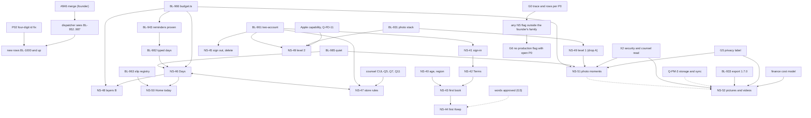

# 23. Dependency map and plan: workstreams, order, gates and the founder queue

Status: CURRENT, 20 Nov 2026. Owner: `product` (written by an interactive session for the product agent; Karma reads, the founder decides).
Replaces (named, parts only, none edited here): `docs/ROADMAP.md` (already marked Superseded), the order table of `docs/roadmap/ROADMAP-2026-12-to-2027-05.md`, section 2 and the rank order of `docs/roadmap/next/20-final-stack-rank-and-sizing-19nov.md`, sections 4 and 5 of `13-engineering-plan.md`, sections 3 to 7 of `docs/engineering/plans/locked-pack-plan.md` (Karma's input to PR #847), the Build 12 and 28 Oct parts of `docs/release/FOUNDER_QUEUE.md`, and the 3 Oct "Critical path to submission" in `docs/BACKLOG.md`. Section 8 lists each part for the consolidation pass; until it runs those parts are stale, not deleted.
Related, not duplicated: architecture and the per-row build order for NS-46 to NS-52 are in `24-engineering-handoff.md` (section 4 build sequence, section 3 conflicts C-1 to C-9); the task-level engineering plan is PR #847's `17-engineering-project-plan.md` (open, not on this branch; I read only its file list). This file holds what neither does: one table across all workstreams, the cross-workstream graph, the gate calendar, the merged founder queue, risks and harness fit.
Load when: planning, sequencing or founder queue.

Docs only. Nothing here is built, no decision is recorded, no date is set. This file cites ids and files; it does not copy requirement text. Where it and a card differ, the card wins. Every fact I could not check is marked UNVERIFIED.

## 0. How this was checked

| Fact | Command or file | Time (UTC) |
|---|---|---|
| Open pull requests: 178 | `gh api 'repos/thesaurabhpareek/earlyletters/pulls?state=open&per_page=100' --paginate` (REST). `gh pr list` failed with HTTP 403 (GraphQL is not available from this session) | Fri 20 Nov 2026, 17:08 |
| State of 43 named PRs | `gh api repos/thesaurabhpareek/earlyletters/pulls/<n>` | 17:10 |
| `develop` head `51aa84b2e` (16:45 UTC) and what merged after the pack branch's merge-base `4f89d659b` | `git fetch origin develop`, `git log 4f89d659b..origin/develop` | about 17:20 |
| Rows on `develop` versus this branch | `git show origin/develop:docs/BACKLOG.md` against `docs/BACKLOG.md` | 17:20 |
| Counts of P0 rows | `python3 -I docs/product/prd/tools/review/p0.py . --json` (850 rows) | 17:15 |
| Repository variable `AGENTS_ENABLED`, workflow runs | `gh api .../actions/variables/...` returned 403 ("not permitted through this proxy") | UNVERIFIED |

Two traps in the sources, found while checking:
- The backlog rows BL-952 to BL-987 are on `docs/prd-lock-v1-20nov` (#846, a draft, head `450bcb4a9`) and not on `develop`. BL-988 to BL-999 are on this branch only, not on #846's head (`git show 450bcb4a9:docs/BACKLOG.md`). The dispatcher reads `develop`, so it cannot hand out any of them today. Several of those rows have already merged work (see section 1), so their `Status:` lines on this branch are behind the code.
- `docs/agents/BOARD.md` has no 20 Nov claim rows (its newest rows are from 10 Nov and earlier; UNVERIFIED that it is unused). Claims for the 20 Nov waves are in the board row of #855 (merged) and PR bodies, which I did not read.

## 1. Workstreams

Columns. Owner: the agent handle in `agents/roster.json` that takes the row (the roster maps backlog Owner names: `mobile engineer`, `export owner` and `reminders owner` all go to `mobile`; `platform` to `ops`; `sync owner` and `family owner` to `sync`; `security engineer` and `auth owner` to `security`). Drop: A, B, C from card 21 ("Release line and cut"); `-` where card 21 sets none. Size is an estimate in the harness meaning (13-engineering-plan section 1). Status is as of Fri 20 Nov 2026, 17:10 UTC, from `gh` and `develop`; "row status" means the line in this branch's `docs/BACKLOG.md`.

### 1a. Engineering platform prerequisites

| Id | Workstream | Owner | Drop | Gate | Depends on | Size | Status |
|---|---|---|---|---|---|---|---|
| P01 | Merge #846 (the locked pack and rows BL-952 to BL-987) | founder (agents never merge) | all | none | council round 2 done | one click | Draft, open, mergeable state unknown. Until it merges `develop` has no BL-952 to BL-987 |
| P02 | Dispatcher reads BL ids of 3 or 4 digits | none yet: propose a row (section 6.3). Path `scripts/agents/**` is founder-owned (`.github/CODEOWNERS`) | all | none | none | S | No row, no PR found (no open PR title or branch mentions it) |
| P03 | BL-966 one notification budget (`budget.ts`) | `mobile` (Owner `reminders owner`) | B (prereq) | none | none; reworks draft #758 | M | Row ready. No `budget.ts` on `develop` (`git ls-tree`). #758 open draft since 10 Nov |
| P04 | BL-943 reminders proven on a phone | `mobile` | B (prereq) | G4 device run with a time-zone change | BL-966 (BL-967 merged, #904) | M | Row says blocked on BL-966 and BL-967; the second is now done, so only BL-966 holds it |
| P05 | BL-985 Quiet this book has a home | `mobile` | B (prereq) | G4 | none | S | Row ready (the control in Me). The planner now reads a quiet book: #901 and #902 merged (titles cite NS-32-R14, NS-13-R12, NS-23-R8). Row text still says there is no reader. UNVERIFIED whether the Me control exists |
| P06 | BL-963 Home slips: one registry, one fixed order | `mobile` | B (prereq) | G4 | none; reconcile draft #721 | S | Row ready. No registry found on `develop` by file name (UNVERIFIED by code read) |
| P07 | BL-961 second account never sees the first's book (`[X4-R1]`) | `mobile` | all that touch a book | G4 two-account device row | none | M | Part 1 of 3 merged (#869). #871 and #879 open, not drafts |
| P08 | BL-982 typed days in reminders (NS-18) | `mobile` (`reminders owner`) | B (prereq) | none | BL-966, BL-943 | S | Row blocked |
| P09 | BL-537 back-off after unopened reminders; the NS-13 anchor | `mobile` | C (prereq in card 21) | G4 | BL-943 | M | Row says deferred to 1.1. Card 21 drop C needs the anchor. Conflict, see section 5 |
| P10 | BL-964 trace sees NS ids (gate G0) | `qa` | - | G0 | none | S | Report mode merged (#878). The ratchet that fails a missing P0 test: UNVERIFIED. #819 closed unmerged |
| P11 | BL-965 words packet; BL-925 let-it-go line | `content` | - | G3 founder words | none | M, S | #870 and #866 open, labelled `needs:founder` |
| P12 | Done on `develop` since the pack branch was cut | `mobile`, `qa`, `ops` | - | - | - | - | BL-958 (#896), BL-962 (#868), BL-967 (#904), BL-959 (#865), BL-975 (#897, #898, #906), BL-927 (#867, #877), BL-964 report mode (#878). BL-928 in part (#892, #893). Their row statuses on this branch are stale |

### 1b. First-run cards NS-38 to NS-45 (card 19)

Card 19 sets no drop. The path is one chain, so I treat it as one release unit for gates G10 to G17 (groups in `BACKLOG-GAPS.md`). No row exists for any of them except the requirement row BL-994 (in progress, "queued behind the agent limit"). P0 rows: 96, of which 94 have no backlog row (`p0.py`).

| Id | Card | Owner | Gate | Depends on | Size | Status |
|---|---|---|---|---|---|---|
| F38 | NS-38 App Store page and install (G10 part) | `content` (listing), `ops` | G2 counsel Q24; G5 label | BL-340 (blocked on a preview build), NS-33 walk | M | no row |
| F39 | NS-39 first launch (G11) | `mobile` | G4 | BL-965, BL-958 (merged) | M | no row |
| F40 | NS-40 age and region (G12) | `mobile`; `regulatory-affairs` reads (no backlog owner name) | founder O-2, O-4; counsel | D-131 path; File 28 and BL-553 before any sign-up outside the family | M | no row |
| F41 | NS-41 sign-in (G13) | `mobile`, `security` | O-5, O-6, O-7, O-20 | BL-961, BL-053 (needs the founder) | L | no row |
| F42 | NS-42 Terms and sensitive data (G14) | `mobile`, `data-architect`, `privacy` | CG3, CG4, counsel Q-D, Q20, Q41, Q44 | BL-577, BL-579 (both deferred), F41 | M | no row |
| F43 | NS-43 the first book (G15) | `mobile` | O-14 | F40, F42; migration `20261109000000` applied (a founder step, UNVERIFIED) | M | no row |
| F44 | NS-44 the first Keep (G16) | `mobile` | G4 | F43, BL-965 | M | no row |
| F45 | NS-45 sign out and delete (G17) | `mobile`, `sync` | O-15 to O-18 | BL-961, F41 | L | no row |

### 1c. Days, cultural background, catalogue, pictures, Home today (card 21)

P0 rows by drop (from the card 21 table, intersected with `p0.py`): NS-46 22 (B 19, B+C 2, C 1); NS-47 27 (B 26, C 1); NS-48 13 (A 6, B 3, C 4); NS-49 21 (A 3, C 18); NS-50 4 (B 4). Total 87: A 9, B 52, B+C 2, C 24. None has a backlog row (86 gap, 1 cite: NS-46-R25 cites BL-985). Groups G18 to G21.

| Id | Workstream | Owner | Drop | Gate | Depends on | Size | Status |
|---|---|---|---|---|---|---|---|
| D01 | NS-46 Days we mark: the library, Days page, planner source | `mobile`, `content` | B (C part: R14, R20) | G1 (L4 store), G2 counsel on tables, G3, G6 flag `EXPO_PUBLIC_DAYS` | P03, P04, P08, P05, P06, P07; NS-47 (one release unit) | L | no row; not built |
| D02 | NS-47 Cultural background: store rules (B), ask slip and tradition browse (C) | `privacy`, `mobile` | B store rules; C the rest | G1, G2 CUL-Q5 to Q7, Q11; G4 J-CUL-01 | D01, P07, P05, BL-975 (merged) | L | no row; not built |
| D03 | NS-48 Notification catalogue: phase 1 words (A), layers after | `content`, `mobile` | A phase 1; B R8, R9, R19, R21, R26; C recency and last-letter | G3 words; G4 NTC-T24 one week of reminders | A: none. B: P03, P05, P08. C: P09, NS-06 flag | M | no row; the built 8 are the base |
| D04 | NS-49 Picture-first: level 1 first-class start (A), level 2 (C) | `mobile`, `privacy`, `security` | A level 1; C level 2 | A: NS-01 on `testflight`, A-S01 AX5 test. C: entitlement, Q-FD-11, weak-link run on iOS 17.0, 17.1, 17.2, 26, G2 | A: BL-931 stack. C: P07, Apple capability (founder) | M (A), L (C) | no row. Level 1 sits on the photo stack in 1d |
| D05 | NS-50 Home today (rank 2b) | `mobile`, `design-systems` | B | G4 | P06, P05, D01 | S | no row |
| D06 | FR-DAY, FR-CUL, FR-NTC, FR-PHS, FR-OPP gap rows (7 + 15 + 9 + 23 + 4 = 58 gap rows, counted inside G18 to G21) | as D01 to D05 | as card | as card | as card | in D01 to D05 | folded into G18 to G21 |

### 1d. Pictures, Find and the locked-card residue

| Id | Workstream | Owner | Drop | Gate | Depends on | Size | Status |
|---|---|---|---|---|---|---|---|
| L01 | NS-01 photo with a letter: BL-931 | `mobile` | - | G1, G2 label line, G6 (flags off in store profiles: BL-958 merged) | ADR 0028 accepted (#797 and #831 merged) | L | Slice 2 (#834), 2b (#841), 2c (#842) merged. #835 to #840 open, not drafts. #833 closed unmerged. Row says in progress (Karma) |
| L02 | NS-02 Find: BL-952, eight PRs | `mobile` | - | G4 device row S1-205 | NS-36 | L | 1 to 3 of 8 merged (#881, #882, #883). 4 to 7 open (#884, #885, #894, #895). 8 of 8 not seen |
| L03 | NS-36, NS-37, export 1.7.0: BL-933 | `mobile` (`export owner`), `data-architect` | - | G1 | BL-868 (ready), BL-931 | M | blocked |
| L04 | Locked-card residue (cards 01 to 37; G01 to G09, 139 rows) | `mobile`, `qa`, `content` | - | per card | rows named in `BACKLOG-GAPS.md` section 5 | L in total | no rows; G01 is only `Satisfies:` edits |
| L05 | Keeping: BL-926, BL-977 (NS-09), BL-978 (NS-10), BL-976 (NS-08) | `mobile`, `sync` | - | G3 (BL-925), G4 two phones | BL-925 words | S, S, M, M | BL-923 and BL-924 done (#832). BL-976 pieces merged (#874, #875). Flip is a founder decision |
| L06 | Reading and capture: BL-937, BL-984, BL-939, BL-941, BL-947, BL-942 | `mobile` | - | G4 | BL-928 remainder, BL-931, BL-952 | S to M each | #843 (open) removes the founder hold from 13 rows; it changes statuses in `docs/BACKLOG.md`, so re-read after it merges |

### 1e. Pictures and videos from the library (file 26, card 27)

Card 27 (`27-photo-moments-and-media.md`, CURRENT, 20 Nov) holds NS-51 (42 rows) and NS-52 (44 rows). Counting table rows marked P0: NS-51 27, NS-52 26, total 53, all drop C ("C, spike first"). `p0.py` reads cards 00 to 21 only, so these 53 are not in the 850 and have no backlog row (UNVERIFIED by a script run; I counted rows in the card). Prerequisites are the card's section 22 lines; I cite them and do not restate them. Ids M01 to M03 and sizes are mine, PROPOSED.

| Id | Workstream | Owner | Drop | Gate | Depends on | Size | Status |
|---|---|---|---|---|---|---|---|
| M01 | NS-51 Photo moments (level 3): spike NS-51-R36 first, then module, moment index, neutral nudge | `mobile` with `security`, `privacy` | C | X2 and `security` read; G2 counsel on usage string, guideline 5.1.1, label, children's pictures; G5; Q-PM-1, 7, 8, 9 | card 27 section 22: NS-01 on `testflight`, NS-49 level 1 shipped (D04), NS-32 budget (P03) and quiet reader (P05), P07, NS-52 (the sheet hands pictures to it) | L (spike S) | no row; card written; reverses the "level 3 closed" lines of NS-49 and 20 section 6.1 (card 27 "Changes to locked cards") |
| M02 | NS-52 Pictures and videos with a letter. Variant A (phone only) is the default; variant B (hosted) only after X2 and a money decision | `mobile`, `data-architect`, `sync` (B), `privacy`; `finance` estimate for B | C | G2 label (A), Q45, Q48, Q54, X2 (B); G5; spike (transcode, metadata, iCloud); Q-PM-2, 3, 4, 7, 10 | card 27 section 22: NS-01 on `testflight`, NS-11 and the export minor, NS-36 erase registry, P07, NS-49 picture sources, L03; the ruling on #835 before it merges (`24` step 0.4, Q-E12: local migration for several pictures and video); `24` step 5.1 then 5.3 | L, a stack | no row; card written |
| M03 | Function addenda ("Addendum 20 Nov 2026") in the function files | the function agents; `product` integrates | - | - | card 27 | S each | present as uncommitted edits in the working tree in 23 function files at 17:40 UTC (`git status`); not reviewed by me |

### 1f. Function-review rows (371 P0 FR rows, 299 with no cite, groups in `BACKLOG-GAPS.md` section 5)

| Function files | Gap rows | Group | Owner | Gate or dependency | Size |
|---|---|---|---|---|---|
| ai-and-speech | 37 | G22 (12), G23 (8), G24 (8), G25 (9) | `speech` (G22 to G24), `security` (G25; `ai-eng-lead` reviews) | BL-043 needs the founder (G23); G05 for G24 | S, M, M, S |
| back-office, finance, operations | 24 | G26 | `ops` | BL-237; BL-551 to BL-553 are bullets, not headings | M |
| lifecycle, reliability | 27 | G27 | `mobile`, `sync` | P07, BL-566, BL-978 | L |
| risk-security | 13 | G28 | `security` | P07, BL-962 (merged) | M |
| data-and-measurement | 9 | G29 | `analytics` | BL-975 (merged) | S |
| privacy | 15 | G30 | `privacy` | BL-960 (#873 open) | M |
| legal, print-and-fulfilment | 14 | G31 | `legal` | BL-973 blocked; counsel answers | M |
| marketing | 19 | G32 | `content` (no `marketing` owner name) | BL-965, BL-958 | M |
| support, policy | 19 | G33 | `content` (no `support` owner name) | BL-364 (web lane), BL-444 | M |
| research-validation | 10 | G34 | `user-research` (roster `daily_runs` 0, so it never auto-runs) | BL-981 | S |
| messaging-and-entry-points | 9 | G35 | `content`, `mobile` | BL-364, BL-510, BL-053 | M |
| languages-and-localisation | 17 (with NS-17: 26) | G05 | `speech`, `content`, `qa` | native reviewer; BL-965 | L |
| compliance | 15 (with NS-38: 23) | G10 | `ops`, `legal` | founder store steps | M |
| quality | 13 (with NS-34: 16) | G08 | `qa` | BL-929, BL-948, BL-964 | M |

All 14 function groups are "no row": status for each is "not started as a row". Some of the work may exist in code or tests (the `[qa] P-8` PRs #888 to #890 cite NS rows in existing tests); UNVERIFIED which rows they cover.

## 2. Dependency graph

Text form, so it can be diffed. Solid arrows are "must be done before". Dotted arrows are "should be decided before, default holds".

### 2.1 Critical path to Build 13

Card 13 and card 21 do not name Build 13's contents; they ask for no build numbers in cards. The only list is a review proposal, `tools/review/r3-cfo-cto-quality.md` line 58: Build 13 has NS-09, NS-10, NS-32, NS-13, NS-33 on, and NS-01, NS-02, NS-37 and the export 1.7.0 dark. That is a proposal, not a ruling; the cut is Q-FD-7's neighbour and the founder's. Using it:

| Step | Chain | Why it is the longest |
|---|---|---|
| 1 | P01 (#846) so the dispatcher sees the rows | all agent assignments of BL-952 to BL-987 wait on it |
| 2 | BL-966 (M), then BL-943 (M), then the founder's device run with a time-zone change | two M rows in series, then a human step that only the founder's phone and time can do |
| 3 | BL-925 words approved (#866), then BL-926, then BL-977 | one founder word approval gates two S rows |
| 4 | BL-961 parts 2 and 3 (#871, #879) review and merge, then the sign-out journey row on a device | the second-account defect gates every card that shows a book |
| 5 | BL-978 (M) and the two-phone row | needs a second phone (Q-FD-33) |
| 6 | Photo stack #835 to #840 and Find #884 to #895 merged with flags off, plus BL-933 | dark in the build; not on the critical path if left off, which the proposal does |
| 7 | ADR 0028 Q4 answer (default no) by the Build 13 freeze | `docs/adr/0028-photo-seal-find-on-device-data.md` line 252 |

Critical path: 1, 2, then the device run. Items 3 to 5 run in parallel and are shorter in agent work but each ends in a founder act. UNVERIFIED: what the Build 12 state is today. `docs/roadmap/ROADMAP-2026-12-to-2027-05.md` (draft, 19 Nov) says "Now, late Nov: First store release (Build 12)".

### 2.2 Critical path to 1.0

"1.0" is read as card 21 reads it: drop B ships "1.0 only if every gate closes before freeze, otherwise 1.1"; drop C after 1.0 is approved. Whether Build 12 is 1.0.0 is UNVERIFIED (`docs/release/1.0.0.md` section 0 says the lane "has not started" and re-plans after the alpha; D-157 and D-160 say the first store release has sign-in on).

Longest chain by count: P01, P03, P04, P08, D01 with D02 (one unit), D03 phase B, D05. In series that is four M or S engineering rows, then a build in which D01 and D02 land together, then NS-50. In parallel and longer in wall time: P07, then F41 to F45 (the first-run stack, one L and one L), the counsel reads (CUL-Q5 to Q7, Q11 and the consent line), a recorded reviewer per tradition (drop C), the October review owner (Q-FD-10), and G4's device walks (J-CUL-01, NTC-T24). The pack's review found no one cut; I cannot size wall time. What I can say: drop B depends on 4 unbuilt engineering rows and 3 external gates, so promising it for 1.0 before BL-966 is merged is not supported.

## 3. Gate calendar

No date below is invented. A gate opens "after" an event. Gate meanings are in `14-test-plan.md` line 96 (G0 to G6) and CG0 to CG6 (compliance's, K7).

| Gate | Opens after | Evidence the record needs | Date |
|---|---|---|---|
| G0 trace and a row per P0 | P01, P02, and the 588 gap rows each named by a row (or a `Satisfies:` edit, G01) | `scripts/trace.mjs` ratchet on; `p0.py --gaps` shows 0 | none; "after P02" for new ids |
| G1 on-device data rules, export schema | BL-933 (blocked on BL-868 and BL-931). ADR 0028 (#797) is merged | export 1.7.0 merged | none |
| G2 counsel reads | founder sends packets (#872; Q-numbers in section 4); answers from counsel | dated answers or a written founder risk acceptance | none; counsel time is not known |
| G3 words | BL-965 packet #870 and BL-925 #866 reviewed | founder's yes per key set | none |
| G4 device rows | the build candidate exists; the founder's phone time | run sheet rows (BL-929, BL-948) | none |
| G5 label and claims | G1 done; BL-975 guard merged | label file matches the binary | none |
| G6 no production flag with an open P0 | all of the above per card | flag table | none |

Dates that exist in the docs (none is a commitment):

| Date | Source | Use |
|---|---|---|
| Dec 2026 to May 2027, month windows | `docs/roadmap/ROADMAP-2026-12-to-2027-05.md` (draft, 19 Nov, "every window provisional until the founder sets it") | order of value; Dec "safe and true", Jan "photo and Find", Feb to Mar "coming back to it", Apr to May "reading back and the keepsake" |
| Sun 9 May 2027 Mother's Day; Sun 20 Jun 2027 Father's Day | same file, citing FUTURE-REBASELINE (not read by me; UNVERIFIED) | drop B days content only helps if it is in a build before each date |
| 1 Jan 2027 California age assurance | same file; "CCO skill, secondary source; counsel must confirm" (UNVERIFIED) | NS-40 Declared Age Range timing, card 19 O-2 |

Spike timing from the README triggers: hands-free spike on the Monday after Build 13 is cut; five-parent studies within one week of the build with the feature on (`README.md` lines 85 and 166 to 170).

## 4. Founder queue, ordered by what each item unblocks

Defaults hold for design and build only, never for public text, a counsel answer or a store submission (card 21 header). "If unanswered" says what the team does. Ids point to the card or file that holds the text; I do not copy it. Hands-on time is the founder's own, not measured unless the source says so.

### 4.1 Unblocks the whole team (do first)

| # | Ask | Type | Unblocks | Default if unanswered | Source |
|---|---|---|---|---|---|
| 1 | Merge #846 | merge | dispatcher sees BL-952 to BL-987; every row named below | rows stay invisible; interactive sessions keep working from the branch | P01 |
| 2 | Approve the engineering row for four-digit ids (P02); it is a founder-owned path | decision, then a merge | all 35 new-row groups; G0 | no id above BL-999; use `Satisfies:` edits and Tier A ids (section 6.3) | `BACKLOG-GAPS.md` section 4 |
| 3 | Q-FD-7 which drop ships when | decision | planning of D01 to D05; what "1.0" holds | A next build; B only if its gates close before the 1.0 freeze; C after approval | card 21, 22 section 7 |
| 4 | Confirm or amend the Build 13 contents (the r3 line 58 proposal) | decision | who may start what; which flags stay dark | proposal stands | section 2.1 |

### 4.2 Unblocks Build 13 and the device rows

| # | Ask | Type | Unblocks | Default if unanswered | Source |
|---|---|---|---|---|---|
| 5 | Approve words: #866 (BL-925) and #870 (BL-965) | decision (G3) | BL-926, BL-977; every PROPOSED key's flag | PROPOSED keys ship behind flags off | P11 |
| 6 | Device time: SE 3 baseline (BL-929), two-phone row (BL-978), NS-13 time-zone run (BL-943), sign-out row (BL-961) | hands-on, own phone plus a second | G4 for the Build 13 set | rows stay unrun; flags stay off | Q-FD-33 (borrow phones; waive only what is missing) |
| 7 | ADR 0028 Q4: does the owner backup carry pictures | decision (with `privacy`) | Build 13 freeze | No in Build 13 | ADR 0028 line 252 |
| 8 | Merge #873 (data inventory, legal text, D-125) and #799 (Find row) | merge | BL-960; G5 | inventory stays behind the code | BL-960 |
| 9 | Send the counsel packet #872 yourself; merge it | counsel, merge | G2 for the locked pack | no counsel read; no flag leaves the founder's family | BL-949; the F6 precedent in `FOUNDER_QUEUE.md` |
| 10 | Open Build 12 items (F-list of 10 Nov). State today UNVERIFIED: the stack PRs (#700, #701, #722, #724, #728, #738, #764), #761, #763, #768 are merged; #760, #767, #769 are open drafts | merge, decisions | Build 12 record | per the file's decision-day fallback rule | `FOUNDER_QUEUE.md` Build 12 section |

### 4.3 Unblocks sign-in for people outside the family (card 19)

| # | Ask | Type | Unblocks | Default if unanswered | Source |
|---|---|---|---|---|---|
| 11 | O-2 record the Texas exposure as a risk acceptance; Declared Age Range timing | decision, DECISIONS entry | NS-40, public sign-up | module in a 1.0.x before 1 Jan 2027 (UNVERIFIED date); exposure recorded | card 19 O-2 |
| 12 | O-4 apply File 28; BL-553 country hook | hands-on (account) | public sign-up | check stays off; DECISIONS line says so | card 19 O-4 |
| 13 | O-3 confirm step after No (BL-561) | decision, counsel | NS-40 | not built | O-3 |
| 14 | O-5 ADR 0031 second account on one phone | decision | NS-41, NS-45 | hide and lock the other account's book | O-5 |
| 15 | O-6 dashboard settings for the email code; O-7 bot check on email send (a new subprocessor) | hands-on, decision | public TestFlight link | settings as proposed; Turnstile before the link | O-6, O-7 |
| 16 | O-20 register the Apple relay domain; O-11 publish the versioned legal pages | Apple account, hands-on | public sign-in; NS-42 | not done; links open the recorded version once published | O-20, O-11 |
| 17 | O-14, O-15 to O-18 (siblings, delete elsewhere, update states, deletion email, revocation) | decisions, defaults are Karma's technical ones | NS-43, NS-45 | defaults as card 19 | card 19 table |
| 18 | BL-053 Apple, Supabase Auth, Resend, DNS setup; BL-043 spike | hands-on | sign-in in any non-founder build | needs-founder as the row says | BL-053, BL-043 |

### 4.4 Unblocks days, background, reminders (card 21)

| # | Ask | Type | Unblocks | Default if unanswered | Source |
|---|---|---|---|---|---|
| 19 | Q-FD-1, Q-FD-2, Q-FD-3, Q-FD-9, Q-FD-10, Q-FD-16, Q-FD-17 (what days, who reviews, when the ask shows, countries) | decisions | D01, D02 content; drop C | the defaults in card 21 | 22 section 7 |
| 20 | Q-FD-5, Q-FD-12, Q-FD-13, Q-FD-14, Q-FD-15, Q-FD-18, Q-FD-29, Q-FD-30 (what is kept on the phone, lock screen, pause) | decisions with `privacy` | D02, G1, G5 | defaults; no public text | same |
| 21 | Q-FD-19, Q-FD-20, Q-FD-21, Q-FD-22, Q-FD-23, Q-FD-24, Q-FD-25, Q-FD-26, Q-FD-27, Q-FD-28, Q-FD-34, Q-NTC-5, 8, 9 (reminder time, first ask, rank, words, claims) | decisions | D01, D03, D05; the listing | defaults; `content` words them, founder approves words (G3) | same |
| 22 | Q-FD-4, Q-PHS-1 to 7, Q-FD-11, Q-FD-31, Q-FD-32 (level 2, iOS floor, Apple capability on the App ID) | decision, Apple account | D04 level 2 | level 2 after NS-01 on `testflight`; flag off until the capability is known | 22 section 7. Note Q-FD-4's "level 3 never in 1.x" is reversed by file 26 (4.5) |
| 23 | Counsel (through you): CUL-Q5, Q6, Q7, Q11, Q-DAY-6, Q-DAY-11, FR-DAY-23, the consent line, DPLA 3.3.3(H), guideline 5.1.3, Q43, Q45, Q48, Q54, K6 age rating | counsel | G2 for D01 to D04 | flags stay off; never defaulted | 22 section 7 |
| 24 | Device walks: J-CUL-01, one week of reminders (NTC-T24), iOS 17.0 to 26 launch run | hands-on | G4 for D01 to D04 | unrun; flags off | card 21, Q-FD-33 |

### 4.5 Unblocks pictures and videos from the library (file 26, card 27)

Defaults are the ones card 27 states (section "Founder questions Q-PM-1 to Q-PM-12"). They hold for design and build; the card says never for public text, a counsel answer or a submission.

| # | Ask | Type | Unblocks | Default if unanswered | Source |
|---|---|---|---|---|---|
| 25 | Q-PM-7 release drop | decision | planning of M01, M02 | drop C, spike first | card 27 |
| 26 | Q-PM-1 limited library or full read access | decision, with `privacy`, `security` | M01 | the app works with whatever Apple's sheet gives; never asks again after limited or denied | card 27 |
| 27 | Q-PM-3 do pictures and videos sync to our servers (the largest cost, label and counsel item) | decision | M02 variant, G5, finance | variant A, phone only | card 27 |
| 28 | Q-PM-2 video limits and what Plus holds (price is yours) | decision | M02, finance | 6 pictures, 2 videos, 60 seconds, 100 MB stored (ASSUMED in the card); all free | card 27 |
| 29 | Q-PM-4 transcribe a video's sound | decision | M02, `speech` | no | card 27 |
| 30 | Q-PM-5 place names in moments; Q-PM-6 image analysis beyond metadata | decisions | M01 | place off; no analysis | card 27 |
| 31 | Q-PM-8 background refresh for nudges; Q-PM-9 lock-screen words naming pictures | decisions | M01 nudge | no background refresh; lock-screen words never mention pictures | card 27 |
| 32 | Q-PM-10 QR on a printed page to a video; Q-PM-11 trim or pick a still; Q-PM-12 pause keeps the index | decisions | M02, print | not built; no trim; pause empties the index | card 27 |
| 33 | Counsel and `security` read for a child's picture or video leaving the phone (X2, Q54); the usage string and guideline 5.1.1 for NS-51 | counsel | M02 variant B; M01 outside the family | nothing leaves the phone; flag off | file 26 section 1, card 27 |
| 34 | Founder note: file 26 reverses three earlier rulings. Q-FD-4's "level 3 never in 1.x" in 22 section 7 no longer holds | confirm | consistency of 21, 22, 20 | card 27 stands as the reversal record (RV-18 onward) | card 27 "Changes to locked cards" |

### 4.6 Gated, no window

| # | Ask | Unblocks | Default | Source |
|---|---|---|---|---|
| 35 | NS-08 backup flip, six conditions (BL-976) | G03 rows | no flip | BL-976 |
| 36 | Counsel for sealed letters, someone else speaks, other parent (Q45, Q46, Q48, Q49, Q51, Q53, Q54, Q32) | NS-06 B, NS-16, NS-25, BL-979 | rows stay blocked | BL rows |
| 37 | NS-03 pilot: counsel reads the consent texts before any parent is contacted | pilot starts | no contact | BL-935 |
| 38 | Co-parent decisions 1 to 9 of #767 | none for Build 13 | recommended answers in #767 | `FOUNDER_QUEUE.md` |

## 5. Risks, and what would make the plan wrong

| Risk | Evidence | What it breaks | Mitigation or signal |
|---|---|---|---|
| Review capacity, not building, sets the pace | 178 open PRs; 101 drafts; 33 non-draft with an `agent:` label; 12 `needs:founder` (REST, 17:08 UTC). 13-engineering-plan section 1 says review sets the pace | every date | if open non-draft PRs keep growing while merges per day stay flat, the order here is right and the speed is wrong |
| The dispatcher cannot see the pack's rows | `develop` has no BL-952 to BL-987; id regexes are 3 digits (`lib.mjs:52,74,141`) | agent assignment | P01 and P02 |
| Row statuses on this branch are behind the code | P12; BL-961 part merged; BL-952 1 to 3 merged | double work, wrong "ready" list | `product` status pass after #846 and #843 land |
| Drop B is promised for 1.0 on four unbuilt rows and three external gates | card 21; `budget.ts` absent | 1.0 contents | Q-FD-7 default keeps B conditional |
| Drop C needs the NS-13 anchor but BL-537 is deferred to 1.1 | BL-537 row; card 21 drop C | C order | decide in Q-FD-7 or move BL-537 |
| File 26 reverses three earlier rulings (level 3 closed, no video, one picture) | file 26 section 1 | NS-49, NS-01, OPP-16 text; 21 and 22 still say level 3 is closed | consolidation pass (section 8); RV-18 onward in `GAP-LOG.md` |
| NS-51 and NS-52 (53 P0 rows, outside `p0.py`) can contradict the privacy rules (no analysis of the library off the phone, no captions) | file 26 section 1 | label, counsel | spike first; "a feature that cannot meet them is redesigned, not waived" |
| Cost of media storage is unknown | file 26 section 3 (finance cost model not written) | Q-PM-2 and Q-PM-3 | do not set a plan price before the model |
| Counsel time is unknown | no dated counsel answer in the repo | G2 for every card | flags stay off; count answers, not dates |
| Mobile is the bottleneck | `mobile` takes the owner names `mobile engineer`, `export owner`, `reminders owner`; 18 open `agent:mobile` PRs against `wip_limit` 3 | all of 1a to 1e | split owner names in the roster (a proposal, section 6.4) |
| Two plans each claim precedence on engineering order | `locked-pack-plan.md` line 3 says #847's `17-` is the plan of record on engineering order; `13-engineering-plan.md` section 3H says 23 and 24 win | duplicated or conflicting order | Karma rules one precedence line (founder item for Karma, not for the founder) |
| Everyone's work runs as founder-account sessions | `HARNESS.md` status box (28 Oct): no autonomous lane had run; `AGENTS_ENABLED` unreadable now (403) | caps below are theory until the lane is on | UNVERIFIED |
| A wrong holiday date, a faith item shown on a lock screen | card 21 promises section 5 of file 22 | trust | DL-3, DL-4, DL-8; device walk J-CUL-01 |

What would make this plan wrong:
- Build 13 is not what the r3 proposal says. Then 2.1 changes; sections 1 and 2 do not.
- #846's text changes after review. Row ids in 1a to 1c would need a re-read.
- The founder rules for the whole of NS-49 level 3 in 1.0. Then M01 leaves drop C and the spike moves ahead of D04 level 2.
- BL-966's rework of #758 is larger than M (the draft is 10 days old and `planner.ts` changed in #901).

## 6. Harness fit

### 6.1 Which agent takes which new rows

| Rows | Agent | Notes |
|---|---|---|
| P03, P04, P05, P06, P07, P08, P09, D01, D02 (app side), D03 (rules), D04, D05, F39 to F45, L01 to L06, M01, M02 (app side), G04, G06, G07 | `mobile` | one agent holds three roster owner names. Highest load. Only `mobile` and `sync` run 4 and 2 a day (`daily_runs`) |
| BL-964 ratchet, L04 G08 quality, device sheets | `qa` | |
| Words: BL-925, BL-965, D03 words, G32, G33, G35 | `content` | `content` has two PR slots (`wip_limit` 2) and 10 open PRs |
| G26, G10 platform, store record | `ops` | no steps that need the store account |
| G28, G25, F41 server side | `security` | `security-architect` and `ai-eng-lead` review, they own no backlog name |
| G29 | `analytics` | |
| G30, D02 store rules | `privacy` | |
| G31, BL-949 | `legal` | founder merges legal text (D-125) |
| G22 to G24, G05 | `speech` | |
| G27, F45 server side, M02 sync | `sync` | |
| G34 | `user-research` | `daily_runs` 0; it never auto-runs. Roster change needed |
| NS-40 compliance reads | `regulatory-affairs` | `daily_runs` 0 and no owner name; needs a roster change or `legal` takes it |
| Backlog order, this file, new rows | `product` | the agent has no owner name; interactive sessions do the work |

### 6.2 Caps

- `limits.max_open_agent_prs` is 10 (`agents/roster.json`). `dispatch.mjs:236` counts every open PR with an `agent:<handle>` label (`agentOfPR`). Today that is 77 (33 non-draft). Whether the dispatcher counts drafts is UNVERIFIED (`openPRs` is not read here). Either way the count is above 10, so with the lane on, agents would only review and fix (`dispatch.mjs:271`).
- Per-agent `wip_limit`: `mobile` 3, `content` 2, `qa` 3, `ops` 1; open PRs with each label are 18, 10, 6 and 11. All above their limits.
- `max_runs_per_day_total` is 30 and `max_parallel` is 6.
- Practical reading: the PRs on this repo today come from interactive sessions using the founder's account, not from the Actions lane (`HARNESS.md` status box). The caps decide nothing until `AGENTS_ENABLED` is on (UNVERIFIED now). The honest cap is the founder's review time.
- Recommendation to the founder: before switching the lane on, merge or close the stale drafts (the 9 to 10 Nov docs PRs #729 to #743, #758, #782 to #792, #815, #821 and older) so the cap counts live work. Closing is the founder's act.

### 6.3 The BL-999 limit: options and recommendation

Facts: highest used id BL-999; `lib.mjs:52` (`BL_RE`), `:74` (heading regex) and `:141` (`takenIds`) match exactly three digits; `lib.test.mjs:130` counts three digits; `hardening.mjs:60` and `id-collisions.mjs` already accept four, and `next-id.mjs` prints `BL-1000`. `RESUME.md` says no row above BL-999 until the format is fixed. BL-1000 and up are invisible to the dispatcher, so a row with that id is never handed out.

| Option | What it is | For | Against |
|---|---|---|---|
| A | Tier A ids BL-826 to BL-829 (`BACKLOG-GAPS.md` section 4: free in all three checks; I rechecked `develop`, this branch, open PR titles and remote branch names: no hit) | works today; four ids | 4 rows for 588 P0 rows: unreviewable at 109 to 196 rows each |
| B | Tier B block BL-677 to BL-711 (35 free holes) | one id per group G01 to G35 | inside ranges that old commit messages allocated; collision risk; needs Karma to confirm one block |
| C | Fix the dispatcher: make the three regexes `\d{3,4}`, the test, and add a four-digit test | permanent; small | `scripts/agents/**` is founder-owned; agents cannot edit it; a one-time interactive session or the founder does it |
| D | Edit `Satisfies:` lines on existing rows | no ids | G01 and parts of G04, G07 only; not new work |

Recommendation: C, as one small PR (S), using BL-826 as its own id. Until it merges: D for G01, A for BL-826 only, and no new groups. After it merges, allocate BL-1000 upward, one row per group, in the order of section 2. Do not use B.

### 6.4 What must be proposed as an engineering row (I cannot add it to `BACKLOG.md`)

1. BL-826 (proposed): dispatcher reads three or four digit BL ids (`lib.mjs:52`, `:74`, `:141`, `lib.test.mjs:130`). Owner: a founder session; not an agent-takeable path.
2. A status correction row for BL-958, BL-961, BL-962, BL-964, BL-967, BL-975, BL-927, BL-928 against the merges in P12 (`product` can do it once #846 merges; it is a backlog edit).
3. A CI step that runs `p0.py` and fails on a P0 row with no row (G0). `qa` cannot edit `.github/workflows/`, so it goes in a proposal under `docs/ops/proposed/` (`BACKLOG-GAPS.md` G08).
4. A roster proposal (not an edit): a second owner name or agent for `mobile`'s three names; a lane for `marketing`, `support` and `regulatory-affairs` rows.
5. New rows for NS-38 to NS-52 and the 35 groups, after item 1, in the order of the graph.

### 6.5 Avoiding duplicate work: overlaps found

| Planned work | Already in the backlog or in an open PR | Action |
|---|---|---|
| P03 `budget.ts` | BL-966; open draft #758 (class registry and shared budget, with Memory Library classes) | rework #758, do not start a second file |
| P06 slip registry | BL-963; draft #721 (Tonight from the book) to reconcile | one PR |
| P07 | BL-961; #871, #879 open; #869 merged | continue those; D01 to D05 do not re-do it |
| P05 | BL-985 and merged #901, #902 | rewrite BL-985's problem text before anyone picks it |
| F41, F42 | BL-577, BL-579 (deferred), BL-053 (founder) | cite, do not copy |
| F45 | BL-237 (done in part) | cite |
| D01 typed days | BL-982 (NS-18) | D01 depends on it; no second typed-days row |
| D04 level 1 | BL-931 stack #835 to #840 and `BL-939` | no new level 1 row |
| L02 | BL-952 #884, #885, #894, #895 | no new Find row |
| M01, M02 | BL-931 (one picture), BL-933 (export), BL-976 (media backup) | extend by `Depends on`, not by copy |
| BL-964 | merged #878; closed #819 | add the ratchet only |
| BL-975, BL-962, BL-958 | merged | do not re-add as G-rows |
| Counsel packet | BL-949 (#872), BL-960 (#873), #799 | NS-51 and NS-52 questions join BL-949's packet, not a new one |
| Words | BL-965 (#870), BL-925 (#866) | NS-46 to NS-52 keys join BL-965's list |
| Status changes | #843 (open) edits `docs/BACKLOG.md` statuses for 13 rows | land #843 before any status pass |
| Engineering order and architecture for NS-46 to NS-52 | `24-engineering-handoff.md` section 4 and 1.x; `locked-pack-plan.md` sections 3 to 5; #847 `17-engineering-project-plan.md` (open, 11:11 UTC) | link by section; do not restate steps; the id-format step is `24` step 0.2 and P02 here |
| Lifecycle rows | #815 (HV2-B38 to B52, harness life cycle) | no overlap found; it adds docs for non-code stages |

## 7. What I could not verify

- The Build 12 state, the Build 13 contents, any founder-set date, and any counsel answer.
- Whether the Actions lane is on; the proxy refused the repository-variable and workflow-run reads.
- Whether `develop` has a Home slip registry or a Me Quiet control (I read file names and merge titles, not code).
- Whether drafts count toward `max_open_agent_prs`.
- Card 27 was read for its section 22 lines, its P0 counts and its question table only; I did not read its 86 rows. The function addenda are uncommitted edits I did not review.
- Any holiday date, Apple rule or law. FUTURE-REBASELINE and the CCO skill were not read.

## 8. Superseded, for the consolidation pass

I edited none of these. Each part below is now covered by this file and should be marked, linked or removed in one pass.

| File | Part now superseded | By |
|---|---|---|
| `docs/ROADMAP.md` | already carries a Superseded banner; the whole 30-day path | section 3 and `docs/roadmap/ROADMAP-2026-12-to-2027-05.md` |
| `docs/roadmap/ROADMAP-2026-12-to-2027-05.md` | the order of value table (draft, provisional) | section 1 order and section 3; keep its dates table, which section 3 cites |
| `docs/roadmap/next/20-final-stack-rank-and-sizing-19nov.md` | section 2 "In flight" (stale since 19 Nov 22:15 UTC), the rank order for waves | sections 1 and 2 |
| `docs/product/prd/13-engineering-plan.md` | section 4 (Order) and section 5 (Dependencies in one picture) | section 2 (graph) and 2.1; sizes in section 3 stay |
| `docs/engineering/plans/locked-pack-plan.md` | sections 3 (phases), 4 (critical paths), 5 (lanes), 6 (gates restated), 7 (risks): they overlap 1 to 3 and 5 here. Its own line 3 defers engineering order to #847 | sections 2, 3 and 6 here; keep 3 (phases) if #847 does not land |
| `docs/product/prd/17-engineering-project-plan.md` (PR #847, open) | not on this branch; precedence on engineering order unresolved (section 5) | Karma to decide whether #847 or `24` section 4 is the one order |
| `docs/product/prd/22-final-holistic-spec.md` | section 4 and 6 release cut and gates (kept as the card's text); section 7 master list stays the one place for Q-FD ids. Q-FD-4 and "level 3 never" is reversed by file 26 | section 4 here points to it by id |
| `docs/product/prd/21-days-cultural-photos-home.md` | "Release line and cut" stays the source of drops; Q-FD-4 default needs the file 26 reversal | section 1c |
| `docs/product/prd/BACKLOG-GAPS.md` | section 5 grouping and section 6 coarse plan are the source of groups; the id options are summarised in 6.3 | section 6.3 |
| `docs/release/FOUNDER_QUEUE.md` | the 28 Oct queue and the Build 12 section: history, stale | section 4 (the Build 12 items are row 10) |
| `docs/FOUNDER_TASKS.md` | FT list (1 of 57 ticked on 30 Oct) | section 4 for anything open |
| `docs/BACKLOG.md` "Critical path to submission" (3 Oct) | all 12 rows: 2 Nov target, superseded by D-101, D-106 | sections 2.1 and 2.2 |
| `docs/agents/BOARD.md` | no 20 Nov claims; stale rows | not replaced; a claim row for this file's follow-up work belongs there |
| `docs/product/prd/26-founder-direction-photos-library-and-media.md` and the pending card 27 | not superseded; they are inputs. Cards 21 and 22 and 20 section 6.1 must say what they now mean | section 1e |

Files I changed: this file (new) and `docs/product/prd/BACKLOG-GAPS.md` (counts refreshed by `p0.py`; E30's "about 70" marked superseded by 588).
