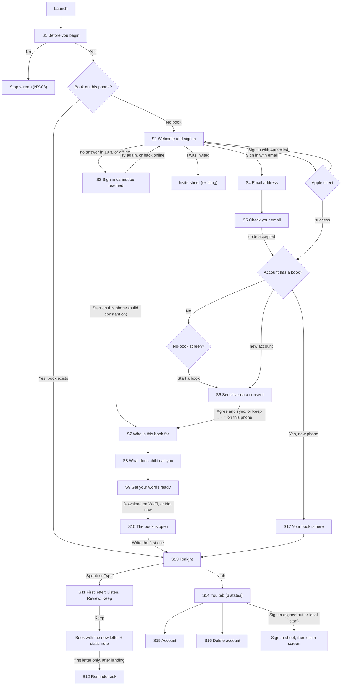

# NX-36: Build 12 screen specs (the design brief engineers build from)

Status: draft, 9 Nov 2026 (UTC). Docs only. Author: `design-systems` (task G-9). Assigns no BL, D or CR id and reserves nothing. Working label NX-36; screens are `NX-36-S<n>` (a working label, `_CONVENTIONS.md` section 1). Companion file: `NX-36-wireframes.html` (static, no external requests, token hex values, light and dark for every screen, AX5 for three).

Readiness: not scored against the 14-point audit; `qa` to score. What keeps it from ready: the founder's six design answers (section 8), word approval and counsel for every string marked NEW (section 4 of each screen), and a device pass for everything marked UNVERIFIED (section 11).

| | |
|---|---|
| Refines | NX-31 revision 3 (364762ca) for the first run; NX-30 (2c6bf5fe) and NX-30a (88e80022) for the bar, Tonight and You; NX-32 for the Build 12 slice of Account; NX-35 (fe545da1) for what motion may ride; the executive council pass 2 gaps 1 to 12 (9 Nov) |
| Reads (code) | `origin/develop` at a0f31520: `(tabs)/index.tsx`, `(tabs)/_layout.tsx`, `settings/index.tsx`, `settings/account.tsx`, `settings/delete-account.tsx`, `onboarding.tsx`, `(auth)/sign-in/{index,email,code,consent}.tsx`, `components/tonight/*`, `components/ui/*`, `packages/design-tokens/src/tokens.ts`, `packages/content/src/{strings.en,features/auth.en,features/account-deletion.en,features/speech.en}.ts`, `packages/analytics/src/catalog.ts`. Open PRs #699, #701, #703 by file list and patch |
| Tag | EVIDENCE for what the code and tokens say; contrast numbers are computed here from token hex values (they equal the comments in `tokens.ts`). HYPOTHESIS for anything about how a parent feels. Anything not read or not measured is marked UNVERIFIED (section 11) |
| Build 12 cut | Founder, 9 Nov, plus the council's rulings (Karma, 9 Nov): account before the book; three tabs (Tonight, Book, You); name optional, date required; local-start fallback as a build-time constant; lock offer at session 3; Delete account in the same build; "From the book" and day-zero Tonight are the one engagement addition. Out of the binary: backup, Photos (tab and any dormant Photos UI), Family tab, search, share, the full motion push |

## 0. Decided before this file (carried in, not reopened)

| Ruling | Source | What it means here |
|---|---|---|
| The third tab is "You". VoiceOver label "You", hint "Settings and account" (a placeholder for `content`), Large Content Viewer title "You". Fallback: if fewer than 4 of 5 parents find Settings in 10 seconds, switch to "Settings" (a one-word change in `copy.tabs.you`). "Profile" is not used: the app has no profile concept | Karma ruling, founder asked the coordinator to decide, 9 Nov | The tab-label question is closed and is not in section 8 |
| Build 12 has three tabs. NX-30's four-tab text and Photos are future | Council pass 2, conflict 1 | Every bar in this file has three items |
| NX-31 governs where NX-30 R17 and NX-31 R22, R26, R27 differ | Council pass 2, conflict 2 | The signed-out and local-start states are NX-31's (S14) |
| Backup copy appears only when backup is actually on. It is off in Build 12. No "kept safe" or other safekeeping claim; use statements of fact (counsel confirms) | Council pass 2, conflicts 3 and 4 | The first-run line is "kept on this phone" |
| One Delete account entry in Build 12 (Settings home, which is the You tab root) | Council pass 2, conflict 8 | S16; NX-32-R19's second entry waits |
| NX-35 M8 ("Your book is kept") is out of Build 12; no new motion tokens | Council pass 2, conflict 10 | S11 has a static first-letter note only |
| No dormant Photos UI in the binary (Apple 2.5.19) | Council pass 2, conflict 17 | The reviewer path (section 7) lists what must be absent |

## 1. How to read a screen spec

Every screen below has the same eight blocks, in this order, so engineers and `qa` find the same thing in the same place:

1. Purpose (one line).
2. Layout, top to bottom, with real component names (`Button`, `ListRow`, `StateScreen`, `Card`, `Sheet`, `TextField`, `Chip`, `BookCover`, `Lamp`, `ExcerptFade`) from `apps/mobile/src/components/ui` and siblings. A component marked NEW does not exist yet.
3. Actions: primary, secondary, where each goes.
4. States: default, loading, error, offline, empty, long text, nameless child, AX5, VoiceOver, Reduce Motion, dark.
5. Copy keys: key, exists or NEW, placeholder words. Every NEW row "needs content and founder approval" (read that into every row); rows marked R are also counsel-registered (they state where something is kept, or what a person agrees to). Placeholders are not final words.
6. Targets and analytics.
7. Truth line: what must be true of the shipped Build 12 for the screen's words to be allowed.
8. Delight within the calm: what is allowed in Build 12 (static craft only; NX-35 F-5: no motion behaviour change except the Tonight row entering with the existing stagger) and what is "later" (NX-35 moment).

## 2. Rules that hold on every screen (stated once)

### 2.1 Tokens, targets, type

- Colours, sizes and durations come from `@scribe/design-tokens` only; a screen types no hex, pt or ms value. Roles used in this file: `bg`, `surface`, `surfaceRaised`, `text`, `textMuted`, `accent`, `accentSoft`, `onAccent`, `line`, `controlBorder`, `destructive`, `caution`, `success`, `focus`.
- Tap targets: 44 pt minimum (`tokens.target.min`); primary buttons 56 pt (`target.primary`, `Button size="lg"`); Speak and Type 64 pt (`target.capture`). A control that wraps at large text grows; it never clips.
- Screen gutter 20 pt (`px-5`, as Tonight, Settings and first run use today; `tokens.space[5]`). Gaps from the 4 pt scale.
- Type: UI in Mukta, letters in Literata. Smallest text anywhere 13 pt at default (`tokens.minFontSize`). Styles named below are `tokens.type` names (`hero`, `title2`, `promptHero`, `letterBody`, `letterDateline`, `body`, `callout`, `footnote`, `caption`, `label`).
- Letter text is never truncated by a screen (D-027). A card excerpt ends on whole lines in `ExcerptFade` (a static fade, no ellipsis glyph); the full words are one tap away.

### 2.2 Dynamic Type to AX5

- Text styles scale; the caps on the type styles (`title2` 2.0, `title1` and `promptHero` 1.8, `hero` 1.6, `letterDateline` 2.4) are `tokens.type` values. Body, callout, label and footnote are uncapped.
- At accessibility sizes (`useIsAccessibilitySize`) pinned footers become inline in the scroll (the rule Tonight and Review already follow, `footerPlacement`), two-up rows (Speak and Type, Yes and No) stack to one column, and a `ListRow` value moves under its title.
- Tab labels are chrome: they stay at 13 pt (`tabBarAllowFontScaling: false`) and a long press shows the Large Content Viewer (`LARGE_CONTENT(title)`). They are never wrapped, hidden or icon-only.
- Artwork with a measured layout (`BookCover`, the lockup) does not scale with type; the same words beside it are real, scaling text.

### 2.3 VoiceOver

- Focus order is visual order, top to bottom. Each step or screen moves focus to its heading on arrival (`useFocusOnMount`, TDD 09 A11Y-F09).
- A card or row is one element with one label and a hint ("Opens the letter."). A control's visible text is its accessible name (WCAG 2.5.3).
- Decorative art (lamp, quote pair, cover when the words beside it say the same) is hidden from VoiceOver.
- An error or state change is announced once in its own plain words through `announce()`; progress is never announced as a stream.

### 2.4 Motion (Build 12)

- No motion behaviour changes in Build 12 except one: the Tonight "From the book" row enters with the existing Tonight stagger (`enter(3 + i)`, once per cold launch, `motion.enter`, 280 ms, 30 ms stagger). Everything else keeps today's motion exactly (the welcome lockup's single `fadeMs` fade, the cover opening, the press scale 0.97, the state screens' single 200 ms fade).
- Reduce Motion: the final state at once, or one `fadeMs` (200 ms) cross-fade. Nothing travels, scales, breathes or draws. Use `useMotion()`, not the raw setting.
- Controls never animate in (MOTION principle 2). No sound is added. Haptics follow the existing map (`press` on Speak and Type, `tap` on a choice, `success` once when the book opens, `warning` once on the typed Delete account confirm); Continue, Back and Close are silent.
- Everything NX-35 proposes beyond this is listed as "later" in each screen's last block.

### 2.5 Contrast and dark mode

Ratios are WCAG 2.x relative luminance on the token hex values, computed for this file (they equal the numbers in the `tokens.ts` comments). Needs: text 4.5 : 1, control boundary and icons 3 : 1, colour never the only signal.

| Pair | Light | Dark |
|---|---|---|
| `text` on `bg` | `#2B2722` on `#FBF8F3` = 14.00 | `#F2ECE4` on `#161412` = 15.66 |
| `text` on `surfaceRaised` (cards) | on `#FFFFFF` = 14.83 | on `#201D1A` = 14.29 |
| `textMuted` on `bg` | `#6B645B` = 5.51 | `#B3AA9E` = 8.01 |
| `textMuted` on `surfaceRaised` | 5.83 | 7.32 |
| `accent` on `bg` (links, quiet buttons, kicker) | `#8A5A3B` = 5.50 | `#D9A47E` = 8.37 |
| `accent` on `surfaceRaised` | 5.82 | 7.64 |
| `onAccent` on `accent` (primary button) | `#FFFFFF` on `#8A5A3B` = 5.82 | `#1E1612` on `#D9A47E` = 8.11 |
| `accent` on `accentSoft` (selected chip, secondary button) | on `#F1E6DC` = 4.74 | on `#3A2E25` = 5.99 |
| `controlBorder` on `bg` (field and outline edge) | `#8A8175` = 3.62 | `#857C70` = 4.47 |
| `controlBorder` on `surfaceRaised` | 3.83 | 4.08 |
| `destructive` on `bg` (Delete account word) | `#B5473A` = 5.05 | `#F08C7C` = 7.65 |
| `focus` on `bg` | `#2F6F8F` = 5.23 | `#8CC4DE` = 9.68 |
| `line` on `bg` / on `surfaceRaised` (hairline, decorative only) | 1.26 / 1.33 | 1.40 / 1.28 |

- A hairline is never the only boundary of a control; fields and outline buttons use `controlBorder`.
- Cards: light uses elevation 1 (`surfaceRaised` plus the warm shadow); dark draws a 1 pt `line` edge instead of a shadow (`elevation[1].darkBorder`). Increase Contrast and Reduce Transparency: plain paper, no lamp, `line` becomes control strength (`tokens.highContrast`).
- Sign in with Apple is Apple's own artwork: black on light, white on dark (the app switches on the scheme, `AppleButton` in `lib/auth/ui.tsx`). It is not restyled.
- No status colour is the only signal: every error or caution line carries an icon (`WarningCircle`) and words.

### 2.6 Words (what a parent may read)

- Parent vocabulary only (BRAND.md glossary and internal-terms table): book, letter, kept, recording, your words, sign in, sign-in link, 6-digit code, Apple Account. Never entry, take, draft, pack, sync (in new strings), upload, transcript, "AI", "we write", "shape", "polish".
- No fear, guilt or loss wording; no counts of gaps; no streak, point, badge or progress ring; no "only N free", no countdown. Never gender the child; use `{child}` with `onboarding.childFallback` ("your child") when no name was typed (the stored name stays empty, the fallback is display only).
- Buttons are 22 characters or fewer (`authCopy` rule in `rules.test.ts`). No em dash, en dash, curly quote, ellipsis character or emoji.
- Nothing says or implies recordings are "kept safe", "backed up" or "come with you": backup is off (`EXPO_PUBLIC_BACKUP` off). The true lines are `onboarding.promise.recordingBody` ("The recording is kept on this phone, so one day {child} can hear you say it.") and `whereLive.onPhone` ("Your letters and recordings are kept on this iPhone."), both exist.
- Several existing error strings begin "Your letters are safe." A brand-new install has no letters. First-run variants without that sentence are NEW (S2, S5).

### 2.7 Analytics

Counts and names only, content-free, opt-in, and off in every 1.0 profile (D-124 item 3): an event "in catalog" still sends nothing. Never a name, a date, an email, letter text, a transcript, audio or a route that contains an id. The allowlist is `packages/analytics/src/catalog.ts` (read on `develop`); an event not there is marked "add to catalog first" (catalog and `docs/analytics/TRACKING_PLAN.md` in the same PR). The answer No on Before you begin is never sent.

## 3. The flow, screen by screen

### 3.1 Diagram



### 3.2 The same flow in words

1. First launch. S1 Before you begin: age question and the agreement. No stops the app with a stop screen (NX-03). Yes continues.
2. A phone with no book and no session sees S2, the one welcome and sign-in screen. Apple and email sit at equal weight. "I was invited" is a small text link.
3. If sign-in does not answer in 10 seconds, or the phone is offline, S3 replaces S2. It offers Try again and, only when the build constant is on and the person answered Yes at S1, a quieter "Start on this phone" option that skips straight to S7.
4. Email path: S4 (address) then S5 (6-digit code, with the recovery set after 60 seconds). Apple path: the Apple sheet, then on.
5. A new account sees S6 (sensitive-data consent) with a decline that still opens the book. An account that already has a book lands in S17 and never sees S7 to S10. An account with no book sees the no-book screen (`authCopy.consent.noBook`) and "Start a book" leads to S6 and S7.
6. S7 child (name optional, date required), S8 signature chip, S9 speech download (skippable), S10 The book is open.
7. Tonight (S13) with the first prompt. First Speak tap asks for the microphone, in context. Review and Keep (S11). The first kept letter lands on the Book with one static note. After it lands, the reminder ask (S12), once.
8. From then on: Tonight shows a kept letter from the book (S13). The You tab (S14) holds Settings and, signed in, Account (S15) and Delete account (S16).
9. Quitting at any point reopens on the first step not completed (S18).

### 3.3 Tab bar shell (applies to S13, S14 and the Book)

See S0 below. The bar does not exist during Before you begin, sign-in, or first run (`/onboarding` is outside the tabs). The first time it appears is Tonight, after S10 ("Write the first one" does `router.replace('/')`), or Tonight for a returning customer.

## 4. Screen specs

### NX-36-S0 The tab bar (three tabs)

Purpose: three places, always visible, one cue a stranger can read at a glance.

Layout: `Tabs` from `expo-router/js-tabs`, bar fill `bg`, 0.5 pt top hairline `line`, item = 5 pt padding + 25 pt Phosphor icon + 18 pt label line + 5 pt, in a 58 pt bar plus the safe-area inset (`BAR = 58`, `_layout.tsx`). Order: Tonight (moon-stars), Book (book-open), You (user glyph; #699 imports `UserIcon`). No Family, no Photos in the store build (Family sits inside `Tabs.Protected`, #699 and #665). Each iOS tab button is wrapped with `LARGE_CONTENT(title)`.

The selection cue (council gap 9; NX-30a found 1.00 : 1 light and 1.04 : 1 dark between selected and unselected). Specified:

| Cue | Selected | Unselected | Why |
|---|---|---|---|
| Icon weight | `fill` | `regular` | Exists. A shape cue, not colour |
| Label face | Mukta SemiBold (`tokens.fontFamily.sansSemiBold`, bundled) | Mukta Medium | NEW. The second non-colour cue, on the part people read. Same 13 pt, same colour roles as today (`accent` / `textMuted`) |
| Colour | `accent` 5.50 (light) / 8.37 (dark) on `bg` | `textMuted` 5.51 / 8.01 | Both pass text contrast; the pair is not the cue |

Measured here from the bundled font files (advance widths, no kerning, 13 pt): Tonight 43.1 pt Medium and 43.8 pt SemiBold; Book 27.6 and 28.2; You 21.3 and 21.7. Three items on a 320 pt phone are 106.7 pt each, on 375 pt 125 pt, so the widest SemiBold label uses 41 percent of the narrowest item: no wrap, no truncation, no More tab. 4-tab arithmetic (80 pt items at 320 pt) also fits, for the future. "Settings" as a fallback label is 46.7 pt SemiBold, also fits. UNVERIFIED: the rendered width on a device (Mukta kerning, Large Content Viewer behaviour) and whether the iOS `Pressable` wrapper keeps the tab role and selected state; this is the first thing the device pass checks.

| State | Spec |
|---|---|
| Targets | Each item full bar height (58 pt plus inset) by 106 pt or more: above 44 pt. Cite `target.min` |
| Badges | None, ever: no count, no dot, no colour change. An account problem is one calm line inside Account |
| VoiceOver | "Tonight, tab, 1 of 3", "Book, tab, 2 of 3", "You, tab, 3 of 3. Settings and account." (hint). Selected state announced. Hint key `tabs.youA11yHint` NEW |
| Large Content Viewer | Long press shows the title: "You" (karma ruling). `LARGE_CONTENT(copy.tabs.you)` |
| AX5 | Labels stay 13 pt; the LCV is the AX5 path. Walk on a 320 pt phone is a pass condition (device row numbered by `qa`). No label ever wraps, hides or goes icon-only |
| Reduce Motion | No transition on tab change today (native swap, no haptic); nothing to reduce. The lamp settles (`persistKey "tabs"`), still under Reduce Motion |
| Dark | Same roles; `bg` bar, hairline `line` (1.40 : 1, decorative) |
| Cold launch | Always Tonight. A reminder tap opens Tonight (UNVERIFIED how a tap routes today) |
| Hidden when | Before you begin, sign-in, first run, Listen, Write, Review, Read together (they are root-stack screens above the tabs) |

Copy keys: `tabs.tonight`, `tabs.book` exist; `tabs.you` NEW in #699 ("You", placeholder by the ruling); `tabs.youA11yHint` NEW "Settings and account" (placeholder, `content`); `tabs.family` exists, hidden. If the usability fallback fires, `tabs.you` becomes "Settings" and the hint reads "Settings and account" (still true).

Analytics: none (`screen_view` is route-based and exists in the catalog). Delight within the calm: the SemiBold cue is the Build 12 craft; later: NX-35 M1 (the incoming tab's first content fades over `exitMs` the first time in a session).

### NX-36-S1 Before you begin

Purpose: adults only, and a plain agreement, before anything else. NX-03 owns the words; this file only places it.

Layout: lamp scene `gate`. `ageGate.title` ("Are you 18 or older?") as the heading, `AgeAnswers` Yes and No as two equal pills with nothing selected, the agreement row (`beforeBegin.agree`, unticked box, links to Terms and Privacy that open in the in-app browser), Continue (`Button size="lg"`, waits with the reason line `beforeBegin.chooseAnswer` or `tickBox`). No Back, no tab bar.

States: No: stop screen `ageGate.stopTitle`, nothing stored, never sent to analytics. Offline: works (needs no network). Long text and AX5: pills stack, links wrap, Continue inline in the scroll. VoiceOver: heading, the two answers as a radio-style group, the box as a checkbox, then links, then Continue; a waiting Continue reads its reason as the hint. Reduce Motion: nothing moves. Dark: lit `gate` pool; no status colour on the lit paper (DESIGN_LANGUAGE 2b).

Copy: `ageGate.*` exists on `develop`; `beforeBegin.*` exists only on #635 (open). Truth line: none beyond NX-03. Analytics: none for this screen. Delight: none; later: none. Open: #635 must merge before S2 is reachable in the designed order.

### NX-36-S2 Welcome and sign in (one screen)

Purpose: say in one line what this is, and get the person into their account (new or returning) with one tap.

Layout, top to bottom (lamp scene `welcome`, `persistKey "firstRun"`, one lamp slot as built; no Back, no tab bar):

1. `WelcomeLockup` (the stacked lockup from the registry; its accessible name is the brand name; one `fadeMs` fade as built).
2. Descriptor in `hero`/`title2` as the welcome has it today (`onboarding.welcome.subtitle`, heading level 1).
3. `onboarding.welcome.body` in `body` (exists; its `{child}` fills with "your child" here because no name exists yet).
4. One benefit line in `callout`, `textMuted`: `authCopy.sheet.bodies.sign_in_first` (NEW; backup-off variant is the default, section 4.1).
5. Pinned footer (thumb zone): the agreement line in `footnote` (`authCopy.sheet.agreeLine`, NEW, R) with the two links; then two full-width buttons, 56 pt tall, 12 pt apart (`tokens.space[3]`): Sign in with Apple (Apple's own button, `AppleButton`) and Sign in with email (`Button size="lg"`); then a text link "I was invited" (`Button variant="quiet" size="sm"`, 44 pt).

Equal weight (NX-31-R8): same height, same width, same text size; Apple solid black (light) or white (dark) as the system requires; email solid `accent` fill with `onAccent` text (5.82 : 1 light, 8.11 : 1 dark). This is the "both solid" look; the alternative (email as an `outline` button) is founder decision 2. The order is Apple, then email. Where the phone knows the last method, a footnote "Last time you used Apple." shows under the buttons (`authCopy.sheet.lastMethod`, exists; not on a fresh install).

Actions: Apple: system sheet; success goes to the account check (S6 for a new account, S17 for an account with a book); cancel returns here and records nothing as a failure. Email: S4. "I was invited": the existing invite sheet (hidden where co-parent is off, `doors.joinButton`).

| State | Spec |
|---|---|
| Default | As above |
| Loading | After an Apple tap the buttons are disabled (opacity 0.5, as `AppleButton` does) and the line `authCopy.sheet.busy` ("Signing you in", exists) shows under them, announced once. No spinner on the Apple button (it cannot hold one) |
| Error | `ErrorLine` (WarningCircle plus words) under the buttons. First-run variants NEW, without "Your letters are safe": `authCopy.firstRun.errors.provider` "That sign-in did not finish. Try again, or try another way."; `.rateLimited` "Too many tries for now. Wait a few minutes, then try again."; `.notAvailable` "This way of signing in is not available right now. Try another way." The existing strings with "Your letters are safe" stay for phones that hold a book |
| Offline / outage | S3 replaces this screen. Tapping a button while offline shows S3's offline state, never an OS error |
| Empty | n/a |
| Long text | Descriptor and body wrap; the footer stays pinned at default sizes |
| Nameless child | No name exists on this screen; `{child}` reads "your child" |
| AX5 | Footer goes inline in the scroll after the benefit line (as Tonight's actions do); buttons stay full width and grow; the lockup keeps its height; links wrap; "I was invited" stays 44 pt or more. Wireframe: NX-36-wireframes.html, AX5 frame |
| VoiceOver | Lockup (brand name), descriptor (heading 1), body, benefit line, agreement line then its two links (each "link"), "Sign in with Apple", "Sign in with email", "I was invited". The agreement line is read before the buttons (R8). Focus lands on the heading |
| Reduce Motion | The lockup's fade is its own Reduce Motion form; the lamp holds still in its final state |
| Dark | Reversed lockup; Apple button white; lamp is the site's evening |

Copy keys:

| Key | Status | Placeholder words | Notes |
|---|---|---|---|
| `onboarding.welcome.subtitle`, `.body`, `.joinButton` | exists | as built | `.body` mentions "Kept for {child} to read and hear for years" |
| `onboarding.welcome.freeLine` | exists | "Your first two letters are free. After that, Plus keeps the book growing. Reading, listening and your copy stay free." | NX-31 rejects a Plus line in first run; founder F5 (1 Nov) says it is said once at setup. Not placed on this screen in this design; see question Q2 (section 8.2) |
| `authCopy.sheet.bodies.sign_in_first` | NEW | "Your book opens on any phone you sign in on." | Backup-off default. Must not mention recordings being kept. R: it says where the book is available |
| `authCopy.sheet.agreeLine` | NEW, R | "By continuing you agree to the Terms of Service and Privacy Policy." | Possible duplicate of the Before you begin agreement; Q3 |
| `authCopy.sheet.email` | exists | "Sign in with email" | BRAND glossary wording |
| Apple button | system | "Sign in with Apple" (type `SIGN_IN`) or "Continue with Apple" (type `CONTINUE`, what `AppleButton` uses today) | Founder decision 3 |
| `authCopy.sheet.busy`, `.lastMethod.*` | exist | | |
| `authCopy.firstRun.errors.*` | NEW | see above | |

Targets: Apple and email 56 pt; link 44 pt. Analytics (all in catalog): `auth_sheet_shown` (trigger `sign_in`), `auth_method_selected`, `auth_succeeded`, `auth_failed`, `auth_deferred` (not used here: there is no "Not now" on a phone with no book). No property carries an email. Truth line: no recording or backup claim on this screen at all; nothing says "free backup". Delight within the calm: Build 12, static: the existing lockup and lamp, the quiet hierarchy (one heading, one benefit sentence, two equal buttons). Later: NX-35 M8 (replace the verify spinner with the breathing mark) stays out; "Your book is kept" is out of Build 12.

### 4.1 Screen 2 copy variants and the sign-in arrival (council gap 6)

| | Backup off (Build 12 default) | Backup on (later; not built, not shipped) |
|---|---|---|
| Benefit line (S2) | "Your book opens on any phone you sign in on." | A statement of fact about the recordings, only for an account whose backup has started (NX-31-R21), wording from counsel after NX-34 |
| Footnote on S10 | `onboarding.promise.recordingBody`: "The recording is kept on this phone, so one day {child} can hear you say it." | A plain state ("Backed up"), never "kept safe" |
| Sign-in arrival | No confirmation screen (NX-31-R10). The screen after sign-in is the next step itself (S6, S7 or S17) with the title `authCopy.sheet.busy` shown on S2 until it appears. No "Your book is kept" card (NX-35 M8 is out) | Same |

The sign-in arrival is therefore not a screen: after Apple returns, or after the code is accepted, the sheet cross-fades (`fadeMs`, as built) to the next step. A returning customer lands on S17 and then Tonight. Nothing animates beyond what exists.

### NX-36-S3 Sign in cannot be reached (outage and offline), and the local start

Purpose: when sign-in has no answer or the phone is offline, say so plainly, retry for the person, and (only when allowed) let them start the book on this phone.

Layout: `StateScreen` (kind error: the warm block, never red), centred block with 20 pt gutters: glyph in a 72 pt `accentSoft` circle (Phosphor `WifiSlash` for offline, `CloudSlash` for an outage; `glyph` slot), heading in `title2`, one sentence in `body`; primary action full width at the bottom (`Try again`, `Button size="lg"`), and beneath it a quiet second option (the local start) with a one-line `footnote` note under it. It replaces S2 after 10 seconds without an answer (the app's gate timeout, `session-provider.tsx`) or at once when offline.

The local-start option shows only if all three hold (NX-31-R18): the person answered Yes at S1; this screen is showing a failure, the 10-second outage or offline (never a healthy S2); and the build constant `LOCAL_START_FALLBACK` (name proposed) is on. There is no remote switch. It is visually quieter than the two sign-in buttons: a `quiet` button, never solid, and its words say "for now".

Actions: Try again re-runs the check; the screen also retries by itself with back-off and, on success, cross-fades back to S2 (`fadeMs`) with a polite announcement "Sign in is back." Local start goes to S7 (a local book: nothing leaves the phone). It does not go through S4 to S6.

| State | Spec |
|---|---|
| Default (outage) | Heading `authCopy.outage.title`, body `authCopy.outage.body`, Try again, local start |
| Offline | Heading `authCopy.offline.title`, body `authCopy.offline.body`; same two actions; no error code is ever shown |
| Loading | While retrying, the Try again button is busy (`loading`: ignores presses, announced "busy"); the glyph breathes only if the existing `Breathe` mark is in the state block (as `StateScreen` does today), still under Reduce Motion |
| Error | The retry failed again: the same screen, no new alarm; the polite line stays |
| Long text, AX5 | The block scrolls, the two actions stay put at the foot at default sizes and sit inline at AX5 (the `StateScreen` contract: content scrolls, actions stay put, nothing clips) |
| Nameless | No name on this screen |
| VoiceOver | Heading first; glyph decorative; body; Try again; the local-start option; the note. State is a polite live region |
| Reduce Motion | The block arrives with one 200 ms fade (which is its Reduce Motion form) |
| Dark | Same roles; no red |

Copy keys (all NEW; the long NX-31 sentence is too long for a button, which is capped at 22 characters, so the button is short and the sentence is its note):

| Key | Placeholder words | R |
|---|---|---|
| `authCopy.outage.title` | "We can't reach sign-in right now." | no |
| `authCopy.outage.body` | "Try again in a moment, or start the book on this phone and sign in later." | no |
| `authCopy.outage.retry` | "Try again" | no |
| `authCopy.outage.startLocal` | "Start on this phone" (19 characters) | no |
| `authCopy.outage.startLocalNote` | "Start the book on this phone for now. You can sign in later to bring it to your account." | R (says where the book is) |
| `authCopy.offline.title` | "Sign in needs a connection." | no |
| `authCopy.offline.body` | "We will try again when you are back online." | no |
| `authCopy.outage.backOnline` | "Sign in is back." | no (announcement only) |

Truth line: "Your letters are safe" is not used (a new install has none). Nothing is recorded before the local start is chosen. Analytics: `sign_in_outage_shown` (NEW, add to catalog first, no properties; NX-31 section 11). An outage itself is counted by the Auth log check and NX-17 alerts, not by app analytics. The word "Yes" at S1 is never sent. Delight within the calm: none; calm is the feature. Later: none.

#### 4.2 The merge-back rule after a local start (council gap 5; proposed, `product` and counsel to confirm)

A local book is a real book on this phone. When the person later signs in (from the You tab card, S14):

1. Nothing moves at sign-in. The sensitive-data consent (S6) is asked first; "Keep on this phone" leaves the local book exactly as it is, signed in, with sync off.
2. After consent, the claim screen (`authCopy.claim.*`, exists, F02-REQ-019) shows the masked address and asks "Keep your letters in this account?" with "Keep in this account" and "Not my account". Nothing is uploaded before "Keep in this account". "Not my account" ends the session and leaves the phone as it was.
3. If the account has no book: the local book becomes the account's book.
4. If the account already has a book and the local book has no kept letters: the account's book opens; the empty local book is removed, and the claim screen says so in one sentence (NEW, R).
5. If the account already has a book and the local book has kept letters: the person chooses where they go, "In the existing book" or "As a second book" (`local_merge_choice` `existing` or `new` is already in the catalog; the screen that asks is UNVERIFIED). Neither choice deletes anything. A letter is never duplicated: a letter already in the account's book is not added twice (the sync layer's job, UNVERIFIED).
6. Recordings of the local book stay on this phone (backup is off); the letters' words travel; the recording line follows S17's rule.

Copy for 4 and 5 is NEW and registered (it states where letters go).

### NX-36-S4 Email address

Purpose: ask for the one address the link and code go to.

Layout: sheet (`SheetFrame`, as the sign-in sheet): title `authCopy.email.title` ("Sign in with email", heading), `TextField` (label `authCopy.email.label`, placeholder `you@example.com`, `keyboardType="email-address"`, `textContentType="emailAddress"`, `autoComplete="email"`, no auto-capitalise), help line `authCopy.email.help` ("A link and a code arrive by email. No password to remember."), primary `Send link` (`authCopy.email.send`, lg), "Not now" top right.

States: loading: Send link busy; error `invalid_email` ("That email doesn't look quite right.") with icon, focus stays in the field; rate limit `email_wait`; offline: S3-style offline line under the field, button stays enabled and shows the line on tap. Long text: address wraps in the field. AX5: field and button grow; the keyboard never covers Send link (it rides above the keyboard). VoiceOver: title, field ("Email, text field"), help, button. Reduce Motion: none. Dark: field edge `controlBorder` 4.47 : 1.

Copy: `authCopy.email.*`, `authCopy.errors.*` exist. First-run variants of `email_wait` and `rate_limited` without "Your letters are safe" are NEW (`authCopy.firstRun.errors.*`). "Not now" closes and changes nothing; on a phone with no book it returns to S2 (there is no skip into the book; founder decision 9 Nov). Analytics: `auth_method_selected` (method email), `auth_email_sent` (in catalog). Truth line: "No password" is true. Delight: none. Later: none.

### NX-36-S5 Check your email (the code screen with the recovery set)

Purpose: get the person from "I asked for a code" to "I'm in", and never leave them at a dead end.

Layout (sheet): title `authCopy.code.title` ("Check your email", heading); `sentToEmail` ("A link and a code are on their way to {email}.", the address in `text`, the rest in `textMuted`); body ("Tap the link on this phone, or type the code here."); the code field (one field, number pad, `textContentType="oneTimeCode"`, tabular figures, Mukta SemiBold 28 pt, tracking 6, centred; submits at full length; paste and AutoFill work); Continue (lg, stays at the foot for VoiceOver and Switch Control); Open Mail (outline, iOS only); the recovery set; "Not now" top right.

The recovery set (NX-31-R11; NEW arrangement, existing strings): after 60 seconds (`RESEND_WAIT_MS`) without a code, three options show together, stacked, each 44 pt or more: "Send a new email", "Use a different email" and "Sign in with Apple" (native button, same height as the others), then the help line and the link "Trouble signing in?" (opens its help in place). Before 60 seconds the only line is `resendWait` ("You can send another in a minute."), static text with no ticking number. There is no dead end.

| State | Spec |
|---|---|
| Loading | Verifying a typed code: Continue busy; no spinner glyph in the field; announced "busy" once |
| Error | Wrong code: the field clears and refocuses; the line fades in (`swapMs`); no shake, no red wash, no haptic. After five wrong codes the pause line (`errors.code_paused`) and `pausedOtherWays` show together; the link in the newest email and Apple still work. Expired: `errors.expired` ("That link has expired. Send a new email for a fresh one.") |
| Offline | Verifying needs a connection: the S3 offline line under the field; the typed code is kept |
| Empty | n/a |
| Long text | The address wraps; never truncated |
| Nameless | n/a |
| AX5 | Field keeps title1's cap; buttons stack and grow; the recovery options are inline in the scroll |
| VoiceOver | Title, the sentence (address read in full), body, "Code, text field", Continue, Open Mail, then (after 60 s) the recovery options in the listed order. The 60-second arrival is announced once ("You can send another email.") |
| Reduce Motion | The error line's fade is its own form; nothing else moves |
| Dark | Code field edge `controlBorder` 4.47 : 1 |

Copy: exists: `authCopy.code.*`, `authCopy.errors.*`. NEW: `authCopy.code.noMailHelp` "Nothing yet? Look in spam, or send a new email." (placeholder); `authCopy.code.announceResend` "You can send another email."; first-run variant of `lettersSafe` (the existing line "Your letters are safe on this phone." is shown only when this phone holds a book, already so in code). Targets: field 56 pt or more; options 44 pt or more. Analytics (catalog): `auth_email_sent`, `auth_succeeded`, `auth_failed`. Truth line: the Hide My Email relay address must receive mail (the sender domain registered with Apple; NX-02); the screen says nothing about deliverability it cannot know. Delight: none. Later: NX-35 M8 would replace a busy state with a breathing mark; not in Build 12.

### NX-36-S6 Sensitive-data consent (the sheet with the decline that still opens the book)

Purpose: ask once, in words, whether the person's words may be stored on our servers so the book can open on another phone; make the answer No as easy as Yes.

Layout (`SheetFrame`, steps replace each other in place, cross-fading over `fadeMs`): title `sensitiveConsent.title` ("Before your book syncs"), body paragraphs `body`, `use`, `changeLater`, `declineHelp`; then two full-width buttons of the same size and weight, stacked (side by side the decline's words would wrap): "Agree and sync" (filled, `Button size="lg"`) and "Keep on this phone" (`outline`, same height). Never pre-ticked, never bundled with the sign-in or with the Terms.

"Not now" in the founder brief is this decline. The registered label is "Keep on this phone" (`sensitiveConsent.declineButton`); `authCopy.consent.terms.notNow` ("Not now") belongs to the Terms step. Do not rename either without counsel.

Actions: Agree records the act (`record_policy_act`, F02-REQ-010) and goes on to the claim screen if this phone holds letters, else to S7. Keep on this phone records a decline, the person stays signed in, sync and sharing stay off, and the book still opens (S7). The Account row "Finish setting up" (S15) and "Agree and sync" bring it back later; consent is never one tap from there.

The Terms step must not appear a second time (Q3, section 8.2): the agreement is recorded at S1 and uploads after sign-in (F02-REQ-014). If `my_sync_gate` still shows the Terms step for a new account, that is a duplicate ask.

States: loading: "Setting up your account" (`authCopy.consent.settingUp`) busy line while the server answers; error: `consent_unavailable` ("Your letters are safe on this phone. Setting up your account did not finish. Try again.") with a first-run variant NEW without the first sentence; offline: S3-style offline line, buttons stay, a tap shows it; long text and AX5: paragraphs wrap, buttons stack and grow, nothing clips; nameless: `body` says "health details about you or {child}" and reads "your child" (check the sentence: "about you or your child" is natural); VoiceOver: title, each paragraph as its own element, then the two buttons in order; Reduce Motion: the step cross-fade is `fadeMs`; dark: same roles.

Copy: all exist and are registered (word for word, counsel's). Analytics: none beyond `auth_succeeded`; the answer is a policy record, not an analytics event. Truth line: the body says "we store what you write on our servers" only after Agree; it says nothing about recordings, because recordings stay on the phone in Build 12. Delight: none, deliberately. Later: none.

### NX-36-S7 Who is this book for? (the child step: optional name, required date)

Purpose: make the book. The date matters (prompts, months, "Before You"); the name only decorates.

Layout (first-run step `child`; lamp scene `form` at half strength; Back row 48 pt; the controls follow the content in the scroll):

1. `BookCover size="sm"` (88 x 116) that takes the typed name after a 300 ms pause (`COVER_PAUSE_MS`), no motion per letter.
2. Heading `onboarding.child.title` ("Who is this book for?", `title1`).
3. `TextField` in the letter face (`nameField`, Literata 22/28): label "Name, if you like" (NEW), placeholder `onboarding.child.namePlaceholder` ("First name, or a nickname"), help `onboarding.child.nameOptionalHelp` (NEW "You can add a name later."). Max 60 characters (`CHILD_NAME_MAX`); the limit line `nameLimit` shows gently near the limit.
4. `ChoiceGroup` "Here yet, or on the way?" with Born and Not here yet (exists).
5. `DateField` (birthday, or due date with the help line `expectingHelp`).
6. "Add another child" quiet button (twins or more; each needs a name so the books can be told apart; #701 keeps this).
7. Reason line (`ReasonLine`, in words, never only a greyed button) and Continue (`Button size="lg"`, full width).

Actions: Continue makes the book on the phone (`finish`, name empty or typed, date required) and goes to S8. Back returns to the promise step (see Q1).

| State | Spec |
|---|---|
| Default | Name empty, date empty, Continue waiting with the reason `needBirthday` / `needDueDate` |
| Nameless child | Name empty and date chosen: Continue is enabled (#701). The cover shows the mark and, once S8 is answered, "From {signsAs}" on its foot line, and no name line; the cover's rendering with an empty name is UNVERIFIED (council device row: "cover with a blank name") and is a pass condition. The reason line uses "your child" (`needBirthday`: "Choose your child's birthday to continue.") |
| Name and no date | Continue waits; the reason line shows; a tap moves focus to the date field |
| Long name (60 characters) | The field wraps to as many lines as it needs; the cover sets the name like a title: at its size unless a word would break, then smaller, down to the 13 pt floor, wrapping at spaces; if it still does not fit, the last line fades into the paper (no ellipsis glyph, no changed letter) |
| Error | Date in the future: `childrenExtra.edit.birthdayFuture`, with the `WarningCircle` icon |
| Offline | The step is local; works |
| Loading | None |
| Empty | See nameless |
| AX5 | Cover stays its measured size above the heading; fields and the date picker stack; Continue is inline after the reason line |
| VoiceOver | Heading first; name field with its help as the hint; the born choice; the date; Continue ("dimmed" when waiting, with the reason as its hint). A tap on the waiting Continue announces the reason and moves focus to what is missing |
| Reduce Motion | The cover's new-name cross-fade is `fadeMs`; fields do not animate in |
| Dark | Field edge `controlBorder` 4.47 : 1 on `bg` |

Copy: exist: `onboarding.child.*` (title, placeholder, bornQuestion, labels, needBirthday, needDueDate, nameLimit, cta), `childFallback` ("your child"). NEW: `onboarding.child.nameOptionalLabel` "Name, if you like"; `onboarding.child.nameOptionalHelp` "You can add a name later." Words of the nine changed strings in #703 need founder approval (Q5).

Resume (NX-31-R4): typed values are kept on the phone; a quit here reopens on this step. Targets: field 56 pt or more; Continue 56 pt; choice pills 44 pt or more (UNVERIFIED for `ChoiceGroup`; QA row). Analytics: `child_added` (in catalog; `has_date`, `child_ordinal`, `in_first_run`, `added_together`) never carries the name. Skipped entirely when the signed-in account already has a book (S17). Truth line: nothing on this screen says where anything is stored. Delight within the calm: Build 12, static: the cover is the one object and it carries the child's name as it is typed (exists). Later: none.

### NX-36-S8 What does {child} call you? (the signature chip)

Purpose: sign every letter in the name the child will know.

Layout: Back row; heading `onboarding.signsAs.title` ("What does {child} call you?", with a nameless child "What does your child call you?"; twins use `titleMany`); `ChipGroup` labelled "A few ideas" (`examplesLabel`) with the eight chips Mama, Papa, Amma, Appa, Mommy, Daddy, Ma, Baba (`Chip`, selected = `accentSoft` fill, `accent` text 4.74 : 1 light and 5.99 : 1 dark, plus a check glyph so selection is not colour alone); `TextField` (placeholder "Papa, Mama, Amma, Baba, Dad"); the preview "From {signsAs}" on the cover's foot line; `notYetHelp`; reason line `needSignsAs`; Continue "Sign my letters".

States: a chip fills the field and the cover's foot line together (`snappy`, existing); typing updates the foot line after a pause. Long text: `SIGNS_AS_MAX` characters, the field wraps. AX5: chips wrap onto as many rows as needed, one per row if they must; each 44 pt or more tall (UNVERIFIED for `Chip`). VoiceOver: group "A few ideas", each chip "Mama, button, selected" or "not selected"; haptic `selection` on a choice. Nameless: the title says "your child". Reduce Motion: the foot-line cross-fade is `fadeMs`. Dark: as S7.

Copy: all exist (`onboarding.signsAs.*`). Analytics: none new. Truth line: none. Delight: static: the preview line on the cover. Later: none.

### NX-36-S9 Get your words ready (the speech download)

Purpose: one honest offer to download the on-phone speech file, never blocking.

Layout: its own step between S8 and S10 (NX-31 screen 5). Today the card sits on "The book is open." beside the lock offer; moving it to its own step is founder decision 6, and the card itself is the existing `SpeechConsentCard`. Heading `speechConsentCopy.title` ("Get your words ready"); body `speechConsentCopy.body` ("Spoken letters are written down on this phone. One download of {size}, on Wi-Fi."); two equal full-width buttons, stacked, 56 pt: "Download on Wi-Fi" (filled) and "Not now" (outline). Skipped when the file is already on the phone (a reinstall).

States: low space `lowSpace` with an icon; chosen yes `chosenYes` ("Getting ready. It waits for Wi-Fi.") then `startNow` ("You can start now. Your voice is kept, and the words follow."); checking `checking`; stopped `stopped` plus a reason line and a Try again; chosen later `chosenLater` ("Your voice is kept either way."). Offline: choosing Download queues it for Wi-Fi; nothing errors. AX5: buttons stack and grow. VoiceOver: heading, body, buttons; progress is announced at the start and the end only. Reduce Motion: none beyond the state text change. Dark: as S7.

Copy: `speechConsentCopy.*` all exist. Analytics: `pack_download` (in catalog; pack id, language code, stage, failure, network). Truth line: "written down on this phone" is true (on-phone speech). "Your voice is kept" is true (the recording is kept on the phone); it must not be read as a safekeeping promise, so counsel confirms the line (Q6). The Lock offer is not on this step or on S10 (NX-31-R14; session 3, S12). Delight: none. Later: none.

### NX-36-S10 The book is open.

Purpose: the one brand moment of first run; land, and say truthfully where the recording is.

Layout (lamp scene `finish`, centred, content scrolls, one button pinned): `BookCover size="md"` (132 x 176) opening on arrival (`openOnMount`: it holds 300 ms, then cross-fades to the flyleaf with an 8 pt shift on `standard`; any tap completes it); heading `onboarding.finish.title` ("The book is open.", `hero`, heading 1); `onboarding.finish.body` ("Say one thing about {child} today. That is a letter."); a `footnote` truth line, NEW placement of an existing string, `onboarding.promise.recordingBody` ("The recording is kept on this phone, so one day {child} can hear you say it."); pinned Continue `onboarding.finish.cta` ("Write the first one"). The Lock offer is removed from this screen (NX-31-R14, decided 9 Nov). The speech card is on S9 (or here if decision 6 says so).

Actions: "Write the first one" does `router.replace('/')` and lands on Tonight with the first prompt (S13 day zero). Haptic `success` once when the step is reached (exists).

States: nameless: cover shows the mark and "From {signsAs}", the body reads "Say one thing about your child today."; long name: the cover's title rules (S7); AX5: the cover stays its size, the hero scales to its 1.6 cap, text wraps, the button stays pinned or goes inline if the content would leave less than the question on screen; VoiceOver: heading first, the body, the footnote, the button; the cover is decorative (hidden) because the words say the same; Reduce Motion: the cover lands open at once; offline: works; dark: reversed cover edge (1 pt `line`), lit `finish` pool.

Copy: `onboarding.finish.*` exist; `onboarding.promise.recordingBody` exists, counsel-reviewed (lawyer-2 H4), registered. Truth line: this is the only place on the way in that says where the recording is, and it says "on this phone". Analytics: none. Delight within the calm: Build 12: exactly what exists (the cover opening, the success haptic, the lamp coming up). Later: none; do not add to it.

### NX-36-S11 The first letter and the first kept-letter moment

Purpose: let the first Keep land quietly and state what exists. Screens in this chain that do not change: Tonight (S13), Listen, Review.

Chain: Tonight with the first prompt; tap Speak (the microphone is asked here, in context, `permissions.en.ts`; before this tap the path shows 0 OS permission sheets other than the Apple sign-in sheet); Listen; Review (words, small fixes as marked, "Exactly as said"); Keep. Keep does `router.dismissTo('/book')` with the arrival params; the Book lands on the new card with the 1.6 s `accentSoft` wash (`newMarkMs`, exists).

What Build 12 adds (static, no new motion token; NX-35 M5 Option B, static form; founder yes needed, Q7): on the Book, directly under the first kept letter's card and only after the very first kept letter, one `AppNote` (small, unsigned, `footnote`, muted, the Info glyph; never in the letter's type, D-084), two lines:

1. "{child}'s first letter." (NEW; `book.firstLetter.line`; nameless: "Your child's first letter.")
2. "The recording is kept on this phone." (`whereLive.onPhone` exists, registered; the R21 account-state line: a backup-on account would instead read a plain state, later).

Drawn static: no `DrawOn`, no hairline animation, no sound. It is part of the page, read as normal text. A second letter shows neither line. The note is not a modal and is never repeated. No "great job", no count, no confetti, no "1 letter".

| State | Spec |
|---|---|
| Default | As above |
| Loading | The save never waits for the animation (MOTION principle 3); the note renders with the card |
| Error | A failed save is the existing Review error; the first-letter note shows only after a letter is kept |
| Offline | Local; same |
| Long text | The card's excerpt ends in `ExcerptFade`; the note sits below the card, never over it |
| Nameless | See line 1 |
| AX5 | Excerpt drops to 2 lines (`SAVED_CARD_LINES_LARGE`); note wraps whole |
| VoiceOver | The existing "Kept in Month N" announcement once; the note is read as normal text where it sits, after the card |
| Reduce Motion | Existing forms; the note has no motion |
| Dark | `AppNote` in `textMuted` 8.01 : 1 on `bg` |

After the Book has landed (`signInAfterLandingMs`, exists), the reminder ask appears (S12). With sign-in first, the "Keep your book" sign-in card never appears in first run; `askAfterSave` must be given `signInOffered: false` for a signed-in account (it is computed from `auth.state.status`, `review.tsx` line 494). Analytics (catalog): `letter_saved` (existing properties; the allowlist test fails on any property that carries text or a name), `capture_started`. Truth line: both lines are statements of fact of Build 12. Delight within the calm: this note is the whole of it in Build 12. Later: NX-35 M5 Option B in full (the line is drawn once over `drawMs` 1200 ms), M7 (ask ordering after landing), M4 and M11 (calm save failed).

### NX-36-S12 The reminder ask, and the third-session ask order

Purpose: offer the one evening habit, once, after the person has felt the product work.

Layout (exists, `ReminderPrimeAsk`, mounted in `(tabs)/_layout.tsx` over the Book): a card with a `BellSimple` glyph, `onboarding.reminder.title` ("A gentle nudge, now and then?"), body ("A couple of evenings a week, at a time you pick, to add to {child}'s book. Never late at night."), three answers: "Yes, evenings" (primary), "Pick a time" (secondary, time picker 7:00 AM to 9:30 PM in 15-minute steps, then "Set reminder"), "No reminders" (quiet). "Yes, evenings" asks iOS for notification permission once, then says what came of it ("Reminders are on. Next: Tuesday at 8:30 PM." with Change, or "Notifications are off" with Open Settings). "No reminders" asks nothing and closes with `noneHelp` ("You can write whenever you like.").

Rules: it is the only ask in that session; it appears only after the first kept letter has landed; after a refusal at the OS sheet it is not shown again; cap of 2 showings ever (`MAX_REMINDER_PRIMES`). No close button, no swipe: one of the three answers ends it. VoiceOver's escape gesture maps to "No reminders" (UNVERIFIED that it is implemented; QA row). Nameless: "to add to your child's book." Buttons 56 pt or 44 pt; AX5: stacked, the card scrolls; Reduce Motion: shown at `fadeMs` or at once; dark: card raised, 1 pt `line` edge. Copy: `onboarding.reminder.*` exist. Analytics (catalog): `reminder_prime_shown` (source `first_letter`), `reminder_prime_result`, `os_permission_result`. Never a reminder that quotes the child's name by default (D-025). Truth line: none beyond "never late at night" being true of the schedule (NX-10). Delight: none. Later: none.

#### 4.3 The asks after first run: session-3 order (council gap 10; NX-31-R14, R29)

At most one ask per session and per calendar day. Every ask is a card of this shape (the S12 pattern, a bottom card over the screen the person is on) and appears only after a kept letter has landed (the `askAfterSave` path). A session with no kept letter shows no ask. This resolves the council's "counter never increments" concern: the counter counts exactly the sessions that can show an ask, so a skipped path cannot leave an offer stuck.

| Order | Ask | When | Not now / decline |
|---|---|---|---|
| 1 | Lock offer (Face ID or passcode, the existing `LockOffer` with two equal buttons, off until turned on; hidden on a phone with no passcode) | Session 3: the third foreground session that ends with at least one kept letter (the counter is #702, a draft; nothing reads it yet) | "Not now" holds 30 days (proposed). Also in Settings, Privacy and security, App lock |
| 2 | Reminder ask, if never shown and reminders are off (it normally was in session 1) | The next session that qualifies | As S12 |
| 3 | Analytics consent ("Help us make it better?") | Only when analytics is switched on in the profile (off in every 1.0 profile) | "Don't share" |

The rating ask is NX-24's and never comes before session 4. The lock offer's words must not name Photos or any tab (council conflict 13). The words of the lock card were not read (`lock-offer.tsx`: UNVERIFIED) and are `content`'s.

### NX-36-S13 Tonight (the arrival, day zero, one letter, and "From the book")

Purpose: one question, every unfinished letter, and Speak and Type, in the lamp's light; and, when the book has something, the parent's own words back to them.

What the founder said: Tonight is dull. HYPOTHESIS (no screenshot or named screen exists): on most days it is one prompt and two buttons, with nothing of the family's own book on it (NX-30 H1). The answer here is not more things; it is the family's own words, set on the paper the way they are set in the book.

Layout, top to bottom (`SafeAreaView` `edges=['top']`, `Lamp scene="tonight"` tinted by the daypart, `persistKey "tabs"`, then a `ScrollView` with 20 pt gutters, then the pinned actions at default sizes):

1. Dateline (`letterDateline`, caps): "ASHA · 7 MONTHS"; before the birth "ASHA · BEFORE YOU". Nameless: the stage alone, "7 MONTHS" (decision needed in code: `tonightDateline(child, age, ...)` builds `${child} · ${age}` and #701 does not change `draft-card.logic.ts`, so an empty name would read " · 7 months"; spec: omit the name and the dot). VoiceOver reads "Asha, 7 months" / "7 months".
2. Greeting (`title2`, two-tone, heading level 1): "Good evening, Mama." (always has `signsAs`).
3. The prompt (`promptHero`, 28/36 serif, on the paper, no card) with `accessibilityHint` "A thought to start with", and "Another thought" (`quiet` `sm` with the arrows glyph, 44 pt). Prompts that depend on the name are skipped for a nameless child (core selection; council item 7, not in #701/#703: Q-core in section 8.2).
4. At accessibility sizes only: the actions here, inline (Speak, Type, Not much today).
5. The waiting letters: one `DraftCard` per waiting recording, or one folded `HeldRow` (existing, unchanged, newest first, no totals).
6. NEW: the "From the book" slot (below), one row at most, after the waiting letters.
7. Pinned at default sizes: optional `PlusLine`; `Button size="capture"` Speak and Type (64 pt, equal twins, icon above label); the quiet "Not much today".
8. The tab bar (S0).

#### The "From the book" card

Component: extend the existing `ResurfacedCard` (`components/tonight/resurfaced-card.tsx`: `Card`, left rule in `accent` of `LETTER_RULE_PT`, caption kicker, `ExcerptFade`) rather than build a new one. It is one `Card` (`variant raised`, `radius md`, padding 16 pt), one button, 20 pt gutters, 12 pt below the last waiting card:

```
 FROM THE BOOK                                  (caption, caps, textMuted)
 +-----------------------------------------------------------+
 | |  She laughed at the dog this morning, the whole way     |
 | |  through breakfast, and then looked at me to be sure    |  letterBody (Literata 20/32),
 | |  I had seen it. I had.                          (fade)  |  3 whole lines, ends in ExcerptFade
 | |                                                          |
 | |  MONTH 3 · SAT 14 OCT                    From Mama      |  letterDateline caps / signature italic
 +-----------------------------------------------------------+
```

Why this reads as material and calm: it is a letter set on paper, in the book's own type (the serif, the signature in italic, the accent rule from the Book's cards), lit by the same lamp, with a warm shadow in light mode and a 1 pt `line` edge in dark mode (DESIGN_LANGUAGE 6). It is the Book's `LetterCard` language, on Tonight. No new colour, no illustration, no new motion.

Details:

- Excerpt: 3 whole lines at default sizes (a card constant, not the shared `EXCERPT`, which is 2 lines for drafts), 2 lines at accessibility sizes (`SAVED_CARD_LINES_LARGE`), always ending in `ExcerptFade`; the words are the person's own first words, never summarised, never rewritten (constitution). Letter text is not truncated anywhere else: one tap opens the whole letter.
- Footer: the Book's dateline for that letter ("MONTH 3 · SAT 14 OCT": the child's age at that letter and the day; the exact helper is the Book's, `mobile` reuses it) and "From {signsAs}". They wrap onto two lines at large sizes. Nameless: the same footer (no name appears in it).
- The kicker is honest: "A month ago" (existing `tonight.resurfaced.kicker`) when the chosen letter is 28 to 35 days old, otherwise "From the book" (NEW). One row, never two.
- Tap opens the letter page (`/letter/[id]`) through the existing card-to-page transition (`CardSource`, `useHiddenBehindCardPage`). No inline audio, no play button, no autoplay (later).
- A recording marker is not drawn in Build 12 (it could be mistaken for a play control).

#### How a kept letter is chosen (rules-based, local, date-seeded; never relevance-scored)

Pure function proposed: `keptLetterForToday(entries, today, activeChildId, yesterdayPickId)` in `draft-card.logic.ts` beside `resurfaced`, with tests.

1. Eligible: a kept letter (`kind letter`, `inBook`) of the active book, with words (`finalText` not empty), not Private, not a quiet-day mark, not dated to a month only (F09-REQ-003), not in Recently deleted, not dated today. (Today's letter lives in the Book; Tonight is the room for the next one.)
2. If a letter is dated 28 to 35 days ago, the newest such letter is the pick, kicker "A month ago". (This is today's `resurfaced` rule, kept, and no longer hidden by waiting drafts.)
3. Otherwise the pick is `eligible[(daysSinceEpoch(today)) mod n]` over the eligible letters sorted by date, oldest first. No hash, no score, no recency weighting, no "most loved". If n is more than 1 and the result equals yesterday's pick (stored as an id only, on the phone), take the next. Kicker "From the book".
4. The pick is stable for the whole local day (same letter on every open and cold start) and changes at local midnight (the room's clock, `roomClock`). There is no refresh control; a slot machine would turn a gift into a game.
5. Later (not Build 12): a parent can pin a letter to Tonight ("parent-choice", NX-30 H4 / council item 6).

#### The three Tonight cases (council gap 1)

| Case | What the slot holds | Why |
|---|---|---|
| Day zero: no kept letters at all, first session | The empty-book card: `BookCover size="sm"` (88 x 116) at the left; title `tonight.fromTheBook.emptyTitle` ("{child}'s book", nameless "Your child's book"); line `tonight.fromTheBook.emptyLine` ("Ready for its first letter."). One `Card` (`flat`, `surface`) that opens the Book tab. No kicker, no number, no "0", no arrow of progress | Celebrates the one thing that exists, the book the person just made, without counting what is missing. It disappears the moment a letter exists |
| One kept letter, not from today | The letter itself, kicker "From the book", every day until a second exists (then the rotation starts). It is the same letter daily, which is true and quiet | A book with one letter should show that letter. No "1 letter" anywhere |
| One kept letter, written today | Nothing. The slot is absent; no empty card, no explanation | Day zero's card does not come back; the letter is in the Book. Tomorrow it appears |
| Many kept letters | The rule above | |
| Only Private letters, or only quiet-day marks | Nothing | A private letter is never shown (S09 rule kept) |
| A waiting recording and kept letters | Waiting cards first (unchanged), then the slot | A task first, a gift after |

How it avoids gaps, streaks and points (a scan of 5 states for numerals is a test, NX-30-R4): the card shows no total of letters, no days since the last letter, no "you have not written", no ring, badge, dot, streak or praise; the only numerals are the child's age at that letter and its date, which are facts about the child and the letter; the empty card states what exists, never what is missing; nothing on Tonight changes colour or moves to nag.

| State | Spec |
|---|---|
| Default | As above |
| Loading | Tonight reads the phone's store on its first render (`readRoom`), so there is no loading state and no skeleton; the slot is absent until read |
| Error | A failed read falls to Tonight's existing boundary; the slot is simply absent |
| Offline | Fully local; no network call is added |
| Empty | Day zero card above; every other empty case shows nothing |
| Long text | A very long first sentence: three lines then `ExcerptFade`; never cut mid-word (whole-word rule); wraps at AX5 |
| Nameless child | Dateline without the name; the empty card says "Your child's book"; the card itself has no name in it |
| AX5 | Actions inline under the prompt (as built); the slot follows the waiting letters; excerpt 2 lines; footer wraps; the card grows; Speak and Type stay above it in the scroll |
| VoiceOver | The card is one element. Label: kicker, the first words (capped at about 25 words, ending on a whole word, then a pause), the date, hint "Opens the letter." Today the label reads the whole letter (`resurfaced()` puts the full `finalText` in `a11yLabel`), which for a long letter is minutes of speech: spec caps it. The empty card: "Asha's book. Ready for its first letter. Opens the book." Order at default sizes follows the layout: dateline, greeting (heading), prompt, Another thought, waiting letters, From the book, Speak, Type, Not much today, tab bar. NX-30-R7 lists the row after Speak and Type; with the pinned actions the row sits above them, so R7's order needs the one-line edit (section 9) |
| Reduce Motion | Appears with the screen. The only Build 12 motion on Tonight: on a cold launch the row enters with the existing stagger (`enter(3 + rows)`, capped at `staggerMax` 6, 280 ms, `easing`, 8 pt rise and opacity; not on a tab switch or a return from Listen). Under Reduce Motion: final state or `fadeMs` |
| Dark | Card `surfaceRaised` `#201D1A` with a 1 pt `line` edge; text 14.29 : 1, kicker `textMuted` 7.32 : 1, rule `accent` 7.64 : 1 |

Copy keys:

| Key | Status | Placeholder words | R |
|---|---|---|---|
| `tonight.fromTheBook.kicker` | NEW | "From the book" | no |
| `tonight.resurfaced.kicker`, `.resurfaced.a11y` | exist | "A month ago"; "A letter from {date}. Opens the letter." | no |
| `tonight.fromTheBook.emptyTitle` | NEW | "{child}'s book" | no |
| `tonight.fromTheBook.emptyLine` | NEW | "Ready for its first letter." | no |
| `tonight.fromTheBook.emptyA11yHint` | NEW | "Opens the book." | no |

Targets: card 44 pt or more by construction (at least three lines plus footer); Speak and Type 64 pt. Analytics: `resurface_shown` and `resurface_opened` exist in the catalog with `kind: oneOf('one_month','one_year')`; "From the book" needs a third value (for example `from_the_book`): add to the catalog first, in the same PR. No letter id, text, date or name. NX-30's `tonight_book_row_opened` is not needed. Truth line: nothing on the card states where a recording is. Delight within the calm: Build 12, static: the letter set in its own serif on raised paper under the lamp, the footer with the child's age and the signature, the honest kicker; the row's one entrance is the existing stagger. Later (NX-35 M2, after Build 12): the row's thumbnail fades in at `fadeMs` once Photos exists (NX-30-R14); a tap-to-hear row (NX-30 option L2); the cover thumbnail beside the excerpt (option B in decision 1); "a day-one reason to return" (section 6.1).

Open question for product (Q4): for a local-start book NX-31-R27 says the signed-out card also shows on Tonight, at most once a day. This spec keeps sign-in prompts off Tonight in Build 12 (the signed-out card lives on the You tab only); it is calmer and avoids a third ask on the first screen. If product disagrees, the card is the S14 `SignedOutCard` placed under the waiting letters, never during recording, review or writing.

### NX-36-S14 The You tab: signed in, signed out, local start (one shell)

Purpose: Settings and the account, one tap from anywhere, and a plain, true card at the top for each of three states.

One shell for all three states (council gap 3). The tab root is the Settings home component (`app/settings/index.tsx`), mounted by `(tabs)/you.tsx` (#699: `export { default } from '../settings/index'`), one component, never a copy (the account-deletion test pins one file naming the delete route). The page title is a native header "Settings" (`copy.settings.title`, heading level 1; a tab root has no Back, so the first element VoiceOver reads is the title, not "Back"). It has no lamp: DESIGN_LANGUAGE 2b and `lamp.test.ts` keep it off Settings, so the page is plain `bg` (see Q8 for the council's contrary line). Sections, in order, as the Settings home draws them today (#614): the top card, the Plan row, Children, Writing, Your letters, Privacy and security, Delete account (signed in only), Help and legal, About, the sign-off. Rows are `ListRow` in `ListSection` (44 pt or more, one element each, chevron or value or its own control; at AX5 the value moves under the title).

Why the tab is called You but the page says Settings: the label is the ruling; the title tells a parent they have arrived where they were looking. If the usability test fails, the label becomes "Settings" and nothing else changes.

#### State A: signed in

- Top card (`ListRow` in its own `ListSection`): title = the name the person signs as ("Mama"), subtitle "Signed in with Apple" (or email), chevron. Hint "Opens Account." It opens S15.
- Plan row under it (Free or Plus, with its line). Delete account is its own destructive section above Help (S16).
- Rows work offline except those that need a connection (they say so inside their own screens).

#### State B: signed out (a phone with a book, no session: signed out, session expired, a deletion elsewhere)

- Top card replaced by `SignedOutCard` (NEW, built from `Card variant outlined`, `Text`, `Button`): title "Not signed in" (`authCopy.account.signedOutTitle`, exists), body `settingsHome.signedOut.body` (NEW), one `Button` "Sign in" (`variant primary`, `size md`, 48 pt) that opens the sign-in sheet (`/sign-in?trigger=settings`). The card never blocks the tab bar, reading, recording or export (NX-31-R22). Account email, plan status that needs the server, and sync status are not shown. The Plan row stays (the Terms name "Settings, Plan").
- Erase everything on this phone: shown (NX-31-R26). Today `localDeletionAllowed()` hides it on a phone that has signed in; whether a signed-out phone that once signed in shows it is UNVERIFIED (`mobile` reads the predicate).
- Delete account: absent (no account in the app); the card's Sign in is the path to it. `accountDeletionCopy.signedOut` explains this if the route is reached by a link.

#### State C: local start (a book made by the outage fallback, no session ever)

- Same card as B, one more line (NEW, R): `settingsHome.localStart.body` "This book is on this phone. When you sign in, it moves to your account after you agree." After Sign in, the merge-back rule (S3, 4.2) governs; nothing moves until consent and the masked-email tap.
- Erase everything on this phone: shown (the person's way to remove a local book).

| State | Spec |
|---|---|
| Loading | While the session restores at cold start (up to 10 s), the top card shows the signs-as name alone; no spinner, no "checking" text; it resolves in place |
| Error | A failed account read changes only the card's subtitle to the cached method; no alarm |
| Offline | Everything local works; Account and Delete show their own connection-needed lines |
| Empty | n/a (the shell always has rows) |
| Long text | Names, row titles and values wrap, never truncate |
| Nameless child | Children section rows: today `ListRow title={ch.name}` renders an empty title and VoiceOver reads nothing (`settings/index.tsx`; #701's file list does not include it). Spec: `title = ch.name \|\| fallback` where the fallback is "Your child's book" (the capitalised `childFallback`, #703's `fill()`); the child's page title the same. The top card needs no change (it names the parent) |
| AX5 | Wireframe frame provided: the card's button full width, rows grow, values under titles, the page scrolls; Delete account stays reachable (inline in the scroll, not pinned) |
| VoiceOver | Tab: "You, tab, 3 of 3. Settings and account." Then the header "Settings" (heading 1), the top card ("Mama, Signed in with Apple. Opens Account." or "Not signed in. {body}" then the "Sign in" button), then rows top to bottom. Group headings are headings |
| Reduce Motion | Nothing enters on a visit; native push for sub-pages; the sign-out fade is `fadeMs` |
| Dark | List card `surfaceRaised` with a 1 pt `line` edge (the `ListSection` does this: `dark:border dark:border-border`) |

Copy keys: exist: `copy.settingsHome.*`, `authCopy.account.{signedOutTitle, signIn, signedInWith.*}`, `copy.settings.title`. NEW: `settingsHome.signedOut.body` "Your letters are on this phone. Sign in to open your book on any phone." (R: says where letters are); `settingsHome.localStart.body` as above (R). A truth problem to clear: `authCopy.sheet.bodies.settings` and `authCopy.account.signedOutBody` say "{child}'s other parent can write in the same book", which is not true in a build with co-parent surfaces hidden (D-126); whether co-parent is on in Build 12 is UNVERIFIED (`capabilities.coParent`). Q9.

Targets: Sign in 48 pt; rows 44 pt or more. Analytics: `screen_view` (route template), `auth_sheet_shown` (trigger `settings`), `signed_out`. No `settings_opened` event is needed. Truth line: no row says recordings are backed up; the Backup row is absent (`backupInBuild()` false); "Where your letters live" says "kept on this iPhone". Delight within the calm: Build 12, static: the top card finally has substance (the parent's signed name and how they sign in); nothing animates. Later: NX-35 M9 (a finished toggle plays `success` only when the state changed), M1 (first content fades the first time in a session).

### NX-36-S15 Account (the NX-32 slice that ships in Build 12)

Purpose: see how I sign in, sign out, and manage this phone's session, in eight short lines.

Scope. Ships: NX-32-R1 (hidden when sign-in is off), R2 (section order), R3 (Signs letters as), R4 read only (ways to sign in listed, no add or remove), R9 only if `list_my_sessions` is ready, else absent, R10 with a confirm, R11 (sign-out words), R12 (App lock row), R14 (Plan link), R15 (Export link), R17 (Sync value agrees with Privacy), R20 (no family), R21 (one Help row), R26 (AX5 and VoiceOver). After Build 12 (not drawn): R5 to R8 add, remove, change email; R13 lost-phone page; R16 get a copy; R18 what we keep; R22 step-up. Delete account stays on Settings home (S16): a second entry in Account (R19) is held until design rules, per the council and the D-129 test.

Layout (a pushed Settings page, native header "Account", no lamp, no haptic for an account; gutter 20 pt, section gap 28 pt), sections in this order and no other; a section whose capability is off is absent, not greyed:

1. You: the provider mark (28 pt), "Signed in with Apple" (`headline`), the address in `footnote` (or the Apple relay address).
2. Signs letters as: one `ListRow`, value "Mama", chevron, opens the book's existing sign-as editor (`settings/children/[id]`). Account holds no copy of the value (R3).
3. Ways to sign in: one row per method: Apple, email, and passkeys where the build enables them; each with the date it was added and "This is how you signed in" on the current one. Read only: no Add and no Remove rows in Build 12.
4. Devices (only if ready): "This phone" first, then others ("Another device") with the date last used; no model, no IP, no place. Then "Sign out other devices" (BRAND glossary wording) with a confirm sheet (NEW; today one tap acts). Offline: "needs a connection" and the row disabled with its reason.
5. Lock: App lock, On or Off, opens the existing page. No claim that the lock protects the account.
6. Your data: Plan (same words as the Settings row), Sync (On / "Off, kept on this phone" / "Not set up yet" / "Waiting for a connection", with "Finish setting up" or "Agree and sync" where they apply; the value is read from the same source as Settings, Privacy), Export your book (opens the existing page; works signed out).
7. Help: one row, the support mail with the fixed subject and nothing else.
8. Sign out, last, in `text` colour (not red: nothing is deleted); the native confirm says "Your letters stay on this phone." (`authCopy.account.signOutBody`, a registered true sentence). While the outbox drains the row becomes the waiting row with a small spinner and "Stay signed in" under it.

| State | Spec |
|---|---|
| Signed out (stale link) | The existing page: small closed cover, "Not signed in", body, "Sign in" |
| Loading | The page reads cached provider and address; the Devices list loads on its own with an inline "Looking" line (NEW) and never blocks the page |
| Error | A failed read of devices or sync: one `ErrorLine` in that section only; the rest works |
| Offline | `authCopy.account.gateOffline` ("You're signed in. This needs a connection. Try again in a moment.") where a call is needed |
| Long text | Address, device names and values wrap; never truncated |
| Nameless child | "Signs letters as" is about the parent; no child name appears |
| AX5 | Rows grow, values under titles, sections do not reorder; destructive or sign-out rows carry a word, not only a colour; 0 clipped lines (NX-32-R26, a HYPOTHESIS until a device row runs it) |
| VoiceOver | Header "Account"; sections as headings; the order above |
| Reduce Motion | Nothing enters; the sign-out page fade is `fadeMs` |
| Dark | As S14 |

Copy: exist: `authCopy.account.*` (title, signedInWith, syncTitle, syncLabel, sync.*, finishSetup, passkeys*, devicesTitle, signOutOthers, signOutOthersHelp, signOutOthersDone, signOut, signOutTitle, signOutBody, signOutWaiting, staySignedIn, cancel), `appLockCopy.settingsHome.*`. NEW (names from NX-32, words are placeholders): `signsAsTitle` "Signs letters as"; `methodsTitle` "Ways to sign in"; `methodThisOne` "This is how you signed in"; `methodAddedOn` "Added {date}"; `devicesThisPhone` "This phone"; `devicesOther` "Another device"; `devicesLastUsed` "Last used {date}"; `devicesNeedConnection` "Needs a connection."; `signOutOthersConfirmTitle` "Sign out other devices?"; `signOutOthersConfirmBody` "Those devices keep their letters. They will ask to sign in again."; the Devices loading line. The Sync row label: `syncLabel` is "Sync and sharing", but sharing is not in the store build; recommend the title "Sync" only (`syncTitle` exists), Q9.

Targets: 44 pt or more. Analytics: `signed_out` (reason), `export_*`, `settings_changed` (key only) in catalog; NX-32 adds events for later rows. Truth line: signing out "keeps letters on this phone" is true and registered; no row says recordings are backed up. Delight: none. Later: NX-35 M8 (out of Build 12), NX-32's rows after Build 12.

### NX-36-S16 Delete account (Apple 5.1.1(v))

Purpose: a person who made an account can delete it inside the app, in plain words, without email or support.

Entry (one, council gap 11): the You tab root, the destructive row "Delete account" in its own section above Help, shown only when `capabilities.accountDeletion && auth.signedIn`. One tap from the You tab, two from anywhere (the tab, then the row). A build with sign-in on must have `EXPO_PUBLIC_ACCOUNT_DELETION` on in the same profile (NX-31-R25, gate G5): QA fails the build otherwise. It is not repeated in Account in Build 12 (NX-32-R19 is held; `test/account-deletion-switch.test.ts` pins `settings/index.tsx` as the only file that names the route). A signed-out phone has no row; Sign in on the top card is the path. A local-start book has no account: its way out is Erase everything on this phone (S14).

Layout (a pushed Settings page on paper, no lamp, the two steps swap in place, each in its own `ScrollView`):

Step 1, What happens: heading; the intro; one line per book with a 20 pt book glyph (what stays with the co-parent, what is deleted); the copies line; a `Card` "Keep a copy first" with a file glyph and "Export everything" (outline); a Plus card only when Plus will renew ("Deleting your account does not cancel Plus", "Manage subscription"); Continue at the foot, enabled once every book's outcome is on the page.

Step 2, Confirm: heading "Delete your account?" in `title2`; the body with the date; the typed field "Type delete to confirm"; "Delete account" filled in the `destructive` colour (5.05 : 1 light, 7.65 : 1 dark; the word carries the meaning, not only the colour), enabled only when "delete" is typed (plays `warning` once); "Keep my account" quiet and the default (VoiceOver's escape gesture takes it).

Scheduled: the date in `title2`; "Cancel deletion" (outline); "Sign out of this phone" (a native confirm first: the request stays open). Executing explains. Signed out offers Sign in.

| State | Spec |
|---|---|
| Loading | The page reads the deletion state; "Continue" waits for it; a spinner row only where S14's rule allows |
| Error | One line with `WarningCircle` that says nothing has changed, next to the button that can try again |
| Offline | The request needs a connection: `ErrorLine` and the button stays; nothing changes |
| Long text | Book lines wrap; dates are written out ("December 9") |
| Nameless child | Book lines read "Your child's book will be deleted" (via `fill()` with the fallback, #703); no empty quotes |
| AX5 | Steps scroll; the typed field and both buttons stack and grow; Continue inline |
| VoiceOver | Starts at step 2's and the scheduled page's heading; the destructive button reads "Delete account, dimmed" until "delete" is typed, with the reason as the hint |
| Reduce Motion | The steps swap in place without movement (as built) |
| Dark | Destructive role 7.65 : 1 |

Copy: `accountDeletionCopy.*` all exist. Truth lines that must be checked against Build 12 (the intro is HELD for counsel, `delete-account.logic.ts` `HELD.intro`): the live `intro` says "removes your letters, recordings, photos and books from our servers". In Build 12 there are no photos and recordings are not on our servers (backup is off); `introProposed` names "recording backup", which does not exist in Build 12. Neither is true as written. A placeholder that is true: "Deleting your account removes your sign-in, and your book if you chose to keep it with us. You have 30 days to change your mind." (NEW, R, counsel). Keep `onThisPhone` ("On this phone, your letters stay. The ones already saved to your account move to Recently deleted.") as it is. Q10.

Analytics (catalog): `account_deletion` with `stage` oneOf started, export_offered, confirmed, undone; `confirmed` is the last event ever sent for that id. Targets: all 44 pt or more; the typed field 56 pt. Delight: none; a deletion flow is not a place for delight. Later: none.

### NX-36-S17 Your book is here (the returning customer and the new phone)

Purpose: someone signs in on a new phone and finds their book, with an honest word about the recordings.

Path (NX-31-R12, 5.3): S1 (the age answer is asked once on every phone) then S2, the same two buttons (the same method as last time where the phone knows it) then S5 or the Apple sheet then, if the account has a book, no child step, no signature step, no reminder or lock card in that session, and the person lands on Tonight (S13). If the account has no book: the existing no-book screen (`authCopy.consent.noBook`: "No book here yet. Did you use a different way to sign in last time?" with "Try another way" and "Start a book"). A different Apple Account or email than last time gets no book: that screen is how they find out.

What arrives: every letter's words, dates and the marks of small fixes. What does not: the recordings, which are on the old phone (audio is local in Build 12). The words say so without alarm:

- On the Book, each affected letter's card shows one `AppNote` line (small, muted, unsigned, the Info glyph): `sync.audioElsewhere.line` (NX-07-R7), placeholder "The recording is on your other phone." The letter page shows the same line where the play button would be; no play button is drawn for a letter with no local audio (0 play buttons); VoiceOver reads the line.
- Once, at the top of the first Book the person opens after arrival, one line (NEW, `authCopy.newPhone.arrivedWords`, R): "Your book is here. The words came across; the recordings are still on your other phone." It is plain text, not a card and not an ask (one ask per session still holds). Backup-on variant (later, not built): "Your recordings are arriving." Never "safe", never a warning.

| State | Spec |
|---|---|
| Loading | The pull of the book: a `StateScreen` loading state (the drawing breathes, announced as busy, 10 s timeout then S3's outage wording) |
| Error | A partial pull: the letters that arrived show; there is no "some letters are still on their way" line (that counts a gap). The retry lives in Settings, Account, Sync ("Finish setting up" or a Try again row) |
| Offline | The book on the phone is local; nothing waits |
| Empty | The account's book has zero letters: the Book's own empty state |
| Long text, AX5 | The line wraps; the cards grow |
| Nameless | The line has no name |
| VoiceOver | The line is read first on the Book, then the months |
| Reduce Motion | No motion |
| Dark | `AppNote` `textMuted` 8.01 : 1 |

Copy: NEW, R (they state where recordings are): `sync.audioElsewhere.line`, `authCopy.newPhone.arrivedWords`. Analytics (catalog): `auth_succeeded`; `letter_opened` (`has_audio`). Truth line: this is the screen where "held on another phone" is said, and it is true. Delight within the calm: the book simply being there. Later: NX-35 M13 (recordings coming back), after NX-34.

### NX-36-S18 Resume after quit, and a failed server create (council gap 12)

Not a screen; the states of the whole first run. NX-31-R4 rules; designs for each:

| Where the person quit or failed | On reopen | What they see |
|---|---|---|
| S1, then quit | S1 again if the answer was not stored; S2 if it was | No change |
| S2 or S4 (no sign-in yet) | S2 | The age answer is not asked again |
| S5 with a code still valid (900 s) | S2, then the address is asked for again (it is never stored) | The code screen offers "Use a different email"; a valid link opened on this phone still works; an expired code is not offered |
| Signed in, S6 not answered | S6 | `authCopy.claim.waiting` / "Finish setting up" row in Account; the book cannot sync before consent, but nothing blocks creating it |
| Signed in, quit in S7 with typed values | S7 with the typed values kept (on the phone only) | A signed-in parent is never sent back to S2 |
| After S7 or S8, before the book exists | The first step not completed, typed values kept | "Erase everything on this phone" removes the kept values |
| The book is made locally but the server create fails (`create_first_run_children`, or the migration is not live: D31-18) | The person must still reach their book: the phone made it first, and the server create retries in the background | The book opens as normal; the failure shows as one calm line in Account ("Finish setting up", exists) and never as a block. If `mobile` finds the create cannot be made after the local book, the fallback is an `InlineState` on S10: "The book did not finish opening. Nothing was lost on this phone." with Try again and, if the build constant is on, the S3 local-start option. UNVERIFIED which of the two is how the code works (not read: the local `children` table and `create_first_run_children`) |
| Relaunch with a deep link or a notification before the book exists | S2, never Tonight | NX-31-R17 |
| A phone with a book and a session that ended | Tonight, readable, recordable, exportable | The S14 card B; no lock-out (NX-31-R22) |

Copy: new lines for the InlineState above are NEW. Analytics: `first_run_resumed` (NEW, no properties, add to catalog first).

## 5. Name-absent audit (council gap 7): every surface, not only strings

The stored name is empty and the display falls back to "your child" (`onboarding.childFallback`); #701 makes the book with an empty name, #703 fixes seven strings and two prompts. This table is the pass condition: each row is checked with a nameless child, light and dark, at AX5.

| Surface | How it reads nameless | State |
|---|---|---|
| Tonight dateline | "7 MONTHS" (no name, no dot) | NEW spec; code path `tonightDateline` unchanged by #701 (UNVERIFIED head) |
| Tonight greeting | uses `signsAs`, unaffected | verified |
| Tonight prompt | `fill(prompt.text, {child})` (#701); name-story prompts skipped | #701 for text; core selection NOT in #701/#703 (Q-core) |
| From the book card, empty-book card | no name in the card; "Your child's book" | NEW |
| Book cover band title, Book spine | "Your child's book" via `fill()` capitalisation (#703) | #703; spine in print is out of Build 12 (dedication addresses the child as "you"; print order refuses a blank name) |
| `BookCover` (S7, S10, S17, Account) | mark, and "From {signsAs}" foot line, no name line | UNVERIFIED render; council device row |
| Listen and Review headers ("To {child} . Month n") | "To your child . Month n" | #701 (`listen.tsx`, `write.tsx`) |
| Letter page, Read together | header "To your child" | UNVERIFIED |
| Settings, Children rows and the child page title | "Your child's book" (spec S14); today blank | NEW, not in #701 |
| Account, sign-in sheet, consent body | `||` fallback (#701) | #701 |
| Delete account book lines | "Your child's book will be deleted" | #703 `fill()` |
| Notifications (evening, birthday, month) | #703 rewrites titles and bodies; never the name by default (D-025) | #703, word approval Q5 |
| Reminder card, speech name check | "your child's book"; name check is not rendered; skip it for a blank name | #703 notes |
| Export file and share names | must not be empty or ".pdf"; fallback "Early Letters book" from `brand` | UNVERIFIED (not read) |
| Accessibility labels everywhere | no label reads "undefined", "'s book" or an empty string | QA scan |
| Print: dedication, spine | refuse a blank name or ask for one | out of Build 12 |
| Analytics, logs, crash reports | never the name, empty or not | rule |

## 6. Specify-only, not Build 12 (council items 13 to 15)

None of this is in the binary. Each is written so it can be built after Build 12 without a new design round.

### 6.1 A day-one reason to return that is not a streak

Allowed shapes: the evening reminder's prompt variety (the 111 prompts, written as an invitation: "Anything to tell {child} today?"), the Tonight "From the book" row (Build 12), and a quiet milestone note on the Book. Not allowed: a streak, a count of days, a badge, a "you missed" line, a countdown, a progress ring, a daily reward. The milestone (C-REQ-010; code UNVERIFIED in file 15): one `AppNote` on the Book, once, static, in words that celebrate what exists ("A whole shelf of letters for {child}." placeholder), with no numeral, at no fixed count; `product` decides whether it exists at all, because any count invites comparison.

### 6.2 One-letter share (file 15, G-3)

On the letter page, a quiet "Share" action in the header menu; it opens the system share sheet with the exact words of the letter as saved (plain text, signed "From {signsAs}") and, if there is a recording on this phone, the recording as saved; no template card, no branding image, no rewritten line, no preview card. A private letter shows no Share action. The share is a file or text the person sends; nothing goes to our servers. Analytics: a count only (`kind` text or audio); never the words. Ships 1.0.1 at the earliest.

### 6.3 Find a letter, and Photos

Find a letter: a search field at the top of the Book (pulled down, or a magnifier in the cover band), searching the letters on the phone only; searched words are letter text and never reach analytics or logs. The Book list must stay readable at length without it (months, newest first, already so). Photos: one photo with a letter, never photo-only (file 15 G-2); it lives in the letter, not in a tab; the Photos tab is dropped from Build 12 and no switch UI, route or string for it is in the binary (Apple 2.5.19). NX-33's five decisions stand open.

## 7. The reviewer and demo path (council gap 8)

What an App Review person sees on a fresh phone, using only the Notes for Review, with the back end on (guideline 2.1(a)) and no founder watching a mailbox (gate G4):

1. S1: Yes and the agreement. 2. S2: Sign in with Apple (a sandbox Apple Account; whether Apple accepts it as a login is UNVERIFIED) or Sign in with email using the review mailbox or the approved fixed sign-in (NX-05). 3. S6 then S7 to S10: the name may be left empty, the date is required. 4. Tonight with three tabs: Tonight, Book, You. 5. You: the top card, Plan, and the destructive row Delete account (5.1.1(v)); the Backup row is absent, there is no Family, no Photos, no "coming soon" screen anywhere. 6. In airplane mode after answering Yes at S1: S3 shows with "Start on this phone"; the Notes name it, how to see it, and that the account-based features are sync, the account and (where on) sharing (guideline 2.5.19, gate G6).

Pass conditions for "no dormant UI": a scan of the binary's routes and strings finds no Photos, Backup, Family or search surface reachable or referenced; the lock offer and every copy string name no tab that is not in the bar.

## 8. Design decisions I need from the founder, and questions for others

### 8.1 Founder decisions (six), each with a recommendation

The tab label is closed ("You", Karma ruling, 9 Nov) and is not asked again.

| # | Decision | Options | Recommendation | Why |
|---|---|---|---|---|
| 1 | The Tonight "From the book" treatment | A. The letter slip: a raised paper card in the book's serif with a left accent rule, 3 lines, the child's age and the signature in the footer (S13). B. The same with the small book cover beside the excerpt ("the book on the table"). C. The row plus a tap-to-hear voice (NX-30 option L2), later | **A in Build 12**; B and C later | A reuses `ResurfacedCard`, `Card`, `ExcerptFade` and the Book's dateline: no new component, no new motion token, no audio in a room where someone is about to record. B depends on the cover rendering well for a nameless child (UNVERIFIED). C is the stronger payoff and the larger risk |
| 2 | The welcome screen look (S2) | A. As built (lockup, lamp, descriptor) with two equal solid buttons, Apple black or white and email `accent`. B. The same with an Apple solid button and the email button outlined. C. The book cover as the one object above the headline | **A** | The founder asked for equal weight (NX-31-R8). A needs no new art and no new component. B ranks Apple first. C needs a nameless cover that is UNVERIFIED |
| 3 | The Apple button wording | A. "Sign in with Apple" (`SIGN_IN`). B. "Continue with Apple" (`CONTINUE`, what `AppleButton` uses today) | **A** | BRAND.md's glossary: "Sign in with Apple; Sign in with email", and bans "Continue with ..." for Google and email. The two buttons then use the same verb. The founder's brief and NX-31 say "Continue with Apple"; this overrides their wording for consistency with the glossary |
| 4 | The title of the You page | A. "Settings" under the tab "You" (what #699 does). B. "You" | **A** | A parent who tapped "You" looking for Settings sees the word immediately; the label stays the founder's. If the usability fallback fires, the tab becomes "Settings" and the page title already matches |
| 5 | Tonight on the first day | A. The empty-book card (the cover, "Your child's book", "Ready for its first letter."). B. Nothing in the slot. C. The first-session prompt alone | **A** | It celebrates what exists (the book just made) and never counts what is missing. It goes away the moment a letter exists |
| 6 | Where the speech download sits | A. Its own step before "The book is open." (NX-31 screen 5). B. On "The book is open." beside the cover, as built | **A** | "The book is open." is the brand moment and should hold one button; at AX5 the cover, hero, body, download card and button stack too tall. B costs less (no new step) |

### 8.2 Questions for product, counsel, `mobile` and `content` (not founder design calls)

| # | Question | Owner | Default in this file |
|---|---|---|---|
| Q1 | The "Exactly as you said it." promise step exists today (step 2 of 5) and NX-31's nine-screen table does not list it. Keep it between sign-in and S7? | product | Kept as built (assumed); S7 Back goes to it |
| Q2 | `onboarding.welcome.freeLine` (founder F5, said once at setup) against NX-31's "no Plus or price in first run" | product, founder | Not on S2; where it moves is open |
| Q3 | A second agreement line on S2 (`authCopy.sheet.agreeLine`, R8) repeats Before you begin; a Terms step after sign-in would be a third | counsel, product | One line above the buttons; no second Terms step |
| Q4 | A sign-in card on Tonight for a local-start book (NX-31-R27) | product | Not on Tonight in Build 12; You tab only |
| Q5 | Founder word approval for #703's nine strings and two prompts, and for every NEW string here | founder, `content` | Gate |
| Q6 | Counsel: "Your voice is kept either way", `whereLive.onPhone`, S3 note, S14 bodies, S17 lines, S16 intro, S2 agreement line | counsel | Registered rows flagged R |
| Q7 | The static first-letter note (S11) is a visible change on the Book in the build; yes or no | founder | Yes, static only |
| Q8 | Council condition 5 says "You uses the same lamp as the other tabs"; DESIGN_LANGUAGE 2b and `lamp.test.ts` keep the lamp off Settings. NX-30a says no lamp | design-systems, CDesO | No lamp; plain paper |
| Q9 | Co-parent sentence in `authCopy.sheet.bodies.settings` and `account.signedOutBody`; "Sync and sharing" label | content, mobile | Untrue if co-parent is hidden; rewrite or relabel |
| Q10 | Account deletion intro states "recordings, photos ... from our servers" | counsel | Placeholder in S16 |
| Q-core | Core prompt selection skips name-dependent prompts for a nameless child (council item 7) | core | Not in #701 or #703 |

## 9. Conflicts and edits needed elsewhere (nothing here edits another file)

Against open pull requests (file lists and patches read on 9 Nov; heads not run):

| PR | What it does | Agrees with this file | Conflicts or gaps |
|---|---|---|---|
| #699 You tab (draft, stacked on #665) | `(tabs)/you.tsx` re-exports `settings/index`; `UserIcon`; header "Settings"; `Tabs.Protected` for Family; `tabs.you` "You"; `tab-labels.test.ts` | Three tabs, last position, one component, native header "Settings", no lamp | No `accessibilityHint` "Settings and account"; no SemiBold selected label (S0); no Large Content Viewer assertion for the new tab; no signed-out or local-start card (needs `settings/index.tsx`, which #699 does not touch); `contentInsetAdjustmentBehavior="automatic"` under a shown header is UNVERIFIED |
| #701 name optional (draft) | `checkFirstRunChildName`, `child-step.logic.ts`, `fill()` fallback in `copy.ts`, `||` fallbacks on sign-in, consent, account, privacy, listen, write, Tonight | S7 behaviour; the nameless reading of S10, S13 prompt, sheets | Does not touch `draft-card.logic.ts` (dateline would read " . 7 months"), `settings/index.tsx` (blank child row), core prompt selection, or the BookCover for an empty name. Shares `(tabs)/index.tsx` and `onboarding.tsx` with the work in S2 to S10: merge #701 first |
| #703 words (draft, stacked on #701) | nine strings, two prompts, `fill()` capital, `nameless-child.test.ts` | Nameless wording of S7, S12, S16 | Needs founder word approval (Q5). Design-systems review of its table: the changes read naturally with and without a name and none uses a forbidden character; "Your child's book" as a title is acceptable at the sizes in S13 and S14 (UNVERIFIED on a cover). Edits `strings.en.ts` where this file's NEW keys also go; the hunks do not overlap with #699's (line 59 against 153 to 756) |

Against other files:

- NX-30-R7 lists Tonight's focus order with the row after Speak and Type. With Speak and Type pinned at default sizes the row sits above them. Edit R7 to the order in S13 (inline order at AX5 is unchanged). NX-30's four-tab text is future.
- NX-30 wireframe puts the row "below Speak and Type"; at default sizes the actions are pinned below the scroll.
- NX-31-R8 and the founder's brief say "Continue with Apple"; decision 3 changes it. NX-31's button label "Start the book on this phone for now" is 36 characters against the 22-character rule; S3 shortens the button and moves the sentence to its note.
- NX-31 screen 5 (speech download) is a separate step; today it sits on screen 6 (decision 6).
- NX-32-R19 asks for a second Delete account entry in Account; held (S16).
- NX-35 M8 "Your book is kept" is out of Build 12; M5 Option B is used in its static form only.
- F03-U02 still says Continue is disabled on an empty name (stale; `product` edits it).

## 10. Design-QA checklist (engineers and `qa` tick, per screen)

Shared items apply to every screen; per-screen items follow. A box is ticked on a device or against the named file, with the date and build. Contrast numbers are in section 2.5.

### 10.1 Every screen

- [ ] Text on its background meets 4.5 : 1 in light and dark; control edges 3 : 1 (`controlBorder` 3.62 light, 4.47 dark on `bg`); no hairline is a control's only boundary.
- [ ] No colour is the only signal (selected chip has a check; errors have `WarningCircle` and words; the tab cue is weight plus fill).
- [ ] Every control is 44 pt or more (`tokens.target.min`); primary buttons 56 pt; Speak and Type 64 pt.
- [ ] AX5 on a 320 pt-wide phone (iPhone SE class): 0 clipped lines, 0 truncated letter text, the primary action reachable without covering the question; tab labels whole, Large Content Viewer works.
- [ ] VoiceOver: focus lands on the heading; order is visual order; every control has its visible text as its name; hints as listed; the error is announced once.
- [ ] Reduce Motion on: final state or one 200 ms fade; nothing travels, scales, breathes or draws. Increase Contrast and Reduce Transparency: plain paper, no lamp.
- [ ] Dark: every colour from the dark role set; cards show a 1 pt `line` edge instead of a shadow; the Apple button is white.
- [ ] Nameless child (stored name empty): no empty quote, no " . 7 months", no "'s book", no blank row, no label reading "undefined".
- [ ] No string contains a streak, point, badge, count of gaps, countdown, "kept safe", "backed up", "AI", "we write", an entry/take/draft/pack/sync (new strings), or any forbidden character; the content rules test passes.
- [ ] Analytics: nothing beyond the catalog; no name, email, date, text or id in any property; nothing sends in a 1.0 profile.
- [ ] Copy is true of the shipped build (backup off, co-parent per `capabilities.coParent`, no photos).

### 10.2 Per screen

| Screen | Tick before it ships |
|---|---|
| S0 Tab bar | [ ] 3 items, order Tonight, Book, You; [ ] selected label is SemiBold and icon filled, unselected Medium and regular; [ ] `accent` 5.50 : 1 and `textMuted` 5.51 : 1 on `bg` (light), 8.37 and 8.01 (dark); [ ] 106.7 pt items at 320 pt, labels whole; [ ] VoiceOver "You, tab, 3 of 3. Settings and account."; [ ] LCV shows "You"; [ ] no badge, dot or count on any of 8 states |
| S1 | [ ] No answer is stored as No beyond the time; [ ] the agreement box starts unticked; [ ] Continue waiting reads its reason |
| S2 | [ ] Apple and email same height and width (56 pt); [ ] agreement line read before the buttons; [ ] no recording or backup sentence; [ ] "I was invited" 44 pt; [ ] AX5 footer inline; [ ] first-run error strings have no "Your letters are safe" |
| S3 | [ ] Appears only after 10 s or offline; [ ] local start appears only after Yes, on a failure, with the constant on; never on a healthy S2; [ ] button 22 characters or fewer; [ ] retries by itself and returns to S2 with "Sign in is back." |
| S4 | [ ] Keyboard never covers Send link; [ ] invalid email icon plus words |
| S5 | [ ] One-time-code AutoFill works; [ ] after 60 s the three recoveries show together; [ ] no ticking number; [ ] five wrong codes pause message says the link and Apple still work |
| S6 | [ ] Two buttons equal size and weight, stacked; [ ] not pre-selected; [ ] decline opens the book and sync stays off; [ ] no second Terms step |
| S7 | [ ] Empty name plus a date: Continue enabled; [ ] 60-character name wraps in the field and sets on the cover down to 13 pt with a fade, no ellipsis; [ ] twins need names; [ ] values kept on quit |
| S8 | [ ] Chips 44 pt or more, wrap at AX5; [ ] selected chip shows a check (4.74 : 1 light, 5.99 : 1 dark on `accentSoft`) |
| S9 | [ ] Equal buttons; [ ] skipping blocks nothing; [ ] no "stored safely" claim |
| S10 | [ ] No lock offer; [ ] footnote says "kept on this phone"; [ ] cover opens, success haptic once, Reduce Motion lands open |
| S11 | [ ] Static note after the first kept letter only; [ ] no count, no "great"; [ ] no sign-in card for a signed-in account; [ ] 0 OS sheets before the first Speak tap except the Apple sheet |
| S12 | [ ] Only ask in its session; [ ] not shown again after an OS refusal; [ ] escape gesture equals "No reminders"; [ ] session-3 order holds (lock, reminder, analytics) |
| S13 | [ ] Row picks by the rule in S13 and is stable all day; [ ] never a Private letter, mark or month-only letter; [ ] 0 numerals about letters or days in 5 states; [ ] card 14.83 : 1 text on raised (light), 14.29 : 1 (dark); [ ] excerpt 3 lines default, 2 at AX5, whole words; [ ] VoiceOver label capped and order as listed; [ ] enters once per cold launch only; [ ] day-zero card opens the Book and vanishes after the first letter; [ ] dateline nameless |
| S14 | [ ] Three states render from one component; [ ] signed-out card has one Sign in button; [ ] local-start card carries the extra line; [ ] Children row nameless has a title; [ ] Delete account row only signed in; [ ] header "Settings" is heading 1 and VoiceOver does not start on "Back"; [ ] no lamp |
| S15 | [ ] Eight sections in order, absent not greyed; [ ] no Add or Remove method; [ ] Sign out other devices has a confirm; [ ] Sign out confirm says letters stay on this phone |
| S16 | [ ] Row present whenever sign-in is on (QA fails the profile otherwise); [ ] typed "delete" enables the button; [ ] "Keep my account" is the default and the escape; [ ] intro true of Build 12; [ ] ends in the app with no email or support |
| S17 | [ ] No play button for a letter with no local audio; [ ] the line is read by VoiceOver; [ ] no child step on an account with a book |
| S18 | [ ] Each row of the resume table reopens where it says; [ ] a signed-in parent never returns to S2 |

## 11. Not verified (UNVERIFIED), and what I did not read

Read in full or in the part that matters: the files named in the header table, NX-31 rev 3 sections 0 to 17, NX-30 and NX-30a (all rows), NX-32 (rows and rollout), NX-35 (sections 4 and 5, M1 to M12 partly), `_CONVENTIONS.md`, the council pass 2 sections 1 and 4 to 8, the open PRs' patches. Measured here: contrast ratios and the SemiBold and Medium label widths from the bundled font files (13 pt, advance widths, no kerning). The wireframes use stand-in typefaces and a stand-in for the lamp, drawn from token colours; they are layout and hierarchy studies, not pixel specs, and the AX5 frames use an illustrative 2.4 scale, not a measured AX5 size.

UNVERIFIED (not read, not run, or not measured):

- Everything on a device: VoiceOver spoken text and focus, Large Content Viewer, the iOS `Pressable` wrapper keeping the tab role, AX5 layouts, Reduce Motion, Increase Contrast, the lamp over the new surfaces.
- The files I did not open: `review.tsx` beyond lines 482 to 495 (the Keep and landing code), `book.tsx`, `lock-offer.tsx` (its words), `speech-consent-card.tsx`, `age-gate-screen.tsx`, `date-field.tsx`, `ChoiceGroup`/`Chip` sizes, `BookCover` with an empty name, the Book's dateline helper, `localDeletionAllowed()`, `apple.ts` scopes, `create_first_run_children`, `lib/asks`, the #702 counter, `permissions.en.ts` text, the `SHEET.button` height, the value of `LETTER_RULE_PT`.
- Whether `capabilities.coParent` is on in Build 12, whether the Terms step reappears after sign-in, which screen asks `local_merge_choice`, whether the code can make the book locally before the server create, whether Apple accepts the sandbox account as a login (NX-31-R24), the exact `copy.settings.title` value, #701's head versus its file list.
- All timing figures (10 s outage, 60 s resend, 900 s code, 30 days "Not now") are the repo's or NX-31's proposed numbers, not data.
- Heads of #699, #701, #703 were read by patch and file list, not built.

## 12. Tests engineers add (working labels; titles start with the id)

| Label | Test title | Layer |
|---|---|---|
| NX-36-S0 | `[NX-36-S0] the selected tab label is SemiBold and the bar has 3 items` | mobile unit (`tab-bar.test.ts`) |
| NX-36-S2 | `[NX-36-S2] Apple and email buttons have equal height; no string on the screen says recordings are kept safe` | mobile unit + content |
| NX-36-S3 | `[NX-36-S3] the local-start option shows only after Yes, on a failure, with the constant on` | mobile unit |
| NX-36-S7 | `[NX-36-S7] an empty name with a date makes the book; the cover and reason line read the fallback` (extends #701) | mobile unit |
| NX-36-S11 | `[NX-36-S11] the first-letter note shows once and carries no numeral` | mobile unit |
| NX-36-S13 | `[NX-36-S13] the From the book pick is stable per day, skips private, mark, month-only and today's letters, and shows 0 numerals` | mobile unit (`draft-card.logic`) |
| NX-36-S13 | `[NX-36-S13] the From the book label is capped to whole words` | mobile unit |
| NX-36-S14 | `[NX-36-S14] one Settings component serves the tab and the pushed page; the three top-card states render` | mobile unit |
| NX-36-S14 | `[NX-36-S14] a nameless child's Settings row has a title` | mobile unit |
| NX-36-S16 | `[NX-36-S16] a build with sign-in on has the Delete account row on the You tab root` | mobile unit (`account-deletion-switch.test.ts`) |
| NX-36-S18 | `[NX-36-S18] a quit at each first-run step reopens on the first step not completed` | mobile unit + Maestro |
| NX-36 name audit | `[NX-36] no label or visible string reads empty, "undefined" or "'s book" with a nameless child` | mobile scan |

Device rows: `qa` numbers them above the claimed ids (the council found collisions at S1-175 and S1-160/161); the AX5-on-320 pt tab bar walk, VoiceOver on the empty-name reason line and the cover with a blank name are required.

Trace: NX-36-S0..S18 -> F03 (first run), F02 (account), F09 (book), F17 (settings), F13 (reminders), A-NFR-005 to A-NFR-007, B-NFR-006, LEGAL-REQ-051; NX-30, NX-31, NX-32, NX-35 as cited.
